# TJ-SP 2017 — Escrevente Técnico Judiciário (prova oficial)

Prova objetiva oficial do concurso de Escrevente Técnico Judiciário do TJ-SP (2017), banca Vunesp, com 100 questões e o gabarito oficial da versão 4.
As figuras foram recortadas do caderno original. O gabarito comentado está no fim do arquivo.

<!-- Gerado por tools/src/prova_to_md.py a partir de 2017prova_escrevente_tj_sp_2017_versao_4.pdf e 2017gabarito_apos_recursos_escrevente_tj_sp_2017.pdf. -->

## Língua Portuguesa

*Leia o texto, para responder às questões de números 01 a 09.*
> Há quatro anos, Chris Nagele fez o que muitos executivos no setor de tecnologia já tinham feito – ele transferiu sua equipe para um chamado escritório aberto, sem paredes e divisórias.
>
> Os funcionários, até então, trabalhavam de casa, mas ele queria que todos estivessem juntos, para se conectarem e colaborarem mais facilmente. Mas em pouco tempo ficou claro que Nagele tinha cometido um grande erro. Todos estavam distraídos, a produtividade caiu, e os nove empregados estavam insatisfeitos, sem falar do próprio chefe.
>
> Em abril de 2015, quase três anos após a mudança para o escritório aberto, Nagele transferiu a empresa para um espaço de 900 m² onde hoje todos têm seu próprio espaço, com portas e tudo.
>
> Inúmeras empresas adotaram o conceito de escritório aberto – cerca de 70% dos escritórios nos Estados Unidos são assim – e até onde se sabe poucos retornaram ao modelo de espaços tradicionais com salas e portas.
>
> Pesquisas, contudo, mostram que podemos perder até 15% da produtividade, desenvolver problemas graves de concentração e até ter o dobro de chances de ficar doentes em espaços de trabalho abertos – fatores que estão contribuindo para uma reação contra esse tipo de organização.
>
> Desde que se mudou para o formato tradicional, Nagele já ouviu colegas do setor de tecnologia dizerem sentir falta do estilo de trabalho do escritório fechado. “Muita gente concorda – simplesmente não aguentam o escritório aberto. Nunca se consegue terminar as coisas e é preciso levar mais trabalho para casa”, diz ele.
>
> É improvável que o conceito de escritório aberto caia em desuso, mas algumas firmas estão seguindo o exemplo de Nagele e voltando aos espaços privados.
>
> Há uma boa razão que explica por que todos adoram um espaço com quatro paredes e uma porta: foco. A verdade é que não conseguimos cumprir várias tarefas ao mesmo tempo, e pequenas distrações podem desviar nosso foco por até 20 minutos.
>
> Retemos mais informações quando nos sentamos em um local fixo, afirma Sally Augustin, psicóloga ambiental e de design de interiores.
>
> (Bryan Borzykowski, “Por que escritórios abertos podem ser ruins
>
> para funcionários.” Disponível em:<www1.folha.uol.com.br>.
>
> Acesso em: 04.04.2017. Adaptado)

**Q01.** Segundo o texto, são aspectos desfavoráveis ao trabalho em espaços abertos compartilhados

- A) a dispersão e a menor capacidade de conservar conteúdos.
- B) a distração e a possibilidade de haver colaboração de colegas e chefes.
- C) a impossibilidade de cumprir várias tarefas e a restrição à criatividade.
- D) o isolamento na realização das tarefas e a vigilância constante dos chefes.
- E) a dificuldade de propor soluções tecnológicas e a transferência de atividades para o lar.

**Q02.** Assinale a alternativa em que a nova redação dada ao seguinte trecho do primeiro parágrafo apresenta concordância de acordo com a norma-padrão:

Há quatro anos, Chris Nagele fez o que muitos executivos no setor de tecnologia já tinham feito.

- A) Devem fazer uns quatro anos que Chris Nagele transferiu sua equipe para escritórios abertos, tais como foi transferido por muitos executivos.
- B) Faz exatamente quatro anos que Chris Nagele fez o que já tinham sido feitos por outros executivos do setor.
- C) Mais de um executivo já tinham transferido suas equipes para escritórios abertos, o que só aconteceu com Chris Nagele fazem mais de quatro anos.
- D) O que muitos executivos fizeram, transferindo suas equipes para escritórios abertos, também foi feito por Chris Nagele, faz cerca de quatro anos.
- E) Muitos executivos já havia transferido suas equipes para o chamado escritório aberto, como feito por Chris Nagele.

**Q03.** É correto afirmar que a expressão – até então –, em destaque no início do segundo parágrafo, expressa um limite, com referência

- A) espacial ao caso de sucesso de outros executivos do setor de tecnologia que aboliram paredes e divisórias.
- B) temporal ao momento em que se deu a transferência da equipe de Nagele para o escritório aberto.
- C) espacial ao novo tipo de ambiente de trabalho, e temporal às mudanças favoráveis à integração.
- D) espacial aos escritórios fechados onde trabalhava a equipe de Nagele antes da mudança para locais abertos.
- E) temporal ao dia em que Nagele decidiu seguir o exemplo de outros executivos, e espacial ao tipo de escritório que adotou.

**Q04.** É correto afirmar que a expressão – contudo –, destacada no quinto parágrafo, estabelece uma relação de sentido com o parágrafo

- A) posterior, contestando com dados estatísticos o formato tradicional de escritório fechado.
- B) anterior, atestando a eficiência do modelo aberto com base em resultados de pesquisas.
- C) anterior, confirmando com estatísticas o sucesso das empresas que adotaram o modelo de escritórios abertos.
- D) posterior, expondo argumentos favoráveis à adoção do modelo de escritórios abertos.
- E) anterior, introduzindo informações que se contrapõem à visão positiva acerca dos escritórios abertos.

**Q05.** Iniciando-se a frase – Retemos mais informações quando nos sentamos em um local fixo... (último parágrafo) – com o termo Talvez, indicando condição, a sequência que apresenta correlação dos verbos destacados de acordo com a norma-padrão será:

- A) retivemos ... sentaríamos
- B) reteríamos ... sentarmos
- C) retínhamos ... sentássemos
- D) retivéssemos ... sentássemos
- E) reteremos ... sentávamos

**Q06.** O termo privado está em relação de sentido com público, seu antônimo, da mesma forma que estão as palavras

- A) distraídos e atentos.
- B) improvável e inaceitável.
- C) conectar e interligar.
- D) tradicional e usual.
- E) insatisfeitos e desabonados.

**Q07.** Na frase – É improvável que o conceito de escritório aberto caia em desuso ... (7o parágrafo) – a expressão em destaque tem o sentido de

- A) mostre-se alterado.
- B) seja substituído.
- C) mereça sanção.
- D) torne-se obsoleto.
- E) sofra censura.

**Q08.** Assinale a frase do texto em que se identifica expressão do ponto de vista do próprio autor acerca do assunto de que trata.

- A) Retemos mais informações quando nos sentamos em um local fixo, afirma Sally Augustin... (último parágrafo).
- B) Os funcionários, até então, trabalhavam de casa, mas ele queria que todos estivessem juntos... (2o parágrafo).
- C) É improvável que o conceito de escritório aberto caia em desuso... (7o parágrafo).
- D) “Nunca se consegue terminar as coisas e é preciso levar mais trabalho para casa”, diz ele. (6o parágrafo).
- E) Inúmeras empresas adotaram o conceito de escritório aberto... (4o parágrafo).

**Q09.** O trecho destacado na passagem – Todos estavam distraídos, a produtividade caiu, e os nove empregados estavam insatisfeitos, sem falar do próprio chefe.– tem sentido de:

- A) portanto o próprio chefe.
- B) diante do próprio chefe.
- C) até mesmo o próprio chefe.
- D) apesar do próprio chefe.
- E) exceto o próprio chefe.

*Leia o texto dos quadrinhos, para responder às questões de números 10 a 13.*
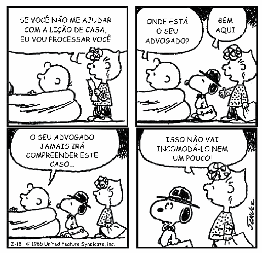
> (Charles M. Schulz. Snoopy- Feliz dia dos namorados!)

**Q10.** É correto afirmar que, na fala da personagem, no último quadrinho, está implícita a ideia de que

- A) a representação de seu advogado é garantia de sucesso na ação.
- B) é irrelevante que seu advogado tenha a competência reconhecida.
- C) o processo, para ela, não passa de um artifício para ganhar tempo.
- D) sua causa está perdida de antemão, graças à ameaça que fez.
- E) a garota se convence da opinião de quem ela quer processar.

**Q11.** Assinale a alternativa que dá outra redação à fala dos quadrinhos, seguindo a norma-padrão de regência, conjugação de verbos e emprego do sinal indicativo de crase.

- A) Pergunto à você onde está seu advogado; não creio que ele resolva ao caso.
- B) Vou acionar à polícia se você não vir me ajudar com à lição de casa.
- C) Se você não se dispor em ajudar à fazer a lição de casa, vou processar você.
- D) Espero que você nomeie à alguém que trata disso melhor do que seu advogado.
- E) Caso você não me acuda quando eu fizer a lição de casa, apelarei à justiça.

**Q12.** A relação de sentido que há entre as partes sinalizadas no período – (I) Se você não me ajudar com a lição de casa, (II) eu vou processar você – é:

- A) (I) expressa uma comparação; (II) expressa seu efeito futuro.
- B) (I) expressa uma causa; (II) expressa o momento da ação.
- C) (I) expressa uma ação possível; (II) expressa uma ação precedente realizada.
- D) (I) expressa modo da ação já realizada; (II) expressa sua causa.
- E) (I) expressa uma condição; (II) expressa uma possível ação consequente.

**Q13.** Assinale a alternativa em que a frase baseada nas falas dos quadrinhos apresenta emprego e colocação de pronomes de acordo com a norma-padrão.

- A) A menina afirmou ao garoto que poderia processá-lo, se este não a ajudasse com a lição de casa.
- B) A menina ameaçou processar-lhe, caso o garoto não ajudasse-a com a lição de casa.
- C) A menina afirmou ao garoto que poderá processar ele, caso este não ajudar-lhe com a lição de casa.
- D) O garoto respondeu à menina, perguntando-a onde estava o advogado dela.
- E) Em resposta à menina, o garoto resolveu perguntá-la onde estava o advogado dela.

*Leia o texto, para responder às questões de números 14 a 18.*
> O ônibus da excursão subia lentamente a serra. Ele, um dos garotos no meio da garotada em algazarra, deixava a brisa fresca bater-lhe no rosto e entrar-lhe pelos cabelos com dedos longos, finos e sem peso como os de uma mãe. Ficar às vezes quieto, sem quase pensar, e apenas sentir – era tão bom. A concentração no sentir era difícil no meio da balbúrdia dos companheiros.
>
> E mesmo a sede começara: brincar com a turma, falar bem alto, mais alto que o barulho do motor, rir, gritar, pensar, sentir, puxa vida! Como deixava a garganta seca.
>
> A brisa fina, antes tão boa, agora ao sol do meio-dia tornara-se quente e árida e ao penetrar pelo nariz secava ainda mais a pouca saliva que pacientemente juntava.
>
> Não sabia como e por que mas agora se sentia mais perto da água, pressentia-a mais próxima, e seus olhos saltavam para fora da janela procurando a estrada, penetrando entre os arbustos, espreitando, farejando.
>
> O instinto animal dentro dele não errara: na curva inesperada da estrada, entre arbustos estava... o chafariz de pedra, de onde brotava num filete a água sonhada.
>
> O ônibus parou, todos estavam com sede mas ele conseguiu ser o primeiro a chegar ao chafariz de pedra, antes de todos.
>
> De olhos fechados entreabriu os lábios e colou-os ferozmente no orifício de onde jorrava a água. O primeiro gole fresco desceu, escorrendo pelo peito até a barriga.
>
> Era a vida voltando, e com esta encharcou todo o seu interior arenoso até se saciar. Agora podia abrir os olhos.
>
> Abriu-os e viu bem junto de sua cara dois olhos de estátua fitando-o e viu que era a estátua de uma mulher e que era da boca da mulher que saía a água.
>
> E soube então que havia colado sua boca na boca da estátua da mulher de pedra. A vida havia jorrado dessa boca, de uma boca para outra.
>
> Intuitivamente, confuso na sua inocência, sentia-se intrigado. Olhou a estátua nua.
>
> Ele a havia beijado.
>
> Sofreu um tremor que não se via por fora e que se iniciou bem dentro dele e tomou-lhe o corpo todo estourando pelo rosto em brasa viva.
>
> (Clarice Lispector, “O primeiro beijo”. Felicidade clandestina. Adaptado)

**Q14.** É correto afirmar que o texto tem como personagem um garoto, descrevendo

- A) uma viagem de ônibus em que ele ficou indiferente ao que acontecia.
- B) a perda da inocência provocada pela gritaria dos companheiros.
- C) o trajeto percorrido pela alma infantil em busca de amizade.
- D) experiências sensoriais que o levam a provar a sensualidade.
- E) a confusão mental ocasionada pela sede não saciada.

**Q15.** Assinale a alternativa em que o pronome em destaque está empregado com o mesmo sentido de posse que tem o pronome “lhe”, na passagem – Ele, um dos garotos no meio da garotada em algazarra, deixava a brisa fresca bater-lhe no rosto e entrar-lhe pelos cabelos...

- A) Não esperávamos entregar-lhes nossos documentos naquele momento.
- B) Chegou-nos a notícia do desaparecimento do helicóptero.
- C) Pegou-me a mão, tentando encorajar-me a tomar uma decisão.
- D) Faça-a ver que ninguém está questionando sua atitude.
- E) Não vá forçá-lo a assumir função para a qual não se acha preparado.

**Q16.** Assinale a alternativa cuja frase contém apenas palavras empregadas em sentido próprio.

- A) Sofreu um tremor que [...] se iniciou bem dentro dele e tomou-lhe o corpo todo estourando pelo rosto em brasa viva.
- B) ... deixava a brisa fresca bater-lhe no rosto e entrar-lhe pelos cabelos com dedos longos...
- C) ... e seus olhos saltavam para fora da janela, procurando a estrada, penetrando entre os arbustos...
- D) O ônibus da excursão subia lentamente a serra. Ele, um dos garotos no meio da garotada em algazarra...
- E) Era a vida voltando, e com esta encharcou todo o seu interior arenoso até se saciar.

**Q17.** Na passagem do 4o parágrafo – Não sabia como e por que mas agora se sentia mais perto da água, pressentia-a mais próxima – as expressões destacadas trazem ao contexto, correta e respectivamente, as ideias de

- A) modo, causa e lugar.
- B) modo, causa e intensidade.
- C) modo, dúvida e lugar.
- D) comparação, causa e tempo.
- E) comparação, dúvida e tempo.

**Q18.** Redigida com base em passagem do texto, a frase que apresenta emprego da vírgula de acordo com a norma-padrão é:

- A) Do chafariz de pedra entre arbustos brotava num filete, a água sonhada.
- B) No meio da balbúrdia dos amigos, a concentração no sentir era difícil.
- C) Sentia-se intrigado intuitivamente confuso, na sua inocência.
- D) Antes tão boa a brisa fina, tornara-se quente e árida ao sol do meio-dia.
- E) Ele conseguiu ser, o primeiro a chegar antes de todos ao chafariz de pedra.

> Para responder às questões de números 19 e 20, observe a charge que retrata uma cena em que uma família faz selfie ao lado de um corpo caído no chão.
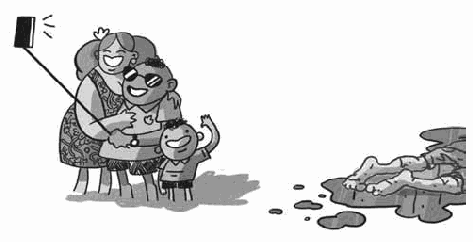
> (João Montanaro. Disponível em:<https://www.facebook.com>.
>
> Acesso em 21.04.2017)

**Q19.** Assinale a alternativa que expressa ideia compatível com a situação representada na charge.

- A) O verdadeiro sentido da solidariedade está em comover-se com o semelhante desamparado.
- B) Hoje, a tecnologia leva a uma compreensão mais ética da realidade circundante.
- C) Não se pode condenar a postura ética das pessoas que se deixam encantar com os modismos.
- D) Um fato violento corriqueiro não justifica a preocupação com a desgraça alheia.
- E) A novidade tecnológica reforça a individualidade, levando as pessoas a ficar alheias à realidade que as cerca.

**Q20.** Assinale a alternativa contendo uma ideia implícita a partir dos fatos retratados na charge.

- A) O pau de selfie permite fotografar várias pessoas.
- B) O grupo familiar posa unido.
- C) As pessoas sorriem para a câmera.
- D) O corpo está estendido no chão.
- E) A violência está banalizada.

*Leia o texto, para responder às questões de números 21 a 24.*
> O problema de São Paulo, dizia o Vinicius, “é que você anda, anda, anda e nunca chega a Ipanema”. Se tomarmos “Ipanema” ao pé da letra, a frase é absurda e cômica. Tomando “Ipanema” como um símbolo, no entanto, como um exemplo de alívio, promessa de alegria em meio à vida dura da cidade, a frase passa a ser de um triste realismo: o problema de São Paulo é que você anda, anda, anda e nunca chega a alívio algum. O Ibirapuera, o parque do Estado, o Jardim da Luz são uns raros respiros perdidos entre o mar de asfalto, a floresta de lajes batidas e os Corcovados de concreto armado.
>
> O paulistano, contudo, não é de jogar a toalha – prefere estendê-la e se deitar em cima, caso lhe concedam dois metros quadrados de chão. É o que vemos nas avenidas abertas aos pedestres, nos fins de semana: basta liberarem um pedacinho do cinza e surgem revoadas de patinadores, maracatus, big bands, corredores evangélicos, góticos satanistas, praticantes de ioga, dançarinos de tango, barraquinhas de yakissoba e barris de cerveja artesanal.
>
> Tenho estado atento às agruras e oportunidades da cidade porque, depois de cinco anos vivendo na Granja Viana, vim morar em Higienópolis. Lá em Cotia, no fim da tarde, eu corria em volta de um lago, desviando de patos e assustando jacus. Agora, aos domingos, corro pela Paulista ou Minhocão e, durante a semana, venho testando diferentes percursos. Corri em volta do parque Buenos Aires e do cemitério da Consolação, ziguezagueei por Santa Cecília e pelas encostas do Sumaré, até que, na última terça, sem querer, descobri um insuspeito parque noturno com bastante gente, quase nenhum carro e propício a todo tipo de atividades: o estacionamento do estádio do Pacaembu.
>
> (Antonio Prata. “O paulistano não é de jogar a toalha. Prefere estendê-la
>
> e deitar em cima.” Disponível em:<http://www1.folha.uol.com.br/colunas>.
>
> Acesso em: 13.04.2017. Adaptado)

**Q21.** É correto afirmar que, do ponto de vista do autor, o paulistano

- A) sabe como vencer a rudeza da paisagem de São Paulo, encontrando nesta espaços para o lazer.
- B) se vê impedido de realizar atividades esportivas, no mar de asfalto que é São Paulo.
- C) toma Ipanema como um símbolo daquilo que se pode alcançar, apesar de muito andar e andar.
- D) busca em Ipanema o contato com a natureza exuberante que não consegue achar em sua cidade.
- E) tem feito críticas à cidade, porque ela não oferece atividades recreativas a seus habitantes.

**Q22.** Assinale a alternativa que dá nova redação à passagem – O paulistano, contudo, não é de jogar a toalha – prefere estendê-la e se deitar em cima, caso lhe concedam dois metros quadrados de chão. – atendendo à norma-padrão de concordância.

- A) Mais de um paulistano não são de jogar a toalha – acham preferíveis estendê-la e se deitarem em cima, caso se dê a eles dois metros de chão.
- B) Os paulistanos não jogam a toalha – acham preferíveis estendê-la e se deitar em cima, caso lhes deem dois metros quadrados de chão.
- C) Cem por cento dos paulistanos não joga a toalha – acha preferível estendê-la para que se deite sobre elas, caso seja dado a eles dois metros quadrados de chão.
- D) A maior parte dos paulistanos, contudo, não são de jogarem a toalha – acha preferível elas serem estendidas e deitar-se em cima, caso lhe seja dado dois metros de chão.
- E) Para os paulistanos, não se joga a toalha – é preferível que seja estendida, para que possam deitar-se sobre ela, caso lhes sejam dados dois metros quadrados de chão.

**Q23.** Assinale a alternativa cuja frase contém palavras empregadas em sentido figurado, no contexto em que se encontram.

- A) ... parque noturno com bastante gente, quase nenhum carro e propício a todo tipo de atividades...
- B) Lá em Cotia, no fim da tarde, eu corria em volta de um lago, desviando de patos...
- C) É o que vemos nas avenidas abertas aos pedestres, nos fins de semana...
- D) O Ibirapuera, o parque do Estado, o Jardim da Luz são uns raros respiros perdidos entre o mar de asfalto...
- E) Corri em volta do parque Buenos Aires e do cemitério da Consolação...

**Q24.** Assinale a alternativa em que a substituição dos trechos destacados na passagem – O paulistano, contudo, não é de jogar a toalha – prefere estendê-la e se deitar em cima, caso lhe concedam dois metros quadrados de chão. – está de acordo com a norma-padrão de crase, regência e conjugação verbal.

- A) prefere estendê-la à desistir – ponham a disposição.
- B) prefere mais estendê-la do que desistir – põe à disposição.
- C) prefere estendê-la a desistir – ponham à disposição.
- D) prefere estendê-la a desistir – põe a disposição.
- E) prefere estendê-la do que desistir – põem a disposição.

## Conhecimentos em Direito

## Direito Penal

**Q25.** O crime denominado “petrechos de falsificação” (CP, art. 294) tem a pena aumentada, de acordo com o art. 295 do CP, se

- A) causar expressivo prejuízo à fé pública.
- B) a vítima for menor de idade, idosa ou incapaz.
- C) o agente for funcionário público e cometer o crime prevalecendo-se do cargo.
- D) praticado com intuito de lucro.
- E) cometido em detrimento de órgão público ou da administração indireta.

**Q26.** Funcionário público municipal, imprudentemente, deixa a porta da repartição aberta ao final do expediente. Assim agindo, mesmo sem intenção, concorre para que outro funcionário público, que trabalha no mesmo local, subtraia os computadores que guarneciam o órgão público. O Município sofre considerável prejuízo. A conduta do funcionário que deixou a porta aberta traduz-se em

- A) mero ilícito funcional, sem repercussão na esfera penal.
- B) peculato-subtração.
- C) peculato culposo.
- D) prevaricação.
- E) fato atípico.

**Q27.** A conduta de “dar causa à instauração de investigação policial, de processo judicial, instauração de investigação administrativa, inquérito civil ou ação de improbidade administrativa contra alguém, imputando-lhe crime de que o sabe inocente” configura

- A) falso testemunho.
- B) comunicação falsa de crime.
- C) fraude processual.
- D) condescendência criminosa.
- E) denunciação caluniosa.

**Q28.** O crime de “impedimento, perturbação ou fraude de concorrência”, do art. 335 do CP, está assim definido: “impedir, perturbar ou fraudar concorrência pública ou venda em hasta pública, promovida pela administração federal, estadual ou municipal, ou por entidade paraestatal; afastar ou procurar afastar concorrente ou licitante, por meio de violência, grave ameaça, fraude ou oferecimento de vantagem.”

Incorre na mesma pena estabelecida para o crime citado, nos termos do parágrafo único do mesmo artigo, quem

- A) faz proposta em certame licitatório que, posteriormente, deixa de cumprir.
- B) se abstém de concorrer ou licitar, em razão da vantagem oferecida.
- C) sendo agente público deixa de inabilitar concorrente sabendo-o fraudador.
- D) sabendo da ocorrência do fato não o denuncia às autoridades públicas.
- E) sendo agente público homologa certame sabendo-o fraudado.

**Q29.** Certos crimes têm suas penas estabelecidas em patamares superiores quando presentes circunstâncias que aumentam o desvalor da conduta. São os denominados “tipos qualificados”.

Assinale a alternativa que indica o crime que tem como qualificadoras “resultar prejuízo público” e “ocorrer em lugar compreendido na faixa de fronteira”.

- A) Violência arbitrária.
- B) Abuso de poder.
- C) Exercício arbitrário das próprias razões.
- D) Abandono de função.
- E) Corrupção passiva.

**Q30.** Imagine que um perito nomeado pelo juiz, em processo judicial, mediante suborno, produza um laudo falso para favorecer uma determinada parte, praticando a conduta que configura crime do art. 342 do CP (falsa perícia). Ocorre que, arrependido e antes de proferida a sentença no mesmo processo, o perito retrata-se, corrigindo a falsidade. De acordo com o texto literal do art. 342, § 2o do CP, como consequência jurídica da retratação,

- A) o perito fica impedido, por 5 (cinco) anos, de prestar tal serviço.
- B) o fato deixa de ser punível.
- C) o perito fica isento de pena criminal, mas deverá indenizar o prejudicado pela falsidade que cometeu.
- D) o perito fica isento de pena criminal, mas deverá devolver os honorários recebidos em dobro.
- E) o perito, se condenado pelo crime de falsa perícia, terá a pena reduzida de 1/3 (um terço) a 2/3 (dois terços).

## Direito Processual Penal

**Q31.** Nos exatos termos do art. 253 do CPP, nos juízos coletivos, não poderão servir no mesmo processo os juízes que forem entre si parentes,

- A) consanguíneos ou afins, em linha reta ou colateral até o terceiro grau, inclusive.
- B) consanguíneos ou afins, em linha reta ou colateral até o terceiro grau, inclusive, bem como amigos íntimos ou inimigos capitais.
- C) consanguíneos ou afins, em linha reta ou colateral até o terceiro grau, inclusive, bem como amigos íntimos.
- D) consanguíneos ou afins, em linha reta ou colateral até o quarto grau, inclusive.
- E) consanguíneos, excluídos os parentes afins.

**Q32.** Determina o art. 261 do CPP que

- A) nenhum acusado, com exceção do revel, será processado ou julgado sem defensor.
- B) nenhum acusado, com exceção do foragido, será processado ou julgado sem defensor.
- C) nenhum acusado, ainda que ausente ou foragido, será processado ou julgado sem defensor.
- D) salvo nos casos de força maior, nenhum acusado, ainda que ausente ou foragido, será processado ou julgado sem defensor.
- E) salvo nos processos contravencionais e nos de rito sumaríssimo, nenhum acusado será processado ou julgado sem defensor.

**Q33.** Estabelece o CPP em seu art. 353 que, quando o réu estiver fora do território da jurisdição do juiz processante, será citado mediante

- A) carta com aviso de recebimento, “de mão própria”.
- B) videoconferência.
- C) qualquer meio que o juiz entenda idôneo.
- D) edital.
- E) precatória.

**Q34.** De acordo com o texto expresso do art. 397 do CPP, o juiz deverá absolver sumariamente o acusado no processo penal quando verificar

- A) falta de pressuposto processual.
- B) que a denúncia é manifestamente inepta.
- C) falta de justa causa para o exercício da ação penal.
- D) extinta a punibilidade do agente.
- E) falta de condição para o exercício da ação penal.

**Q35.** No julgamento dos recursos de apelação, expressamente de acordo com os artigos 616 e 617 do CPP, poderá o tribunal, câmara ou turma

- A) condenar o acusado absolvido em sentença de primeiro grau, mesmo que a parte acusatória não tenha apelado.
- B) analisar a matéria em toda a sua extensão sem, contudo, produzir novas provas.
- C) agravar a pena, mesmo quando somente o réu houver apelado da sentença.
- D) proceder a novo interrogatório do acusado, reinquirir testemunhas ou determinar outras diligências.
- E) analisar a matéria em toda a sua extensão sem, contudo, produzir novas provas, exceto proceder a novo interrogatório do acusado.

**Q36.** Assinale a alternativa correta no que concerne à revisão criminal, tratada nos artigos 621 a 630 do CPP.

- A) Em seu julgamento, admite-se o agravamento da pena imposta na decisão revista.
- B) Quando, no curso da revisão, falecer a pessoa cuja condenação tiver de ser revista, o processo será extinto.
- C) É possível a revisão de decisões que ainda não transitaram em julgado, ou seja, ainda não findos.
- D) É vedado arbitrar indenização em favor do beneficiado por decisão que julgue procedente a revisão.
- E) É pedido que pode ser articulado a qualquer tempo, antes da extinção da pena ou após.

**Q37.** O processo perante o Juizado Especial Criminal objetiva, sempre que possível, a reparação dos danos sofridos pela vítima e a aplicação de pena não privativa de liberdade.

Nos literais e exatos termos do art. 62 da Lei no 9.099/95, são critérios que orientam o processo no Juizado Especial Criminal:

- A) oralidade, informalidade, objetividade e celeridade.
- B) oralidade, instrumentalidade, economia processual e celeridade.
- C) oralidade, informalidade, economia processual e celeridade.
- D) oralidade, objetividade, economia processual e publicidade.
- E) boa-fé, objetividade, economia processual e celeridade.

## Direito Processual Civil

**Q38.** Dr. Jonas era advogado da empresa MMC Ltda. Estudioso, preparou-se com afinco para o concurso da magistratura paulista e hoje é juiz da 1a Vara Cível da Comarca de Santos, local onde atuou como advogado durante anos. Agora, ao analisar um processo, descobriu que está sob seu julgamento um caso no qual a empresa MMC é parte.

Nesse caso, é correto afirmar que Dr. Jonas

- A) é impedido, e, se tal impedimento não for reconhecido de ofício, o tribunal fixará o momento a partir do qual ele não poderia ter atuado.
- B) é impedido, e poderá alegar que seu afastamento se dará em virtude de motivos de foro íntimo, sem necessidade de declarar suas razões.
- C) é suspeito, pois demonstra ser interessado em julgar a causa a favor do seu ex-cliente.
- D) está apto a julgar a ação, pois o fato de ter advogado para uma das partes antes de ser juiz em nada interfere na sua atuação e imparcialidade.
- E) é suspeito para atuar na causa, por isso deverá reconhecer tal suspeição e remeter os autos para seu substituto legal.

**Q39.** Luís ingressou com uma ação contra Mirela. Em 09.03 (sexta-feira), na audiência de instrução e julgamento, o juiz julgou a ação improcedente, saindo as partes intimadas de tal decisão nessa data. A parte sucumbente pretende recorrer da decisão do juiz.

Levando em consideração que, durante o prazo do recurso, não há qualquer feriado, é correto afirmar que

- A) tanto Luís quanto Mirela têm interesse de agir no recurso de apelação, e eles terão prazo comum de 15 dias úteis, contados de 12.03 (segunda-feira), para apresentar tal peça processual.
- B) Mirela deverá manejar recurso de apelação no prazo de 15 dias corridos, contados a partir de 12.03 (segunda-feira).
- C) Luís deverá interpor recurso de apelação, e terá, para isso, prazo fatal até 30.03 (sexta-feira).
- D) o recurso a ser manejado por Luís é o de agravo de instrumento, e ele terá 15 dias úteis para fazer tal peça processual, contados a partir de 09.03.
- E) Luís deverá interpor recurso de agravo de instrumento, e terá, para isso, prazo fatal até 30.03 (sexta-feira).

**Q40.** Sobre a forma dos atos processuais, é correto afirmar que

- A) o direito de consultar os autos do processo que tramita em segredo de justiça e de pedir certidões é restrito aos advogados das partes, pois somente esses possuem capacidade postulatória.
- B) de comum acordo, o juiz e as partes podem fixar calendário para prática dos atos processuais, quando for o caso.
- C) é possível lançar nos autos físicos cotas marginais e interlineares às quais o juiz mandará riscar quando não tiver autorizado, impondo, inclusive, multa de até um salário-mínimo vigente a quem as fez.
- D) os atos meramente ordinatórios, como a juntada e a vista obrigatória, dependem de despacho e devem ser revistos pelo juiz da causa.
- E) o documento em língua estrangeira poderá ser juntado aos autos independentemente de tradução em língua portuguesa firmada por tradutor juramentado.

**Q41.** Determinada lide esbarra numa súmula vinculante que favorece o réu na sua interpretação. Assim, pretende o réu que essa discussão seja imediatamente solucionada, requerendo tutela provisória nesse sentido, pelas vias processuais adequadas.

Nesse caso, é correto afirmar que

- A) por se tratar de assunto que deve aguardar a cognição exauriente, o pedido de tutela provisória do réu deverá ser indeferido.
- B) para que seja concedida a tutela pretendida, será necessária a presença dos requisitos da verossimilhança, da alegação e do risco de dano.
- C) o réu não tem legitimidade para requerer tutela provisória nesse caso, pois esse pedido deve ser formulado exclusivamente pelo autor dessa demanda.
- D) só será concedida a tutela caso o réu a tenha pleiteado na forma de urgência antecipada antecedente.
- E) o réu tem interesse em pleitear a provisória de evidência, independentemente da presença dos requisitos da verossimilhança, da alegação e do risco de dano.

**Q42.** Numa audiência de instrução e julgamento, o juiz determinou que primeiro se ouvissem as testemunhas das partes, e, após isso, fossem prestados os esclarecimentos dos peritos. Além disso, no momento dos debates orais, numa ação em que havia interesse de menores, concedeu prazo de 40 minutos para o advogado do autor e de 30 minutos para o advogado do réu e para o promotor de justiça se pronunciarem.

Diante dessa situação, é correto afirmar que o juiz

- A) acertou ao inverter a ordem da colheita de provas em audiência, pois não há uma obrigatoriedade nesse roteiro; mas errou ao fixar limite de tempo de 40 minutos para o pronunciamento em razões finais do advogado do autor, prazo superior ao estabelecido em lei.
- B) errou na questão da inversão da ordem das provas em audiência, bem como ao conceder prazo maior para uma das partes em detrimento das outras, ferindo o princípio da igualdade processual.
- C) errou unicamente ao conceder prazo para o ministério público, tendo em vista que somente as partes devem participar dos debates orais, cabendo ao promotor apenas manifestar-se por escrito por meio de memoriais.
- D) acertou em todos os seus atos, pois a ordem da oitiva é passível de modificação a critério do juiz, bem como os prazos para debates orais devem ser estipulados pelo magistrado.
- E) somente errou ao inverter a ordem de oitiva do perito, tento em vista que a lei determina que, obrigatoriamente, sejam ouvidos primeiro o perito e depois as testemunhas.

**Q43.** Lucas Bastos propôs ação contra a empresa Limiar Ltda., pois teve seu nome negativado indevidamente. Requereu liminar, que foi indeferida pelo juiz de primeiro grau. Fez agravo de instrumento contra a decisão do juiz singular e requereu a declaração de efeito ativo ao recurso, pois estava pretendendo comprar uma casa e precisava de seu nome sem restrições. O relator indeferiu monocraticamente esse efeito.

Diante dessa decisão do relator, é correto afirmar que Lucas

- A) por estar diante de uma decisão irrecorrível, não tem meios de rediscutir a decisão do relator.
- B) poderá manejar outro agravo de instrumento, por se tratar de decisão interlocutória que analisa tutela provisória.
- C) tem como única forma recursal à sua disposição o pedido de retratação, claramente prescrito na nova sistemática processual.
- D) poderá manejar agravo interno, que é recurso cabível contra as decisões proferidas pelo relator.
- E) poderá manejar agravo retido, pois, apenas com o julgamento de outro recurso, essa situação poderá ser rediscutida.

**Q44.** Sobre o que dispõe a Lei no 9.099/95, é correto afirmar:

- A) O menor de dezoito anos poderá ser autor, independentemente de assistência, inclusive para fins de conciliação.
- B) Dentre os meios de citação possíveis no âmbito dos Juizados Especiais, incluem-se: carta, oficial de justiça, edital e meios eletrônicos.
- C) Registrado o pedido, após distribuição e autuação, a Secretaria do Juizado designará a sessão de conciliação, a realizar-se no prazo de quinze dias.
- D) Nas causas de valor de até vinte salários-mínimos, as partes comparecerão pessoalmente, podendo ser assistidas por advogado; nas causas entre 20 e 40 salários-mínimos, a assistência de advogado é obrigatória.
- E) Nos procedimentos que tramitam perante os Juizados Especiais Cíveis, o réu, sendo pessoa jurídica ou titular de firma individual, poderá ser representado por preposto credenciado, munido de carta de preposição com poderes para transigir, havendo necessidade de vínculo empregatício.

## Direito Constitucional

**Q45.** Sempre que a falta de norma regulamentadora torne inviável o exercício dos direitos e liberdades constitucionais, conceder-se-á

- A) habeas data.
- B) mandado de segurança.
- C) mandado de injunção.
- D) mandado de segurança coletivo.
- E) ação de descumprimento de preceito fundamental.

**Q46.** É direito constitucional dos trabalhadores urbanos e rurais:

- A) remuneração do serviço extraordinário superior em, no mínimo, trinta por cento à do serviço normal.
- B) seguro contra acidentes de trabalho, a cargo do empregador, sem excluir a indenização a que este está obrigado quando incorrer em dolo ou culpa.
- C) assistência gratuita aos filhos e dependentes desde o nascimento até os 06 (seis) anos de idade em creches e pré-escolas.
- D) licença à gestante, sem prejuízo do emprego e do salário, com a duração de cento e oitenta dias.
- E) aviso prévio proporcional ao tempo de serviço, no máximo de trinta dias, nos termos da lei.

**Q47.** Maria, brasileira, estava grávida quando viajou para a Alemanha. Em virtude de complicações de saúde, seu bebê nasceu antes do tempo, quando Maria ainda estava na Alemanha. Considerando apenas os dados apresentados, pode-se afirmar que, nos termos da Constituição Federal, o filho de Maria será considerado

- A) brasileiro nato, pois Maria é brasileira.
- B) brasileiro nato, bastando que o pai do bebê também seja brasileiro, nato ou naturalizado.
- C) brasileiro naturalizado desde que opte, em qualquer tempo, depois de atingida a maioridade, pela nacionalidade brasileira.
- D) brasileiro nato, bastando que venha a residir na República Federativa do Brasil.
- E) brasileiro nato se Maria estiver, na Alemanha, a serviço da República Federativa do Brasil.

**Q48.** Luiz ocupa cargo em comissão como assessor em um órgão público federal para o qual foi nomeado sem se submeter à aprovação prévia em concurso público de provas ou de provas e títulos. Descontente em relação ao seu vencimento, Luiz entrou em greve, seguindo orientação do sindicato ao qual é associado. Sobre essa situação, e levando-se em conta o que estabelece a Constituição Federal, é correto afirmar que

- A) Luiz, por ser servidor público, goza do direito à greve nos termos e nos limites definidos em lei específica.
- B) Luiz, por ocupar cargo em comissão, não goza do direito à greve.
- C) a investidura de Luiz ao cargo não obedece aos preceitos constitucionais.
- D) Luiz, por ocupar cargo em comissão, não goza do direito à livre associação sindical.
- E) Luiz, por ser servidor público, não goza do direito à livre associação sindical.

**Q49.** Nos termos da Constituição Federal, extinto o cargo, o servidor público estável ficará em disponibilidade

- A) com remuneração proporcional ao tempo de serviço, até serem preenchidas as condições necessárias para sua aposentadoria.
- B) com remuneração integral, até serem preenchidas as condições necessárias para sua aposentadoria.
- C) com remuneração integral, até seu adequado aproveitamento em outro cargo.
- D) sem remuneração, até seu adequado aproveitamento em outro cargo.
- E) com remuneração proporcional ao tempo de serviço, até seu adequado aproveitamento em outro cargo.

**Q50.** Sobre os servidores públicos, a Constituição Federal estabelece expressamente que

- A) lei da União, dos Estados, do Distrito Federal e dos Municípios disciplinará a aplicação de recursos orçamentários provenientes da economia com despesas correntes em cada órgão, autarquia e fundação, para aplicação no desenvolvimento de programas de qualidade e produtividade.
- B) os Poderes Executivo, Legislativo e Judiciário publicarão semestralmente os valores do subsídio e da remuneração dos cargos e empregos públicos.
- C) a União, os Estados e o Distrito Federal manterão escolas de governo para a formação e o aperfeiçoamento dos servidores públicos, constituindo-se a participação nos cursos um dos requisitos para a manutenção do servidor na carreira.
- D) ato do chefe do Poder Executivo da União, dos Estados, do Distrito Federal e dos Municípios poderá estabelecer a relação entre a maior e a menor remuneração dos servidores públicos.
- E) os detentores de mandato eletivo não poderão ser remunerados exclusivamente por subsídio fixado em parcela única.

**Q51.** Assinale a alternativa que apresenta corretamente órgão(s) do Poder Judiciário.

- A) Conselho Nacional do Ministério Público.
- B) Tribunais e Juízes Militares.
- C) Tribunais de Contas dos Estados.
- D) Tribunais de Arbitragem.
- E) Juízes de Paz.

## Direito Administrativo

**Q52.** Escrevente Técnico Judiciário apresenta recurso de multa de trânsito, recebida por seu esposo, perante o Departamento de Trânsito do Estado de São Paulo – DETRAN. De acordo com o Estatuto dos Funcionários Públicos Civis do Estado de São Paulo, a conduta descrita é

- A) proibida, pois o funcionário público pode exercer o direito de petição perante quaisquer repartições públicas, mas somente em nome próprio, não podendo representar terceiros.
- B) indiferente ao Estatuto, que nada prevê em relação à possibilidade do funcionário público peticionar, em nome próprio ou de terceiros, perante repartições públicas.
- C) permitida, pois o funcionário pode, excepcionalmente, ser procurador ou servir de intermediário perante qualquer repartição pública, quando se tratar de interesse de cônjuge ou parente até segundo grau.
- D) permitida, pois o Estatuto expressamente permite que o funcionário público exerça o direito de petição em nome próprio ou de qualquer terceiro.
- E) proibida, pois ao funcionário público é vedado peticionar perante qualquer repartição pública, não podendo requerer, representar, pedir reconsideração ou recorrer de decisões, ainda que em nome próprio.

**Q53.** Dentre os deveres estabelecidos pelo Estatuto dos Funcionários Públicos Civis do Estado de São Paulo, encontra-se previsto expressamente o dever de

- A) estar em dia com as leis, regulamentos, regimentos, instruções e ordens de serviço que digam respeito às suas funções.
- B) levar as irregularidades de que tiver ciência em razão do cargo ao conhecimento da primeira autoridade com a qual tiver contato.
- C) cumprir as ordens superiores, mesmo quando manifestamente ilegais, cabendo, nesse caso, todavia, representar contra elas.
- D) prestar, ao público em geral, as informações requeridas no prazo máximo de 48 (quarenta e oito) horas.
- E) atender com urgência e preferência à expedição de certidões requeridas para defesa de direito ou para esclarecimento de situações de interesse pessoal.

**Q54.** Considere a seguinte situação hipotética:

Funcionário público comete erro de cálculo, o que leva ao recolhimento de valor menor do que o devido para a Fazenda Pública Estadual. A responsabilização prescrita pelo Estatuto dos Funcionários Públicos Civis do Estado de São Paulo, nesse caso, determina que

- A) haja instauração de processo administrativo disciplinar e, comprovado o prejuízo, seja aplicada a pena de demissão, independentemente de ter agido o funcionário com má-fé ou não.
- B) o funcionário seja obrigado a repor, de uma só vez, a importância do prejuízo causado, sem prejuízo das sanções penais cabíveis.
- C) o valor do prejuízo seja apurado e descontado do vencimento ou remuneração mensal, não excedendo o desconto a 30% (trinta por cento) do valor desses.
- D) não tendo havido má-fé, seja aplicada a pena de repreensão e, na reincidência, a de suspensão.
- E) seja o caso remetido aos juízos civil e criminal, aguardando a resolução de ambos para decidir acerca da conduta administrativa cabível.

**Q55.** Determinada a instauração de sindicância ou processo administrativo, ou no seu curso, havendo conveniência para a instrução ou para o serviço, poderá o Chefe de Gabinete, por despacho fundamentado, ordenar o afastamento preventivo do servidor quando

- A) houver alcance, desfalque, remissão ou omissão em efetuar recolhimento, com prejuízo de vencimentos ou vantagens, por até 90 (noventa) dias, prorrogáveis uma única vez por igual período.
- B) necessário para a apuração do fato, com prejuízo de vencimentos ou vantagens, pelo prazo improrrogável de 180 (cento e oitenta) dias, findo o qual o funcionário automaticamente retornará ao cargo ou função.
- C) o fato apurado também for previsto como crime no Código Penal, com prejuízo de vencimentos ou vantagens, por até 180 (cento e oitenta) dias, prorrogáveis uma única vez por igual período.
- D) houver suspeita fundada de prejuízo ao Erário, sem prejuízo de vencimentos ou vantagens, por até 360 (trezentos e sessenta) dias, prorrogáveis uma única vez por igual período.
- E) o recomendar a moralidade administrativa ou a apuração do fato, sem prejuízo de vencimentos ou vantagens, por até 180 (cento e oitenta) dias, prorrogáveis uma única vez por igual período.

**Q56.** Suponha que Secretário da Fazenda de um estado qualquer da Federação aceite exercer, nas horas vagas, concomitantemente ao exercício do cargo público, atividades de consultoria a empresas sujeitas ao recolhimento do ICMS, tributo estadual. Nesse caso, à luz do previsto na Lei Federal no 8.429/92, a conduta descrita pode ser considerada

- A) ato de improbidade administrativa decorrente de concessão ou aplicação indevida de benefício financeiro ou tributário.
- B) indiferente, pois não caracteriza nenhuma das hipóteses de ato de improbidade administrativa previstas.
- C) ato de improbidade administrativa que importa enriquecimento ilícito.
- D) ato de improbidade administrativa que causa prejuízo ao Erário.
- E) ato de improbidade administrativa que atenta contra os princípios da Administração Pública.

**Q57.** Assinale a alternativa que corretamente discorre sobre as penas previstas na Lei de Improbidade Administrativa.

- A) As penas previstas na Lei de Improbidade Administrativa deverão ser aplicadas cumulativamente, exceto quando se tratar de ato de improbidade administrativa que atente contra os princípios da Administração Pública.
- B) Na fixação das penas previstas na Lei de Improbidade Administrativa, o juiz levará em conta a extensão do dano causado, assim como o proveito patrimonial obtido pelo agente.
- C) No caso de condenação por ato de improbidade administrativa decorrente de concessão ou aplicação indevida de benefício financeiro ou tributário, não cabe a aplicação da pena de perda da função pública.
- D) A aplicação das penas previstas na Lei de Improbidade Administrativa impede a aplicação das demais sanções penais, civis e administrativas previstas em legislação específica.
- E) A pena de proibição de contratar com o Poder Público ou receber benefícios ou incentivos fiscais ou creditícios, direta ou indiretamente, ainda que por intermédio de pessoa jurídica da qual seja sócio majoritário, terá o prazo máximo de 2 (dois) anos.

**Q58.** O procedimento administrativo previsto na Lei Federal no 8.429/92, destinado a apurar a prática de ato de improbidade,

- A) impedirá a apuração dos fatos pelo Ministério Público, caso se conclua pela improcedência das acusações.
- B) poderá acarretar o exame e o bloqueio de bens, contas bancárias e aplicações financeiras mantidas pelo indiciado no exterior, se for o caso.
- C) deverá ser levado ao conhecimento do Ministério Público e do Tribunal ou Conselho de Contas, pela Comissão Processante.
- D) será iniciado por representação, que será escrita ou reduzida a termo, podendo o representante permanecer anônimo, se assim o desejar.
- E) poderá compreender o decreto de sequestro dos bens do agente ou terceiro que tenha enriquecido ilicitamente ou causado dano ao patrimônio público.

**Q59.** No processo judicial de improbidade administrativa, o Ministério Público

- A) atuará somente como fiscal da lei, mas promoverá as ações necessárias à complementação do ressarcimento do patrimônio público.
- B) atuará somente como autor, não intervindo se a pessoa jurídica interessada propuser a ação ordinária.
- C) é o único legitimado a propor a ação ordinária, dentro de trinta dias da efetivação da medida cautelar.
- D) poderá abster-se de contestar o pedido, ou poderá atuar ao lado do autor, desde que isso se afigure útil ao interesse público, a juízo do Procurador Geral de Justiça.
- E) se não intervir no processo como parte, atuará obrigatoriamente, como fiscal da lei, sob pena de nulidade.

## Normas da Corregedoria Geral da Justiça

**Q60.** As Normas da Corregedoria Geral de Justiça definem a correição ordinária como sendo a fiscalização

- A) para o saneamento de irregularidades constatadas em visitas correcionais.
- B) direcionada à verificação da regularidade de funcionamento da unidade.
- C) excepcional, realizada a qualquer momento e sem prévio anúncio.
- D) virtual, com vistas ao controle permanente das atividades subordinadas à correição.
- E) prevista e efetivada segundo as referidas normas e leis de organização judiciária.

**Q61.** Assinale a alternativa que corretamente aborda aspectos do sistema informatizado oficial previstos nas Normas da Corregedoria Geral de Justiça.

- A) As cartas precatórias serão cadastradas no sistema informatizado diferentemente dos processos comuns, consignando-se apenas a indicação completa do juízo deprecante, a natureza da ação e a diligência deprecada.
- B) As vítimas identificadas na denúncia ou queixa e as testemunhas de processo criminal não terão suas qualificações lançadas no sistema informatizado oficial, exceto quando requererem expressamente ao juízo tal providência.
- C) O funcionário credenciado poderá ceder a respectiva senha do sistema ou permitir que outrem, funcionário ou não, use-a, desde que seja para acesso de informações abertas ao público em geral.
- D) O sistema informatizado atribuirá, a cada processo distribuído, um número de controle interno da unidade judicial, sem prejuízo do número do processo (número do protocolo que seguirá série única).
- E) Quando uma parte estiver vinculada a processos que tramitam em outros ofícios de justiça, nos quais tenha havido expedição de certidão de homonímia, as eventuais retificações de seus dados deverão ser aplicadas a todos os feitos.

**Q62.** Em relação ao protocolo e à juntada de petições, as Normas da Corregedoria de Justiça preveem que

- A) é vedado aos ofícios de justiça receber e juntar petições que não tenham sido encaminhadas pelo setor de protocolo, salvo, em hipóteses excepcionais, como quando houver, em cada caso concreto, expressa decisão fundamentada do juiz do feito dispensando o protocolo no setor próprio.
- B) se a petição inicial ou intermediária for acompanhada de objetos de inviável entranhamento aos autos do processo, o escrivão deverá conferir, arrolar e quantificá-los, lavrando certidão, na presença do interessado, a quem caberá mantê-los sob sua guarda e responsabilidade até encerramento da demanda.
- C) o lançamento do termo de juntada deverá ser efetuado na própria petição ou no documento a ser encartado aos autos, sendo certificado o ato de juntada nos autos e anotado no sistema informatizado oficial.
- D) os ofícios de justiça não podem receber diretamente petições de requerimento de juntada de procuração ou de substabelecimento apresentadas pelo interessado, casos em que uma informação na petição mencionará essa circunstância.
- E) os ofícios de justiça devem receber todas as petições e juntá-las aos autos respectivos, remetendo ao protocolo aquelas que sejam pertinentes a processos que tramitem em outros ofícios daquela Comarca.

**Q63.** Acerca da consulta ao processo eletrônico no sítio do Tribunal de Justiça do Estado de São Paulo, as Normas da Corregedoria Geral de Justiça preveem que

- A) a indicação de sigilo ou segredo de justiça não implica a impossibilidade de consulta dos autos por quem não é parte no processo, a qual é presumida válida, até decisão judicial em sentido contrário, de ofício ou a requerimento da parte.
- B) os advogados, os defensores públicos, os procuradores e membros do Ministério Público, não vinculados a processo, previamente identificados, poderão acessar todos os atos e documentos processuais armazenados, salvo nos casos de processos em sigilo ou segredo de justiça.
- C) a consulta, no sítio do Tribunal de Justiça do Estado de São Paulo, às movimentações processuais, ao inteiro teor das decisões, às sentenças, aos votos, aos acórdãos e aos mandados de prisão registrados no BNMP – Banco Nacional de Mandados de Prisão não é livre, pois depende do recolhimento da taxa judicial.
- D) o advogado, o defensor público e o membro do Ministério Público terão acesso a todo o conteúdo do processo eletrônico se forem cadastrados e habilitados nos autos, ou seja, somente se atuarem no processo, independentemente de estarem os autos em segredo de justiça ou não.
- E) os defensores públicos, os procuradores e os membros do Ministério Público, não vinculados a processo, previamente identificados, poderão acessar todos os atos e documentos processuais armazenados, mesmo nos casos de processos em sigilo ou segredo de justiça, prerrogativa não estendida aos advogados.

**Q64.** Na elaboração dos documentos, serão utilizados os modelos de expediente institucionais padronizados, autorizados e aprovados pela Corregedoria Geral da Justiça, podendo ser criados modelos de grupo ou usuário no ofício de justiça, a partir dos modelos institucionais ou da autoria intelectual do magistrado, o que somente será permitido para, entre outras, as seguintes categorias:

- A) respostas do réu, incidentes, instrução processual, despachos, decisões e sentenças.
- B) contestações, incidentes, saneadores, requerimentos, sentenças e termos de audiência.
- C) instrução processual, provas documentais, sentenças, termos de audiência, Setor Técnico – Assistente Social e Setor Técnico – Psicologia.
- D) respostas do réu, incidentes, ajuizamentos, atos ordinatórios, despachos e termos de audiência.
- E) ajuizamentos, certidões de cartório, despachos, decisões, requerimentos e sentenças.

## Conhecimentos Gerais

> ATUALIDADES E NOÇÕES SOBRE DIREITOS
>
> DAS PESSOAS COM DEFICIÊNCIA

**Q65.** Leia a notícia a seguir.

Marine Le Pen e Emmanuel Macron venceram o primeiro turno das eleições francesas neste domingo [23 de abril], classificando-se para o embate final em 7 de maio. O resultado é histórico. É a primeira vez na história moderna da França em que nenhum candidato dos principais partidos chega ao segundo turno. Rejeitados nas urnas, eles deixam um espaço em aberto para a população testar outras forças.

(Folha de S.Paulo, 23.04.17. Disponível em: <https://goo.gl/Uuyp62>. Adaptado) O embate entre Le Pen e Macron marcou a disputa, respectivamente, entre

- A) os favoráveis ao acolhimento dos imigrantes de fora da Europa e os que defendem o fechamento das fronteiras.
- B) um projeto de centro, economicamente liberal, e um projeto de esquerda, favorável à ampliação dos direitos sociais.
- C) o nacionalismo xenófobo, associado à direita, e a defesa da integração europeia, proposta pelo centro.
- D) um projeto economicamente nacionalista, pautado na intervenção do Estado, e uma agenda reformista socialdemocrata.
- E) os conservadores, que defendem o aprofundamento da globalização, e a esquerda antieuropeísta.

**Q66.** A crise atual entre os EUA e a Coreia do Norte se intensificou em 8 de abril, quando, após um teste de míssil frustrado pela Coreia do Norte, Trump disse ter enviado uma “armada muito poderosa” para a península coreana, uma referência ao porta-aviões USS Carl Vinson e a um grupo tático.

(G1, 23.04.17. Disponível em: <https://goo.gl/20hQJx>. Adaptado) Entre as reações da Coreia do Norte a essa ação norte-americana, é correto identificar

- A) o seu desligamento da ONU, a expulsão dos diplomatas dos países ocidentais e a aliança com outros países comunistas.
- B) o pedido de intermediação da China, o recurso à ONU para negociação e o aceno aos EUA com uma proposta de acordo.
- C) a decisão de interromper o programa nuclear, o convite público a agentes de inspeção da ONU e a aproximação com os países vizinhos.
- D) a exibição pública do seu arsenal militar, a realização de novos testes de mísseis e a ameaça de um ataque nuclear preventivo.
- E) a ruptura com a moderada e conciliatória China, a ameaça de invasão da Coreia do Sul e a hostilização do Japão.

**Q67.** Os chanceleres dos países fundadores do Mercosul (Brasil, Argentina, Paraguai e Uruguai) farão uma reunião de emergência neste sábado [1 de abril] em Buenos Aires para discutir sua reação à situação da Venezuela. O tema central deverá ser a suspensão do país do bloco econômico. É possível que se discuta uma medida ainda mais dura: a expulsão.

(Estadão, 31.03.17. Disponível em: <https://goo.gl/w9Pv4N>. Adaptado) Essa possível suspensão ou expulsão deve-se

- A) à iminência de guerra civil por conta da profunda crise social que atinge a Venezuela, retirando o país da situação de paz interna exigida pelo bloco.
- B) à aplicação da cláusula democrática, que determina alguma sanção nos casos de interrupção da ordem democrática, como estaria ocorrendo na Venezuela.
- C) à realização de práticas irregulares de protecionismo e renúncia fiscal na Venezuela, contrariando as políticas de livre comércio do bloco.
- D) à recusa da Venezuela em aceitar as propostas que visam à construção de uma moeda única para o bloco, o que atrasa o processo de integração.
- E) aos obstáculos impostos pela Venezuela às negociações dos tratados de comércio com os EUA, destoando das decisões dos outros países do bloco.

**Q68.** O governo endureceu as negociações com os parlamentares e deu um basta a novas concessões na reforma da Previdência, rejeitando assim o lobby pesado de algumas categorias do serviço público, sobretudo com altos salários.

(O Globo, 23.04.17. Disponível em: <https://goo.gl/E79kQQ>. Adaptado) Entre os direitos que alguns servidores públicos gostariam de manter, é correto identificar

- A) o período mínimo de 25 anos de contribuição, que passaria para 35 com a reforma, e o mínimo de 50 anos de idade para aposentar-se, que poderia aumentar para 60 anos.
- B) a não contribuição dos servidores com o INSS, destinado apenas à aposentadoria na iniciativa privada, e o direito ao aumento real anual no valor da aposentadoria.
- C) a integralidade, que garante a aposentadoria com o último salário da carreira, e a paridade, que garante ao servidor aposentado reajustes salarias iguais ao do pessoal da ativa.
- D) a aplicação do fator previdenciário para servidores públicos e o direito à aposentadoria com menos anos de contribuição do que os trabalhadores privados.
- E) a estabilidade após dez anos de serviço e o pagamento, aos filhos, de pensão integral vitalícia no caso de servidores públicos que venham a falecer.

**Q69.** Nos termos da Lei Federal no 13.146/2015, a pessoa com deficiência

- A) somente será atendida sem seu consentimento prévio, livre e esclarecido em casos de risco de morte e de emergência em saúde, resguardado seu superior interesse e adotadas as salvaguardas legais cabíveis.
- B) poderá ser obrigada a se submeter a intervenção clínica ou cirúrgica, tratamento ou institucionalização forçada, mediante prévia avaliação biopsicossocial, realizada por equipe multiprofissional e interdisciplinar.
- C) em situação de curatela, não terá participação na obtenção de consentimento para a prática dos atos da vida civil, pois, em tal circunstância, não possui qualquer capacidade civil.
- D) e seu acompanhante ou atendente pessoal têm direito à prioridade na tramitação processual e nos procedimentos judiciais em que forem partes ou interessados.
- E) está obrigada à fruição de benefícios decorrentes de ação afirmativa, a fim de que sejam construídos ambientes de trabalho acessíveis e inclusivos.

**Q70.** A Resolução no 230/2016 do Conselho Nacional de Justiça prevê, para a inclusão da pessoa com deficiência no serviço público,

- A) a colocação competitiva, em igualdade de oportunidades com as demais pessoas, nos termos da legislação trabalhista e previdenciária, na qual devem ser atendidas as regras de acessibilidade, o fornecimento de recursos de tecnologia assistiva e a adaptação razoável no ambiente de trabalho.
- B) a restrição ao trabalho da pessoa com deficiência em razão de sua condição, inclusive nas etapas de recrutamento, seleção, contratação, admissão, exames admissional e periódico, permanência no emprego, ascensão profissional e reabilitação profissional, sendo possível a exigência de aptidão plena.
- C) a criação de um banco de dados nacional, com cadastro de todos os servidores, serventuários extrajudiciais e terceirizados com deficiência que trabalham nos quadros do Poder Judiciário, contendo especificações sobre suas deficiências e necessidades particulares e mantido pelo Conselho Nacional de Justiça.
- D) a não extensão a servidor com deficiência de qualquer diminuição de jornada de trabalho, por liberalidade do órgão, se a esse servidor já tenha sido concedido horário especial, nos termos da legislação aplicável.
- E) a possibilidade de a Administração obrigar o servidor com mobilidade comprometida a utilizar o sistema home office, se comprovada a existência de muitos custos para a promoção da acessibilidade do servidor em seu local de trabalho.

## Matemática

**Q71.** A empresa Alfa Sigma elaborou uma previsão de receitas trimestrais para 2018. A receita prevista para o primeiro trimestre é de 180 milhões de reais, valor que é 10% inferior ao da receita prevista para o trimestre seguinte. A receita prevista para o primeiro semestre é 5% inferior à prevista para o segundo semestre. Nessas condições, é correto afirmar que a receita média trimestral prevista para 2018 é, em milhões de reais, igual a

- A) 203.
- B) 198.
- C) 200.
- D) 195.
- E) 190.

**Q72.** A figura seguinte, cujas dimensões estão indicadas em metros, mostra as regiões R1 e R2, ambas com formato de triângulos retângulos, situadas em uma praça e destinadas a atividades de recreação infantil para faixas etárias distintas.

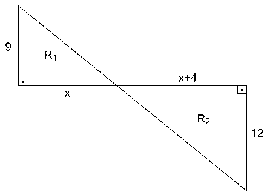

Se a área de R1 é 54 m², então o perímetro de R2 é, em metros, igual a

- A) 48.
- B) 36.
- C) 42.
- D) 54.
- E) 40.

**Q73.** Sabe-se que 16 caixas K, todas iguais, ou 40 caixas Q, todas também iguais, preenchem totalmente certo compartimento, inicialmente vazio. Também é possível preencher totalmente esse mesmo compartimento completamente vazio utilizando 4 caixas K mais certa quantidade de caixas Q. Nessas condições, é correto afirmar que o número de caixas Q utilizadas será igual a

- A) 18.
- B) 22.
- C) 10.
- D) 30.
- E) 28.

**Q74.** Para segmentar informações, de modo a facilitar consultas, um painel de formato retangular foi dividido em 3 regiões quadradas, Q1, Q2 e Q3, e uma região retangular R, conforme mostra a figura, com dimensões indicadas em metros.

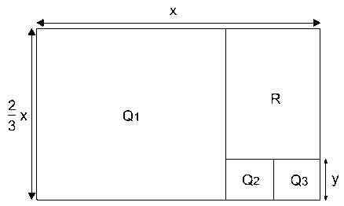

A área, em m², da região retangular R é corretamente representada por:

- A) 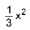
- B) 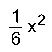
- C) 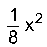
- D) 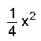
- E) 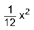

**Q75.** As figuras seguintes mostram os blocos de madeira A, B e C, sendo A e B de formato cúbico e C com formato de paralelepípedo reto retângulo, cujos respectivos volumes, em cm³, são representados por VA, VB e VC.

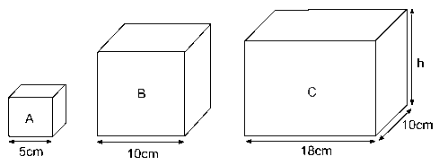

Se 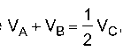 então a medida da altura do bloco C,

indicada por h na figura, é, em centímetros, igual a

- A) 11.
- B) 12,5.
- C) 16.
- D) 15,5.
- E) 14.

**Q76.** Os preços de venda de um mesmo produto nas lojas X, Y e Z são números inteiros representados, respectivamente, por x, y e z. Sabendo-se que x + y = 200, x + z = 150 e y + z = 190, então a razão  é:

- A) 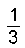
- B) 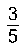
- C) 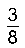
- D) 
- E) 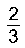

## Informática

**Q77.** No sistema operacional Windows 10, em sua configuração padrão, um usuário aciona o Explorador de Arquivos, seleciona um arquivo e pressiona a tecla F3. Em seguida,

- A) a Ajuda do Windows 10 será ativada.
- B) o cursor será colocado no campo de busca da Ferramenta de Pesquisa.
- C) as propriedades do arquivo serão exibidas.
- D) o arquivo será deletado e colocado na Lixeira.
- E) o arquivo será deletado definitivamente.

**Q78.** A Área de Transferência do MS-Office 2016 permite que dados sejam transferidos entre os diversos aplicativos. Suponha que um usuário tenha aberto um arquivo do MS-Excel 2016 e outro do MS-Word 2016 e que, no Excel, algumas células tenham sido copiadas com o comando Ctrl + C. Observe a figura do MS-Word 2016.

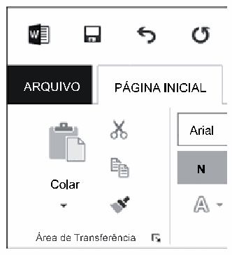

Caso a seta ao lado do texto “Área de Transferência” na figura seja clicada,

- A) todo o conteúdo da Área de Transferência será copiado para a posição após o cursor no texto.
- B) o último elemento copiado para a Área de Transferência será copiado para a posição após o cursor no texto, na forma “Colar Especial”.
- C) a Área de Transferência será limpa.
- D) uma janela lateral será aberta, exibindo todos os elementos colocados na Área de Transferência, além de botões diversos.
- E) o último elemento copiado para a Área de Transferência será copiado para a posição após o cursor no texto, na forma “Manter Formatação Original”.

**Q79.** No sistema operacional Windows 10, em sua configuração padrão, um usuário clicou com o botão direito do mouse em um espaço livre da Área de Trabalho, e a seguinte lista de opções surgiu na tela.

Esse usuário deseja criar um atalho para um arquivo na Área de Trabalho, e, para isso, ele deve clicar em

- A) “Atualizar”, em seguida, selecionar “Atalho” na lista de opções que surge na tela, e seguir as orientações na janela “Criar Atalho”.
- B) “Novo”, em seguida, selecionar “Atalho” na lista de opções que surge na tela, e seguir as orientações na janela “Criar Atalho”.
- C) “Exibir”, em seguida, digitar o nome do atalho na janela que surge na tela.
- D) “Exibir”, em seguida, selecionar “Atalho” na lista de opções que surge na tela, e seguir as orientações na janela “Criar Atalho”.
- E) “Novo”, em seguida, digitar o nome do atalho na janela que surge na tela.

**Q80.** No sistema operacional Windows, em sua configuração padrão, os nomes de arquivos ou pastas seguem algumas regras, sobre as quais é correto afirmar que

- A) caracteres como \ / : * ? “ < > | podem ser utilizados nos nomes no Windows 10.
- B) os nomes dos arquivos no Windows 10 podem ter até 128 caracteres.
- C) o nome do arquivo no Windows 10 não pode ter caracteres como \ / : * ? “ < > |, mas o nome do seu caminho pode incluí-los.
- D) o nome do arquivo no Windows 10 não pode ter caracteres como \ / : * ? “ < > |, mas a sua extensão pode incluí-los.
- E) o tamanho máximo de caracteres que pode ser utilizado no Windows 10 inclui o nome do arquivo e do seu caminho.

**Q81.** No MS-Word 2016, são elementos gráficos do tipo SmartArt que podem ser inseridos em um documento:

- A) Matriz, Link e Comentário.
- B) Pirâmide, Imagem Online e Forma.
- C) Processo, Ciclo e Hierarquia.
- D) Imagem, Processo e Gráfico.
- E) Ciclo, Caixa de Texto e Vídeo Online.

**Q82.** Durante o processo de edição de um documento no MS-Word 2016, um usuário decidiu formatar um parágrafo selecionado, clicando sobre o botão “Justificar”, presente no grupo Parágrafo da guia Página Inicial. Essa ação fará com que o texto do parágrafo selecionado seja

- A) distribuído uniformemente entre as margens esquerda e direita.
- B) alinhado apenas à margem direita.
- C) alinhado apenas à margem esquerda.
- D) distribuído uniformemente entre as margens superior e inferior.
- E) centralizado na página.

**Q83.** A colocação de um cabeçalho em um documento editado no MS-Word 2016 pode ser feita por meio da guia

- A) Inserir, no grupo Comentários, no botão Cabeçalho e Rodapé.
- B) Layout da Página, no grupo Design, no botão Cabeçalho e Rodapé.
- C) Design, no grupo Efeitos, no botão Cabeçalho.
- D) Layout da Página, no grupo Margens, no botão Inserir Cabeçalho.
- E) Inserir, no grupo Cabeçalho e Rodapé, no botão Cabeçalho.

**Q84.** Um usuário do MS-Word 2016 selecionou uma letra de uma palavra e, em seguida, pressionou simultaneamente duas teclas: Ctrl e =. Essa ação aplicará, no caractere selecionado, a formatação

- A) Itálico.
- B) Subscrito.
- C) Tachado.
- D) Sublinhado.
- E) Sobrescrito.

*Observe a planilha a seguir, elaborada no MS-Excel 2016, em sua configuração padrão, para responder às questões de números 85 e 86.*
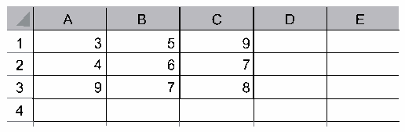

**Q85.** Suponha que a seguinte fórmula tenha sido colocada na célula D4 da planilha:

=MÁXIMO(A1;A1:B2;A1:C3)

O resultado produzido nessa célula é:

- A) 3
- B) 7
- C) 8
- D) 9
- E) 6

**Q86.** Na célula E4 da planilha, foi digitada a seguinte fórmula: =CONCATENAR(C3;B2;A1;A3;C1) O resultado produzido nessa célula é:

- A) 86399
- B) 3689
- C) 8+6+3+9+9
- D) 36899
- E) 8;6;3;9;9

**Q87.** No MS-Excel 2016, por meio do ícone Área de Impressão, localizado no grupo Configuração de Página da guia Layout da Página, tem-se acesso ao recurso “Limpar área de impressão”, utilizado quando se deseja

- A) imprimir uma planilha vazia.
- B) imprimir toda a planilha.
- C) retirar todas as planilhas colocadas na fila de impressão.
- D) esvaziar a área de transferência do aplicativo.
- E) retirar todas as fórmulas calculadas automaticamente na planilha.

**Q88.** Considerando o uso de correio eletrônico, ao se preparar uma mensagem para envio,

- A) o número de destinatários em cópia aberta deve ser igual ao número de destinatários em cópia oculta.
- B) se esta for um encaminhamento de uma mensagem recebida, não é possível enviá-la a destinatários em cópia oculta.
- C) é possível enviá-la sem a especificação de seu assunto.
- D) se esta for um encaminhamento de uma mensagem recebida, não é possível alterar o assunto presente na mensagem original.
- E) o número de destinatários em cópia oculta não pode ser superior ao número de destinatários em cópia aberta.

**Q89.** Em geral, a especificação completa do Uniform Resource Locator (URL) apresenta os seguintes campos: esquema://domínio:porta/caminhorecurso?querystring#fragmento Sobre esses campos, é correto afirmar que

- A) o domínio determina o servidor que torna disponível o recurso ou o documento solicitado.
- B) a porta sempre será um número menor ou igual a 40.
- C) o caminho especifica as redes por meio das quais a solicitação será encaminhada.
- D) o fragmento é uma parte obrigatória, presente em qualquer URL.
- E) o esquema pode ser apenas http ou https.

**Q90.** Alguns navegadores utilizados na internet, como o Microsoft Edge e o Chrome, permitem um tipo de navegação conhecida como privada ou anônima. Sobre esse recurso, é correto afirmar que ele foi concebido para, normalmente,

- A) impedir que o provedor de internet e os sites visitados tenham acesso aos dados relativos à navegação do usuário.
- B) permitir que sites sejam acessados sem que sejam guardados quaisquer dados ou informações que possam ser usados para rastrear, a partir do navegador, as visitas efetuadas pelo usuário.
- C) não permitir que sejam realizados downloads de quaisquer tipos de arquivos.
- D) substituir os dados do usuário por outros fictícios, definidos pelo próprio usuário, e evitar que propaganda comercial e e-mails do tipo spam sejam posteriormente encaminhados ao usuário.
- E) não permitir o armazenamento de “favoritos” durante uma navegação.

## Raciocínio Lógico

**Q91.** Uma negação lógica para a afirmação “João é rico, ou Maria é pobre” é:

- A) João é rico, e Maria não é pobre.
- B) João não é rico, ou Maria não é pobre.
- C) Se João não é rico, então Maria não é pobre.
- D) Se João é rico, então Maria é pobre.
- E) João não é rico, e Maria não é pobre.

**Q92.** “Existe um lugar em que não há poluição” é uma negação lógica da afirmação:

- A) Em alguns lugares, pode não haver poluição.
- B) Em alguns lugares, não há poluição.
- C) Em alguns lugares, há poluição.
- D) Em todo lugar, há poluição.
- E) Em todo lugar, não há poluição.

**Q93.** Considerando falsa a afirmação “Se Ana é gerente, então Carlos é diretor”, a afirmação necessariamente verdadeira é:

- A) Ana não é gerente, ou Carlos é diretor.
- B) Ana não é gerente, e Carlos não é diretor.
- C) Ana é gerente.
- D) Ana é gerente, e Carlos é diretor.
- E) Carlos é diretor.

**Q94.** Uma afirmação equivalente para “Se estou feliz, então passei no concurso” é:

- A) Passei no concurso e não estou feliz.
- B) Estou feliz e passei no concurso.
- C) Se não passei no concurso, então não estou feliz.
- D) Se passei no concurso, então estou feliz.
- E) Não passei no concurso e não estou feliz.

**Q95.** Sabendo que é verdadeira a afirmação “Todos os alunos de Fulano foram aprovados no concurso”, então é necessariamente verdade:

- A) Se Carlos não foi aprovado no concurso, então ele não é aluno de Fulano.
- B) Fulano não foi aprovado no concurso.
- C) Se Elvis foi aprovado no concurso, então ele é aluno de Fulano.
- D) Fulano foi aprovado no concurso.
- E) Se Roberto não é aluno de Fulano, então ele não foi aprovado no concurso.

**Q96.** Se Débora é mãe de Hugo, então Marcelo é baixo. Se Carlos não é filho de Débora, então Neusa não é avó dele. Sabendo-se que Marcelo é alto ou que Neusa é avó de Carlos, conclui-se corretamente que

- A) Débora não é mãe de Hugo, ou Carlos é filho de Débora.
- B) Hugo e Carlos são irmãos.
- C) Neusa é mãe de Débora.
- D) Hugo e Carlos não são irmãos.
- E) Débora não é mãe de Hugo, e Carlos é filho de Débora.

**Q97.** Em um edifício com apartamentos somente nos andares de 1o ao 4o, moram 4 meninas, em andares distintos: Joana, Yara, Kelly e Bete, não necessariamente nessa ordem. Cada uma delas tem um animal de estimação diferente: gato, cachorro, passarinho e tartaruga, não necessariamente nessa ordem. Bete vive reclamando do barulho feito pelo cachorro, no andar imediatamente acima do seu. Joana, que não mora no 4o, mora um andar acima do de Kelly, que tem o passarinho e não mora no 2o andar. Quem mora no 3o andar tem uma tartaruga. Sendo assim, é correto afirmar que

- A) o gato é o animal de estimação da menina que mora no 1o andar.
- B) Kelly não mora no 1o andar.
- C) Bete tem um gato.
- D) Yara mora no 4o andar e tem um cachorro.
- E) Joana mora no 3o andar e tem um gato.

**Q98.** Carlos é o único atleta que tem patrocínio de 3 empresas: A, B e C. Em se tratando de atletas que recebem patrocínios de apenas 2 dessas empresas, temos: Leandro e Hamilton, das empresas A e B; Marta e Silas, das empresas A e C; e Amanda, Renata e Sérgio, das empresas B e C. Se esses atletas fazem parte de um grupo contendo, ao todo, 18 atletas que recebem patrocínio das empresas A, B ou C, e cada empresa tem, pelo menos, 1 atleta recebendo patrocínio somente dela, então é correto afirmar que os números mínimo e máximo de atletas que a empresa B pode patrocinar são, respectivamente,

- A) 8 e 16.
- B) 6 e 12.
- C) 4 e 8.
- D) 5 e 10.
- E) 7 e 14.

**Q99.** Na sequência numérica 2, 3, 5, 9, 17, 33, 65, 129, ..., mantida a ordem preestabelecida, o próximo elemento é

- A) 281.
- B) 273.
- C) 257.
- D) 265.
- E) 249.

**Q100.** Observe as 4 primeiras figuras de uma sequência, em que cada figura contém 5 símbolos:

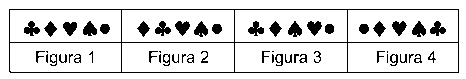

Nessa sequência, as figuras 5, 6, 7 e 8 correspondem, respectivamente, às figuras 1, 2, 3 e 4, assim como as figuras 9, 10, 11 e 12, e assim por diante, mantendo-se essa correspondência. Com relação à ordem dos símbolos, o 1o dessa sequência é  , o 8o é  , o 15o é  , e assim por diante. Nestas condições, o 189o símbolo é

- A) 
- B) 
- C) 
- D) 
- E) 

---

# ✅ Gabarito comentado

## Gabarito oficial

| Q | Resposta | Por quê |
|---|---|---|
| Q01 | **A** | Gabarito oficial da Vunesp. |
| Q02 | **D** | Gabarito oficial da Vunesp. |
| Q03 | **B** | Gabarito oficial da Vunesp. |
| Q04 | **E** | Gabarito oficial da Vunesp. |
| Q05 | **D** | Gabarito oficial da Vunesp. |
| Q06 | **A** | Gabarito oficial da Vunesp. |
| Q07 | **D** | Gabarito oficial da Vunesp. |
| Q08 | **C** | Gabarito oficial da Vunesp. |
| Q09 | **C** | Gabarito oficial da Vunesp. |
| Q10 | **B** | Gabarito oficial da Vunesp. |
| Q11 | **E** | Gabarito oficial da Vunesp. |
| Q12 | **E** | Gabarito oficial da Vunesp. |
| Q13 | **A** | Gabarito oficial da Vunesp. |
| Q14 | **D** | Gabarito oficial da Vunesp. |
| Q15 | **C** | Gabarito oficial da Vunesp. |
| Q16 | **D** | Gabarito oficial da Vunesp. |
| Q17 | **B** | Gabarito oficial da Vunesp. |
| Q18 | **B** | Gabarito oficial da Vunesp. |
| Q19 | **E** | Gabarito oficial da Vunesp. |
| Q20 | **E** | Gabarito oficial da Vunesp. |
| Q21 | **A** | Gabarito oficial da Vunesp. |
| Q22 | **E** | Gabarito oficial da Vunesp. |
| Q23 | **D** | Gabarito oficial da Vunesp. |
| Q24 | **C** | Gabarito oficial da Vunesp. |
| Q25 | **C** | Gabarito oficial da Vunesp. |
| Q26 | **C** | Gabarito oficial da Vunesp. |
| Q27 | **E** | Gabarito oficial da Vunesp. |
| Q28 | **Anulada** | Questão anulada pela banca: o ponto é atribuído a todos. |
| Q29 | **D** | Gabarito oficial da Vunesp. |
| Q30 | **B** | Gabarito oficial da Vunesp. |
| Q31 | **A** | Gabarito oficial da Vunesp. |
| Q32 | **C** | Gabarito oficial da Vunesp. |
| Q33 | **E** | Gabarito oficial da Vunesp. |
| Q34 | **D** | Gabarito oficial da Vunesp. |
| Q35 | **D** | Gabarito oficial da Vunesp. |
| Q36 | **E** | Gabarito oficial da Vunesp. |
| Q37 | **C** | Gabarito oficial da Vunesp. |
| Q38 | **Anulada** | Questão anulada pela banca: o ponto é atribuído a todos. |
| Q39 | **C** | Gabarito oficial da Vunesp. |
| Q40 | **Anulada** | Questão anulada pela banca: o ponto é atribuído a todos. |
| Q41 | **E** | Gabarito oficial da Vunesp. |
| Q42 | **A** | Gabarito oficial da Vunesp. |
| Q43 | **D** | Gabarito oficial da Vunesp. |
| Q44 | **D** | Gabarito oficial da Vunesp. |
| Q45 | **C** | Gabarito oficial da Vunesp. |
| Q46 | **B** | Gabarito oficial da Vunesp. |
| Q47 | **E** | Gabarito oficial da Vunesp. |
| Q48 | **A** | Gabarito oficial da Vunesp. |
| Q49 | **E** | Gabarito oficial da Vunesp. |
| Q50 | **A** | Gabarito oficial da Vunesp. |
| Q51 | **Anulada** | Questão anulada pela banca: o ponto é atribuído a todos. |
| Q52 | **C** | Gabarito oficial da Vunesp. |
| Q53 | **A** | Gabarito oficial da Vunesp. |
| Q54 | **D** | Gabarito oficial da Vunesp. |
| Q55 | **E** | Gabarito oficial da Vunesp. |
| Q56 | **C** | Gabarito oficial da Vunesp. |
| Q57 | **B** | Gabarito oficial da Vunesp. |
| Q58 | **C** | Gabarito oficial da Vunesp. |
| Q59 | **E** | Gabarito oficial da Vunesp. |
| Q60 | **E** | Gabarito oficial da Vunesp. |
| Q61 | **D** | Gabarito oficial da Vunesp. |
| Q62 | **A** | Gabarito oficial da Vunesp. |
| Q63 | **B** | Gabarito oficial da Vunesp. |
| Q64 | **E** | Gabarito oficial da Vunesp. |
| Q65 | **C** | Gabarito oficial da Vunesp. |
| Q66 | **D** | Gabarito oficial da Vunesp. |
| Q67 | **B** | Gabarito oficial da Vunesp. |
| Q68 | **C** | Gabarito oficial da Vunesp. |
| Q69 | **A** | Gabarito oficial da Vunesp. |
| Q70 | **A** | Gabarito oficial da Vunesp. |
| Q71 | **D** | Gabarito oficial da Vunesp. |
| Q72 | **A** | Gabarito oficial da Vunesp. |
| Q73 | **D** | Gabarito oficial da Vunesp. |
| Q74 | **B** | Gabarito oficial da Vunesp. |
| Q75 | **B** | Gabarito oficial da Vunesp. |
| Q76 | **E** | Gabarito oficial da Vunesp. |
| Q77 | **B** | Gabarito oficial da Vunesp. |
| Q78 | **D** | Gabarito oficial da Vunesp. |
| Q79 | **B** | Gabarito oficial da Vunesp. |
| Q80 | **E** | Gabarito oficial da Vunesp. |
| Q81 | **C** | Gabarito oficial da Vunesp. |
| Q82 | **A** | Gabarito oficial da Vunesp. |
| Q83 | **E** | Gabarito oficial da Vunesp. |
| Q84 | **B** | Gabarito oficial da Vunesp. |
| Q85 | **D** | Gabarito oficial da Vunesp. |
| Q86 | **A** | Gabarito oficial da Vunesp. |
| Q87 | **B** | Gabarito oficial da Vunesp. |
| Q88 | **C** | Gabarito oficial da Vunesp. |
| Q89 | **A** | Gabarito oficial da Vunesp. |
| Q90 | **B** | Gabarito oficial da Vunesp. |
| Q91 | **E** | Gabarito oficial da Vunesp. |
| Q92 | **D** | Gabarito oficial da Vunesp. |
| Q93 | **C** | Gabarito oficial da Vunesp. |
| Q94 | **C** | Gabarito oficial da Vunesp. |
| Q95 | **A** | Gabarito oficial da Vunesp. |
| Q96 | **A** | Gabarito oficial da Vunesp. |
| Q97 | **D** | Gabarito oficial da Vunesp. |
| Q98 | **E** | Gabarito oficial da Vunesp. |
| Q99 | **C** | Gabarito oficial da Vunesp. |
| Q100 | **A** | Gabarito oficial da Vunesp. |
