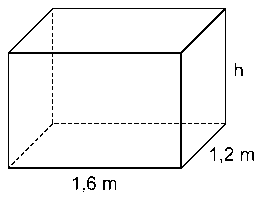
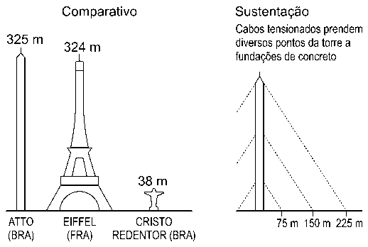
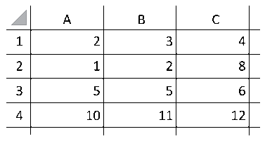
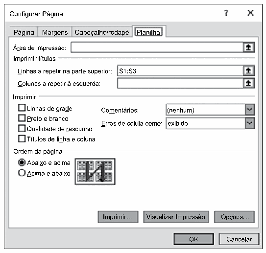
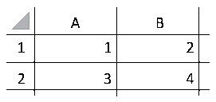
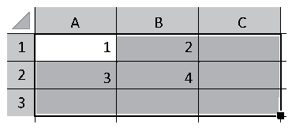
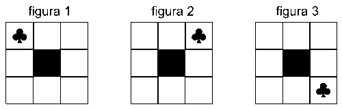

# TJ-SP 2018 — Escrevente Técnico Judiciário (prova oficial)

Prova objetiva oficial do concurso de Escrevente Técnico Judiciário do TJ-SP (2018), banca Vunesp, com 100 questões e o gabarito oficial da versão 2.
As figuras foram recortadas do caderno original. O gabarito comentado está no fim do arquivo.

<!-- Gerado por tools/src/prova_to_md.py a partir de 2018escrevente_tecnico_judiciario.pdf e 2018gabarito.pdf. -->

## Língua Portuguesa

*Leia o texto para responder às questões de números 01 a 05.*
> Quem assiste a “Tempo de Amar” já reparou no português extremamente culto e correto que é falado pelos personagens da novela. Com frases que parecem retiradas de um romance antigo, mesmo nos momentos mais banais, os personagens se expressam de maneira correta e erudita.
>
> Ao UOL, o autor da novela, Alcides Nogueira, diz que o linguajar de seus personagens é um ponto que leva a novela a se destacar. “Não tenho nada contra a linguagem coloquial, ao contrário. Acho que a língua deve ser viva e usada em sintonia com o nosso tempo. Mas colocar um português bastante culto torna a narrativa mais coerente com a época da trama. Fora isso, é uma oportunidade de o público conhecer um pouco mais dessa sintaxe poucas vezes usada atualmente”.
>
> O escritor, que assina o texto da novela das 18h ao lado de Bia Corrêa do Lago, conta que a decisão de imprimir um português erudito à trama foi tomada por ele e apoiada pelo diretor artístico, Jayme Monjardim. Ele revela que toma diversos cuidados na hora de escrever o texto, utilizando, inclusive, o dicionário. “Muitas vezes é preciso recorrer às gramáticas. No início, o uso do coloquial era tentador. Aos poucos, a escrita foi ficando mais fácil”, afirma Nogueira, que também diz se inspirar em grandes escritores da literatura brasileira e portuguesa, como Machado de Assis e Eça de Queiroz.
>
> Para o autor, escutar os personagens falando dessa forma ajuda o público a mergulhar na época da trama de modo profundo e agradável. Compartilhou-lhe o sentimento Jayme Monjardim, que também explica que a estética delicada da novela foi pensada para casar com o texto. “É uma novela que se passa no fim dos anos 1920, então tudo foi pensado para que o público entrasse junto com a gente nesse túnel do tempo. Acho que isso é importante para que o telespectador consiga se sentir em outra época”, diz.
>
> (Guilherme Machado. UOL. https://tvefamosos.uol.com.br.
>
> 15.11.2017. Adaptado)

**Q01.** De acordo com o texto, entende-se que as formas linguísticas empregadas na novela

- A) correspondem a um linguajar que, apesar de ser antigo, continua em amplo uso na linguagem atual.
- B) divergem dos usos linguísticos atuais, caracterizados pela adoção de formas mais coloquiais.
- C) estão associadas ao coloquial, o que dá mais vivacidade à linguagem e desperta o interesse do público.
- D) harmonizam-se com a linguagem dos dias atuais porque deixam de lado os usos corretos e formais.
- E) constituem usos comuns na linguagem moderna, porém a maior parte das pessoas não os entende.

**Q02.** As informações textuais permitem afirmar corretamente que

- A) a proximidade entre a literatura e as novelas exige que haja um senso estético aguçado em relação à linguagem, por isso essas artes primam pelo erudito.
- B) a linguagem coloquial atrai sobremaneira os autores de novelas, como é o caso de Alcides Nogueira, que desconhecia o emprego de formas eruditas.
- C) a linguagem erudita deixa de ser empregada na novela quando há necessidade de retratar os momentos mais banais vividos pelas personagens.
- D) a opção por escrever uma novela de época implica a transposição de elementos visuais e linguísticos para o tempo presente, modernizando-os.
- E) a harmonização entre a linguagem e a estética da novela contribui para que a caracterização de uma época seja mais bem entendida pelo público.

**Q03.** No texto, há exemplo de uso coloquial da linguagem na passagem:

- A) ... então tudo foi pensado para que o público entrasse junto com a gente nesse túnel do tempo.
- B) Com frases que parecem retiradas de um romance antigo, [...] os personagens se expressam de maneira correta e erudita.
- C) Quem assiste a “Tempo de Amar” já reparou no português extremamente culto e correto...
- D) ... o autor da novela [...] diz que o linguajar de seus personagens é um ponto que leva a novela a se destacar.
- E) Ele revela que toma diversos cuidados na hora de escrever o texto, utilizando, inclusive, o dicionário.

**Q04.** Considere as passagens:

• ... os personagens se expressam de maneira correta e erudita. (1o parágrafo)

• Compartilhou-lhe o sentimento Jayme Monjardim... (4o parágrafo)

• “... para que o telespectador consiga se sentir em outra época”... (4o parágrafo)

Os pronomes, em destaque, assumem nos enunciados, correta e respectivamente, os sentidos:

- A) recíproco, possessivo e reflexivo.
- B) recíproco, reflexivo e reflexivo.
- C) reflexivo, possessivo e reflexivo.
- D) reflexivo, demonstrativo e enfático.
- E) reflexivo, enfático e possessivo.

**Q05.** Sem prejuízo de sentido ao texto, as passagens “Quem assiste a ‘Tempo de Amar’ já reparou no português extremamente culto...” (1o parágrafo) e “Aos poucos, a escrita foi ficando mais fácil”… (3o parágrafo) estão corretamente reescritas em:

- A) Quem assiste a “Tempo de Amar” já corrigiu o português excepcionalmente culto... / Seguramente, a escrita foi ficando mais fácil.
- B) Quem assiste a “Tempo de Amar” já se deu conta do português agudamente culto... / Rapidamente, a escrita foi ficando mais fácil.
- C) Quem assiste a “Tempo de Amar” já percebeu o português muitíssimo culto... / Paulatinamente, a escrita foi ficando mais fácil.
- D) Quem assiste a “Tempo de Amar” já reconheceu o português ocasionalmente culto... / Curiosamente, a escrita foi ficando mais fácil.
- E) Quem assiste a “Tempo de Amar” já se aborreceu com o português sagazmente culto... / Lentamente, a escrita foi ficando mais fácil.

*Leia o texto para responder às questões de números 06 a 08.*
> Se determinado efeito, lógico ou artístico, mais fortemente se obtém do emprego de um substantivo masculino apenso a substantivo feminino, não deve o autor hesitar em fazê-lo. Quis eu uma vez dar, em uma só frase, a ideia – pouco importa se vera ou falsa – de que Deus é simultaneamente o Criador e a Alma do mundo. Não encontrei melhor maneira de o fazer do que tornando transitivo o verbo “ser”; e assim dei à voz de Deus a frase:
>
> – Ó universo, eu sou-te,
>
> em que o transitivo de criação se consubstancia com o intransitivo de identificação.
>
> Outra vez, porém em conversa, querendo dar incisiva, e portanto concentradamente, a noção verbal de que certa senhora tinha um tipo de rapaz, empreguei a frase “aquela rapaz”, violando deliberadamente e justissimamente a lei fundamental da concordância.
>
> A prosódia, já alguém o disse, não é mais que função do estilo.
>
> A linguagem fez-se para que nos sirvamos dela, não para que a sirvamos a ela.
>
> (Fernando Pessoa. A língua portuguesa, 1999. Adaptado)

**Q06.** No texto, o autor defende que

- A) a transformação das formas de comunicação está restrita à linguagem oral, normalmente menos formal que a escrita.
- B) a linguagem deve atender às necessidades comunicativas das pessoas, nem que para isso suas regras tenham de ser violadas.
- C) o estilo dos escritores rompe com a tradição da linguagem, o que implica que eles, cada vez mais, estão submissos a ela.
- D) os discursos lógicos e artísticos, para serem mais coerentes, têm evitado as violações linguísticas a que poderiam recorrer.
- E) a forma como muitas pessoas se comunicam cotidianamente tem deturpado a essência da língua, comprometendo-lhe a clareza.

**Q07.** Assinale a alternativa em que, ao contrário da construção “aquela rapaz”, segue-se a lei fundamental da concordância, de acordo com a norma-padrão.

- A) Quando o despacho chegou, a primeira coisa que o advogado fez foi conferir os documentos anexos.
- B) Era um dia ensolarado, e não se sabe como foi atropelado aquela mulher em uma avenida tranquila.
- C) Parece-me que este ano está chovendo muito, mas ainda assim há menas chuvas do que em anos anteriores.
- D) As crianças brincavam no jardim, colhendo flores colorida e presenteando-se num gesto emocionante.
- E) Quando entraram na casa abandonada, uma cobra estava escondido ali. Assustaram-se, pois era um bicho perigoso.

**Q08.** Assinale a alternativa que atende à norma-padrão de colocação pronominal.

- A) A prosódia, já disse-o alguém, não é mais que função do estilo.
- B) Se consubstancia o transitivo de criação com o intransitivo de identificação na frase: – Ó universo, eu sou-te.
- C) Tendo referido-me a Deus simultaneamente como o Criador e a Alma do mundo, recorri à frase: – Ó universo, eu sou-te.
- D) Sirvamo-nos da linguagem para quaisquer efeitos, sejam eles lógicos ou artísticos.
- E) Para expressar minha ideia, juntariam-se o transitivo de criação com o intransitivo de identificação na frase.

*Leia o texto para responder às questões de números 09 a 18.*
> Ai, Gramática. Ai, vida.
>
> O que a gente deve aos professores!
>
> Este pouco de gramática que eu sei, por exemplo, foram Dona Maria de Lourdes e Dona Nair Freitas que me ensinaram. E vocês querem coisa mais importante do que gramática? La grammaire qui sait régenter jusqu’aux rois – dizia Molière: a gramática que sabe reger até os reis, e Montaigne: La plus part des ocasions des troubles du monde sont grammairiens – a maior parte de confusão no mundo vem da gramática.
>
> Há quem discorde. Oscar Wilde, por exemplo, dizia de George Moore: escreveu excelente inglês, até que descobriu a gramática. (A propósito, de onde é que eu tirei tantas citações? Simples: tenho em minha biblioteca três livros contendo exclusivamente citações. Para enfeitar uma crônica, não tem coisa melhor. Pena que os livros são em inglês. Aliás, inglês eu não aprendi na escola. Foi lendo as revistas MAD e outras que vocês podem imaginar).
>
> Discordâncias à parte, gramática é um negócio importante e gramática se ensina na escola – mas quem, professoras, nos ensina a viver? Porque, como dizia o Irmão Lourenço, no schola sed vita – é preciso aprender não para a escola, mas para a vida.
>
> Ora, dirão os professores, vida é gramática. De acordo. Vou até mais longe: vida é pontuação. A vida de uma pessoa é balizada por sinais ortográficos. Podemos acompanhar a vida de uma criatura, do nascimento ao túmulo, marcando as diferentes etapas por sinais de pontuação.
>
> Infância: a permanente exclamação:
>
> Nasceu! É um menino! Que grande! E como chora! Claro, quem não chora não mama!
>
> Me dá! É meu!
>
> Ovo! Uva! Ivo viu o ovo! Ivo viu a uva! O ovo viu a uva!
>
> Olha como o vovô está quietinho, mamãe!
>
> Ele não se mexe, mamãe! Ele nem fala, mamãe!
>
> Ama com fé e orgulho a terra em que nasceste! Criança – não verás nenhum país como este!
>
> Dá agora! Dá agora, se tu és homem! Dá agora, quero ver!
>
> (Moacyr Scliar. Minha mãe não dorme enquanto
>
> eu não chegar, 1996. Adaptado)

**Q09.** No texto, o autor recorre a várias citações, com a finalidade de

- A) discutir a falta de necessidade do ensino de gramática, uma vez que seu domínio não implica necessariamente saber usar a língua de forma adequada.
- B) enfatizar as discrepâncias quanto à necessidade da gramática para a vida, concluindo que ela é inútil e só tem servido como atividade escolar.
- C) propor a obrigatoriedade do ensino da gramática dentro e fora da escola, possibilitando que as pessoas usem melhor a língua materna.
- D) questionar a fascinação que grandes personalidades têm em relação à gramática, a qual, na maioria das vezes, ultrapassa os limites do contexto escolar.
- E) mostrar diferentes perspectivas em relação à gramática, concluindo que ela é relevante e que algumas de suas partes assemelham-se a fases da vida.

**Q10.** Observe as passagens do texto:

• O que a gente deve aos professores! (1o parágrafo)

• ... mas quem, professoras, nos ensina a viver? (4o parágrafo)

Observando-se o contexto em que ocorrem e a pontuação nelas presentes, conclui-se que as frases apontam, correta e respectivamente, para os seguintes sentidos:

- A) o narrador sente que está em dívida com os professores, por tudo o que aprendeu; o narrador acredita que o papel da gramática no cotidiano é incompreendido.
- B) o narrador demonstra reconhecimento pelo que lhe foi ensinado pelos professores; o narrador questiona qual é o papel da gramática na vida cotidiana das pessoas.
- C) o narrador ironiza a educação e os ensinamentos de seus professores; o narrador sugere que a gramática não tem importância nenhuma na vida das pessoas.
- D) o narrador expressa certo descontentamento com o que os professores lhe ensinaram; o narrador tem plena certeza de que a gramática transforma a vida das pessoas.
- E) o narrador questiona os ensinamentos gramaticais que recebeu dos professores; o narrador discorda da ideia de que a gramática seja a disciplina mais importante.

**Q11.** Quando o autor diz que a vida é pontuação e associa a infância à exclamação, seu objetivo é mostrar que

- A) o pleno encantamento marca esse período da vida, e as emoções tendem a mostrar-se com mais intensidade e espontaneidade.
- B) a percepção exagerada das crianças não tem como se justificar na relação que elas estabelecem com os adultos e o mundo.
- C) os adultos tendem a ficar incomodados com a forma como as crianças vão descobrindo os segredos do mundo.
- D) os adultos têm dificuldade para atender o encantamento das crianças pelas suas descobertas com o mundo que as circunda.
- E) as crianças normalmente descobrem o mundo sem reagir aos acontecimentos que marcam essa etapa de seu desenvolvimento.

**Q12.** O que Oscar Wilde afirma acerca de George Moore – escreveu excelente inglês, até que descobriu a gramática – significa que

- A) George Moore passou a escrever em inglês popular somente depois que descobriu a riqueza da gramática.
- B) a descoberta da gramática por George Moore surpreendeu a todos, pelo padrão de excelência de sua obra.
- C) o fato de escrever com excelência em inglês não impediu George Moore de buscar linguagem mais contemporânea.
- D) a gramática agiu, na obra de George Moore, para acentuar sua tendência a uma escrita de alta qualidade técnica.
- E) o contato com a gramática ocasionou, na obra de George Moore, o comprometimento da qualidade de sua escrita.

**Q13.** Assinale a alternativa em que as frases da passagem Infância: a permanente exclamação expressam as vivências infantis relacionadas à possessividade e à escolarização, respectivamente.

- A) Dá agora! Dá agora, se tu és homem! / Ele não se mexe, mamãe!
- B) Que grande! E como chora! / Ele nem fala, mamãe!
- C) Ama com fé e orgulho a terra em que nasceste! / Dá agora, quero ver!
- D) Me dá! É meu! / Ovo! Uva! Ivo viu o ovo! Ivo viu a uva! O ovo viu a uva!
- E) Claro, quem não chora não mama! / Olha como o vovô está quietinho, mamãe!

**Q14.** Nas passagens “Porque, como dizia o Irmão Lourenço, no schola sed vita – é preciso aprender não para a escola, mas para a vida.” (4o parágrafo) e “Ama com fé e orgulho a terra em que nasceste! Criança – não verás nenhum país como este!” (penúltimo parágrafo), as conjunções destacadas estabelecem, correta e respectivamente, relações de sentido de

- A) conformidade e causa.
- B) comparação e causa.
- C) conformidade e comparação.
- D) comparação e comparação.
- E) conformidade e conformidade.

**Q15.** Considere os trechos do texto:

• Há quem discorde. (3o parágrafo)

• Para enfeitar uma crônica, não tem coisa melhor. (3o parágrafo)

• Vou até mais longe: vida é pontuação. (5o parágrafo) De acordo com o sentido do texto e com a norma-padrão, os enunciados podem ser ampliados, respectivamente, com as reescritas:

- A) Há quem discorde dessas opiniões. / Para enfeitar uma crônica, não tem coisa melhor do que uma citação. / Vou até mais longe, afirmando que vida é pontuação.
- B) Há quem discorde com essas opiniões. / Para enfeitar uma crônica, não tem coisa melhor como uma citação. / Vou até mais longe, afirmando de que vida é pontuação.
- C) Há quem discorde ante essas opiniões. / Para enfeitar uma crônica, não tem coisa melhor do que uma citação. / Vou até mais longe, afirmando em que vida é pontuação.
- D) Há quem discorde contra essas opiniões. / Para enfeitar uma crônica, não tem coisa melhor de que uma citação. / Vou até mais longe, afirmando que vida é pontuação.
- E) Há quem discorde nessas opiniões. / Para enfeitar uma crônica, não tem coisa melhor que uma citação. / Vou até mais longe, afirmando de que vida é pontuação.

**Q16.** Nas frases “Simples: tenho em minha biblioteca três livros contendo exclusivamente citações.” (3o parágrafo), “Vou até mais longe: vida é pontuação.” (5o parágrafo) e “A vida de uma pessoa é balizada por sinais ortográficos.” (5o parágrafo), as expressões em destaque podem ser substituídas, sem prejuízo de sentido ao texto, correta e respectivamente, por:

- A) também; bem além; distinguida.
- B) somente; bem além; limitada.
- C) inclusive; bem adiante; orientada.
- D) apenas; bem aquém; restrita.
- E) unicamente; bem afora; orientada.

**Q17.** De acordo com a norma-padrão, o trecho do 4o parágrafo “ … gramática é um negócio importante e gramática se ensina na escola…” está corretamente reescrito em:

- A) Se ensina gramática na escola devido à sua importância.
- B) Gramática é um negócio importante cujo ensina-se na escola.
- C) Se ensina gramática na escola, devido a sua importância.
- D) Como a gramática é um negócio importante, a escola lhe ensina.
- E) Gramática é um negócio importante que se ensina na escola.

**Q18.** Assinale a alternativa em que há expressão(ões) empregada(s) em sentido figurado.

- A) Oscar Wilde, por exemplo, dizia de George Moore: escreveu excelente inglês, até que descobriu a gramática.
- B) Aliás, inglês eu não aprendi na escola. Foi lendo as revistas MAD e outras que vocês podem imaginar.
- C) Este pouco de gramática que eu sei, por exemplo, foram Dona Maria de Lourdes e Dona Nair Freitas que me ensinaram.
- D) Ora, dirão os professores, vida é gramática. De acordo. Vou até mais longe: vida é pontuação.
- E) Simples: tenho em minha biblioteca três livros contendo exclusivamente citações.

*Leia o texto para responder às questões de números 19 a 24.*
> Ei-lo agora, adolescente recluso em seu quarto, diante de um livro que não lê. Todos os seus desejos de estar longe erguem, entre ele e as páginas abertas, uma tela esverdeada que perturba \_\_\_\_\_\_ linhas. Ele está sentado diante da janela, a porta fechada \_\_\_\_\_\_ costas. Página 48. Ele não tem coragem de contar as horas passadas para chegar \_\_\_\_\_\_ essa quadragésima oitava página. O livro tem exatamente quatrocentas e quarenta e seis. Pode-se dizer 500 páginas! Se ao menos tivesse uns diálogos, vai. Mas não! Páginas completamente cheias de linhas apertadas entre margens minúsculas, negros parágrafos comprimidos uns sobre os outros e, aqui e acolá, a caridade de um diálogo – um travessão, como um oásis, que indica que um personagem fala \_\_\_\_\_\_ outro personagem. Mas o outro não responde. E segue-se um bloco de doze páginas! Doze páginas de tinta preta! Falta de ar! Ufa, que falta de ar! Ele xinga. Muitas desculpas, mas ele xinga. Página quarenta e oito... Se ao menos conseguisse lembrar do conteúdo dessas primeiras quarenta e oito páginas!
>
> (Daniel Pennac. Como um romance, 1993. Adaptado)

**Q19.** Em conformidade com a norma-padrão, as lacunas do texto devem ser preenchidas, respectivamente, com:

- A) as ... às ... a ... a
- B) às ... às ... à ... à
- C) as ... às ... à ... à
- D) às ... as ... a ... a
- E) as ... as ... à ... à

**Q20.** O texto relata que

- A) o livro cativa o adolescente, ansioso por terminar logo a leitura das quase 500 páginas.
- B) o xingamento do adolescente é inevitável, mas ele se arrepende e volta a ler o livro.
- C) o adolescente considera penosa a tarefa de ler um livro de 446 páginas.
- D) a recordação do conteúdo do livro ameniza o sofrimento do adolescente com a leitura.
- E) a história do livro desanima o adolescente, que pula páginas em busca de um diálogo.

**Q21.** Nas passagens “Ei-lo agora, adolescente recluso em seu quarto, diante de um livro que não lê.” e “negros parágrafos comprimidos uns sobre os outros”, os termos destacados têm como antônimos, respectivamente:

- A) enclausurado e apertados.
- B) liberto e expandidos.
- C) apartado e ampliados.
- D) solitário e espalhados.
- E) solto e limitados.

**Q22.** Com a passagem “O livro tem exatamente quatrocentas e quarenta e seis. Pode-se dizer 500 páginas!”, entende-se que a página “500” do livro seria a

- A) quinquagésima, minimizando a importância da obra.
- B) quinquagésima, questionando a importância da obra.
- C) quinhentésima, evidenciando o tamanho da obra.
- D) quingentésima, reforçando a extensão da obra.
- E) quingentésima, enaltecendo o conteúdo da obra.

**Q23.** No texto, um dos trechos construídos com palavras e expressões em sentido próprio é

- A) “Se ao menos conseguisse lembrar do conteúdo dessas primeiras quarenta e oito páginas!”, o qual revela o pensamento do adolescente e, ao mesmo tempo, sinaliza sua dispersão na leitura.
- B) “Ele está sentado diante da janela, a porta fechada...”, o qual remete à ideia de que o adolescente, tendo de realizar a tarefa de ler, fica circunspecto, analisando-se frente à situação imposta.
- C) “Todos os seus desejos de estar longe erguem, entre ele e as páginas abertas, uma tela esverdeada que perturba...”, o qual remete à ideia de que o adolescente queria estar em outro lugar.
- D) “Páginas completamente cheias de linhas apertadas entre margens minúsculas, negros parágrafos comprimidos uns sobre os outros...”, o qual mostra a percepção objetiva que o adolescente tem da leitura.
- E) “... e, aqui e acolá, a caridade de um diálogo – um travessão, como um oásis, que indica que um personagem fala...”, o qual indica que, aos poucos, o adolescente vai se interessando pelo livro.

**Q24.** Assinale a alternativa correta quanto à concordância verbal, de acordo com a norma-padrão.

- A) A página do livro cheia de linhas apertadas e negros parágrafos deixam o adolescente com falta de ar.
- B) O adolescente está no quarto, sentado diante da janela. Passou as horas, e ele não tem coragem de contá-las.
- C) Ao encontrar um diálogo, o adolescente espera que hajam longas conversas entre as personagens.
- D) O livro tem exatamente 486 páginas. É quase 500 páginas de leitura, e praticamente não existe diálogos.
- E) O bloco de doze páginas provoca os xingamentos do adolescente, e logo são proferidas as desculpas.

## Conhecimentos em Direito

## Direito Penal

**Q25.** A respeito dos crimes previstos nos artigos 293 a 305 do Código Penal, assinale a alternativa correta.

- A) A falsificação de livros mercantis caracteriza o crime de falsificação de documento particular (art. 298 do CP).
- B) O crime de falsidade ideológica (art. 299 do CP), em documento público, é próprio de funcionário público.
- C) No crime de falsidade de atestado médico (art. 302 do CP), independentemente da finalidade de lucro do agente, além da pena privativa de liberdade, aplica-se multa.
- D) O crime de supressão de documento (art. 305 do CP), para se caracterizar, exige que o documento seja verdadeiro.
- E) O crime de falsificação de documento público (art. 297 do CP) é próprio de funcionário público.

**Q26.** No tocante às infrações previstas nos artigos 307, 308 e 311-A, do Código Penal, assinale a alternativa correta.

- A) A conduta de atribuir a terceiro falsa identidade é penalmente atípica, sendo crime apenas atribuir a si próprio identidade falsa.
- B) O crime de fraude em certames de interesse público configura-se pela divulgação de conteúdo de certa-me, ainda que não sigiloso.
- C) O crime de fraude em certames de interesse público prevê a figura qualificada, se dele resulta dano à administração pública.
- D) A conduta de ceder o documento de identidade a terceiro, para que dele se utilize, é penalmente atípica, sendo crime apenas o uso, como próprio, de documento alheio.
- E) O crime de fraude em certames de interesse público é próprio de funcionário público.

**Q27.** A respeito dos crimes praticados por funcionários públicos contra a administração pública, é correto afirmar que

- A) Caio, funcionário público, ao empregar verba própria da educação, destinada por lei, na saúde, em tese, incorre no crime de emprego irregular de verba pública (art. 315 do CP).
- B) Tícia, funcionária pública, ao exigir, em razão de sua função, que determinada empresa contrate o filho, em tese, incorre no crime de corrupção passiva (art. 317 do CP).
- C) Mévio, funcionário público, em razão de sua função, ao aceitar promessa de recebimento de passagens aéreas, para férias da família, não incorre no crime de corrupção passiva (art. 317 do CP), já que referido tipo penal exige o efetivo recebimento de vantagem indevida.
- D) Tício, funcionário público, ao se apropriar do dinheiro arrecadado pelos funcionários da repartição para comprar o bolo de comemoração dos aniversariantes do mês, em tese, pratica o crime de peculato (art. 312 do CP).
- E) Mévia, funcionária pública, não sendo advogada, não pode incorrer no crime de advocacia administrativa (art. 321 do CP), já que referido tipo penal exige a qualidade de advogado do sujeito ativo.

**Q28.** A respeito dos crimes praticados por particulares contra a administração, em geral (arts. 328; 329; 330; 331; 332; 333; 335; 336 e 337 do CP), assinale a alternativa correta.

- A) O crime de desacato não se configura se o funcionário público não estiver no exercício da função, ainda que o desacato seja em razão dela.
- B) Para se configurar, o crime de usurpação de função pública exige que o agente, enquanto na função, obtenha vantagem.
- C) Para se configurar, o crime de corrupção ativa exige o retardo ou a omissão do ato de ofício, pelo funcionário público, em razão do recebimento ou promessa de vantagem indevida.
- D) Aquele que se abstém de licitar em hasta pública, em razão de vantagem indevida, não é punido pelo crime de impedimento, perturbação ou fraude de concorrência, já que se trata de conduta atípica.
- E) Não há previsão de modalidade culposa.

**Q29.** A respeito dos crimes contra a administração da justiça (arts. 339 a 347 do CP), assinale a alternativa correta.

- A) A autoacusação para acobertar ascendente ou descendente é atípica.
- B) Dar causa a inquérito civil contra alguém, imputando-lhe falsamente a prática de crime, em tese, caracteriza o crime de denunciação caluniosa.
- C) Provocar a ação de autoridade, comunicando a ocorrência de crime que sabe não ter se verificado, em tese, caracteriza o crime de denunciação caluniosa.
- D) O crime de falso testemunho exige, para configuração, que o agente receba vantagem econômica ou outra de qualquer natureza.
- E) O crime de exercício arbitrário das próprias razões procede-se mediante queixa, ainda que haja emprego de violência.

**Q30.** A respeito do crime de exploração de prestígio (art. 357 do CP), é correto afirmar que

- A) prevê causa de aumento se o agente alega ou insinua que o dinheiro é também destinado a funcionário público estrangeiro.
- B) prevê modalidade culposa.
- C) se caracteriza pela conduta de receber dinheiro a pretexto de influir em ato praticado por qualquer funcionário público.
- D) se trata de crime comum, não se exigindo qualquer qualidade especial do autor.
- E) para se configurar, exige o efetivo recebimento de dinheiro pelo agente.

## Direito Processual Penal

**Q31.** A respeito das causas de impedimento e suspeição do juiz, de acordo com o Código de Processo Penal, assinale a alternativa correta.

- A) Nos juízos coletivos, não poderão servir no mesmo processo os juízes que forem entre si parentes, consanguíneos ou afins, em linha reta ou colateral, até o quarto grau.
- B) O juiz será suspeito, podendo ser recusado por qualquer das partes, se já tiver funcionado como juiz de outra instância, pronunciando-se de fato ou de direito sobre a questão.
- C) Ainda que dissolvido o casamento, sem descendentes, que ensejava impedimento ou suspeição, não funcionará como juiz o sogro, o padrasto, o cunhado, o genro ou enteado de quem for parte no processo.
- D) O juiz será impedido se for credor ou devedor de qualquer das partes.
- E) A suspeição poderá ser reconhecida ou declarada ainda que a parte injurie, de propósito, o juiz.

**Q32.** A respeito do acusado e do defensor, é correto afirmar que

- A) o acusado, ainda que tenha habilitação, não poderá a si mesmo defender, sendo-lhe nomeado defensor, pelo juiz, caso não o tenha.
- B) a constituição de defensor dependerá de instrumento de mandato, ainda que a nomeação se der por ocasião do interrogatório.
- C) o acusado ausente não poderá ser processado sem defensor. Já o foragido, existindo sentença condenatória, ainda que não transitada em julgado, sim.
- D) se o defensor constituído pelo acusado não puder comparecer à audiência, por motivo justificado, provado até a abertura da audiência, nomear-se-á defensor dativo, para a realização do ato, que não será adiado.
- E) o acusado, ainda que possua defensor nomeado pelo Juiz, poderá, a todo tempo, nomear outro, de sua confiança.

**Q33.** Com relação à citação do acusado, assinale a alternativa correta.

- A) A citação inicial do acusado far-se-á pessoalmente, por intermédio de mandado judicial, carta precatória ou hora certa.
- B) Ao acusado, citado por edital, que não comparecer ou constituir advogado, será nomeado defensor, prosseguindo o processo.
- C) Estando o acusado no estrangeiro, suspende-se o processo e o prazo prescricional até que retorne ao País.
- D) Completada a citação por hora certa, não comparecendo o réu, ser-lhe-á nomeado defensor dativo.
- E) A citação do réu preso far-se-á na pessoa do Diretor do estabelecimento prisional.

**Q34.** Segundo o Código de Processo Penal, a respeito do processo comum, é correto dizer que

- A) aceita a denúncia ou a queixa, o Juiz não poderá absolver sumariamente o réu, após a apresentação da resposta à acusação.
- B) a parte, no procedimento ordinário, não poderá desistir de testemunha, anteriormente arrolada.
- C) o procedimento será ordinário, sumário ou sumaríssimo; o procedimento sumaríssimo será o aplicado quando se tem por objeto crime sancionado com pena privativa de liberdade de até 04 (quatro) anos.
- D) são causas de rejeição da denúncia ou queixa a inépcia, a falta de pressuposto processual ou condição para o exercício da ação penal e a falta de justa causa.
- E) no procedimento ordinário, poderão ser ouvidas até 08 (oito) testemunhas, de acusação e defesa, compreendidas, nesse número, as que não prestam compromisso.

**Q35.** Com relação ao procedimento relativo aos processos de competência do tribunal do júri, assinale a alternativa correta.

- A) Pronunciado o acusado, remetidos os autos ao tribunal do júri, será a defesa intimada para apresentar o rol de testemunhas que irão depor, em plenário, até o máximo de 08 (oito).
- B) Constituirão o Conselho de Sentença, em cada sessão de julgamento, 07 (sete) jurados, sorteados dentre os alistados, aplicando-se a eles o disposto sobre os impedimentos, a suspeição e as incompatibilidades dos juízes togados.
- C) Encerrada a instrução preliminar, o juiz, fundamentadamente, pronunciará ou impronunciará o acusado, não cabendo, nessa fase, a absolvição sumária.
- D) Contra a sentença de impronúncia do acusado caberá recurso em sentido estrito.
- E) O risco à segurança pessoal do acusado não enseja desaforamento do julgamento para outra comarca, sendo motivo justificante a dúvida razoável sobre a imparcialidade do júri.

**Q36.** Com relação aos recursos e revisão, de acordo com o Código de Processo Penal, é correto dizer que

- A) no caso de concurso de agentes, a decisão do recurso interposto por um dos réus, ainda que fundado em motivos pessoais, aproveitará aos outros.
- B) a revisão criminal só poderá ser requerida no prazo de até 02 (dois) anos da sentença condenatória, transitada em julgado.
- C) interposta a Apelação somente pelo acusado, não pode o Tribunal reinquirir testemunhas ou determinar diligências.
- D) nos processos de contravenção, interposta a apelação, o prazo para arrazoar será de 03 (três) dias.
- E) na apelação e no recurso em sentido estrito, há previsão de juízo de retratação.

**Q37.** A respeito da Lei no 9.099/95 (arts. 60 a 83; 88 e 89), assinale a alternativa correta.

- A) Reunidos os processos, por força de conexão ou continência, perante o juízo comum ou tribunal do júri, observar-se-ão os institutos da transação penal e da composição dos danos civis.
- B) São consideradas infrações de menor potencial ofensivo as contravenções e os crimes a que a lei comine pena máxima não superior a 03 (três) anos, cumulada ou não com multa.
- C) Não sendo encontrado o acusado, o feito permanecerá no Juizado Especial Criminal, mas ficará suspenso, até que seja localizado.
- D) O acordo de composição civil entre o acusado e a vítima, nos casos de ação penal pública, condicionada e incondicionada, implica extinção da punibilidade ao autor do fato.
- E) Nos crimes em que a pena mínima cominada for inferior a 02 (dois) anos, o Ministério Público, ao oferecer denúncia, poderá propor a suspensão condicional do processo ao acusado que não esteja sendo processado ou não tenha sido condenado por outro crime.

## Direito Processual Civil

**Q38.** Legalmente, incumbe ao escrivão ou ao chefe de secretaria:

- A) efetuar avaliações, quando for o caso.
- B) certificar proposta de autocomposição apresentada por qualquer das partes, na ocasião de realização de ato de comunicação que lhe couber.
- C) manter sob sua guarda e responsabilidade os bens móveis de pequeno valor penhorados.
- D) auxiliar o juiz na manutenção da ordem.
- E) comparecer às audiências ou, não podendo fazê-lo, designar servidor para substituí-lo.

**Q39.** Serão admitidos(as) a propor ação perante o Juizado Especial Cível regido pela Lei no 9.099/95:

- A) as sociedades de economia mista, por serem pessoas de direito privado.
- B) os insolventes civis, ante sua hipossuficiência devidamente comprovada.
- C) as pessoas jurídicas qualificadas como Organização da Sociedade Civil de Interesse Público.
- D) os incapazes, devidamente representados por procuração, por instrumento público.
- E) as pessoas enquadradas como microempreendedores individuais, cujo empreendedor individual tenha renunciado ao direito próprio.

**Q40.** Se a tutela antecipada for concedida nos casos em que a urgência for contemporânea à propositura da ação e a petição inicial limitar-se ao requerimento da tutela antecipada e à indicação do pedido de tutela final, com a exposição da lide, do direito que se busca realizar e do perigo de dano ou do risco ao resultado útil do processo, e a decisão se tornar estável, o juiz deverá

- A) mandar emendar a inicial.
- B) suspender a ação até seu efetivo cumprimento.
- C) julgar extinto o processo.
- D) determinar a contestação da ação.
- E) sanear o feito.

**Q41.** Processa(m)-se durante as férias forenses, onde as houver, e não se suspendem pela superveniência delas:

- A) a homologação de desistência de ação.
- B) os procedimentos de jurisdição voluntária e os necessários à conservação de direitos, quando puderem ser prejudicados pelo adiamento.
- C) os processos que versem sobre arbitragem, inclusive sobre cumprimento de carta arbitral.
- D) o registro de ato processual eletrônico e a respectiva intimação eletrônica da parte.
- E) a realização de audiência cujas datas tiverem sido designadas.

**Q42.** Com relação ao direito de recorrer, assinale a alternativa correta.

- A) A renúncia ao direito de recorrer depende da aceitação da outra parte.
- B) A parte que aceitar tacitamente a decisão poderá recorrer, se ainda no prazo recursal.
- C) Dos despachos cabem os recursos de agravo de instrumento ou embargos de declaração.
- D) A desistência do recurso não impede a análise de questão cuja repercussão geral já tenha sido reconhecida.
- E) O recorrente, para desistir do recurso, necessitará da anuência de seus litisconsortes.

**Q43.** Diante do que prevê a Lei que regulamenta o Juizado Especial da Fazenda Pública, é correto afirmar:

- A) Os representantes judiciais dos réus presentes à audiência não poderão conciliar ou transigir.
- B) O pagamento de obrigação de pequeno valor deverá ser feito no prazo máximo de 90 dias a contar da entrega da requisição do juiz.
- C) Sendo o caso, haverá reexame necessário.
- D) Da sentença caberá apelação, não se admitindo agravo de instrumento por vedação legal.
- E) O juiz poderá, de ofício, deferir providências cautelares e antecipatórias, para evitar dano de difícil ou de incerta reparação.

**Q44.** Nas causas que dispensem a fase instrutória, o juiz, independentemente da citação do réu, poderá julgar liminarmente improcedente o pedido

- A) que tiver petição inicial inepta.
- B) cujo autor carecer de interesse processual.
- C) que tenha parte manifestamente ilegítima.
- D) que não indicar o fundamento legal.
- E) que contrariar enunciado de súmula de tribunal de justiça sobre direito local.

## Direito Constitucional

**Q45.** De acordo com texto expresso na Constituição da República Federativa do Brasil (CRFB/88), é correto afirmar que a lei

- A) assegurará aos autores de inventos industriais privilégio permanente para sua utilização.
- B) penal sempre retroagirá, seja para beneficiar ou não o réu.
- C) regulará a individualização da pena e adotará, entre outras, a perda de bens.
- D) poderá excluir da apreciação do Poder Judiciário lesão ou ameaça a direito.
- E) deverá punir ato atentatório a liberdades com penas restritivas de direito.

**Q46.** Salvo em caso de guerra declarada, nos termos expressos da Constituição da República Federativa do Brasil (CRFB/88), não haverá penas

- A) de morte.
- B) de banimento.
- C) de caráter perpétuo.
- D) de trabalhos forçados.
- E) de expulsão.

**Q47.** No que diz respeito à nacionalidade, de acordo com a Constituição da República Federativa do Brasil (CRFB/88), é correto afirmar que o brasileiro

- A) naturalizado poderá ser extraditado, pela prática de crime de furto, após a naturalização, no caso de condenação por sentença judicial.
- B) naturalizado poderá ocupar cargo no Conselho da República.
- C) naturalizado poderá ocupar o cargo de Ministro do Superior Tribunal de Justiça.
- D) nato poderá ser extraditado no caso de envolvimento no crime de tráfico internacional de entorpecentes.
- E) nato não poderá ter declarada a perda da nacionalidade.

**Q48.** Nos termos da Constituição da República Federativa do Brasil (CRFB/88), é correto afirmar que

- A) é vedada a acumulação remunerada de dois cargos públicos de professor, independentemente de haver compatibilidade de horário.
- B) os vencimentos dos cargos do Poder Legislativo e do Poder Executivo não poderão ser superiores aos pagos pelo Poder Judiciário.
- C) o servidor público da administração direta, autárquica e fundacional, investido no mandato de Prefeito, será afastado do cargo, emprego ou função, sendo-lhe vedado optar pela sua remuneração.
- D) os proventos de aposentadoria e as pensões, por ocasião de sua concessão, não poderão exceder a remuneração do respectivo servidor, no cargo efetivo em que se deu a aposentadoria ou que serviu de referência para a concessão da pensão.
- E) o servidor público estável perderá o cargo em virtude de sentença judicial ou administrativa, que prescindem de processo prévio em contraditório.

**Q49.** São assegurados, nos termos da Constituição da República Federativa do Brasil, (CRFB/88) à categoria dos trabalhadores domésticos os seguintes direitos:

- A) proteção em face da automação, na forma da lei.
- B) reconhecimento das convenções e acordos coletivos de trabalho.
- C) jornada de seis horas para trabalho realizado em turnos ininterruptos de revezamento.
- D) participação nos lucros, ou resultados, desvinculada da remuneração, conforme definido em lei.
- E) piso salarial proporcional à extensão e à complexidade do trabalho.

**Q50.** Conforme dispõe expressamente o texto constitucional, são gratuitas as ações de

- A) mandado de segurança e mandado de segurança coletivo.
- B) mandado de segurança e habeas corpus.
- C) mandado de segurança e habeas data.
- D) habeas corpus e mandado de injunção.
- E) habeas corpus e habeas data.

**Q51.** Em relação à Ação Popular, é correto afirmar que

- A) haverá pagamento de custas pelo autor no caso de nova ação.
- B) serão devidas as custas, desde que comprovada a má-fé do autor.
- C) a improcedência por carência de provas evidencia a má-fé do autor da ação popular.
- D) a improcedência torna devidos os honorários de sucumbência.
- E) serão devidas as custas judiciais e ônus de sucumbência.

## Direito Administrativo

**Q52.** Arceus Cipriano foi processado criminalmente sob a acusação de cometimento de crime contra a administração pública e pelos mesmos fatos também foi demitido do cargo público que ocupava. Contudo, na seara criminal, logrou êxito em comprovar que não foi o autor dos fatos, tendo sido absolvido por esse fundamento, na instância criminal. Diante disso, assinale a alternativa correta, nos termos do Estatuto dos Funcionários Públicos Civis do Estado de São Paulo.

- A) A demissão é nula porque a Administração Pública não deveria ter processado administrativamente Arceus e proferido decisão demissória antes do trânsito em julgado da sentença no processo criminal.
- B) Arceus poderá pedir o desarquivamento e a revisão da decisão administrativa que o demitiu, utilizando como documento novo a sentença absolutória proferida no processo criminal.
- C) Arceus terá direito à reintegração ao serviço público, no cargo que ocupava e com todos os direitos e vantagens devidas, mediante simples comprovação do trânsito em julgado da decisão absolutória no juízo criminal.
- D) Se a absolvição criminal ocorreu depois do prazo de interposição do recurso da decisão demissória proferida no processo administrativo, não será possível Arceus valer-se da sentença criminal para buscar a anulação da demissão.
- E) Como a responsabilidade administrativa é independente da civil e da criminal, a absolvição de Arceus Cipriano na justiça criminal em nada altera decisão proferida na esfera administrativa.

**Q53.** Consoante o Estatuto dos Funcionários Públicos Civis do Estado de São Paulo, será aplicada a pena de demissão nos casos de

- A) aplicação indevida de dinheiros públicos.
- B) prática de insubordinação grave.
- C) exercício de advocacia administrativa.
- D) pedir, por empréstimo, dinheiro ou quaisquer valores a pessoas que tratem de interesses ou o tenham na repartição, ou estejam sujeitos à sua fiscalização.
- E) prática, em serviço, de ofensas físicas contra funcionários ou particulares.

**Q54.** Nos termos da Lei no 10.261/1968, quanto ao procedimento disciplinar, assinale a alternativa correta.

- A) Se a testemunha não for localizada, a defesa poderá substituí-la, se quiser, levando, na mesma data designada para a audiência, outra testemunha, independentemente de notificação.
- B) A demissão a bem do serviço público acarreta a incompatibilidade permanente para nova investidura em cargo, função ou emprego público.
- C) No processo administrativo, se houver denunciante, este deverá prestar declarações depois do interrogatório do acusado, devendo ser notificado para tal fim.
- D) A prova de antecedentes do acusado pode ser feita por todos os meios de prova em direito admitidos, tais como documentos, testemunhas, perícias etc.
- E) Será instaurada sindicância quando a falta disciplinar, por sua natureza, possa determinar as penas de demissão ou disponibilidade.

**Q55.** De acordo com a Lei no 10.261/1968, no que concerne aos recursos no processo administrativo, é correta a seguinte afirmação:

- A) Não cabe pedido de reconsideração de decisão tomada pelo Governador do Estado em única instância.
- B) O recurso será apresentado ao superior hierárquico da autoridade que aplicou a pena, que, em 15 (quinze) dias, de forma motivada, deve manter a decisão ou reformá-la.
- C) Os recursos não têm efeito suspensivo; e os que forem providos darão lugar às retificações necessárias, retroagindo seus efeitos à data do ato punitivo.
- D) O prazo para recorrer é de 15 (quinze) dias, contados da publicação da decisão impugnada no Diário Oficial do Estado ou da intimação do procurador do servidor, se for o caso.
- E) O recurso não poderá ser apreciado pela autoridade competente se incorretamente denominado ou endereçado.

**Q56.** Nos termos da Lei no 8.429/1992, é correta a seguinte afirmação:

- A) Esta Lei se aplica apenas aos funcionários públicos que pratiquem ato lesivo ao erário da administração direta, indireta ou fundacional de qualquer dos Poderes da União, dos Estados ou do Distrito Federal.
- B) Se a lesão ao patrimônio decorrer de ação ou omissão culposa do agente ou do terceiro, não se fará necessário o integral ressarcimento do dano.
- C) Para os fins desta Lei, não se reputa agente público aquele que, por designação, exerça função de confiança junto a órgão da administração direta ou indireta, sem recebimento de remuneração.
- D) O sucessor daquele que causar lesão ao patrimônio público ou enriquecer ilicitamente em razão do serviço público não se sujeita às cominações desta Lei, ainda que o falecido tenha deixado herança.
- E) As disposições desta Lei poderão ser aplicadas àquele que, mesmo não sendo agente público, induza ou concorra para a prática do ato de improbidade ou dele se beneficie sob qualquer forma direta ou indireta.

**Q57.** Constitui ato de improbidade administrativa importando enriquecimento ilícito auferir qualquer tipo de vantagem patrimonial indevida em razão do exercício de cargo, mandato, função, emprego ou atividade nas entidades mencionadas no artigo 1o da Lei de Improbidade a seguinte hipótese:

- A) permitir ou concorrer para que pessoa física ou jurídica privada utilize bens, rendas, verbas ou valores integrantes do acervo patrimonial das entidades públicas protegidas por esta Lei, sem observância das formalidades legais ou regulamentares aplicáveis à espécie.
- B) realizar operação financeira sem observância das normas legais e regulamentares ou aceitar garantia insuficiente ou inidônea.
- C) ordenar ou permitir a realização de despesas não autorizadas em lei ou regulamento.
- D) aceitar emprego, comissão ou exercer atividade de consultoria ou assessoramento para pessoa física ou jurídica que tenha interesse suscetível de ser atingido ou amparado por ação ou omissão decorrente das atribuições do agente público, durante a atividade.
- E) permitir ou facilitar a aquisição, permuta ou locação de bem ou serviço por preço superior ao de mercado.

**Q58.** Constitui ato de improbidade administrativa que atenta contra os princípios da administração pública qualquer ação ou omissão que viole os deveres de honestidade, imparcialidade, legalidade, e lealdade às instituições, e notadamente,

- A) perceber vantagem econômica para intermediar a liberação ou aplicação de verba pública de qualquer natureza.
- B) liberar verba pública sem a estrita observância às normas pertinentes ou influir, de qualquer forma, para a sua aplicação irregular.
- C) permitir, facilitar ou concorrer para que terceiro se enriqueça ilicitamente.
- D) revelar fato ou circunstância de que tem ciência em razão das atribuições e que deva permanecer em segredo.
- E) agir negligentemente na arrecadação de tributo ou renda, bem como no que diz respeito à conservação do patrimônio público.

**Q59.** Em consonância com a Lei de Improbidade, assinale a alternativa correta.

- A) O cidadão, no gozo de seus direitos políticos, tem exclusividade para representar à autoridade administrativa competente a fim de que seja instaurada investigação destinada a apurar a prática de ato de improbidade.
- B) Estando a petição inicial em devida forma, o juiz mandará autuá-la e ordenará a notificação do requerido, para oferecer manifestação por escrito, que poderá ser instruída com documentos e justificações, dentro do prazo de quinze dias.
- C) O Ministério Público ou qualquer cidadão no gozo de seus direitos políticos pode ingressar com ação de improbidade administrativa.
- D) Havendo fundados indícios de responsabilidade, a comissão processante poderá requerer em juizo a decretação do sequestro dos bens do agente ou terceiro que tenha enriquecido ilicitamente ou causado dano ao patrimônio público.
- E) A perda da função pública e a suspensão dos direitos políticos do condenado por ato de improbidade efetivam-se com a publicação da condenação por ato de improbidade em segunda instância.

## Normas da Corregedoria Geral da Justiça

**Q60.** Nos termos das Normas da Corregedoria Geral de Justiça, no que tange ao Sistema Informatizado Oficial, assinale a alternativa correta.

- A) Nos ofícios de justiça, o registro e controle da movimentação dos feitos realizar-se-ão pelo sistema informatizado oficial, sendo facultada a elaboração de fichas materializadas em papel ou constantes de outros sistemas informatizados para auxiliar no controle do trâmite processual.
- B) Não será admitida exclusão de parte no processo, procedendo-se à sua baixa, quando necessário.
- C) Todas as vítimas identificadas na denúncia ou queixa, e também as testemunhas de processo criminal, sejam estas de acusação, defesa ou comuns, terão suas qualificações lançadas no sistema informatizado oficial.
- D) Os escrivães judiciais do serviço de distribuição e dos ofícios de justiça realizarão auditoria quinzenal no sistema SAP/PG, de acordo com os níveis de criticidade definidos, comunicando ao Corregedor Geral da Justiça qualquer irregularidade.
- E) O cadastro no sistema informatizado oficial conterá exclusivamente as seguintes informações a respeito do processo, de modo a individualizá-lo com exatidão: qualificação das partes e de eventuais representantes, advogados e os respectivos números de inscrição na OAB.

**Q61.** Quanto à escrituração, é correta a seguinte afirmação:

- A) Caberá ao escrivão certificar a autenticidade da firma do juiz que subscreveu o documento, indicando-lhe nome, cargo e o exercício no juízo, nos atos para os quais a lei exige certificação de autenticidade e quando houver dúvida sobre a autenticidade da firma.
- B) É vedada a utilização de abreviaturas, abreviações, acrônimos, siglas ou símbolos, ainda que elas estejam consagradas no Vocabulário Ortográfico da Língua Portuguesa da Academia Brasileira de Letras.
- C) Deve ser evitada a assinatura de atos e termos em branco, total ou parcialmente.
- D) São vedadas anotações de “sem efeito” e anotações a lápis nos livros e autos de processo, mesmo que a título provisório.
- E) Os mandados, cartas postais, consideradas inclusive as expedidas por meio eletrônico, ofícios gerais de comunicação, expedidos em cumprimento de ato judicial, serão assinados pelos escrivães ou chefes de seção, declarando que o fazem por ordem do juiz.

**Q62.** Quanto à Ordem dos Serviços dos Processos em Geral, assinale a alternativa correta.

- A) Cabe aos escrivães judiciais ou, sob sua supervisão, aos escreventes, zelar pela correta numeração das folhas dos autos e, na hipótese de numeração repetida, acrescentar-se-á apenas uma letra do alfabeto, em sequência, certificando-se.
- B) É permitido o lançamento de cotas marginais ou interlineares nos autos, bem como sublinhar palavras, desde que a lápis.
- C) O ofício de justiça afixará nas autuações tarjas coloridas, na posição vertical, para assinalar situações especiais descritas nas Normas de Serviço.
- D) Em nenhuma hipótese é permitido aos ofícios de justiça receber e juntar petições que não tenham sido encaminhadas pelo setor de protocolo.
- E) Todos os atos e termos do processo devem ser certificados nos autos e anotados no sistema informatizado oficial, inclusive com relação à emissão de documento que passe a fazer imediatamente parte integrante dos autos, por original ou por cópia, rubricado pelo emitente.

**Q63.** Assinale a alternativa correta, no que concerne à consulta e carga dos autos.

- A) Não havendo fluência de prazo, os autos poderão ser retirados em carga, pelas partes, pelos advogados ou estagiários, independentemente de requerimento de vista dos autos dirigido ao juiz.
- B) A carga dos autos judiciais e administrativos em andamento no cartório ou processos findos é reservada unicamente a advogados ou estagiários de Direito regularmente inscritos na OAB, constituídos procuradores de alguma das partes.
- C) Se, intimado pessoalmente, o advogado não devolver os autos no prazo de 3 (três) dias, perderá o direito à vista fora do cartório e incorrerá em multa correspondente à metade do salário-mínimo.
- D) O acesso aos autos judiciais e administrativos de processos em andamento ou findos é assegurado aos advogados, estagiários de Direito e ao público em geral, por meio do exame em balcão do ofício de justiça ou seção administrativa, sendo vedada a extração de cópias reprográficas ou utilização de escâner portátil ou máquina fotográfica.
- E) É permitida a retenção do documento de identificação do advogado ou do estagiário de Direito no ofício de justiça, para a finalidade de controle de carga de autos.

**Q64.** Quanto ao Processo Eletrônico, assinale a alternativa correta.

- A) Será considerada original a versão armazenada no servidor do Tribunal de Justiça do Estado de São Paulo, somente enquanto o processo estiver em tramitação.
- B) O acesso à íntegra dos processos digitais que não tramitem sob segredo de justiça a terceiro será franqueado mediante senha pessoal e intransferível, disponibilizada para utilização pelo período de 48 (quarenta e oito) horas após a sua emissão.
- C) É de exclusiva responsabilidade do titular de certificação digital o uso e sigilo da chave privada da sua identidade digital, não sendo oponível, em nenhuma hipótese, alegação de seu uso indevido.
- D) Será fornecida senha de acesso a peritos, assistentes e outros auxiliares da justiça nomeados nos autos, de acordo com o tipo de participação no processo, para consulta da íntegra dos autos digitais na internet, sendo dispensada a autorização do magistrado.
- E) Os processos que tramitam no sistema de processamento eletrônico do Tribunal de Justiça do Estado de São Paulo, em segredo de justiça, poderão ser consultados pelas partes, procuradores habilitados a atuar no processo, advogados, defensores públicos e membros do ministério público, ainda que não vinculados ao processo e desde que previamente identificados.

## Conhecimentos Gerais

## Atualidades

**Q65.** Em ofício enviado nesta quarta-feira (24 de janeiro) ao Supremo Tribunal Federal (STF), o vice-procurador-geral da República se manifestou favoravelmente a manter suspensa a posse da deputada Cristiane Brasil (PTB-RJ) como ministra do Trabalho. A posse estava marcada para a última segunda (22 de janeiro), mas foi cancelada após a presidente do Supremo, ministra Cármen Lúcia, atender a um recurso e suspender a cerimônia. A ministra analisou uma reclamação movida por um grupo de advogados, que contestou no STF a decisão do Superior Tribunal de Justiça (STJ) que, no sábado (20 janeiro), havia liberado a posse de Cristiane Brasil.

(G1, 24.01.2018. Disponível em: <https://goo.gl/skSVZg>. Adaptado) No recurso ao STF, o grupo de advogados questionou

- A) a honra e a honestidade da deputada.
- B) a celeridade do Judiciário na resolução da ação.
- C) a moralidade da nomeação da deputada.
- D) a prática de loteamento de cargos pelo Executivo.
- E) a competência do STJ para julgar o caso.

**Q66.** O Ministério da Saúde anunciou uma campanha de emergência nos estados mais atingidos pela febre amarela: São Paulo, Rio de Janeiro e Bahia. A ideia é combater com maior agilidade a circulação do vírus.

(G1, 10.01.2018. Disponível em: <https://goo.gl/QjKvxX>. Adaptado) A principal medida da campanha de emergência anunciada pelo governo está relacionada

- A) à quarentena imposta às pessoas contaminadas pela doença, evitando com isso a sua transmissão nos ambientes urbanos.
- B) à busca pela população de macacos portadores da doença, com o objetivo de isolar os animais do convívio humano.
- C) a um mapeamento rigoroso dos casos de doença, com a finalidade de vacinar exclusivamente os bairros mais atingidos.
- D) à aplicação de doses fracionadas da vacina, com o objetivo de ampliar o número de pessoas imunes à doença.
- E) a uma ampla campanha publicitária de combate ao mosquito Aedes aegypti, responsável pela transmissão da doença.

**Q67.** O Banco Mundial informa que vai investigar a manipulação de dados, ocorrida durante vários anos, sobre as condições de negócios no Chile em um de seus mais importantes estudos, o “Doing Business”. De acordo com o economista-chefe do organismo multilateral, que se desculpou formalmente ao governo chileno, a metodologia usada na elaboração do ranking do relatório foi alterada em diversas ocasiões.

(Valor, 14.01.2018. Disponível em: <https://goo.gl/S9M5xo>. Adaptado) Essa manipulação de dados teria motivação

- A) financeira, e favoreceu corporações do petróleo que faziam lobby pela privatização de reservas chilenas.
- B) política, e favoreceu uma liderança liberal em detrimento de uma liderança de centro-esquerda.
- C) geopolítica, e favoreceu os EUA na disputa com a China para transformar o Chile em parceiro privilegiado.
- D) ambiental, e favoreceu grupos econômicos contrários às políticas de preservação da fauna e da flora do país.
- E) pessoal, e favoreceu empresários chilenos que mantêm vínculos com diretores do organismo multilateral.

**Q68.** Dois promotores de Justiça entraram com uma ação civil pública com pedido de liminar contra os responsáveis pelo bloco carnavalesco “Porão do DOPS 2018”. Na ação, os promotores lembram que entre os homenageados do bloco estão o coronel Carlos Alberto Brilhante Ustra e o delegado Sérgio Paranhos Fleury.

(G1, 29.01.2018. Disponível em: <https://goo.gl/VPKjSZ>. Adaptado) Na ação, o objetivo dos promotores era

- A) recuperar o dinheiro da prefeitura investido no bloco.
- B) proibir o bloco de omitir os crimes cometidos pela ditadura.
- C) pedir a prisão dos organizadores do bloco.
- D) exigir do bloco a defesa ativa dos direitos humanos.
- E) impedir o bloco de fazer apologia à tortura.

**Q69.** Uma guerra de facções, em meio a uma onda de violência, está por trás do assassinato de 14 pessoas em uma casa de forró no último sábado (27 de janeiro). Uma pessoa foi presa. A casa de forró era frequentada por membros de uma das facções, disseram um policial militar e moradores do bairro; o ataque é atribuído pelas mesmas pessoas a outra facção.

(G1, 29.01.2018. Disponível em: <https://goo.gl/tyqXYp>. Adaptado) Policiais militares, civis e bombeiros decidiram nesta terça-feira (9 de janeiro) pôr fim à paralisação das categorias, que durou 22 dias. Em reunião nesta tarde com representantes de associações de classe, o governador aceitou as reivindicações das categorias e prometeu não abrir processo administrativo ou qualquer outra sanção contra nenhum agente pela paralisação.

(Folha de S.Paulo, 09.01.2018. Disponível em: https://goo.gl/sRkS1A. Adaptado) As duas notícias tratam, respectivamente,

- A) do Ceará e do Rio Grande do Norte.
- B) de Pernambuco e de Sergipe.
- C) do Piauí e do Maranhão.
- D) da Paraíba e do Pará.
- E) da Bahia e de Alagoas.

**Q70.** O noroeste da Síria voltou nesta segunda-feira (29 de janeiro) a ser palco de um confronto entre soldados ligados à Turquia e milícias curdas, que disputam o controle de uma colina na região. O governo turco afirma que as milícias curdas que controlam a região são ligadas aos curdos que vivem na Turquia e que decidiu agir para expulsar os terroristas das proximidades de sua fronteira. (Folha de S.Paulo, 29.01.2018. Disponível em: <https://goo.gl/XeN3ia>. Adaptado) O conflito entre turcos e curdos mencionado na notícia está relacionado

- A) ao vínculo entre os curdos e o Estado Islâmico.
- B) à luta pela autonomia e independência dos curdos.
- C) ao posicionamento curdo favorável ao governo sírio.
- D) à aliança entre os curdos, a Rússia e os EUA na região.
- E) à defesa radical da causa palestina feita pelos curdos.

## Matemática

**Q71.** Ontem, os ciclistas Afonso e Bernardo iniciaram os respectivos treinamentos, feitos em uma mesma pista, exatamente no mesmo horário, às 8h 12min. Ambos percorreram a pista no mesmo sentido, sendo que Afonso partiu de um ponto P dessa pista e Bernardo partiu de um ponto Q, situado 1,26 km à frente de P. Por determinação do técnico, no treinamento desse dia, ambos mantiveram ritmos uniformes e constantes: Afonso percorreu 420 metros a cada 1 minuto e 20 segundos, e Bernardo percorreu, a cada 1 minuto e 20 segundos, 80% da distância percorrida por Afonso. Nessas condições, Afonso alcançou Bernardo às

- A) 8h 30min.
- B) 8h 45min.
- C) 8h 38min.
- D) 8h 32min.
- E) 8h 28min.

**Q72.** No posto Alfa, o custo, para o consumidor, de um litro de gasolina é R$ 3,90, e o de um litro de etanol é R$ 2,70. Se o custo de um litro de uma mistura de quantidades determinadas desses dois combustíveis é igual a R$ 3,06, então o número de litros de gasolina necessários para compor 40 litros dessa mistura é igual a

- A) 12.
- B) 24.
- C) 28.
- D) 20.
- E) 16.

**Q73.** Um investidor adquiriu um terreno por R$ 74.000,00. Algum tempo depois, o terreno foi vendido, e o lucro obtido pelo investidor foi igual a 20% do valor da venda. Se esse investidor conceitua lucro como sendo a diferença entre os valores de venda e de compra, então o lucro obtido por ele nessa negociação foi de

- A) R$ 16.600,00.
- B) R$ 17.760,00.
- C) R$ 18.500,00.
- D) R$ 15.870,00.
- E) R$ 14.400,00.

**Q74.** Uma concessionária que vai recapear uma faixa de rolamento de uma pista em certa rodovia, em um trecho de x quilômetros, possui uma determinada quantidade y de balizadores refletivos disponíveis para a sinalização desse trecho e, com base nessa quantidade, constatou que, se colocar um número n de balizadores a cada quilômetro, precisará adquirir mais 40 unidades. Porém, se colocar (n – 4) balizadores a cada quilômetro, sobrarão 20 unidades. Se a razão  é de 3 para 52, nessa

ordem, então a quantidade de balizadores disponíveis para sinalizar o trecho a ser recapeado é igual a

- A) 350.
- B) 280.
- C) 330.
- D) 230.
- E) 260.

**Q75.** Um estabelecimento comercial possui quatro reservatórios de água, sendo três deles de formato cúbico, cujas respectivas arestas têm medidas distintas, em metros, e um com a forma de um paralelepípedo reto retângulo, conforme ilustrado a seguir.

Sabe-se que, quando totalmente cheios, a média aritmética dos volumes de água dos quatro reservatórios é igual a 1,53 m3, e que a média aritmética dos volumes de água dos reservatórios cúbicos, somente, é igual a 1,08 m3. Desse modo, é correto afirmar que a medida da altura do reservatório com a forma de bloco retangular, indicada por h na figura, é igual a

- A) 1,40 m.
- B) 1,50 m.
- C) 1,35 m.
- D) 1,45 m.
- E) 1,55 m.

**Q76.** Inaugurado em agosto de 2015, o Observatório da Torre Alta da Amazônia (Atto, em inglês) é um projeto binacional Brasil-Alemanha que busca entender o papel da Amazônia no clima do planeta e os efeitos das mudanças climáticas no funcionamento da floresta. Construída numa região de mata preservada, dentro da Reserva de Desenvolvimento Sustentável do Uamatã, a torre Atto tem 325 m de altura e é a maior estrutura de pesquisa desse tipo em florestas tropicais no mundo.

(O Estado de S.Paulo, 16.10.2017. Adaptado)

Considere a torre posicionada perpendicularmente ao solo e admita que o cabo tensionado fixado no solo a uma distância de 75 m da base da torre esteja preso à torre em um determinado ponto, cuja altura, em relação ao solo, seja igual a 100 m. Nesse caso, é correto afirmar que o comprimento desse cabo é igual a

- A) 135 m.
- B) 150 m.
- C) 130 m.
- D) 110 m.
- E) 125 m.

## Informática

**Q77.** O Windows 10 permite que o seu Explorador de Arquivos possa ser configurado em relação aos arquivos e pastas que manipula. Uma das configurações permitidas é ocultar

- A) os arquivos criptografados ou protegidos por senha.
- B) os arquivos de aplicativos não licenciados para o Windows 10.
- C) as extensões dos tipos de arquivo conhecidos.
- D) os arquivos que não foram ainda avaliados pelo antivírus.
- E) os arquivos não manipulados há pelo menos um ano.

**Q78.** Um usuário de um computador com o sistema operacional Windows 10 clicou no seguinte botão presente na Barra de Tarefas:

Esse botão permite que

- A) a tela seja estendida em um segundo monitor de vídeo conectado no computador.
- B) a tela do computador seja reproduzida em um projetor.
- C) todas as janelas abertas sejam fechadas.
- D) múltiplas áreas de trabalho possam ser criadas ou gerenciadas.
- E) a lupa do Windows seja ativada para ampliar as informações exibidas na tela.

**Q79.** A seguir, é apresentada uma parte do Explorador de Arquivos do Windows 10.

A seta para cima presente antes da Barra de Endereço se destina a

- A) levar à tela seguinte.
- B) levar ao nível acima do atual, ou seja, Este Computador.
- C) desfazer a última ação realizada.
- D) levar à tela anterior.
- E) levar ao nível abaixo do atual Downloads, se existir.

**Q80.** O Windows 10, em sua configuração padrão, permite que o usuário configure o Menu Iniciar, por exemplo, para

- A) mostrar os aplicativos mais usados.
- B) bloquear os aplicativos que possam estar infectados por vírus.
- C) indicar os aplicativos que não foram certificados para o Windows 10.
- D) ativar automaticamente a Ajuda do Windows a cada erro do usuário.
- E) restaurar programas apagados acidentalmente.

**Q81.** No sistema operacional Windows 10, uma das maneiras de encontrar algum programa ou aplicativo disponível no computador é

- A) digitar o nome do programa ou aplicativo na Barra de Pesquisa do Edge.
- B) pressionar a tecla do logotipo do Windows + P, que provocará a exibição de todos os programas disponíveis.
- C) selecionar o ícone Busca de Programas no Painel de Controle e digitar o nome do programa ou aplicativo.
- D) selecionar o ícone Programas e Aplicativos na Barra de Tarefas, que exibe todos os programas ou aplicativos instalados.
- E) digitar o nome do programa ou aplicativo na Caixa de Pesquisa na Barra de Tarefas.

**Q82.** Em um documento em edição no MS-Word 2016 (versão em português e em sua configuração padrão), tem-se um parágrafo conforme apresentado a seguir.

mercado de Peixe.

Com esse parágrafo inteiramente selecionado, acionou-se uma das opções disponibilizadas por meio do

botão  presente no grupo Fonte da guia Página Inicial do aplicativo, e o resultado foi o seguinte: Mercado De Peixe.

Assinale a alternativa que apresenta a opção acionada a partir desse botão.

- A) minúscula
- B) aLTERNAR mAIÚSC./mINÚSC.
- C) Colocar Cada Palavra em Maiúscula
- D) Primeira letra da frase em maiúscula.
- E) MAIÚSCULAS

**Q83.** Considere o seguinte botão, presente na guia Página Inicial do MS-Word 2016 (versão em português e em sua configuração padrão).

Por meio dele, pode-se adicionar espaçamento

- A) antes e depois de parágrafo, apenas.
- B) entre linhas de parágrafo, bem como antes e depois de parágrafo.
- C) antes de parágrafo, apenas.
- D) depois de parágrafo, apenas.
- E) entre linhas de parágrafo, apenas.

**Q84.** Uma caixa de texto foi inserida em um documento que estava sendo editado no MS-Word 2016 (versão em português e em sua configuração padrão), por meio da guia Inserir, grupo Texto, botão Caixa de Texto. Caso se deseje alterar a cor da linha dessa caixa de texto, basta ajustar esse parâmetro após se

- A) selecionar a caixa de texto e pressionar a tecla de atalho Ctrl+T, que esse parâmetro será apresentado em um quadro.
- B) dar um duplo click com o botão esquerdo do mouse, em sua configuração padrão, sobre a borda dessa caixa, que esse parâmetro será apresentado em um quadro.
- C) dar um click com o botão direito do mouse, em sua configuração padrão, dentro dessa caixa de texto e selecionar a opção “Formatar Borda...”.
- D) dar um click com o botão direito do mouse, em sua configuração padrão, sobre a borda dessa caixa de texto e selecionar a opção “Formatar Forma...”.
- E) dar um duplo click com o botão esquerdo do mouse, em sua configuração padrão, dentro dessa caixa, que esse parâmetro será apresentado em um quadro.

**Q85.** Considere a seguinte tabela, editada no MS-Excel 2016 (versão em português e em sua configuração padrão).

Suponha, ainda, que a fórmula a seguir tenha sido digitada na célula D6.

=SE(MENOR(A1:C4;5)<>MAIOR(A1:C4;6);

MENOR(A2:B3;2);MAIOR(A1:B4;3))

O resultado produzido em D6 é:

- A) 12
- B) 3
- C) 2
- D) 1
- E) 11

**Q86.** Analise a seguinte janela, gerada quando um usuário estava imprimindo a sua planilha no MS-Excel 2016 (versão em português e em sua configuração padrão).

Ao se apertar o botão Imprimir... dessa janela, em todas as páginas impressas da planilha, será(ão) repetida(s), na parte superior da folha,

- A) as linhas 1 e 3, apenas.
- B) a linha 2, apenas.
- C) a linha 1, apenas.
- D) a linha 3, apenas.
- E) as linhas de 1 a 3.

**Q87.** Um usuário do MS-Excel 2016 (versão em português e em sua configuração padrão) possui uma planilha com o seguinte conteúdo:

Em um dado momento, esse usuário selecionou as células do intervalo A1 até C3, conforme apresentado a seguir:

Caso, a partir do botão  (disponível a partir da guia Página Inicial do aplicativo), seja selecionada a opção Soma, o resultado produzido nas células A3, B3, C1, C2 e C3 será:

Dado: O símbolo “–” representa “célula não alterada”.

- A) A3: 4; B3: 6; C1: 3; C2: 7; C3: 10
- B) A3: –; B3: –; C1: 3; C2: –; C3: –
- C) A3: –; B3: –; C1: 3; C2: 7; C3: –
- D) A3: 4; B3: –; C1: –; C2: –; C3: –
- E) A3: 4; B3: 6; C1: –; C2: –; C3: –

**Q88.** Quando se recebe uma mensagem por meio do correio eletrônico, há diversas opções de resposta, sendo que na opção encaminhar,

- A) na mensagem de encaminhamento, não pode ser editado ou alterado o campo Assunto da mensagem original recebida.
- B) se houver anexos na mensagem original recebida, esta só pode ser enviada para um destinatário.
- C) se houver anexos na mensagem original recebida, apenas um deles pode ser incorporado à mensagem de encaminhamento.
- D) tanto o texto da mensagem original recebida quanto eventuais anexos são incorporados à mensagem de encaminhamento.
- E) não pode haver destinatários em cópia, se houver mais de um anexo na mensagem original recebida.

**Q89.** Um usuário de um computador digitou o seguinte endereço na Barra de endereços do navegador Internet Explorer:

https://www.google.com.br

Com relação ao endereço digitado, é correto afirmar que

- A) é um site de uma organização sem fins lucrativos.
- B) a troca de dados entre o navegador e o servidor do site é criptografada.
- C) é um site de uma organização não governamental.
- D) o site visitado é seguro, ou seja, livre de vírus e outros códigos maliciosos.
- E) é um site de uma organização governamental.

**Q90.** Utilizando o site de busca Google, deseja-se pesquisar apenas as páginas que contenham exatamente a frase: feriados no Brasil. Para isso, deve-se digitar, na Barra de Pesquisa do site, o seguinte:

- A) (feriados no Brasil)
- B) feriados-no-Brasil
- C) feriados&no&Brasil
- D) feriadosANDnoANDBrasil
- E) “feriados no Brasil”

## Raciocínio Lógico

**Q91.** Considere os primeiros 8 elementos da sequência de figuras:

Nesta sequência, as figuras 9, 10, 11, 12, 13, 14, 15 e 16 correspondem, respectivamente, às figuras 1, 2, 3, 4, 5, 6, 7, 8, assim como as figuras 17, 18, 19, 20, 21, 22, 23 e 24, e assim segue, mantendo-se esta correspondência. Sobrepondo-se as figuras 109, 131 e 152, obtém-se a figura

- A) 
- B) 
- C) 
- D) 
- E) 

**Q92.** Na sequência numérica 1, 2, 3, 6, 7, 8, 21, 22, 23, 66, 67, 68, ..., os termos se sucedem segundo um padrão. Mantido o padrão, o décimo quarto termo é o número

- A) 202.
- B) 282.
- C) 229.
- D) 308.
- E) 255.

**Q93.** Em um grupo de 100 esportistas que praticam apenas os esportes A, B ou C, sabe-se que apenas 12 deles praticam os três esportes. Em se tratando dos esportistas que praticam somente dois desses esportes, sabe-se que o número dos que praticam os esportes A e B é 2 unidades menor que o número dos que praticam os esportes A e C, e o número dos esportistas que praticam B e C excede em 2 unidades o número de esportistas que praticam os esportes A e C. Sabe-se, ainda, que exatamente 26, 14 e 12 esportistas praticam, respectivamente, apenas os esportes A, B e C. Dessa forma, o número total de esportistas que praticam o esporte A é

- A) 54.
- B) 60.
- C) 58.
- D) 56.
- E) 62.

**Q94.** “Carlos tem apenas 3 irmãs, e essas 3 irmãs cursam o ensino superior.”

Supondo verdadeira a afirmação apresentada, é correto afirmar que

- A) Carlos cursa o ensino superior.
- B) Carlos não cursa o ensino superior.
- C) se Ana cursa o ensino superior, então ela é irmã de Carlos.
- D) se Rute não cursa o ensino superior, então ela não é irmã de Carlos.
- E) se Bia não é irmã de Carlos, então ela não cursa o ensino superior.

**Q95.** Se Maria é bonita, então Carlos é rico. Se Ana é feliz, então José é um herói. Sabe-se que Maria é bonita e Ana não é feliz. Logo, pode-se afirmar corretamente que

- A) Carlos é rico ou José é um herói.
- B) Carlos não é rico.
- C) José não é um herói.
- D) José não é um herói e Carlos é rico.
- E) José é um herói.

**Q96.** Quatro amigos, Paulo, João, Fábio e Caio, nasceram em anos distintos, a saber 1970, 1977, 1981 ou 1990, não necessariamente nessa ordem. Cada um exerce, também não necessariamente nessa ordem, uma das profissões entre arquiteto, fotógrafo, engenheiro e advogado. Sabe-se que Paulo não nasceu em 1970, que o arquiteto nasceu antes de Caio e antes do fotógrafo João, que Fábio nasceu antes do advogado, que o advogado não nasceu em 1977 e que o engenheiro, que não é Caio, nasceu em 1981. Sendo assim, é correto afirmar que

- A) Fábio é advogado.
- B) Paulo nasceu antes de Caio.
- C) Caio é arquiteto.
- D) João nasceu antes de Fábio.
- E) o engenheiro nasceu antes do fotógrafo.

**Q97.** Considere falsa a afirmação “Se hoje estudo, então amanhã não trabalho.”

Nesse caso, é necessariamente verdade que

- A) Hoje não estudo e amanhã trabalho.
- B) Amanhã não trabalho.
- C) Se amanhã trabalho, então hoje não estudo.
- D) Hoje não estudo ou amanhã não trabalho.
- E) Hoje estudo e amanhã trabalho.

**Q98.** Uma negação lógica para a afirmação “Se Patrícia não é engenheira, então Maurício é empresário” está contida na alternativa:

- A) Patrícia é engenheira e Maurício não é empresário.
- B) Patrícia é engenheira ou Maurício não é empresário.
- C) Patrícia não é engenheira e Maurício não é empresário.
- D) Se Maurício não é empresário, então Patrícia é engenheira.
- E) Se Patrícia é engenheira, então Maurício não é empresário.

**Q99.** Considere falsa a afirmação “Hélio é bombeiro e Cláudia é comissária de bordo” e verdadeira a afirmação “Se Hélio é bombeiro, então Cláudia é comissária de bordo”. Nessas condições, é necessariamente verdade que

- A) Hélio é bombeiro.
- B) Cláudia não é comissária de bordo.
- C) Hélio não é bombeiro.
- D) Cláudia é comissária de bordo.
- E) Hélio é bombeiro ou Cláudia não é comissária de bordo.

**Q100.** Considere a afirmação “Marta não atende ao público interno ou Jéssica cuida de processos administrativos”. Uma afirmação equivalente à afirmação apresentada é:

- A) se Jéssica não cuida de processos administrativos, então Marta atende ao público interno.
- B) se Marta não atende ao público interno, então Jéssica cuida de processos administrativos.
- C) se Marta atende ao público interno, então Jéssica não cuida de processos administrativos.
- D) se Marta atende ao público interno, então Jéssica cuida de processos administrativos.
- E) se Marta não atende ao público interno, então Jéssica não cuida de processos administrativos.

---

# ✅ Gabarito comentado

## Gabarito oficial

| Q | Resposta | Por quê |
|---|---|---|
| Q01 | **B** | Gabarito oficial da Vunesp. |
| Q02 | **E** | Gabarito oficial da Vunesp. |
| Q03 | **A** | Gabarito oficial da Vunesp. |
| Q04 | **C** | Gabarito oficial da Vunesp. |
| Q05 | **C** | Gabarito oficial da Vunesp. |
| Q06 | **B** | Gabarito oficial da Vunesp. |
| Q07 | **A** | Gabarito oficial da Vunesp. |
| Q08 | **D** | Gabarito oficial da Vunesp. |
| Q09 | **E** | Gabarito oficial da Vunesp. |
| Q10 | **B** | Gabarito oficial da Vunesp. |
| Q11 | **A** | Gabarito oficial da Vunesp. |
| Q12 | **E** | Gabarito oficial da Vunesp. |
| Q13 | **D** | Gabarito oficial da Vunesp. |
| Q14 | **C** | Gabarito oficial da Vunesp. |
| Q15 | **A** | Gabarito oficial da Vunesp. |
| Q16 | **B** | Gabarito oficial da Vunesp. |
| Q17 | **E** | Gabarito oficial da Vunesp. |
| Q18 | **D** | Gabarito oficial da Vunesp. |
| Q19 | **A** | Gabarito oficial da Vunesp. |
| Q20 | **C** | Gabarito oficial da Vunesp. |
| Q21 | **B** | Gabarito oficial da Vunesp. |
| Q22 | **D** | Gabarito oficial da Vunesp. |
| Q23 | **A** | Gabarito oficial da Vunesp. |
| Q24 | **E** | Gabarito oficial da Vunesp. |
| Q25 | **D** | Gabarito oficial da Vunesp. |
| Q26 | **C** | Gabarito oficial da Vunesp. |
| Q27 | **A** | Gabarito oficial da Vunesp. |
| Q28 | **E** | Gabarito oficial da Vunesp. |
| Q29 | **B** | Gabarito oficial da Vunesp. |
| Q30 | **D** | Gabarito oficial da Vunesp. |
| Q31 | **C** | Gabarito oficial da Vunesp. |
| Q32 | **E** | Gabarito oficial da Vunesp. |
| Q33 | **D** | Gabarito oficial da Vunesp. |
| Q34 | **D** | Gabarito oficial da Vunesp. |
| Q35 | **B** | Gabarito oficial da Vunesp. |
| Q36 | **D** | Gabarito oficial da Vunesp. |
| Q37 | **A** | Gabarito oficial da Vunesp. |
| Q38 | **E** | Gabarito oficial da Vunesp. |
| Q39 | **C** | Gabarito oficial da Vunesp. |
| Q40 | **C** | Gabarito oficial da Vunesp. |
| Q41 | **B** | Gabarito oficial da Vunesp. |
| Q42 | **D** | Gabarito oficial da Vunesp. |
| Q43 | **E** | Gabarito oficial da Vunesp. |
| Q44 | **E** | Gabarito oficial da Vunesp. |
| Q45 | **C** | Gabarito oficial da Vunesp. |
| Q46 | **A** | Gabarito oficial da Vunesp. |
| Q47 | **C** | Gabarito oficial da Vunesp. |
| Q48 | **D** | Gabarito oficial da Vunesp. |
| Q49 | **B** | Gabarito oficial da Vunesp. |
| Q50 | **E** | Gabarito oficial da Vunesp. |
| Q51 | **B** | Gabarito oficial da Vunesp. |
| Q52 | **C** | Gabarito oficial da Vunesp. |
| Q53 | **A** | Gabarito oficial da Vunesp. |
| Q54 | **A** | Gabarito oficial da Vunesp. |
| Q55 | **C** | Gabarito oficial da Vunesp. |
| Q56 | **E** | Gabarito oficial da Vunesp. |
| Q57 | **D** | Gabarito oficial da Vunesp. |
| Q58 | **D** | Gabarito oficial da Vunesp. |
| Q59 | **B** | Gabarito oficial da Vunesp. |
| Q60 | **B** | Gabarito oficial da Vunesp. |
| Q61 | **A** | Gabarito oficial da Vunesp. |
| Q62 | **A** | Gabarito oficial da Vunesp. |
| Q63 | **C** | Gabarito oficial da Vunesp. |
| Q64 | **C** | Gabarito oficial da Vunesp. |
| Q65 | **E** | Gabarito oficial da Vunesp. |
| Q66 | **D** | Gabarito oficial da Vunesp. |
| Q67 | **B** | Gabarito oficial da Vunesp. |
| Q68 | **E** | Gabarito oficial da Vunesp. |
| Q69 | **A** | Gabarito oficial da Vunesp. |
| Q70 | **B** | Gabarito oficial da Vunesp. |
| Q71 | **D** | Gabarito oficial da Vunesp. |
| Q72 | **A** | Gabarito oficial da Vunesp. |
| Q73 | **C** | Gabarito oficial da Vunesp. |
| Q74 | **E** | Gabarito oficial da Vunesp. |
| Q75 | **B** | Gabarito oficial da Vunesp. |
| Q76 | **E** | Gabarito oficial da Vunesp. |
| Q77 | **C** | Gabarito oficial da Vunesp. |
| Q78 | **D** | Gabarito oficial da Vunesp. |
| Q79 | **B** | Gabarito oficial da Vunesp. |
| Q80 | **A** | Gabarito oficial da Vunesp. |
| Q81 | **E** | Gabarito oficial da Vunesp. |
| Q82 | **C** | Gabarito oficial da Vunesp. |
| Q83 | **B** | Gabarito oficial da Vunesp. |
| Q84 | **D** | Gabarito oficial da Vunesp. |
| Q85 | **C** | Gabarito oficial da Vunesp. |
| Q86 | **E** | Gabarito oficial da Vunesp. |
| Q87 | **A** | Gabarito oficial da Vunesp. |
| Q88 | **D** | Gabarito oficial da Vunesp. |
| Q89 | **B** | Gabarito oficial da Vunesp. |
| Q90 | **E** | Gabarito oficial da Vunesp. |
| Q91 | **B** | Gabarito oficial da Vunesp. |
| Q92 | **A** | Gabarito oficial da Vunesp. |
| Q93 | **B** | Gabarito oficial da Vunesp. |
| Q94 | **D** | Gabarito oficial da Vunesp. |
| Q95 | **A** | Gabarito oficial da Vunesp. |
| Q96 | **B** | Gabarito oficial da Vunesp. |
| Q97 | **E** | Gabarito oficial da Vunesp. |
| Q98 | **C** | Gabarito oficial da Vunesp. |
| Q99 | **C** | Gabarito oficial da Vunesp. |
| Q100 | **D** | Gabarito oficial da Vunesp. |
