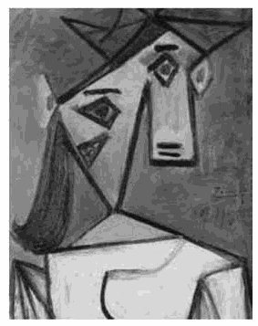
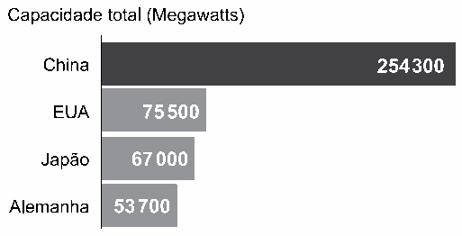
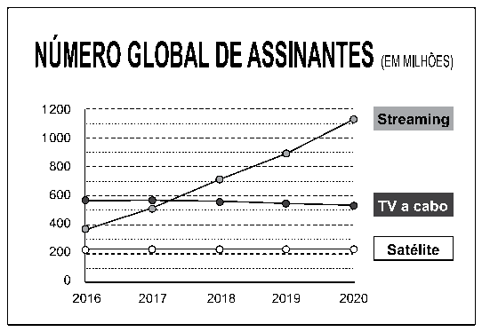
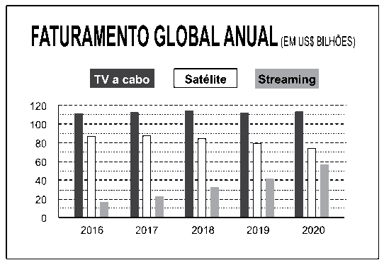
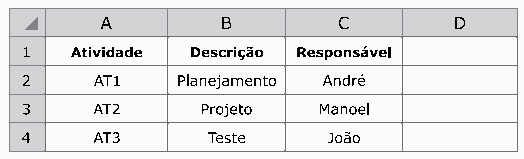
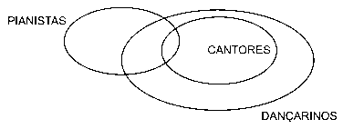
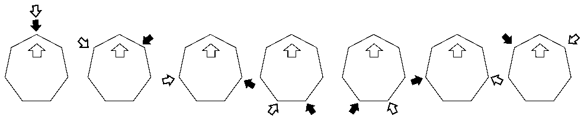
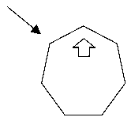
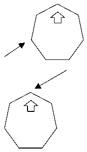
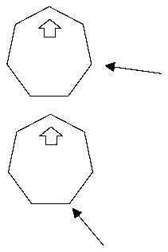

# TJ-SP 2021 — Escrevente Técnico Judiciário (prova oficial)

Prova objetiva oficial do concurso de Escrevente Técnico Judiciário do TJ-SP (2021), banca Vunesp, com 100 questões e o gabarito oficial da versão 2.
As figuras foram recortadas do caderno original. O gabarito comentado está no fim do arquivo.

<!-- Gerado por tools/src/prova_to_md.py a partir de 2021escrevente_tecnico_judiciario.pdf e 2021gabarito.txt. -->

## Língua Portuguesa

*Leia o texto para responder às questões de números 01 a 05.*
> Amor é para gastar
>
> Na economia da vida, o maior desperdício é fazer poupança de amor. Prejuízo na certa. Amor é para gastar, mostrar, ostentar. O amor, aliás, é a mais saudável forma de ostentação que existe no mundo.
>
> Vai por mim, amar é luxo só. Triste de quem sente e esconde, de quem sente e fica no joguinho dramático, de quem sente e guarda a sete chaves. Sinto muito.
>
> Amor é da boca para fora. Amor é um escândalo que não se abafa. “Eu te amo” é para ser dito, desbocadamente. Guardar “eu te amo” é prejudicial à saúde.
>
> Na economia amorosa, só existe pagamento à vista, missa de corpo presente. O amor não se parcela, não admite suaves prestações.
>
> Não existe essa de amor só amanhã, como na placa do fiado do boteco. Amor é hoje, aqui, agora... Amor não se sonega, amor é tudo a declarar.
>
> (Xico Sá, “Amor é para gastar”. Em: http://www.itatiaia.com.br)

**Q01.** O estabelecimento de sentido no texto se dá pela inter-relação entre a área do amor e a da

- A) psicologia, enfatizando-se que a primeira vira ostentação quando se faz joguinho dramático.
- B) finança, enfatizando-se que a primeira dispensa grandes investimentos para que logre êxito.
- C) etiqueta, enfatizando-se que a primeira pode trazer prejuízos à vida social se promove escândalos.
- D) saúde, enfatizando-se que a primeira pode trazer problemas físicos se o amor é exagerado.
- E) economia, enfatizando-se que a primeira exige o dispêndio de recursos de forma intensa.

**Q02.** A frase inicial do 2o parágrafo sintetiza o ponto de vista do autor: “Vai por mim, amar é luxo só.” Coerente com esse posicionamento, o autor reconhece que o amor é

- A) uma lembrança do passado que se legitima como poupança.
- B) um sentimento que deve ser declarado e vivido no tempo presente.
- C) uma dívida de boteco que se intensifica quando é paga aos poucos.
- D) uma ilusão que vai sendo construída ao longo da vida das pessoas.
- E) um desperdício na vida das pessoas se não for bem guardado.

**Q03.** De acordo com a norma-padrão, a reescrita de informações do texto está correta quanto à concordância verbal em:

- A) Tristes daqueles que sente e esconde, que sente e fica no joguinho dramático.
- B) Quando se usa sete chaves para guardar o amor, ele vai da boca para fora.
- C) Existe sentimentos, como o amor, que são escândalos e que não se abafa.
- D) Acontece que, quando há suaves prestações, o amor está sendo poupado.
- E) Joguinhos dramáticos expõe o perfil daquela pessoa que sente e esconde.

**Q04.** No trecho do 3o parágrafo – Guardar “eu te amo” é prejudicial à saúde. –, a crase mantém-se se a expressão destacada for substituída por:

- A) pessoa que o esconde.
- B) pessoas que o escondem.
- C) qualquer pessoa que o esconda.
- D) quem o esconde.
- E) todos que o escondem.

**Q05.** Releia as passagens do texto.

• Na economia amorosa, só existe pagamento à vista, missa de corpo presente. O amor não se parcela...

• Não existe essa de amor só amanhã, como na placa do fiado do boteco. Amor é hoje...

• Amor não se sonega, amor é tudo a declarar. Na organização e estruturação das informações no texto, conclui-se corretamente que, em cada par de expressões destacadas, as relações entre as ideias se baseiam no sentido de

- A) discrepância.
- B) consequência.
- C) semelhança.
- D) analogia.
- E) harmonia.

*Leia o texto para responder às questões de números 06 a 10.*
> Perto do apagão
>
> \_\_\_\_\_\_ a falta de chuvas nos últimos dois meses, inferiores ao padrão já escasso do mesmo período de 2020, ficou mais evidente a ameaça \_\_\_\_\_\_ a geração de energia se mostre insuficiente para manter o fornecimento até novembro, quando se encerra o período seco.
>
> Novas simulações do Operador Nacional do Sistema
>
> (ONS) mostram agravamento, com destaque para a região Sul, onde o nível dos reservatórios até 24 de agosto caiu para 30,7% – a projeção anterior apontava para 50% no fechamento do mês.
>
> Mesmo no cenário mais favorável, que pressupõe um amplo conjunto de medidas, como acionamento de grande capacidade de geração térmica, importação de energia e postergação de manutenção de equipamentos, o país chegaria \_\_\_\_\_\_ novembro praticamente sem sobra de potência, o que amplia a probabilidade de apagões.
>
> Embora se espere que tais medidas sejam suficientes para evitar racionamento neste ano, não se descartam sobressaltos pontuais, no contexto da alta demanda \_\_\_\_\_\_ o sistema será submetido.
>
> Se o regime de chuvas no verão não superar a média dos últimos anos, a margem de manobra para 2022 será ainda menor. Calcula-se que, nesse quadro, a geração térmica, mais cara, tenha de permanecer durante todo o período úmido, o que seria algo inédito.
>
> Desde já o país precisa considerar os piores cenários e agir com toda a prudência possível, com foco em investimentos na geração, modernização de turbinas em hidrelétricas antigas e planejamento para ampliar a resiliência do sistema.
>
> (Editorial. Folha de S.Paulo, 27.08.2021. Adaptado)

**Q06.** Em conformidade com a norma-padrão, as lacunas do texto devem ser preenchidas, respectivamente, com:

- A) Sobre ... que ... em ... de que
- B) Perante ... que ... à ... em que
- C) Com ... de que ... a ... a que
- D) Sob ... que ... em ... que
- E) Devido ... que ... a ... com que

**Q07.** As informações do editorial permitem concluir corretamente que

- A) a geração térmica, a importação de energia e a postergação de manutenção de equipamentos livram o país de um apagão.
- B) a geração de energia no país está comprometida pela falta de chuvas, o que exige atenção pelo risco de apagão.
- C) o regime das chuvas, que já chegou a causar preocupação no país pelo risco de apagão, estará normalizado até novembro.
- D) a geração de energia térmica em 2022 tenderá a estar mais cara, graças ao verão úmido e à superação dos índices pluviométricos.
- E) a previsão de chuvas para 2022 será um problema menor, considerando-se os níveis dos reservatórios em 50% em 2021.

**Q08.** Considere as passagens do texto.

• ... onde o nível dos reservatórios até 24 de agosto caiu para 30,7%... (2o parágrafo)

• ... a margem de manobra para 2022 será ainda menor. (5o parágrafo)

• ... o que seria algo inédito. (5o parágrafo)

No contexto em que estão empregadas, as formas verbais expressam, correta e respectivamente, sentido de:

- A) ação concluída; imperativo; hipótese.
- B) ação frequente; presente; certeza.
- C) ação anterior a outra; futuro; desejo.
- D) ação concluída; futuro; hipótese.
- E) ação frequente; presente; dúvida.

**Q09.** A reescrita do trecho do 5o parágrafo – Se o regime de chuvas no verão não superar a média dos últimos anos, a margem de manobra para 2022 será ainda menor. – está em conformidade com a norma-padrão e com o sentido do texto em:

- A) Por mais que o regime de chuvas no verão não supera a média dos últimos anos, a margem de manobra para 2022 será ainda menor.
- B) Ainda que o regime de chuvas no verão não supere a média dos últimos anos, a margem de manobra para 2022 será ainda menor.
- C) Desde que o regime de chuvas no verão não supera a média dos últimos anos, a margem de manobra para 2022 será ainda menor.
- D) Enquanto o regime de chuvas no verão não superar a média dos últimos anos, a margem de manobra para 2022 será ainda menor.
- E) Caso o regime de chuvas no verão não supere a média dos últimos anos, a margem de manobra para 2022 será ainda menor.

**Q10.** Nas passagens “postergação de manutenção de equipamentos” (3o parágrafo), “o que seria algo inédito” (4o parágrafo) e “ampliar a resiliência do sistema” (6o parágrafo), os termos destacados têm como sinônimos, correta e respectivamente:

- A) realização; original; capacidade de transformação.
- B) adiamento; sem precedentes; capacidade de recuperação.
- C) procrastinação; corrente; capacidade de manutenção.
- D) preterição; habitual; capacidade de modernização.
- E) adiantamento; convencional; capacidade de reintegração.

*Leia o texto para responder às questões de números 11 a 17.*
> Vida ao natural
>
> Pois no Rio tinha um lugar com uma lareira. E quando ela percebeu que, além do frio, chovia nas árvores, não pôde acreditar que tanto lhe fosse dado. O acordo do mundo com aquilo que ela nem sequer sabia que precisava como numa fome. Chovia, chovia. O fogo aceso pisca para ela e para o homem. Ele, o homem, se ocupa do que ela nem sequer lhe agradece; ele atiça o fogo na lareira, o que não lhe é senão dever de nascimento. E ela – que é sempre inquieta, fazedora de coisas e experimentadora de curiosidades – pois ela nem lembra sequer de atiçar o fogo; não é seu papel, pois se tem o seu homem para isso. Não sendo donzela, que o homem então cumpra a sua missão. O mais que ela faz é às vezes instigá-lo: “aquela acha*”, diz-lhe, “aquela ainda não pegou”. E ele, um instante antes que ela acabe a frase que o esclareceria, ele por ele mesmo já notara a acha, homem seu que é, e já está atiçando a acha. Não a comando seu, que é a mulher de um homem e que perderia seu estado se lhe desse ordem. A outra mão dele, a livre, está ao alcance dela. Ela sabe, e não a toma. Quer a mão dele, sabe que quer, e não a toma. Tem exatamente o que precisa: pode ter.
>
> Ah, e dizer que isto vai acabar, que por si mesmo não pode durar. Não, ela não está se referindo ao fogo, refere-se ao que sente. O que sente nunca dura, o que sente sempre acaba, e pode nunca mais voltar. Encarniça-se então sobre o momento, come-lhe o fogo, e o fogo doce arde, arde, flameja. Então, ela que sabe que tudo vai acabar, pega a mão livre do homem, e ao prendê-la nas suas, ela doce arde, arde, flameja.
>
> (Clarice Lispector, Os melhores contos
>
> [seleção Walnice Nogueira Galvão], 1996) * pequeno pedaço de madeira usado para lenha

**Q11.** No conto, o narrador explora a ideia de

- A) inversão de papéis de gênero.
- B) questionamento da liberdade.
- C) fugacidade do sentimento.
- D) desapego da vida ao natural.
- E) desalento dos apaixonados.

**Q12.** Em uma passagem do texto, o pronome é seguido do seu referente para evitar uma interpretação equivocada. Isso ocorre em:

- A) Ela sabe, e não a toma. Quer a mão dele, sabe que quer...
- B) ... e ao prendê-la nas suas, ela doce arde, arde, flameja.
- C) Ele, o homem, se ocupa do que ela nem sequer lhe agradece...
- D) ... ele por ele mesmo já notara a acha, homem seu que é...
- E) ... ele atiça o fogo na lareira, o que não lhe é senão dever de nascimento.

**Q13.** Encarniça-se então sobre o momento, come-lhe o fogo, e o fogo doce arde, arde, flameja. Então, ela que sabe que tudo vai acabar, pega a mão livre do homem, e ao prendê-la nas suas, ela doce arde, arde, flameja. A passagem final do texto permite concluir que

- A) a mulher decidiu desfrutar a situação romântica que o momento lhe propiciava.
- B) a mulher decidiu entregar-se com suavidade ao momento ao lado do homem.
- C) o casal rompeu, conscientes de que estavam de que tudo lhes era transitório.
- D) o homem vivia um sentimento diferente daquele da mulher, pois queria ser livre.
- E) o homem perdeu a mulher amada que foi consumida pelo fogo da lareira.

**Q14.** Identifica-se termo empregado em sentido figurado no trecho:

- A) Pois no Rio tinha um lugar com uma lareira.
- B) O fogo aceso pisca para ela e para o homem.
- C) ... ele atiça o fogo na lareira...
- D) Quer a mão dele, sabe que quer, e não a toma.
- E) ... ele por ele mesmo já notara a acha...

**Q15.** Assinale a alternativa em que a reescrita de informações textuais atende à norma-padrão de colocação pronominal.

- A) Ela acha que aquilo vai acabar. Não é ao fogo que refere-se, certamente refere-se ao que sente.
- B) Se apercebendo de que chovia nas árvores, ela não pôde acreditar que tanto lhe fosse dado.
- C) Ela às vezes instiga o homem, dizendo-lhe: “aquela acha ainda não pegou e você não atiçou-a”.
- D) Antes que ela esclareça onde está a acha, ele por ele mesmo já tinha notado-a, homem seu que é.
- E) Como ela esquece de atiçar o fogo, pois não é seu papel, o seu homem dedica-se a essa missão.

**Q16.** Assinale a alternativa em que a reescrita das informações do texto atende à norma-padrão de pontuação.

- A) Poder ter, é exatamente o que ela precisa e sabendo disso, ela não toma a mão do homem.
- B) A outra mão do homem, está ao alcance dela, e ela, apesar de saber disso não a toma.
- C) Ela sabe que o que sente, pode nunca mais voltar e então, sabe que tudo aquilo vai acabar.
- D) O homem, como não era donzela, que cumprisse, então, a sua missão de cuidar do fogo.
- E) Quando ela percebeu que, chovia, chovia, não pôde acreditar que tanto lhe fosse dado.

**Q17.** A repetição dos termos destacados tem a função de enfatizar uma ação na passagem:

- A) ... ele por ele mesmo já notara a acha, [...] e já está atiçando a acha.
- B) ... “aquela acha”, diz-lhe, “aquela ainda não pegou”.
- C) Chovia, chovia. O fogo aceso pisca para ela e para o homem.
- D) ... homem seu que é [...] que é a mulher de um homem...
- E) ... come-lhe o fogo, e o fogo doce arde, arde, flameja.

**Q18.** A inflação brasileira está fora do jogo. Para começar, a última projeção do mercado, de 7,11% em 2021, supera de longe a meta (3,75%) e até o limite de tolerância (5,25%) \_\_\_\_\_\_ pelo Conselho Monetário Nacional. Em segundo lugar, a alta de preços \_\_\_\_\_\_ no mercado para o próximo ano, de 3,93%, está bem acima do centro da meta (3,50%). Se as previsões estiverem \_\_\_\_\_\_, os preços continuarão subindo rapidamente, enquanto o crescimento econômico será igual ou até inferior a 2% – abaixo do medíocre, portanto.

(https://opiniao.estadao.com.br. Adaptado) Em conformidade com a norma-padrão, as lacunas do texto devem ser preenchidas, respectivamente, com:

- A) fixados ... estimada ... certas
- B) fixadas ... estimado ... certo
- C) fixado ... estimadas ... certas
- D) fixado ... estimados ... certa
- E) fixada ... estimados ... certo

*Leia o texto para responder às questões de números 19 a 22.*
> O Dia Nacional de Combate ao Fumo (29 de agosto) foi criado em 1986, com o objetivo de reforçar as ações nacionais de conscientização sobre os danos sociais, de saúde, econômicos e ambientais causados pelo tabaco.
>
> A campanha promovida pelo Inca (Instituto Nacional de Câncer) este ano chama-se Comprometa-se a parar de fumar. O instituto lembra que o tabagismo é um fator de risco importante para a Covid-19, por isso parar de fumar se torna uma medida de proteção à saúde de todos os cidadãos.
>
> Peças criadas para redes sociais com a frase “Cringe mesmo é fumar” fazem parte da campanha. Os materiais desenvolvidos pelo Ministério da Saúde, em parceria com a Organização Pan-Americana de Saúde, destacam a importância de proteger a saúde de crianças, jovens e adolescentes, que são alvo de estratégias de venda para que possam se tornar um mercado repositor de novos consumidores, já que o consumo de tabaco mata mais da metade de seus usuários.
>
> Vale lembrar que os cigarros eletrônicos, ou pods, não são opções mais saudáveis ao cigarro tradicional. No Brasil, a comercialização desses dispositivos é proibida, já que não foi autorizada pela Agência Nacional de Vigilância Sanitária
>
> (Anvisa). Muitos países que liberaram sua venda estão revendo as suas posições depois de novas orientações da Organização Mundial da Saúde (OMS).
>
> (https://doutorjairo.uol.com.br)
>
> Cringe: Para os integrantes da geração Z, é um adjetivo usado para classificar pessoas que fazem coisas fora de moda, ultrapassadas, cafonas mesmo. Eles também costumam classificar atitudes ou objetos. Nesse caso, ela é usada como sinônimo de vergonha alheia.
>
> (https://g1.globo.com)

**Q19.** De acordo com as informações do texto, é correto afirmar que o slogan da peça para as redes sociais “Cringe mesmo é fumar” assevera que

- A) ser criança, jovem ou adolescente no mundo de hoje tem a vantagem de poder escolher opções saudáveis ao cigarro tradicional, como é o caso dos pods.
- B) buscar uma vida saudável implica fazer escolhas e, nesse caso, o uso de cigarros eletrônicos é uma saída para crianças, jovens e adolescentes afastarem-se do tabaco.
- C) fumar está na contramão de uma vida saudável e, por essa razão, é importante que crianças, jovens e adolescentes evitem virar reposição de novos consumidores.
- D) estar em sintonia com as orientações da OMS permite que crianças, jovens e adolescentes se tornem alvo de estratégias de venda da indústria do tabaco.
- E) desenvolver a conscientização de crianças, jovens e adolescentes tem como finalidade torná-los cringes, perfil que se contrapõe às tendências das redes sociais.

**Q20.** De acordo com as informações do 2o parágrafo, parar de fumar, no contexto da pandemia vivida no mundo, é uma ação de

- A) medo, porque se juntas duas doenças de alto poder letal às pessoas.
- B) empatia, porque envolve a preocupação com o coletivo social.
- C) orgulho, porque reforça a determinação para superar o vício.
- D) exibicionismo, porque as mortes pela Covid-19 não diminuirão.
- E) respeito, porque devolve a autoestima para a maioria da população.

**Q21.** Os materiais desenvolvidos pelo Ministério da Saúde, em parceria com a Organização Pan-Americana de Saúde, destacam a importância de proteger a saúde de crianças, jovens e adolescentes, que são alvo de estratégias de venda para que possam se tornar um mercado repositor de novos consumidores, já que o consumo de tabaco mata mais da metade de seus usuários. No trecho destacado do 3o parágrafo, há três orações que expressam, correta e respectivamente, sentidos de

- A) explicação, finalidade e causa.
- B) restrição, causa e consequência.
- C) adição, comparação e consequência.
- D) causa, consequência e causa.
- E) explicação, finalidade e comparação.

**Q22.** Nas passagens – proteção à saúde de todos os cidadãos (2o parágrafo) – e – proteger a saúde de crianças, jovens e adolescentes (3o parágrafo) –, o substantivo “cidadão” faz o plural com “ãos”, e o substantivo feminino “crianças” refere-se tanto ao sexo masculino quanto ao feminino. Substantivos com essas mesmas propriedades gramaticais, empregados em sua forma singular, estão destacados, correta e respectivamente, em:

- A) Durante a missa, o padre pediu a atenção a todos os presentes e orientou aos fiéis para que fossem bons com toda pessoa.
- B) Na sessão de terapia, o rapaz parecia fazer uma confissão ao referir-se à forma como tratava sua colega de trabalho.
- C) Quando saiu da igreja, o sacristão ficou aterrorizado com o acidente e preocupado para saber se houve alguma vítima.
- D) O patrão chegou alterado na empresa, tinha sido informado de que um assaltante estava rondando aquela região.
- E) O tabelião confundiu-se na hora de assinar o contrato, e pediu desculpas ao agente que esperava o documento para conferir.

*Leia o texto para responder às questões de números 23 e 24.*
> Motivação é a energia que nos leva \_\_\_\_\_\_ agir – e não sou a única pessoa que acha difícil encontrar essa motivação. Alguns de nós sofreram um burnout total depois de mais de um ano de perdas, dor e problemas relacionados \_\_\_\_\_\_ pandemia. Outros se sentem mais como estou me sentindo – nada está terrivelmente errado, mas não conseguimos encontrar inspiração. Seja qual for a situação em que nos encontramos, um exame mais profundo da motivação pode nos dar mais incentivo para avançar, não só no dia \_\_\_\_\_\_ dia, mas num futuro incerto.
>
> (Cameron Walker, The New York Times.
>
> Em: https://economia.estadao.com.br. Adaptado)

**Q23.** De acordo com a norma-padrão da língua portuguesa, as lacunas do texto devem ser preenchidas, respectivamente, com

- A) a ... a ... a
- B) à ... à ... a
- C) a ... à ... à
- D) a ... à ... a
- E) à ... à ... à

**Q24.** Em conformidade com a norma-padrão e o sentido do texto, a frase – ... e não sou a única pessoa que acha difícil encontrar essa motivação. – está adequadamente reescrita em:

- A) ... e outras pessoas, tanto quanto eu, acham difícil encontrar-na.
- B) ... e eu e também outras pessoas achamos difícil encontrar ela.
- C) ... e outras pessoas, tal qual eu, achamos difícil encontrar-lhe.
- D) ... e eu e outras pessoas também acham difícil encontrar esta.
- E) ... e outras pessoas, assim como eu, acham difícil encontrá-la.

## Conhecimentos em Direito

## Direito Penal

**Q25.** O proprietário do veículo que indica falsamente outra pessoa como condutora do veículo no momento da infração de trânsito em formulário (notificação de multa) da autoridade de trânsito, em tese, pratica o crime de:

- A) Falsificação de documento público.
- B) Falsidade ideológica.
- C) Falsificação de documento particular.
- D) Falsa identidade.
- E) Uso de documento falso.

**Q26.** A respeito do crime de petrechos de falsificação, previsto no artigo 294, do Código Penal, é correto dizer que

- A) Admite a modalidade culposa.
- B) É crime próprio de funcionário público.
- C) É tipo misto alternativo.
- D) É crime material.
- E) É instantâneo.

**Q27.** Mévio, aprovado em processo seletivo para trabalhar como operador de trator, a fim de cumprir exigência da empresa contratante, apresenta atestado médico, por ele adquirido, em que consta a falsa informação de não uso de medicação controlada, de uso contínuo. A respeito da conduta de Mévio, é correto dizer que, em tese, caracteriza o crime de

- A) falsidade material de atestado ou certidão.
- B) certidão ou atestado ideologicamente falso.
- C) falsidade ideológica.
- D) uso de documento falso.
- E) falsidade de atestado médico.

**Q28.** Caio, tendo conhecimento que possui contra si mandado de prisão expedido por falta de pagamento de pensão alimentícia, ao ser parado em blitz policial, apresenta ao policial carteira de habilitação de Tício, amigo que estava no carro e consentiu com a apresentação de seu documento. A respeito da situação hipotética, assinale a alternativa correta.

- A) Caio e Tício, em tese, praticaram o crime previsto no artigo 308, do Código Penal (usar como próprio documento de identificação alheio).
- B) Caio, em tese, praticou o crime de falsa identidade, previsto no artigo 307, do Código Penal; enquanto Tício não incorreu em qualquer prática delitiva, visto que sua conduta é atípica.
- C) Caio, em tese, praticou o crime de falsa identidade, previsto no artigo 307, do Código Penal; enquanto Tício, em tese, praticou o crime previsto no artigo 308, do Código Penal (ceder documento de identificação para outrem).
- D) Caio e Tício, em tese, praticaram o crime de falsa identidade, previsto no artigo 307, do Código Penal, em coautoria.
- E) Caio não incorreu em qualquer prática delitiva, haja vista o direito fundamental à não autoincriminação.

**Q29.** Tício, funcionário do órgão privado responsável pela realização de concurso público, chateado por não lhe ter sido conferido direito a férias no período almejado, objetivando denegrir a imagem da instituição, fez cópia de uma das versões da prova, sigilosa, já que ainda não aplicada, e a divulgou na internet. Tício não auferiu qualquer vantagem com a divulgação, tendo por móvel apenas abalar a imagem da instituição em que trabalhava. No entanto, em razão da divulgação, o concurso foi adiado e toda a prova refeita. Sobre a situação hipotética, é correto dizer que

- A) a conduta de Tício é atípica, pois inexistiu vantagem com a violação do sigilo da prova, elemento comum aos crimes de fraude em certames de interesse público; violação de sigilo funcional e impedimento, perturbação ou fraude de concorrência.
- B) Tício, em tese, praticou o crime de impedimento, perturbação ou fraude de concorrência.
- C) Tício, em tese, praticou o crime de violação de sigilo funcional.
- D) a conduta de Tício é atípica, já que ele não é funcionário público, condição necessária do agente nos crimes de fraude em certames de interesse público; violação de sigilo funcional e de impedimento, perturbação ou fraude de concorrência.
- E) Tício, em tese, praticou o crime de fraudes em certames de interesse público.

**Q30.** Sobre os crimes contra a Administração da Justiça, previstos no Código Penal, assinale a alternativa correta.

- A) O crime de exploração de prestígio (art. 357, do CP) é próprio, podendo ser praticado apenas pelos sujeitos previstos no tipo penal.
- B) Dar causa a ação de improbidade administrativa, imputando a alguém ato improbo de que sabe inocente, valendo-se de nome suposto, em tese, caracteriza o crime de denunciação caluniosa.
- C) O crime de exercício arbitrário das próprias razões, previsto no artigo 345, do CP, somente se procede mediante queixa.
- D) O crime de favorecimento pessoal caracteriza-se pelo auxílio prestado a autor de crime, a fim de que ele escape da ação das autoridades públicas, desde que o crime praticado seja punido com reclusão.
- E) Oferecer dinheiro a testemunha para fazer afirmação falsa em depoimento, em tese, caracteriza o crime de coação no curso do processo, previsto no artigo 344, do CP.

## Direito Processual Penal

**Q31.** A respeito do impedimento e da suspeição do Juiz, é correto afirmar que

- A) o Juiz restará suspeito para atuar em processo em que o próprio já tenha atuado como autoridade policial ou mesmo órgão do Ministério Público.
- B) as causas de impedimento e suspeição do Juiz não se aplicam aos serventuários e servidores da justiça.
- C) mesmo dissolvido o casamento, ainda que sem filhos em comum, o Juiz não poderá figurar em processos em que são partes os pais e irmãos do ex-cônjuge.
- D) as causas de impedimento estão relacionadas ao animus subjetivo do juiz quanto às partes; enquanto as de suspeição referem-se a vínculos objetivos do Juiz com o processo.
- E) o Juiz restará impedido de atuar no processo se ele ou seu cônjuge, seus ascendentes ou descendentes estiverem respondendo a processo por fato análogo.

**Q32.** A respeito da citação e intimação do acusado, nos termos do Código de Processo Penal, assinale a alternativa correta.

- A) Estando o acusado no estrangeiro, em lugar conhecido, a citação dar-se-á por carta rogatória, suspendendo-se o curso do prazo prescricional até o efetivo cumprimento.
- B) Citado por hora certa, o não comparecimento do réu implicará a suspensão do processo e do prazo prescricional, podendo o Juiz decretar-lhe a prisão preventiva.
- C) Na hipótese de suspeita de ocultação do réu, para se furtar a citação, certificada pelo oficial de justiça, o Juiz determinará a citação, por edital.
- D) Intimado pessoalmente para qualquer ato, o não comparecimento do réu implicará a suspensão do processo e do prazo prescricional, podendo o Juiz decretar-lhe a prisão preventiva.
- E) São previstas a citação pessoal, por hora certa, por edital, por requisição, na hipótese de réu militar e via postal, na hipótese de réu preso.

**Q33.** São causas de rejeição da denúncia e absolvição sumária, respectivamente, previstas nos artigos 395 e 397, do Código de Processo penal:

- A) inépcia e falta de justa causa para a ação penal.
- B) falta de justa causa para a ação penal e falta de condição para o exercício da ação penal.
- C) inépcia e prescrição.
- D) existência manifesta de excludente de ilicitude do fato e falta de condições para o exercício da ação penal.
- E) inimputabilidade e atipicidade.

**Q34.** A respeito dos recursos e das ações constitucionais, previstos no Código de Processo Penal, assinale a alternativa correta:

- A) Da decisão de pronúncia ou impronúncia do réu, nos processos da competência do tribunal de júri, caberá apelação.
- B) A interposição de recursos será sempre voluntária, inexistindo hipótese de interposição de recurso de ofício pelo juiz.
- C) Das decisões proferidas pelos Tribunais, quando não unânimes e favoráveis ao réu, caberão embargos infringentes, a serem interpostos pelo órgão de acusação, no prazo de 10 dias.
- D) A revisão criminal tem por objeto tanto inocentar o condenado quanto diminuir-lhe a pena, na hipótese de surgimento de circunstâncias que autorizem ou determinem diminuição especial da pena.
- E) A legitimidade para impetrar Habeas Corpus é privativa do advogado, admitindo-se, excepcionalmente, o Ministério Público como fiscal da lei.

**Q35.** A respeito dos procedimentos ordinário e sumário, de acordo com o texto legal previsto no Código de Processo Penal, é correto afirmar que:

- A) em ambos os procedimentos, as alegações finais serão orais, apresentadas em audiência, admitindo-se memoriais por escrito, no prazo de 03 dias, em caso de complexidade do feito.
- B) em ambos os procedimentos, em regra, as alegações finais serão por escrito, sendo facultada a apresentação oral, em audiência, caso haja concordância de todas as partes.
- C) no procedimento ordinário, admitem-se alegações finais por escrito, no prazo de 05 (cinco) dias e, no sumário, no prazo de 03 dias.
- D) no procedimento ordinário, as alegações finais serão por escrito e, no sumário, em regra, orais, apresentadas em audiência.
- E) no procedimento ordinário, admitem-se alegações finais por escrito quando há elevado número de acusados, regra inaplicável ao procedimento sumário.

**Q36.** A respeito do procedimento relativo ao Tribunal do Júri, assinale a alternativa correta.

- A) Oferecida a denúncia por crime de competência do Tribunal do Júri, o Juiz Singular pode, desde logo, rejeitá-la, se presentes as hipóteses previstas no artigo 395, do Código de Processo Penal.
- B) Recebida a denúncia, não sendo localizado o réu, para fins de citação pessoal, far-se-á a citação por edital. Findo o prazo fixado no edital, caso o réu não compareça, o juiz lhe nomeará defensor, prosseguindo o feito, até a finalização da fase de pronúncia.
- C) Citado o acusado, não apresentada a resposta à acusação no prazo legal, o Juiz nomeará defensor para oferecê-la, no prazo de 05 dias.
- D) O desaforamento do julgamento para outra Comarca da mesma região poderá ser feito apenas a requerimento do acusado.
- E) Encerrada a instrução processual da primeira fase do Júri, poderá o Juiz pronunciar o acusado, impronunciar, absolver sumariamente ou reconhecer a prática de crime não sujeito à competência do Tribunal do Júri, proferindo, desde logo, a sentença condenatória.

**Q37.** A respeito da Lei no 9.099/95, é correto afirmar que:

- A) a transação penal, nas ações penais públicas condicionadas à representação, oferecida pelo Ministério Público ao autor da infração e por ele aceita, não será homologada pelo Juiz se não contar com a anuência da vítima.
- B) na eventual reunião de processos, perante o juízo comum, decorrentes da aplicação de regra de conexão e continência, às infrações de menor potencial ofensivo aplicar-se-ão os institutos da transação penal e composição dos danos civis.
- C) são infrações de menor potencial ofensivo as contravenções penais e os crimes cuja pena mínima não exceda a 1 (um) ano.
- D) a suspensão condicional do processo, prevista no artigo 89 da Lei, aplica-se aos crimes cuja pena mínima não exceda a 2 (dois) anos.
- E) não cabe prisão em flagrante nos crimes de menor potencial ofensivo.

## Direito Processual Civil

**Q38.** Mariana estava voltando para casa com um carro dirigido por um motorista de aplicativo. No trajeto para casa, o carro capotou em uma curva e, como consequência, Mariana ficou internada por três semanas experimentando diversos gastos médicos. Buscando ressarcir seus gastos, Mariana propõe ação de indenização por danos materiais em face de Cleber, o motorista, alegando que ele foi imprudente e estava trafegando acima da velocidade permitida na via. A ação foi proposta perante a 5a Vara Cível da Comarca de Santa Madalena, cujo Chefe de Secretaria era amigo íntimo de Cleber. No momento de produção de provas, o juiz nomeou perito para averiguar se Cleber estava trafegando ou não acima da velocidade permitida na via. Cleber nomeou assistente técnico para auxiliar na perícia. O assistente técnico, no entanto, era proprietário do imóvel que Mariana locava e autor da ação de despejo que estava em fase de recurso perante a 2a Vara Cível da Comarca de Santa Madalena. Diante da situação hipotética, Mariana poderá alegar que, em relação do processo de indenização,

- A) o assistente técnico é impedido.
- B) o assistente técnico é suspeito.
- C) o chefe de Secretaria é suspeito.
- D) o chefe de Secretaria é impedido.
- E) tanto o chefe de Secretaria como o assistente técnico são suspeitos.

**Q39.** A citação poderá ser feita em qualquer lugar em que se encontre o réu, o executado ou o interessado. No entanto, não se fará a citação, salvo para evitar o perecimento do direito

- A) de noivos, nos 5 (cinco) primeiros dias seguintes ao casamento.
- B) de cônjuge, de companheiro ou de qualquer parente do morto, consanguíneo ou afim, em linha reta ou na linha colateral em terceiro grau, no dia do falecimento e nos 7 (sete) dias seguintes.
- C) de doente, enquanto grave o seu estado.
- D) quando se verificar que o citando é mentalmente incapaz ou está impossibilitado de recebê-la.
- E) de quem estiver participando de ato de culto religioso, desde que aos domingos.

**Q40.** A petição inicial da ação, que visa à prestação de tutela cautelar em caráter antecedente, indicará a lide e seu fundamento, a exposição sumária do direito que se objetiva assegurar e o perigo de dano ou o risco ao resultado útil do processo. No que diz respeito ao procedimento da tutela cautelar requerida em caráter antecedente, é correto afirmar:

- A) a causa de pedir poderá ser aditada no momento de formulação do pedido principal.
- B) se por qualquer motivo cessar a eficácia da tutela cautelar, é permitido à parte renovar o pedido, sob o mesmo fundamento, no prazo de 30 (trinta) dias.
- C) o pedido principal deverá ser formulado em separado do pedido de tutela cautelar.
- D) apresentado o pedido principal, as partes serão intimadas para a audiência de conciliação ou de mediação, sendo necessária nova citação do réu.
- E) efetivada a tutela cautelar, o pedido principal terá de ser formulado pelo autor no prazo de 30 (trinta) dias, caso em que será apresentado nos mesmos autos em que deduzido o pedido de tutela cautelar, dependendo de novas custas processuais.

**Q41.** Joana assinou um contrato de prestação de serviços com Pedro, no valor de R$ 200,00 (duzentos reais mensais) no qual restou estabelecido que ele entregaria, mensalmente, em sua casa de campo, uma cesta de alimentos ou de bebidas. Passados oito meses, Pedro não entregou nenhuma cesta e, por isso, Joana decidiu propor ação de obrigação de fazer em face de Pedro para que ele cumprisse o contratado.

Diante da situação hipotética, considerando que

- A) Pedro ainda não foi citado, Joana poderá, até o saneamento do processo, alterar o pedido, independentemente de consentimento do réu.
- B) o pedido deve ser certo e determinado, compreendem-se no principal os juros legais, a correção monetária, devendo ser especificado, de forma apartada, as verbas de sucumbência, inclusive os honorários advocatícios.
- C) o pedido é cumulativo, é lícito formular mais de um pedido em ordem subsidiária, a fim de que o juiz conheça do posterior, quando não acolher o anterior.
- D) o pedido é alternativo, o juiz assegurará ao devedor o direito de cumprir a prestação de um ou de outro modo, ainda que o autor não tenha formulado pedido alternativo.
- E) a ação que tem por objeto cumprimento de obrigação em prestações sucessivas, deverá haver declaração expressa do autor para que sejam incluídas na condenação, enquanto durar a obrigação.

**Q42.** Dentre os recursos previstos no Código de Processo Civil, é correto afirmar que os embargos de declaração

- A) consideram-se incluídos no acórdão os elementos que o embargante suscitou, para fins de pré-questionamento, desde que os embargos de declaração sejam admitidos e o tribunal superior considere existentes erro, omissão, contradição ou obscuridade.
- B) serão opostos, no prazo de 5 (cinco) dias, em petição dirigida ao juiz, com indicação do erro, obscuridade, contradição ou omissão, mediante preparo no valor de um por cento sobre o valor da causa.
- C) possuem efeito suspensivo e interrompem o prazo para a interposição de recurso.
- D) podem ser opostos contra qualquer decisão judicial para esclarecer obscuridade ou eliminar contradição, considerando-se obscura a decisão que deixe de se manifestar sobre tese firmada em julgamento de casos repetitivos aplicável ao caso sob julgamento.
- E) quando manifestamente protelatórios, sujeitam o embargante a pagar ao embargado multa não excedente a dois por cento sobre o valor atualizado da causa, desde que previsto em decisão fundamentada do juiz ou do tribunal.

**Q43.** É permitido nos Juizados Especiais Cíveis

- A) que os atos processuais sejam realizados em horário noturno, sendo que a prática de atos processuais em outras comarcas poderá ser solicitada por qualquer meio idôneo de comunicação.
- B) a citação por correspondência, com aviso de recebimento em mão própria, por oficial de justiça, independentemente de mandado ou carta precatória ou por edital.
- C) a propositura de ações de alimentos, desde que o valor não exceda a quarenta vezes o salário mínimo.
- D) o incidente de desconsideração da personalidade jurídica e a assistência.
- E) mandato verbal ao advogado para assinar declaração de hipossuficiência econômica.

**Q44.** A Empresa NTO – EPP é proprietária de um grande terreno na cidade de Andrenópolis, que tem por confinante uma praça Municipal. Passando por dificuldades financeiras, a empresa NTO decide vender o seu terreno, no entanto, quando foi verificar as medidas exatas, seus sócios perceberam que parte do terreno da empresa estava sendo utilizado como estacionamento da praça. Inconformados, decidem, em nome da empresa, propor ação demarcatória em face do Município de Andrenópolis. A ação foi proposta perante o Juizado Especial da Fazenda Pública de Andrenópolis, a certidão da propriedade e os demais documentos necessários foram juntados ao processo e foi dado à causa o valor de 50 (cinquenta salários mínimos). O juiz recebeu a ação e, de ofício, deferiu tutela de urgência de natureza cautelar para evitar dano de difícil ou incerta reparação.

Diante da situação hipotética, assinale a alternativa correta.

- A) A ação não é de competência do Juizado Especial da Fazenda Pública, pois ultrapassa o valor de 40 (quarenta) salários mínimos.
- B) A ação não é de competência do Juizado Especial da Fazenda Pública, pois trata de ação de demarcação.
- C) É defeso ao juiz, nas causas propostas perante o Juizado Especial da Fazenda Pública, deferir, de ofício, providências cautelares no curso do processo.
- D) Haverá prazo em dobro apenas para a interposição de recursos, devendo a citação para a audiência de conciliação ser efetuada com antecedência mínima de 15 (quinze) dias.
- E) A ação deve ser julgada improcedente considerando a incompetência absoluta do Juizado Especial da Fazenda Pública, uma vez que o autor é Empresa de Pequeno Porte.

## Direito Constitucional

**Q45.** Assinale a alternativa que contempla hipótese de crime para o qual a Constituição Federal não veda o arbitramento de fiança.

- A) Prática do racismo.
- B) Ação de grupos armados contra a ordem constitucional e o Estado Democrático.
- C) Crime doloso contra a vida.
- D) Tráfico ilícito de entorpecentes e drogas afins.
- E) Crime hediondo.

**Q46.** Considerando o disposto na Constituição Federal, assinale a alternativa que aponta uma situação que, em tese, viola um dos direitos ou garantias individuais do cidadão brasileiro.

- A) Mandado judicial de prisão cumprido por policiais civis às 9h00 dentro da residência do réu.
- B) Policial, sem mandado judicial, adentra em domicílio, durante à noite, sem consentimento do morador, para efetuar prisão em flagrante.
- C) Suspensão das atividades de associação civil, de fins lícitos, por decisão judicial, em caráter liminar.
- D) Ordem de prisão civil por dívida do responsável pelo inadimplemento voluntário e inescusável de obrigação alimentícia.
- E) Ordem emanada de juiz que determina à polícia que seja efetuada a escuta telefônica de réu em processo civil de reparação de danos.

**Q47.** É um dos direitos constitucionais dos trabalhadores urbanos e rurais:

- A) participação nos lucros, ou resultados, vinculada à última remuneração do trabalhador.
- B) relação de emprego protegida contra despedida arbitrária com ou sem justa causa, nos termos de lei complementar, que preverá indenização compensatória.
- C) licença à gestante, sem prejuízo do emprego e do salário, com a duração de 180 (cento e oitenta) dias.
- D) assistência gratuita aos filhos e dependentes desde o nascimento até 5 (cinco) anos de idade em creches e pré-escolas.
- E) jornada de oito horas para o trabalho realizado em turnos ininterruptos de revezamento, salvo negociação coletiva.

**Q48.** Considerando as hipóteses possíveis de naturalização brasileira, assinale a alternativa que descreve uma situação de naturalização compatível com a Constituição Federal.

- A) O nascido no estrangeiro, de pai brasileiro ou mãe brasileira, desde que qualquer deles esteja a serviço da República Federativa do Brasil.
- B) O nascido no estrangeiro de pai brasileiro ou de mãe brasileira, registrado em repartição brasileira ou que venha a residir no Brasil e opte, a qualquer tempo, pela nacionalidade brasileira.
- C) O estrangeiro de qualquer nacionalidade, residente na República Federativa do Brasil há mais de dez anos ininterruptos e sem condenação penal.
- D) Cidadão originário de país de língua portuguesa, idôneo moralmente, residente há um ano ininterrupto no Brasil, e, que, na forma da lei, adquirir a nacionalidade brasileira.
- E) O nascido na República Federativa do Brasil, com pais estrangeiros que não estejam a serviço de seu país.

**Q49.** É um cargo público privativo de brasileiro nato:

- A) de Presidente da Câmara dos Deputados.
- B) de Procurador Geral da República.
- C) de Senador da República.
- D) de Ministro do Tribunal de Contas da União.
- E) de Presidente do Superior Tribunal de Justiça.

**Q50.** Nos moldes da Constituição Federal, o servidor público titular de cargo efetivo, que tenha sofrido limitação em sua capacidade física ou mental, poderá, atendidas as demais exigências, ser readaptado,

- A) para exercício de novo cargo compatível com a sua limitação, devendo receber a remuneração do cargo de destino.
- B) para exercício de novo cargo compatível com a sua limitação, podendo o servidor optar entre a remuneração do cargo de origem e a do cargo de destino.
- C) para exercício do mesmo cargo, com os necessários ajustes à sua limitação, garantida a mesma remuneração do cargo.
- D) para exercício de novo cargo compatível com a sua limitação, devendo receber pelo menos 70% (setenta por cento) da remuneração do cargo de origem.
- E) para exercício de novo cargo compatível com a sua limitação, mantida a remuneração do cargo de origem.

**Q51.** No tocante às disposições constitucionais, que tratam do tema dos servidores públicos, é correto afirmar que

- A) aplica-se ao agente público ocupante, exclusivamente, de cargo em comissão declarado em lei de livre nomeação e exoneração, de outro cargo temporário, inclusive mandato eletivo, o Regime Próprio de Previdência Social dos Servidores.
- B) o membro de Poder, o detentor de mandato eletivo, os Ministros de Estado e os Secretários Estaduais e Municipais serão remunerados exclusivamente por subsídio fixado em parcela única, que poderá ser acrescido de gratificação, adicional, abono, prêmio e verba de representação.
- C) é vedada a incorporação de vantagens de caráter temporário ou vinculadas ao exercício de função de confiança ou de cargo em comissão à remuneração do cargo efetivo.
- D) por motivos de segurança, é expressamente vedado aos Poderes Executivo, Legislativo e Judiciário divulgar ou publicar os valores do subsídio e da remuneração dos cargos e empregos públicos dos seus respectivos servidores.
- E) o tempo de contribuição federal, estadual, distrital ou municipal e o tempo de serviço público correspondente serão contados para fins de disponibilidade e aposentadoria do servidor.

## Direito Administrativo

**Q52.** Cícero, que é funcionário público estadual, havia sido demitido do serviço público, mas, posteriormente, foi absolvido pela Justiça, em decisão que negou a existência da sua autoria. Nessa situação hipotética, portanto, considerando o Estatuto dos Funcionários Públicos Civis do Estado de São Paulo, é correto afirmar que Cícero deverá ser

- A) reincorporado ao serviço público, em cargo equivalente ao que ocupava e com todos os direitos e vantagens devidas, mediante certidão do cartório judicial que comprove a decisão absolutória.
- B) reintegrado ao serviço público, em cargo superior ao que ocupava e com todos os direitos e vantagens devidas, mediante certidão do cartório judicial que comprove o teor da decisão absolutória.
- C) readmitido ao serviço público, no mesmo cargo ou em cargo equivalente, com todos os direitos e vantagens devidas, mediante simples comprovação do trânsito em julgado de decisão judicial.
- D) reintegrado ao serviço público, no cargo que ocupava e com todos os direitos e vantagens devidas, mediante simples comprovação do trânsito em julgado de decisão judicial.
- E) readmitido em outro cargo diferente do que ocupava, sem os direitos e vantagens do cargo anterior, mediante certidão do cartório judicial que comprove o teor da decisão absolutória.

**Q53.** Medéia, funcionária pública estadual, praticou, quando em atividade, falta grave para a qual é cominada a pena de demissão prevista no Estatuto dos Funcionários Públicos Civis do Estado de São Paulo. Porém, a portaria que instaurou o respectivo processo administrativo para apuração da infração foi publicada somente dois anos após Medéia ter se aposentado do serviço público. Nessa situação hipotética, considerando, ainda, o fato de que a falta cometida ocorreu um ano antes de sua aposentadoria, é correto afirmar que Medéia

- A) estará sujeita apenas às penas de multa e ressarcimento aos cofres públicos dos valores recebidos durante todo o período da sua aposentadoria.
- B) poderá ter sua aposentadoria cassada, uma vez que a inatividade não impede a aplicação da sanção e não se operou a prescrição nesse caso.
- C) não mais poderá ser punida em razão de ter se aposentado, independentemente da data da portaria que instaurou o processo administrativo.
- D) estaria sujeita à pena de cassação de sua aposentadoria, mas a portaria foi instaurada intempestivamente, tendo ocorrido a prescrição da pena.
- E) deverá retornar ao serviço público, para trabalhar pelo mesmo período que ficou aposentada, devendo pagar multa de até 5 vezes o valor dos seus proventos mensais.

**Q54.** Considerando o disposto no Estatuto dos Funcionários Públicos Civis do Estado de São Paulo, assinale a alternativa correta a respeito das normas do processo administrativo.

- A) Não tendo o acusado recursos financeiros ou negando-se a constituir advogado, o presidente nomeará advogado dativo.
- B) Não poderá ser encarregado da apuração, parente consanguíneo ou afim, em linha reta ou colateral, podendo atuar apenas como secretário no processo.
- C) Não comparecendo o acusado no interrogatório, será decretada sua condenação, podendo, contudo, participar dos demais atos do processo até a fase recursal.
- D) O acusado poderá, até a fase do seu interrogatório, constituir advogado para prosseguir na sua defesa, vedada a constituição depois dessa fase processual.
- E) O acusado tem o direito de assistir à inquirição do denunciante, para que tenha ciência pessoal das declarações que aquele deverá prestar em audiência.

**Q55.** A respeito das testemunhas no processo administrativo, o Estatuto dos Funcionários Públicos Civis estabelece que

- A) o presidente e cada acusado poderão arrolar até 5 (cinco) testemunhas.
- B) se tratando de servidor público, sua oitiva em audiência se dará em segredo de justiça.
- C) nenhuma testemunha poderá se recusar a depor em razão de função, ministério, ofício ou profissão.
- D) o Presidente poderá recusar até três testemunhas arroladas pela defesa, que poderá substituí-las, se quiser.
- E) as testemunhas de defesa terão competência para fazer prova dos antecedentes do acusado.

**Q56.** A teor do que dispõe o Estatuto dos Funcionários Públicos Civis do Estado de São Paulo a respeito dos recursos e da revisão, no âmbito do processo administrativo, é correto afirmar que

- A) a autoridade que aplicou a penalidade não poderá apreciar o pedido de revisão quanto à sua admissibilidade.
- B) nenhum recurso será admitido se incorretamente denominado ou endereçado.
- C) do recurso deverá constar a exposição das razões de inconformismo e o comprovante do recolhimento da taxa recursal.
- D) não caberá recurso ou pedido de reconsideração de decisão tomada pelo Governador do Estado em única instância.
- E) entre outros efeitos, a decisão que julgar procedente a revisão poderá modificar a pena ou anular o processo.

**Q57.** Perseu cometeu ato de improbidade que causou lesão ao patrimônio público e lhe propiciou enriquecimento ilícito. Narciso, que é a autoridade responsável para a apuração da referida conduta, com fundamento na Lei no 8.429/92, procedeu à abertura do inquérito cabível no caso. Nessa situação hipotética, caberá a Narciso representar

- A) à Justiça Eleitoral, para a suspensão dos direitos políticos de Perseu.
- B) ao Juiz Cível, para a aplicação de multa civil a Perseu.
- C) ao Juiz Criminal, para as devidas sanções penais a Perseu.
- D) ao Ministério Público, para a indisponibilidade dos bens de Perseu.
- E) à Autoridade Policial, para a investigação da conduta de Perseu.

**Q58.** Segundo o que estabelece a Lei no 8.429/92, na hipótese de funcionário público que cometeu ato de improbidade administrativo, ensejando seu enriquecimento ilícito pessoal, devidamente comprovado pelo competente processo administrativo, mas que veio a falecer antes de ressarcir os cofres públicos, é correto afirmar que o seu sucessor

- A) poderá vir a ser condenado a pagar pelos danos, se o falecido não possuía bens.
- B) ficará sujeito às cominações da Lei até o limite do valor do dano causado.
- C) ficará sujeito às cominações da Lei até o limite do valor da herança.
- D) será obrigado a reparar os danos integralmente, independentemente do seu valor.
- E) não poderá ser responsabilizado, pois a pena não pode passar da pessoa do condenado.

**Q59.** Astrid, que é servidora pública, deixou de praticar, indevidamente, ato de ofício que era de sua responsabilidade, atentando contra os princípios da Administração Pública. Essa conduta de Astrid, nos moldes da Lei no 8.429/92,

- A) ficará sujeita, entre outras sanções, à suspensão dos direitos políticos, multa civil e proibição de contratar com o poder público.
- B) ficará sujeita às penas previstas na Lei, mas terá redução de pena em razão de sua conduta não ter sido intencional.
- C) estará sujeita às penas da Lei, desde que a omissão de Astrid tenha causado algum prejuízo concreto aos cofres públicos.
- D) não é passível de penalidade, tendo em vista que as penas da Lei não são aplicáveis às condutas omissivas.
- E) deverá ensejar as sanções criminais, administrativas e civis cabíveis, mas a improbidade ensejará apenas a perda da função pública.

## Normas da Corregedoria Geral da Justiça

**Q60.** Considerando o disposto nas Normas da Corregedoria Geral da Justiça no tocante às correições, é correto afirmar que

- A) o Juiz Corregedor Permanente efetuará, uma vez por ano, sempre no mês de janeiro, correição ordinária em todas as serventias, repartições e estabelecimentos sujeitos à sua fiscalização.
- B) a correição extraordinária pode ser realizada a qualquer momento, com prévio anúncio e poderá ser geral ou parcial, conforme as necessidades e a conveniência do serviço correcional.
- C) no caso de registros controlados exclusivamente pela via eletrônica, não havendo relatórios de processos físicos, o Cartório ficará dispensado de apresentar os relatórios de pendências do sistema informatizado.
- D) os estabelecimentos prisionais e outros destinados ao recolhimento de pessoas, sujeitos à atividade correcional do juízo, serão visitados uma vez por ano pelo Juiz Corregedor Permanente.
- E) em até 30 (trinta) dias depois de assumir a corregedoria permanente em caráter definitivo, o juiz fará visita correcional às unidades sob sua corregedoria.

**Q61.** Suponha que em apuração preliminar concluiu-se que Arturo e Shênia, ambos servidores públicos do Tribunal de Justiça, ocupantes de cargos de provimento efetivo, cometeram infrações cujas penas previstas são, respectivamente, de suspensão e demissão. Todavia, Shênia aposentou-se logo em seguida.

Nessa situação hipotética, considerando o disposto nas Normas da Corregedoria Geral da Justiça, é correto afirmar que

- A) a Corregedoria poderá aplicar as referidas sanções a ambos os servidores, com base na apuração, sem a necessidade de processo administrativo.
- B) Arturo deverá responder a uma sindicância e Shênia a um processo administrativo, podendo vir a ter cassada a sua aposentadoria.
- C) ambos os servidores deverão responder a uma sindicância administrativa, sendo que Shênia poderá ter cassada sua aposentadoria.
- D) Arturo deverá responder a um processo administrativo e Shênia a uma sindicância, podendo ser condenada a ressarcir aos cofres públicos pelos proventos recebidos indevidamente na aposentadoria.
- E) Arturo deverá responder a uma sindicância e Shênia não sofrerá a pena de demissão por ter se aposentado antes da conclusão do seu caso pela Corregedoria.

**Q62.** No tocante à movimentação dos autos, as Normas da Corregedoria Geral da Justiça determinam que deverá ser feita conclusão dos autos no prazo de

- A) 5(cinco) dias e executados os atos processuais no prazo de 10(dez) dias.
- B) 1(um) dia e executados os atos processuais no prazo de 2(dois) dias.
- C) 48(quarenta e oito) horas e executados os atos processuais no prazo de 7(sete) dias.
- D) 1(um) dia e executados os atos processuais no prazo de 5(cinco) dias.
- E) 48(quarenta e oito) horas e executados os atos processuais no prazo de 5(cinco) dias.

**Q63.** A respeito dos mandados judiciais, as Normas da Corregedoria Geral da Justiça estabelecem que

- A) nos mandados em geral, constarão todos os endereços dos destinatários da ordem judicial, declinados ou existentes nos autos, exceto do seu local de trabalho.
- B) o escrivão relacionará mensalmente os mandados em poder dos oficiais de justiça, suspendendo as cargas dos oficiais que retiverem mandados além dos prazos legais ou fixados.
- C) nas certidões de expedição e de entrega dos mandados, em processos de livre acesso, é vedado, por motivos de segurança, constar o nome do oficial de justiça a quem confiado o mandado.
- D) os mandados serão distribuídos, na forma determinada pelo juiz Diretor do Foro da respectiva Comarca, para cumprimento pelos oficiais de justiça nela lotados.
- E) os mandados de prisão não serão entregues aos oficiais de justiça, mas encaminhados ao Instituto de Identificação Ricardo Gumbleton Daunt – IIRGD.

**Q64.** Assinale a alternativa que, nos moldes das Normas da Corregedoria Geral da Justiça, contempla alternativa correta a respeito da consulta de movimentações processuais e decisões.

- A) Será fornecida senha às partes para acesso à íntegra de seu processo eletrônico juntamente com a citação ou quando solicitada, sendo vedada a retirada de senha por meio de advogado constituído.
- B) O acesso à integra dos processos digitais que não tramitem sob segredo de justiça a terceiro interessado será franqueado mediante uso de senha pessoal e intransferível, desde que comprove documentalmente seu interesse pessoal no processo.
- C) Os processos que tramitam no sistema de processamento eletrônico do Tribunal de Justiça do Estado de São Paulo, em segredo de justiça, só poderão ser consultados pelas partes e procuradores habilitados a atuar no processo.
- D) Os defensores públicos, procuradores e membros do Ministério Público, não vinculados a processo, previamente identificados, poderão acessar todos os atos e documentos processuais armazenados, incluindo processos em sigilo ou segredo de justiça.
- E) É livre a consulta, no sítio do Tribunal de Justiça do Estado de São Paulo, às movimentações processuais, inteiro teor das decisões, sentenças, votos, acórdãos, exceto quanto aos mandados de prisão registrados no BNMP.

## Conhecimentos Gerais

## Atualidades

**Q65.** “É cruel que esse país, berço da civilização, tenha sido atingido por um golpe tão bárbaro, com destruição de locais de devoção ancestrais destruídos e milhares de pessoas, muçulmanos, cristãos, yazidis e outros, forçados a ir embora ou mortos”, declarou (em 07 de março deste ano) o papa Francisco ao visitar a cidade de Mossul, que esteve sob comando do Estado Islâmico entre 2014 e 2017. (Uol. Disponível em https://bit.ly/3fZt6NQ. Acesso em 12.08.2021) A declaração foi feita durante viagem do Papa

- A) ao Iraque.
- B) à Arábia Saudita.
- C) ao Paquistão.
- D) ao Afeganistão.
- E) ao Irã.

**Q66.** No dia 22 de abril de 2021, a EBC (Empresa Brasil de Comunicação) informou que os “Estados Unidos e outros países aumentaram as metas de cortes de emissões de gases do efeito estufa em uma cúpula climática global comandada pelo presidente Joe Biden”. O evento, intitulado de “Cúpula do Dia da Terra” foi realizado virtualmente. “O presidente Jair Bolsonaro anunciou sua meta ambiental mais ambiciosa até agora, dizendo que o Brasil chegará à neutralidade até

(EBC. Disponível em https://bit.ly/3iGe15y. Acesso em 12.08.2021)

- A) 2045, quando passará a vigorar a lei que proíbe a derrubada de árvores em todo país”.
- B) 2050, antecipando em 10 anos a meta anterior”.
- C) 2030, com a redução anual de 10% das emissões de CO2”.
- D) 2035, quando serão proibidos de circular carros movidos a combustíveis fósseis”.
- E) 2040, porque até lá todos os automóveis serão movidos por motores elétricos”.

**Q67.** Analise a imagem.

As agências internacionais divulgaram a recuperação da obra reproduzida, roubada em 2012 da Galeria Nacional de Atenas. O autor da tela havia doado a pintura à Grécia em reconhecimento à resistência do país à Alemanha nazista.

(Uol. Disponível em https://bit.ly/3iHg3T6. Acesso em 12.08.2021) O título da tela recuperada, no dia 29 de junho de 2021, é

- A) Camille, de Claude Monet.
- B) A Persistência da Memória, de Salvador Dali.
- C) Cabeça de mulher, de Pablo Picasso.
- D) Retrato da mãe do artista, de James McNeill Whistler.
- E) Mestiço, de Cândido Portinari.

**Q68.** No dia 28 de fevereiro deste ano, segundo a agência UOL, “o Amazonia 1, primeiro satélite de observação da Terra totalmente projetado, integrado, testado e operado pelo Brasil, foi lançado à 1h54 de hoje na Índia. O satélite foi colocado em órbita pela missão PSLV-C51, da agência espacial indiana Indian Space Research Organisation (ISRO)”.

(Uol. Disponível em https://bit.ly/2UbblU0. Acesso em 12.08.2021) Entre outros objetivos, o Amazonia 1 deverá fornecer dados de sensoriamento remoto da região amazônica e

- A) mensurar os índices de poluição da Região Norte.
- B) oferecer dados meteorológicos da Região Nordeste.
- C) monitorar as fronteiras brasileiras da Região Norte.
- D) capturar imagens da Região Nordeste, principalmente da região de caatinga.
- E) monitorar a agricultura no país.

**Q69.** Assinale a alternativa que está em conformidade com o disposto na Lei no 13.146/2015 (Estatuto da Pessoa com Deficiência).

- A) A pessoa com deficiência tem direito a receber atendimento prioritário, exceto para fins de recebimento de restituição de imposto de renda.
- B) É facultado a qualquer pessoa comunicar à autoridade competente ameaça ou violação aos direitos da pessoa com deficiência.
- C) Os fatores socioambientais, psicológicos e pessoais não devem ser considerados para fins de avaliação da deficiência.
- D) A pessoa com deficiência não está obrigada à fruição de benefícios decorrentes de ação afirmativa.
- E) A deficiência não afeta a plena capacidade civil da pessoa, exceto para exercer o direito à guarda, à tutela, à curatela e à adoção.

**Q70.** No tocante ao direito ao trabalho da pessoa com deficiência, nos moldes da Lei no 13.146/2015, é correto afirmar que

- A) o cooperativismo e o associativismo devem prever a participação da pessoa com deficiência e a disponibilização de linhas de crédito, quando necessárias.
- B) a pessoa com deficiência tem direito à remuneração maior do que à das demais pessoas por trabalho de igual valor.
- C) o empregador deve sempre oferecer maiores oportunidades de trabalho às pessoas com deficiência do que às demais pessoas.
- D) é vedada restrição ao trabalho da pessoa com deficiência em razão de sua condição, exceto nas etapas de recrutamento e seleção.
- E) a pessoa com deficiência terá prioridade sobre os demais empregados em promoções, bonificações e incentivos profissionais oferecidos pelo empregador.

## Matemática

**Q71.** O PIX é um meio de pagamento eletrônico, lançado no Brasil no final de 2020. Na ocasião, especialistas tinham diferentes expectativas sobre o seu impacto nos meios de pagamentos eletrônicos. De toda forma, esses especialistas entendiam que qualquer pequena variação nesse mercado seria muita coisa já que, em 2019, por exemplo, esse mercado movimentou 1,8 trilhão de reais. Considerando o valor movimentado em 2019 pelo mercado de pagamentos eletrônicos, uma variação de 0,1% corresponderia a

- A) 0,18 bilhão de reais.
- B) 1,8 bilhão de reais.
- C) 180 bilhões de reais.
- D) 18 bilhões de reais.
- E) 1 800 bilhões de reais.

**Q72.** Um processo seletivo para o cargo de digitador em um escritório adota na prova prática o seguinte cálculo para nota:

NOTA = 10 – (D × 0,05) – (F × 0,2)

Nessa fórmula, D corresponde ao número de erros de digitação e F ao número de erros na formatação do documento.

Considere um candidato cujo número de erros de digitação superou o número de erros de formatação em 20 e que teve um total de erros, considerando digitação e formatação, igual a 28.

De acordo com o cálculo apresentado, a nota desse candidato será

- A) 7,4.
- B) 8,0.
- C) 2,0.
- D) 5,6.
- E) 5,0.

**Q73.** Na reunião do balanço anual, o síndico apresentou a prestação de contas de um conjunto habitacional. Chamou a atenção dos presentes à inadimplência por atraso no pagamento do condomínio.

Segundo regimento do local, está estabelecida a cobrança de multa, a juros simples diários de 0,03% sobre a mensalidade do condomínio. O valor fixo do condomínio mensal desse conjunto habitacional é de R$ 900,00. O síndico comentou que o habitual observado mensalmente no local é que, em média, 45 moradores atrasam o pagamento em 5 dias.

Considerando o número médio mensal de moradores que atrasam o pagamento da mensalidade do condomínio e o número médio mensal de dias desses atrasos, o total anual de multas cobradas por atraso no pagamento do condomínio é um valor

- A) entre R$ 750,00 e R$ 800,00.
- B) entre R$ 650,00 e R$ 700,00.
- C) superior a R$ 800,00.
- D) inferior a R$ 650,00.
- E) entre R$ 700,00 e R$ 750,00.

**Q74.** A China é o país com maior volume total de emissões de carbono, mas também está na liderança da produção de energia solar. O gráfico informa a capacidade total dos quatro principais países na produção de energia solar no ano de 2020.

(https://www.bbc.com/portuguese. Adaptado) Analisando-se as informações do gráfico, assinale a alternativa que mais se aproxima da razão entre a média aritmética simples da capacidade total de produção de energia solar dos EUA, Japão e Alemanha, e a capacidade total de produção da China, no ano de 2020.

- A) 
- B) 
- C) 
- D) 
- E) 

**Q75.** O plano de reabertura do comércio de uma cidade, devido à pandemia de covid-19, determinava a ocupação máxima dos estabelecimentos, considerando certo raio de afastamento entre as pessoas, de acordo com o seguinte cálculo:

Nesse cálculo, a área de circulação deve ser apresentada em metros quadrados. No caso de o resultado ser um número decimal, deve-se considerar o número 0,7 como decimal referência de arredondamento para o próximo número inteiro. Por exemplo, se o resultado for um número maior do que 12 e menor ou igual a 12,7, o número máximo de pessoas a ser considerado é 12, mas se o resultado for maior do que 12,7 e menor do que 13, o número máximo de pessoas a ser considerado é 13. Uma galeria instalada nessa cidade possui área de circulação composta por um quadrado e dois retângulos, sendo que cada retângulo possui um lado em comum com o quadrado. O quadrado tem 8 metros de lado, enquanto um retângulo tem 20 metros de comprimento, e o outro retângulo tem 25 metros de comprimento.

Nesse caso, a ocupação máxima da área de circulação dessa galeria é de

- A) 60 pessoas.
- B) 80 pessoas.
- C) 81 pessoas.
- D) 51 pessoas.
- E) 61 pessoas.

**Q76.** Nos últimos anos, a TV a cabo, a TV via satélite e o streaming têm disputado a atenção e a fidelização dos consumidores para os seus produtos e pacotes de serviço. Os gráficos a seguir apresentam o número de assinantes ao redor do mundo e o faturamento global anual provenientes das anuidades dessas três modalidades de tecnologia de entretenimento de 2016 a 2020.

(https://super.abril.com.br. Adaptado) Considerando que o valor médio da anuidade resulta da divisão do valor do faturamento global anual pelo número global de assinantes, ao analisar os gráficos apresentados, pode-se concluir que, de 2016 a 2020, o valor médio da anuidade do serviço via satélite sempre foi \_\_\_\_\_\_ que o da TV a cabo, que, por sua vez, no ano de 2020, tinha um valor médio de anuidade \_\_\_\_\_\_ ao triplo do valor médio da anuidade do streaming. Os termos que completam, respectiva e corretamente, a frase são:

- A) maior ... inferior
- B) menor ... inferior
- C) menor ... igual
- D) maior ... superior
- E) menor ... superior

## Informática

**Q77.** A Área de Transferência do MS-Windows 10, em sua configuração padrão, permite que o conjunto de aplicativos do MS-Office 2016 possa copiar itens de documentos do Office, e os cole em outro documento do Office. Em relação à quantidade máxima de itens que podem ser copiados na Área de Transferência, tem-se que ela

- A) depende do tamanho do disco do computador.
- B) é maior ou igual a 1 000 itens.
- C) é maior ou igual 100 e inferior a 1 000 itens.
- D) depende do tamanho da memória do computador.
- E) é maior ou igual a 20 e inferior a 100 itens.

**Q78.** O sistema operacional MS-Windows 10 permite a criação de um atalho para um programa na Área de Trabalho. Para tanto, uma das formas de se realizar tal tarefa é localizar o programa por meio do Explorador de Arquivos e, utilizando o mouse em sua configuração padrão,

- A) selecionar o programa, pressionar o botão direito e, na janela exibida na tela, selecionar a opção Criar atalho na Área de Trabalho.
- B) clicar duas vezes com o botão esquerdo no nome do programa, posicionar o mouse na Área de Trabalho e clicar duas vezes.
- C) clicar com o botão esquerdo no nome do programa e arrastá-lo para a Área de Trabalho.
- D) selecionar o programa, selecionar as teclas Ctrl + C, posicionar o mouse na Área de Trabalho e selecionar as teclas Ctrl + V.
- E) selecionar o programa, pressionar o botão direito e, na janela exibida na tela, selecionar a opção Propriedades e em seguida, selecionar Atalho.

**Q79.** Um usuário de um computador com o sistema operacional MS-Windows 10, em sua configuração padrão, deseja criar uma nova pasta na Área de Trabalho.

Uma das formas de criar essa pasta é com o mouse, em sua configuração padrão, selecionar

- A) o Explorador de Arquivos e selecionar a opção Área de Trabalho e, em seguida, selecionar Criar pasta.
- B) um espaço vazio na Área de Trabalho, pressionar o seu botão direito e, na janela que surge na tela, selecionar Novo e selecionar a opção Pasta.
- C) um espaço vazio na Área de Trabalho, pressionar o seu botão direito e, na janela que surge na tela, selecionar o Explorador de Arquivos e selecionar a opção Criar nova pasta.
- D) o Explorador de Arquivos e selecionar a opção Criar nova pasta e, em seguida, selecionar Área de Trabalho.
- E) um espaço vazio na Barra de Ferramentas, pressionar o seu botão esquerdo e, na janela que surge na tela, selecionar Nova Pasta.

**Q80.** No sistema operacional MS-Windows 10, selecionou-se uma pasta com o botão direito do mouse, este em sua configuração padrão, e selecionou-se Propriedades na relação de opções que foi exibida.

Na janela que se abriu, há a possibilidade de se escolher os atributos da pasta, que são:

- A) Somente leitura (arquivos da pasta) e Oculto.
- B) Oculto e Visível.
- C) Compactada e Somente leitura (arquivos da pasta).
- D) Compactada, Criptografada e Protegida.
- E) Somente escrita e Somente leitura.

**Q81.** Um usuário do MS-Word 2016, em português e na sua configuração padrão, selecionou uma palavra de um parágrafo que estava com estilo normal de fonte. A seguir, com essa palavra selecionada, escolheu, na guia Página Inicial, grupo Fonte, um efeito de fonte que deixou essa palavra com letras bem pequenas acima da linha de texto. O efeito selecionado foi o

- A) Subscrito.
- B) Todas em maiúsculas.
- C) Versalete.
- D) Sobrescrito.
- E) Tachado.

**Q82.** Deseja-se, no MS-Word 2016, em português e na sua configuração padrão, imprimir um documento que possui mais de 20 páginas. Ao se navegar no aplicativo via Arquivo > Imprimir, pode-se configurar a impressão. Em particular, a opção de configuração Impressão Personalizada permite, por exemplo,

- A) colocar uma cor de fundo no documento a ser impresso.
- B) configurar uma marca d´água no documento a ser impresso.
- C) inserir numeração de páginas no documento a ser impresso.
- D) inserir data de impressão no documento a ser impresso.
- E) imprimir somente as páginas e/ou intervalo de páginas digitadas no quadro “Páginas:”.

**Q83.** No MS-Excel 2016, em português e na sua configuração padrão, elaborou-se a seguinte planilha, contendo as atividades a serem desenvolvidas em uma empresa, as descrições dessas atividades e o responsável por cada atividade.

Deseja-se inserir, na célula D2, uma fórmula que junte os conteúdos das células B2 e C2, que devem ficar separados pelo caractere ´-´, gerando o seguinte resultado em D2:

Planejamento-André

A fórmula que se inserida na célula D2 produz esse resultado é:

- A) = SOMASE(B2;"-";C2)
- B) =SOMASE(B2-C2)
- C) =CONCATENAR(B2,-,C2)
- D) =CONCATENAR(B2;"-";C2)
- E) =CONCATENAR(B2-C2)

**Q84.** Em uma planilha do MS-Excel 2016, em português e na sua configuração padrão, as colunas C e D foram selecionadas. Em seguida, na guia Página Inicial, grupo Células, clicou-se sobre o botão Inserir, selecionando-se no menu que aparece a opção Inserir Colunas na Planilha. Assinale a alternativa que apresenta a ação decorrente da operação realizada.

- A) A coluna B foi eliminada, sendo criada no seu lugar uma nova coluna vazia.
- B) Duas colunas novas foram criadas entre as colunas B e C originais. As colunas C e D originais passaram a ser as colunas E e F, respectivamente.
- C) Uma coluna nova foi criada entre as colunas B e C originais. As colunas C e D originais passaram a ser as colunas D e E, respectivamente.
- D) A coluna C foi eliminada, sendo criada no seu lugar uma nova coluna vazia.
- E) As colunas C e D foram eliminadas, sendo criadas nos seus lugares duas novas colunas vazias.

**Q85.** No MS-Excel 2016, em português e na sua configuração padrão, tem-se as guias com os nomes das planilhas existentes no arquivo aberto, localizadas na parte inferior da janela do aplicativo. Ao se clicar com o botão direito do mouse (em sua configuração padrão) sobre o nome de uma planilha, por exemplo, de nome P1, pode-se realizar algumas ações sobre ela, como:

- A) limpar todo o conteúdo de P1.
- B) mudar a cor da guia de P1.
- C) inserir linhas de grade em P1.
- D) enviar P1 para outro usuário por e-mail.
- E) imprimir P1.

**Q86.** Considerando-se os softwares de correio eletrônico, suponha que um usuário recebeu duas mensagens diferentes de um mesmo remetente, cada uma contendo um arquivo anexo. Esse usuário deseja retransmitir esses dois arquivos, como anexos, para outro destinatário. Nesse caso,

- A) é possível reunir ambos os arquivos em uma mesma mensagem, desde que a soma de seus tamanhos não ultrapasse o limite imposto pelo software de correio eletrônico.
- B) será necessário enviar cada um desses dois arquivos anexos em duas mensagens separadas, ainda que destinadas ao mesmo destinatário.
- C) o envio dos dois arquivos estará sujeito a uma aprovação prévia a ser gerada pelo sistema operacional do computador do usuário.
- D) será possível enviar esses dois arquivos em uma mesma mensagem desde que ambos tenham a mesma extensão (por exemplo, txt, doc, etc.).
- E) será possível enviar ambos os arquivos em uma mesma mensagem, porém o software de correio eletrônico irá impor uma defasagem mínima de 1 minuto entre o envio de cada um dos dois arquivos.

**Q87.** Os softwares de correio eletrônico contêm uma pasta especial denominada pasta de spam. O correio eletrônico filtra essas mensagens, utilizando como um de seus critérios, mensagens

- A) recebidas de remetentes situados em países diferentes do receptor da mensagem.
- B) originadas de remetentes corporativos e não de pessoas físicas.
- C) que contenham um número muito grande de destinatários.
- D) consideradas como sendo de caráter publicitário.
- E) com muitas imagens em seu conteúdo.

**Q88.** Os navegadores para Internet possibilitam que se faça a navegação no modo anônimo. Tal modo possui algumas características peculiares, sendo correto que, nesse modo de navegação,

- A) o tempo de permanência em cada página é limitado.
- B) permissões concedidas a sites são salvas.
- C) o histórico de navegação não é salvo.
- D) informações inseridas em formulários são salvas.
- E) o número de páginas que podem ser visitadas é restrito pelo navegador.

**Q89.** Ao navegar pela internet, deve-se conhecer a URL de um site. Considerando-se que a URL é composta por três partes principais: caminho, protocolo e domínio, a estrutura adotada para a URL é:

- A) caminho://protocolo/domínio
- B) domínio://caminho/protocolo
- C) protocolo://domínio/caminho
- D) domínio://protocolo/caminho
- E) protocolo://caminho/domínio

**Q90.** Considerando o software Microsoft Teams, é correto afirmar que

- A) um canal de uma equipe deve incluir todos os membros dessa equipe.
- B) todas as equipes criadas no Teams devem ser públicas.
- C) uma equipe representa um grupo de pessoas que podem compartilhar, por exemplo, conversas.
- D) cada usuário do Teams não pode pertencer a mais de uma equipe.
- E) cada equipe comporta um máximo de cinco canais.

## Raciocínio Lógico

**Q91.** Considere as afirmações:

I. Não existe mecânico que não goste de carro.

II. Alguns funileiros gostam de carro.

A partir dessas afirmações, é correto concluir que

- A) se José gosta de carro, então José é funileiro.
- B) qualquer mecânico é funileiro.
- C) quem gosta de carro é mecânico ou funileiro.
- D) alguns funileiros são mecânicos.
- E) se Carlos não gosta de carro, então Carlos não é mecânico.

**Q92.** Sabe-se que das afirmações a seguir, apenas a afirmação (III) é falsa.

I. Em um mesmo dia, ou João corre 10 km ou João pratica meditação.

II. Se João corre 10 km, então ele fica o dia todo bem humorado.

III. Ontem João estava bem humorado.

IV. No dia em que João pratica meditação, ele não conversa com ninguém.

Sendo assim, é correto concluir que ontem João

- A) não estava bem humorado e conversou com alguém.
- B) não conversou com ninguém.
- C) não estava bem humorado e correu 10 km.
- D) correu 10 km.
- E) correu 10 km ou não praticou meditação.

**Q93.** Observe o diagrama a seguir.

A partir das informações fornecidas pelo diagrama, conclui-se que a única afirmação verdadeira é:

- A) Os pianistas que não são dançarinos são cantores.
- B) Os cantores pianistas são dançarinos.
- C) Os dançarinos que são pianistas são cantores.
- D) Todo pianista é cantor ou dançarino.
- E) Todo cantor é pianista.

**Q94.** Identifique a afirmação que corresponda à negação lógica da afirmação a seguir:

Se a questão é fácil, então todos os candidatos acertam.

- A) A questão é fácil e pelo menos um candidato não acerta.
- B) Se a questão não é fácil, então nenhum candidato acerta.
- C) A questão não é fácil e todos os candidatos acertam.
- D) A questão é fácil ou pelo menos um candidato acerta.
- E) Se todos os candidatos não acertam, então a questão não é fácil.

**Q95.** Uma afirmação equivalente à afirmação ‘Se Alice estuda, então ela faz uma boa prova, e se Alice estuda, então ela não fica triste’ é

- A) Alice estuda e ela faz uma boa prova e não fica triste.
- B) Alice não estuda, e ela faz uma boa prova ou não fica triste.
- C) Se Alice estuda, então ela não faz uma boa prova ou ela fica triste.
- D) Se Alice estuda, então ela faz uma boa prova e ela não fica triste.
- E) Se Alice fica triste e não faz uma boa prova, então ela não estuda.

**Q96.** Na sequência a seguir (45, 41, 42, 38, 40, 36, 39, 35, 39, 35, 40, 36, 42, 38, 45, 41, 49, ...), a soma entre o elemento da posição 21 e o elemento da posição 26 é igual a

- A) 131.
- B) 143.
- C) 134.
- D) 138.
- E) 129.

**Q97.** A sequência das figuras a seguir é infinita e seus sete primeiros termos se repetem, sempre na mesma ordem e com o mesmo padrão de formação.

Se forem sobrepostos, um exatamente sobre o outro, o 10o, o 18o e o 42o termos, o único vértice da figura resultante que ficará sem ter uma seta apontando para ele é

- A) 
- B) 
- C) 
- D) 
- E) 

**Q98.** A sequência a seguir foi criada com um padrão. Os números seguidos por um espaço tracejado são antecedidos por uma vogal, e o número antecedido por um espaço tracejado é seguido por uma vogal.

1A2E3I4O5U6A7E8I9O10U11A12E ... 35_ ... 41_ ... 59_ ... 67_ ... _70 ... E98I99O100

As letras que ocuparão os espaços tracejados, na ordem em que aparecem, são

- A) EAIUO
- B) AUIEI
- C) UAEIO
- D) UAIEO
- E) UAOEO

**Q99.** Considere verdadeiras as afirmações: I, III e IV, e considere falsa a afirmação II.

I. Se Leonardo é escrevente, então Marcela é técnica judiciária.

II. Se Natália é analista judiciária, então Olívia é oficial de justiça.

III. Se Marcela é técnica judiciária, então Olívia é oficial de justiça.

IV. Patrícia é juíza ou Leonardo é escrevente.

A partir dessas afirmações, é correto concluir que

- A) Marcela é técnica judiciária e Natália é analista judiciária.
- B) Marcela é técnica judiciária e Patrícia é juíza.
- C) Leonardo é escrevente e Natália é analista judiciária.
- D) Olívia é oficial de justiça ou Leonardo é escrevente.
- E) Patrícia é juíza ou Olívia é oficial de justiça.

**Q100.** Na gaveta de camisetas de Jeferson há 5 camisetas pretas, 7 camisetas vermelhas e 9 camisetas azuis. O menor número de camisetas que Jeferson precisará retirar da gaveta, de maneira aleatória e sem saber quais camisetas estão saindo, para ter certeza de ter retirado pelo menos uma camiseta preta e uma camiseta azul, é

- A) 16.
- B) 17.
- C) 14.
- D) 18.
- E) 20. 

---

# ✅ Gabarito comentado

## Gabarito oficial

| Q | Resposta | Por quê |
|---|---|---|
| Q01 | **E** | Gabarito oficial da Vunesp. |
| Q02 | **B** | Gabarito oficial da Vunesp. |
| Q03 | **D** | Gabarito oficial da Vunesp. |
| Q04 | **A** | Gabarito oficial da Vunesp. |
| Q05 | **A** | Gabarito oficial da Vunesp. |
| Q06 | **C** | Gabarito oficial da Vunesp. |
| Q07 | **B** | Gabarito oficial da Vunesp. |
| Q08 | **D** | Gabarito oficial da Vunesp. |
| Q09 | **E** | Gabarito oficial da Vunesp. |
| Q10 | **B** | Gabarito oficial da Vunesp. |
| Q11 | **C** | Gabarito oficial da Vunesp. |
| Q12 | **C** | Gabarito oficial da Vunesp. |
| Q13 | **A** | Gabarito oficial da Vunesp. |
| Q14 | **B** | Gabarito oficial da Vunesp. |
| Q15 | **E** | Gabarito oficial da Vunesp. |
| Q16 | **D** | Gabarito oficial da Vunesp. |
| Q17 | **C** | Gabarito oficial da Vunesp. |
| Q18 | **A** | Gabarito oficial da Vunesp. |
| Q19 | **C** | Gabarito oficial da Vunesp. |
| Q20 | **B** | Gabarito oficial da Vunesp. |
| Q21 | **A** | Gabarito oficial da Vunesp. |
| Q22 | **C** | Gabarito oficial da Vunesp. |
| Q23 | **D** | Gabarito oficial da Vunesp. |
| Q24 | **E** | Gabarito oficial da Vunesp. |
| Q25 | **B** | Gabarito oficial da Vunesp. |
| Q26 | **C** | Gabarito oficial da Vunesp. |
| Q27 | **D** | Gabarito oficial da Vunesp. |
| Q28 | **A** | Gabarito oficial da Vunesp. |
| Q29 | **E** | Gabarito oficial da Vunesp. |
| Q30 | **B** | Gabarito oficial da Vunesp. |
| Q31 | **C** | Gabarito oficial da Vunesp. |
| Q32 | **A** | Gabarito oficial da Vunesp. |
| Q33 | **C** | Gabarito oficial da Vunesp. |
| Q34 | **D** | Gabarito oficial da Vunesp. |
| Q35 | **E** | Gabarito oficial da Vunesp. |
| Q36 | **A** | Gabarito oficial da Vunesp. |
| Q37 | **B** | Gabarito oficial da Vunesp. |
| Q38 | **C** | Gabarito oficial da Vunesp. |
| Q39 | **C** | Gabarito oficial da Vunesp. |
| Q40 | **A** | Gabarito oficial da Vunesp. |
| Q41 | **D** | Gabarito oficial da Vunesp. |
| Q42 | **E** | Gabarito oficial da Vunesp. |
| Q43 | **A** | Gabarito oficial da Vunesp. |
| Q44 | **B** | Gabarito oficial da Vunesp. |
| Q45 | **C** | Gabarito oficial da Vunesp. |
| Q46 | **E** | Gabarito oficial da Vunesp. |
| Q47 | **D** | Gabarito oficial da Vunesp. |
| Q48 | **D** | Gabarito oficial da Vunesp. |
| Q49 | **A** | Gabarito oficial da Vunesp. |
| Q50 | **E** | Gabarito oficial da Vunesp. |
| Q51 | **C** | Gabarito oficial da Vunesp. |
| Q52 | **D** | Gabarito oficial da Vunesp. |
| Q53 | **B** | Gabarito oficial da Vunesp. |
| Q54 | **A** | Gabarito oficial da Vunesp. |
| Q55 | **A** | Gabarito oficial da Vunesp. |
| Q56 | **E** | Gabarito oficial da Vunesp. |
| Q57 | **D** | Gabarito oficial da Vunesp. |
| Q58 | **C** | Gabarito oficial da Vunesp. |
| Q59 | **A** | Gabarito oficial da Vunesp. |
| Q60 | **E** | Gabarito oficial da Vunesp. |
| Q61 | **B** | Gabarito oficial da Vunesp. |
| Q62 | **D** | Gabarito oficial da Vunesp. |
| Q63 | **E** | Gabarito oficial da Vunesp. |
| Q64 | **C** | Gabarito oficial da Vunesp. |
| Q65 | **A** | Gabarito oficial da Vunesp. |
| Q66 | **B** | Gabarito oficial da Vunesp. |
| Q67 | **C** | Gabarito oficial da Vunesp. |
| Q68 | **E** | Gabarito oficial da Vunesp. |
| Q69 | **D** | Gabarito oficial da Vunesp. |
| Q70 | **A** | Gabarito oficial da Vunesp. |
| Q71 | **B** | Gabarito oficial da Vunesp. |
| Q72 | **B** | Gabarito oficial da Vunesp. |
| Q73 | **E** | Gabarito oficial da Vunesp. |
| Q74 | **C** | Gabarito oficial da Vunesp. |
| Q75 | **A** | Gabarito oficial da Vunesp. |
| Q76 | **D** | Gabarito oficial da Vunesp. |
| Q77 | **E** | Gabarito oficial da Vunesp. |
| Q78 | **C** | Gabarito oficial da Vunesp. |
| Q79 | **B** | Gabarito oficial da Vunesp. |
| Q80 | **A** | Gabarito oficial da Vunesp. |
| Q81 | **D** | Gabarito oficial da Vunesp. |
| Q82 | **E** | Gabarito oficial da Vunesp. |
| Q83 | **D** | Gabarito oficial da Vunesp. |
| Q84 | **B** | Gabarito oficial da Vunesp. |
| Q85 | **B** | Gabarito oficial da Vunesp. |
| Q86 | **A** | Gabarito oficial da Vunesp. |
| Q87 | **D** | Gabarito oficial da Vunesp. |
| Q88 | **C** | Gabarito oficial da Vunesp. |
| Q89 | **C** | Gabarito oficial da Vunesp. |
| Q90 | **C** | Gabarito oficial da Vunesp. |
| Q91 | **E** | Gabarito oficial da Vunesp. |
| Q92 | **B** | Gabarito oficial da Vunesp. |
| Q93 | **B** | Gabarito oficial da Vunesp. |
| Q94 | **A** | Gabarito oficial da Vunesp. |
| Q95 | **D** | Gabarito oficial da Vunesp. |
| Q96 | **A** | Gabarito oficial da Vunesp. |
| Q97 | **C** | Gabarito oficial da Vunesp. |
| Q98 | **E** | Gabarito oficial da Vunesp. |
| Q99 | **E** | Gabarito oficial da Vunesp. |
| Q100 | **B** | Gabarito oficial da Vunesp. |
