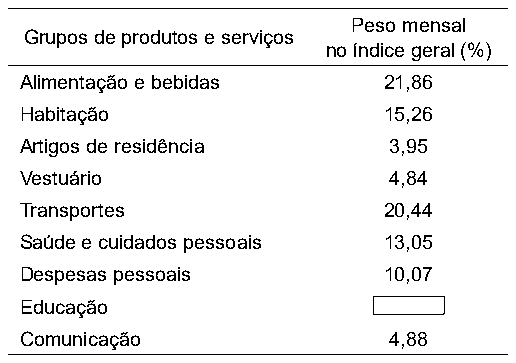
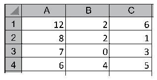
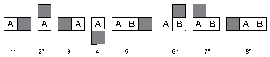
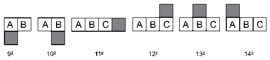
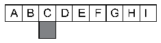
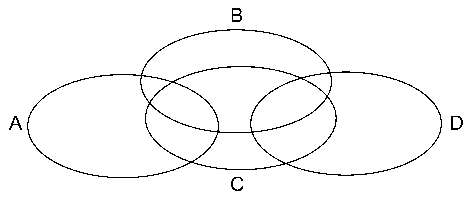

# TJ-SP 2023 — Escrevente Técnico Judiciário (prova oficial)

Prova objetiva oficial do concurso de Escrevente Técnico Judiciário do TJ-SP (2023), banca Vunesp, com 100 questões e o gabarito oficial da versão 3.
As figuras foram recortadas do caderno original. O gabarito comentado está no fim do arquivo.

<!-- Gerado por tools/src/prova_to_md.py a partir de 2023vunesp-2023-tj-sp-escrevente-tecnico-judiciario-prova.pdf e 2023vunesp-2023-tj-sp-escrevente-tecnico-judiciario-gabarito.pdf. -->

## Língua Portuguesa

*Leia o poema para responder às questões de números 01 e 02.*
> aqui
>
> nesta pedra
>
> alguém sentou
>
> olhando o mar
>
> o mar
>
> não parou
>
> pra ser olhado
>
> foi mar
>
> pra tudo quanto é lado
>
> (Paulo Leminski, Caprichos e relaxos)

**Q01.** Os versos finais do poema – foi mar / pra tudo quanto é lado – permitem entender que o mar

- A) se espantou com os olhares ao tocar rudemente a pedra.
- B) se movimentou timidamente devido à admiração humana.
- C) se espalhou e atingiu tudo o que encontrou a sua frente.
- D) se moveu violentamente e aterrorizou as pessoas.
- E) se mostrou plácido para as pessoas que o contemplavam.

**Q02.** No poema, há uma relação entre passado e presente, este marcado pelo emprego do termo

- A) “olhado”.
- B) “lado”.
- C) “alguém”.
- D) “aqui”.
- E) “parou”.

*Leia o texto para responder às questões de números 03 a 06.*
> Cidadania e Justiça
>
> A cidadania, na lição do professor Dalmo de Abreu Dallari, expressa um conjunto de direitos que dá à pessoa a possibilidade de participar ativamente da vida e do governo do seu povo.
>
> Colocar o bem comum em primeiro lugar e atuar para a sua manutenção é dever de todo cidadão responsável. É por meio da cidadania que conseguimos assegurar nossos direitos civis, políticos e sociais.
>
> Ser cidadão é pertencer a um país e exercer seus direitos e deveres.
>
> Cidadão é, pois, o natural de uma cidade, sujeito de direitos políticos e que, ao exercê-los, intervém no governo. O fato de ser cidadão propicia a cidadania, que é a condição jurídica que podem ostentar as pessoas físicas e que, por expressar o vínculo entre o Estado e seus membros, implica submissão à autoridade e ao exercício de direito.
>
> O cidadão é membro ativo de uma sociedade política independente. A cidadania se diferencia da nacionalidade porque esta supõe a qualidade de pertencer a uma nação, enquanto o conceito de cidadania pressupõe a condição de ser membro ativo do Estado. A nacionalidade é um fato natural e a cidadania obedece a um verdadeiro contrato.
>
> A cidadania é qualidade e um direito do cidadão.
>
> Na Roma Antiga, o cidadão constituía uma categoria superior do homem livre.
>
> (Ruy Martins Altenfelder da Silva.
>
> Em: https://www.estadao.com.br/opiniao, 08.03.2023. Adaptado)

**Q03.** Na discussão que faz sobre o conceito de cidadania, o autor deixa claro que ela está

- A) custodiada pelo Estado que, à revelia dos anseios da população, determina quais são os direitos e os deveres que cabem aos cidadãos.
- B) relacionada à noção romana de homem livre, o que exime as pessoas da maioria das obrigações da vida social e política.
- C) organizada a partir de um ordenamento jurídico, cujo contrato social se estabelece com o fortalecimento dos interesses subjetivos.
- D) fundamentada na relação entre direitos e deveres, que podem ser usufruídos pelos cidadãos, sem intervenção do Estado.
- E) vinculada ao papel que as pessoas assumem, quando se colocam como membros ativos da sociedade em que vivem.

**Q04.** Com base na diferenciação que o autor faz entre cidadania e nacionalidade, é correto concluir que um cidadão

- A) é um homem livre sem exercer a democracia, sendo esta um contrato social que limita os direitos do cidadão.
- B) mantém a sua nacionalidade, ainda que deixe de exercer seus direitos e deveres na sociedade.
- C) pode ser cidadão em qualquer país, desde que abra mão de sua nacionalidade, de seus direitos e deveres.
- D) vive soberanamente dentro e fora de seu país, ainda que o exercício da cidadania se limite ao seu país de origem.
- E) ganha mais notoriedade cidadã fora de seu país, onde a nacionalidade impõe excesso de deveres com poucos direitos.

**Q05.** Considere as passagens do quarto parágrafo:

• Cidadão é, pois, o natural de uma cidade, sujeito de direitos políticos e que, ao exercê-los, intervém no governo.

• O fato de ser cidadão propicia a cidadania, que é a condição jurídica que podem ostentar as pessoas físicas e que, por expressar o vínculo entre o Estado e seus membros, implica submissão à autoridade e ao exercício de direito.

Os trechos destacados expressam, correta e respectivamente, relações de sentido de:

- A) conclusão e causa.
- B) explicação e restrição.
- C) conclusão e comparação.
- D) explicação e finalidade.
- E) adversidade e causa.

**Q06.** Na passagem do 4o parágrafo – O fato de ser cidadão propicia a cidadania, que é a condição jurídica que podem ostentar as pessoas físicas e que, por expressar o vínculo entre o Estado e seus membros, implica submissão à autoridade e ao exercício de direito. –, os termos destacados significam, correta e respectivamente:

- A) coíbe; vangloriar-se; permite.
- B) estimula; provocar; inibe.
- C) admite; reformular; acarreta.
- D) permite; exibir; pressupõe.
- E) favorece; exigir; sugestiona.

*Leia o texto para responder às questões de números 07 a 11.*
> Trabalho a preservar
>
> São dignos de celebração os números que mostram a expressiva queda do desemprego no país ao longo do ano passado, divulgados pelo IBGE.
>
> Encerrou-se 2022 com taxa de desocupação de 7,9% no quarto trimestre, ante 11,1% medidos 12 meses antes e 14,2% ao final de 2020, quando se vivia o pior do impacto da pandemia. Trata-se da melhora mais longa e aguda desde o fim da recessão de 2014-16.
>
> Isso não quer dizer, claro, que se viva um momento brilhante de pujança econômica e ascensão social. Há senões, a começar pelo rendimento médio do trabalho de R$ 2.808 mensais – que, embora tenha aumentado recentemente, ainda é o menor em cinco anos.
>
> As médias, ademais, escondem desigualdades de todos os tipos. O desemprego entre as mulheres nordestinas ainda atinge alarmantes 13,2%, enquanto entre os homens do Sul não passa de 3,6%.
>
> Nada menos que 16,4% dos jovens de 18 a 24 anos em busca de ocupação não a conseguem. Entre os que se declaram pretos, a taxa de desocupação é de 9,9%, ante 9,2% dos pardos e 6,2% dos brancos.
>
> Pode-se constatar, de qualquer modo, que o mercado de trabalho se tornou mais favorável em todos os recortes, graças a um crescimento surpreendente da economia, em torno dos 3% no ano passado.
>
> (Editorial. Folha de S. Paulo, 28.02.2023. Adaptado)

**Q07.** Na análise que faz da situação do trabalho no Brasil, o editorial enfatiza

- A) a desvalorização excessiva do rendimento médio do trabalhador, que acompanha o recrudescimento do desemprego, como mostram dados de 2020, 2021 e 2022.
- B) o aumento das vagas de emprego nos últimos dois anos, pontuando que a participação de jovens no mercado de trabalho vem sendo maior e propiciando ascensão social.
- C) a crescente participação das mulheres no mercado de trabalho, ainda que a recuperação tenha sido mais difícil para elas do que para outros segmentos da sociedade.
- D) a melhora da economia brasileira nos últimos 3 anos, dando cabo ao fantasma do desemprego que rondava as famílias e à desvalorização dos salários dos trabalhadores.
- E) a queda expressiva do desemprego ao final de 2022, na comparação com os anos de 2021 e 2020, ressalvando, porém, que o cenário ainda é marcado por muitas desigualdades.

**Q08.** Nas passagens – ... a expressiva queda do desemprego... (1o parágrafo) – e – Isso não quer dizer... (3o parágrafo) –, os termos destacados pertencem, correta e respectivamente, às mesmas classes de palavras daqueles destacados em:

- A) ... graças a um crescimento surpreendente da economia... / Pode-se constatar, de qualquer modo, que o mercado de trabalho...
- B) ... o mercado de trabalho se tornou mais favorável em todos os recortes... /... graças a um crescimento surpreendente da economia…
- C) ... a começar pelo rendimento médio do trabalho... / As médias, ademais, escondem desigualdades de todos os tipos.
- D) ... um momento brilhante de pujança econômica... / Trata-se da melhora mais longa e aguda desde o fim da recessão de 2014-16.
- E) Trata-se da melhora mais longa e aguda desde o fim da recessão de 2014-16. / Entre os que se declaram pretos, a taxa de desocupação é de 9,9%...

**Q09.** Considere as passagens:

• Isso não quer dizer, claro, que se viva um momento brilhante de pujança econômica e ascensão social. (3o parágrafo)

• ... embora tenha aumentado recentemente, ainda é o menor em cinco anos. (3o parágrafo)

• As médias, ademais, escondem desigualdades de todos os tipos. (4o parágrafo)

Os termos destacados expressam, correta e respectivamente, circunstâncias de

- A) intensidade; modo; tempo; concessão.
- B) afirmação; tempo; tempo; inclusão.
- C) modo; tempo; afirmação; intensidade.
- D) causa; modo; afirmação; inclusão.
- E) afirmação; tempo; modo; comparação.

**Q10.** Assinale a alternativa em que o sinal indicativo da crase está empregado em conformidade com a norma-padrão.

- A) Devido à economia em crescimento no ano de 2022, chegou-se à uma melhora mais longa e aguda.
- B) Jovens saem de casa à procura de emprego, muitos não o encontram, o que é um ônus à Nação.
- C) Quando se referem à pandemia, é preciso lembrar que coube à ela a deterioração dos empregos.
- D) O desemprego, embora atinja à todos os segmentos sociais, agride mais às classes mais pobres.
- E) De ano à ano, calcula-se a taxa de desocupação e, em 2022, ela foi à 7,9% no quarto trimestre.

**Q11.** Identifica-se uma expressão iniciada com artigo definido em:

- A) a expressiva queda do desemprego no país (1o parágrafo).
- B) com taxa de desocupação de 7,9% (2o parágrafo).
- C) em busca de ocupação (5o parágrafo).
- D) Entre os que se declaram pretos (5o parágrafo).
- E) um momento brilhante de pujança econômica e ascensão social (3o parágrafo).

*Leia o texto para responder às questões de números 12 a 14.*
> Em noite de chuva, o Coldplay deu início à maratona de 11 shows que fará no Brasil com uma apresentação exuberante em São Paulo nesta sexta-feira. A banda preencheu o estádio do Morumbi não só de música, mas também com feixes de luz, cores, fogos de artifício e muita gritaria.
>
> A turnê “Music of the Spheres Tour”, que celebra o último disco da banda, resgata também seus maiores hits e músicas favoritas dos fãs. Após cerca de 15 minutos de atraso, os músicos subiram ao palco com “Higher Power” e a plateia assistiu sob uma chuva de fitas coloridas e bolas gigantes. É uma introdução apoteótica.
>
> A grande surpresa do show foi a presença de Seu Jorge no palco com o Coldplay. O brasileiro cantou sozinho o clássico do samba “Amiga da Minha Mulher” enquanto Chris Martin e os outros integrantes tocavam os instrumentos.
>
> (Folha de S. Paulo, 10.03.2023. Adaptado)

**Q12.** Em conformidade com a norma-padrão de pontuação e com os aspectos de coesão, um título adequado ao texto é:

- A) Em show que abre maratona no Brasil debaixo de chuva, Coldplay recebe, Seu Jorge.
- B) Debaixo de chuva, Coldplay recebe Seu Jorge em show que abre maratona no Brasil.
- C) Coldplay, recebe Seu Jorge em show debaixo de chuva, que abre maratona no Brasil.
- D) No Brasil debaixo de chuva, Coldplay, que abre maratona recebe em show, Seu Jorge.
- E) Debaixo de chuva, Seu Jorge em show no Brasil, que abre maratona, recebe Coldplay.

**Q13.** Na passagem do primeiro parágrafo – A banda preencheu o estádio do Morumbi não só de música, mas também com feixes de luz, cores, fogos de artifício e muita gritaria. –, a relação de sentido entre as orações é a mesma que se estabelece no período:

- A) Durante a reunião, o diretor falou tanto que terminou a apresentação afônico.
- B) A casa era, de fato, muito agradável, porém o valor do aluguel era muito alto.
- C) É importante chegar cedo para que não se corra o risco de não ser atendido.
- D) Todos já estavam no aeroporto e esperavam ansiosos a chegada dos amigos.
- E) Os documentos foram devidamente organizados, conforme instruiu o chefe.

**Q14.** A concordância verbal e a concordância nominal atendem à norma-padrão em:

- A) Foi 15 minutos de atraso até os músicos subirem ao palco, onde se resgatou os maiores hits da banda e as músicas preferidas dos fãs, entusiasmados com o show.
- B) No Brasil, haverão 11 shows na maratona do Coldplay, e o de São Paulo deu início a ela com uma exuberante apresentação, muito bem recebido pelos fãs da banda.
- C) Em uma introdução apoteótica, apresentaram-se em São Paulo Coldplay e Seu Jorge, para celebrar o último disco da admirada banda que está em maratona pelo Brasil.
- D) A plateia acompanharam uma introdução apoteótica, pois uma chuva de fitas coloridas e bolas gigantes tinham caído no local, deixando todos eletrizados.
- E) Ouvia-se os instrumentos sendo tocado pelos integrantes da banda Coldplay, enquanto Seu Jorge cantava o clássico do samba “Amiga da Minha Mulher”.

*Leia o texto para responder às questões de números 15 a 17.*
> Leolinda Daltro (1859-1935) – A educadora é considerada uma das primeiras sufragistas e precursora do feminismo no Brasil. Fundou o Partido Republicano Feminino, três jornais para as mulheres e foi uma das criadoras da Linha de Tiro Feminino Orsina da Fonseca, onde elas treinavam com armas de fogo. No fim do século 19, viajou pelo Brasil divulgando ideias como a educação laica e os direitos indígenas.
>
> (https://www.uol.com.br/universa/reportagens-especiais. Adaptado)

**Q15.** Sabendo-se que Leolinda Daltro foi precursora do feminismo no Brasil, ao se afirmar que ela foi uma das “primeiras sufragistas”, entende-se que a educadora defendia

- A) a liberdade de vestimenta das mulheres.
- B) a equiparação de salários entre homens e mulheres.
- C) a participação das mulheres em cargos públicos.
- D) a inserção da mulher no mercado de trabalho.
- E) o direito do voto das mulheres.

**Q16.** Assinale a alternativa em que a palavra “onde” está corretamente empregada, conforme no trecho: “... foi uma das criadoras da Linha de Tiro Feminino Orsina da Fonseca, onde elas treinavam com armas de fogo.”

- A) A casa onde ele mora é um refúgio dentro da cidade grande, com árvores, flores, pássaros e um clima de tranquilidade.
- B) Onde eu me dirijo para obter mais informações turísticas? – perguntou o rapaz ansioso a um transeunte do local.
- C) O que me encantava era saber que a cidade onde ele foi era tão distante que a rotina dali passava longe das redes sociais.
- D) Não sabemos onde ele quer chegar com aquelas conclusões precipitadas em relação a um assunto tão complexo e polêmico.
- E) A discussão daquele tema onde eu não tinha muita familiaridade trazia um pouco de preocupação naquele momento.

**Q17.** Na frase final do texto – No fim do século 19, viajou pelo Brasil divulgando ideias como a educação laica e os direitos indígenas. –, reescrevendo-se o trecho destacado e mantendo-se o sentido de finalidade, obtém-se:

- A) para divulgar ideias como a educação laica e os direitos indígenas.
- B) e divulgava ideias como a educação laica e os direitos indígenas.
- C) já que divulgava ideias como a educação laica e os direitos indígenas.
- D) caso divulgasse ideias como a educação laica e os direitos indígenas.
- E) embora divulgasse ideias como a educação laica e os direitos indígenas.

*Leia o texto para responder às questões de números 18 a 24.*
> Infeliz Aniversário
>
> A Branca de Neve de Disney fez 80 anos, com direito a chamada na primeira página de um jornalão e farta matéria crítica lá dentro. Curiosamente, as críticas não eram à versão Disney cujo aniversário se comemorava, mas à personagem em si, cuja data natalícia não se comemora porque pode estar no começo do século XVII, quando escrita pelo italiano Gianbattista Basile, ou nas versões orais que se perdem na névoa do tempo.
>
> É um velho vício este de querer atualizar, podar, limpar, meter em moldes ideológicos as antigas narrativas que nos foram entregues pela tradição. A justificativa é sempre a mesma, proteger as inocentes criancinhas de verdades que poderiam traumatizá-las. A verdade é sempre outra, impingir às criancinhas as diretrizes sociais em voga no momento.
>
> E no momento, a crítica mais frequente aos contos de fadas é a abundância de princesas suspirosas à espera do príncipe. Mas a que “contos de fadas” se refere? Nos 212 contos recolhidos pelos irmãos Grimm, há muito mais do que princesas suspirosas. Nos dois volumes de “The virago book on fairy tales”, em que a inglesa Angela Carter registrou contos do mundo inteiro, não se ouvem suspiros. Nem suspiram princesas entre as mulheres que correm com os lobos, de Pinkola Estés.
>
> As princesas belas e indefesas que agora estão sendo criticadas foram uma cuidadosa e progressiva escolha social. Escolha de educadores, pais, autores de antologias, editores. Escolha doméstica, feita cada noite à beira da cama. Garimpo determinado selecionando, entre tantas narrativas, aquelas mais convenientes para firmar no imaginário infantil o modelo feminino que a sociedade queria impor.
>
> Não por acaso Disney escolheu Branca de Neve para seu primeiro longa-metragem de animação. O custo era altíssimo, não poderia haver erro. E, para garantir açúcar e êxito, acrescentou o beijo.
>
> Os contos maravilhosos, ou contos de fadas, atravessaram séculos, superaram inúmeras modificações sociais, venceram incontáveis ataques. Venceram justamente pela densidade do seu conteúdo, pela riqueza simbólica com que retratam nossas vidas, nossas humanas inquietações. Querer, mais uma vez, sujeitá-los aos conceitos de ensino mais rasteiros, às interpretações mais primárias, é pura manipulação, descrença no poder do imaginário.
>
> (https://www.marinacolasanti.com/. Adaptado)

**Q18.** De acordo com o texto, é correto afirmar que os contos de fadas

- A) se configuram em textos altamente prejudiciais ao desenvolvimento cultural e social, e o ideal é que a sociedade deixe de fazê-los circular nas escolas.
- B) resultam de uma visão distorcida da sociedade, e a sua escolha é ruim por deixar de lado a visão de educadores, pais, autores de antologias e editores.
- C) formalizaram o perfil feminino que organiza a sociedade através dos tempos, e as pessoas o usam prudentemente para resguardar a integridade psicológica das crianças.
- D) resgatam as experiências humanas altamente carregados de simbologia, e o melhor é deixá-los livres dos conceitos de ensino inexpressivos.
- E) manipularam a sociedade ao longo da história, porém as pessoas ainda devem recorrer a eles como forma de evitar problemas na formação dos jovens.

**Q19.** De acordo com a autora, o perfil das princesas que atualmente é alvo de críticas construiu-se, ao longo dos tempos,

- A) à revelia da cultura dominante.
- B) de forma intencional e deliberada.
- C) sem preocupação com a ordem social.
- D) com oposição à sociedade patriarcal.
- E) sob tensões quase incontornáveis.

**Q20.** Na frase que inicia o texto – A Branca de Neve de Disney fez 80 anos, com direito a chamada na primeira página de um jornalão e farta matéria crítica lá dentro. –, o emprego do substantivo destacado reforça

- A) a irrelevância do tema e do meio de comunicação.
- B) o desprezo das pessoas pelo jornal referido.
- C) a importância do veículo de comunicação.
- D) o exagero da matéria no jornal em questão.
- E) a grande repercussão atingida pela matéria.

**Q21.** Identifica-se termo empregado em sentido figurado em:

- A) ... as críticas não eram à versão Disney cujo aniversário se comemorava...
- B) ... impingir às criancinhas as diretrizes sociais em voga no momento.
- C) O custo era altíssimo, não poderia haver erro.
- D) Escolha de educadores, pais, autores de antologias, editores.
- E) E, para garantir açúcar e êxito, acrescentou o beijo.

**Q22.** Assinale a alternativa em que o enunciado, reescrito a partir das informações do texto, atende à norma-padrão de colocação pronominal.

- A) Escolheu-se Branca de Neve para ser o primeiro longa-metragem de animação da Disney, sabendo-se que não poderia haver erro.
- B) Crê-se que o aniversário de Branca de Neve seria no começo do século XVII, ou nas versões orais, que teriam perdido-se na névoa do tempo.
- C) Me pergunto a que contos de fadas refere-se a crítica mais frequente, que fala da abundância de princesas suspirosas à espera do príncipe.
- D) Quem atreveria-se a desdizer que os contos de fadas que disseminaram-se no cotidiano social visam manter as diretrizes sociais em voga no momento?
- E) Os contos maravilhosos se impuseram por séculos, e isso certamente deu-se justamente pela densidade do seu conteúdo e pela sua riqueza simbólica.

**Q23.** Assinale a alternativa que atende à norma-padrão de regência nominal e verbal.

- A) A imposição a um modelo feminino veio sendo construído ao longo do tempo, visando pela dominância de um comportamento.
- B) A crítica que se faz às princesas suspirosas provavelmente se respalda no anseio das pessoas pela oposição a um comportamento.
- C) Os contos de fadas que nos referimos continuamente vieram em nossas vidas pela tradição, que a origem foge de nosso conhecimento.
- D) Educadores, pais, autores de antologias e editores são responsáveis das escolhas das histórias que hoje se fazem críticas.
- E) As pessoas têm a pretensão que os contos sejam atualizados e colocados em moldes, pois aspiram por limpeza ideológica.

**Q24.** Assinale a alternativa em que, na reescrita da passagem

– Curiosamente, as críticas não eram à versão Disney cujo aniversário se comemorava, mas à personagem em si… (1o parágrafo) –, a forma verbal destacada confere sentido de conjectura ao enunciado.

- A) Curiosamente, as críticas não têm sido à versão Disney cujo aniversário se comemorava, mas à personagem em si.
- B) Curiosamente, as críticas não são à versão Disney cujo aniversário se comemorava, mas à personagem em si.
- C) Curiosamente, as críticas não foram à versão Disney cujo aniversário se comemorava, mas à personagem em si.
- D) Curiosamente, as críticas não seriam à versão Disney cujo aniversário se comemorava, mas à personagem em si.
- E) Curiosamente, as críticas não tinham sido à versão Disney cujo aniversário se comemorava, mas à personagem em si.

## Conhecimentos em Direito

## Direito Penal

**Q25.** Com relação aos Crimes contra a Fé Pública, previstos no Capítulo II e III, do Título X, do Código Penal, assinale a alternativa correta.

- A) Nos crimes de falsificação de documento público e falsificação de documento particular, a falsidade recai sobre a própria autenticidade do documento; no crime de falsidade ideológica, a falsidade recai sobre o conteúdo do documento.
- B) Os crimes de falsificação de papéis público, petrechos de falsificação e falsificação de selo ou sinal público são próprios de funcionários públicos, praticados no exercício do cargo.
- C) O crime de falsidade de atestado médico é um crime comum, podendo ser praticado por qualquer pessoa, não sendo necessário ser médico.
- D) Se o sujeito, além de falsificar o documento, também o utiliza, incorrerá nas penas do crime de falsificação e do crime de uso.
- E) O crime de falso reconhecimento de firma ou letra somente se caracteriza em documento público.

**Q26.** Tendo em conta os Crimes contra a Administração Pública, previstos no Código Penal, assinale a alternativa correta.

- A) O crime de abandono de função somente se caracteriza se ocorrer prejuízo público, tratando-se, assim, de crime material.
- B) O crime de corrupção passiva é formal, consumando-se ainda que o funcionário público não receba vantagem indevida.
- C) Para a caracterização do crime de prevaricação, é necessário que o funcionário público retarde ou deixe de praticar, indevidamente, ato de ofício, cedendo a pedido ou influência de outro.
- D) O crime de advocacia administrativa se consuma quando o advogado privado, para defender interesse de seu cliente, junto à Administração Pública, oferece vantagem a funcionário público, para o influenciar na prática de ato.
- E) O crime de peculato é praticado por funcionário público, exigindo que o bem ou valor apropriado seja público.

**Q27.** A respeito dos Crimes contra a Administração da Justiça, previstos no Código Penal, é correto afirmar que

- A) o crime de coação no curso do processo será qualificado se praticado em processo que envolva crime contra a dignidade sexual.
- B) a imputação de prática de contravenção penal que sabe ser inverídica não configura o crime de denunciação caluniosa, pois o tipo penal fala apenas em crime, ato improbo e infração ética-disciplinar.
- C) o crime de fraude processual será qualificado se a inovação tiver como objetivo produzir efeito em processo penal.
- D) a retração ou declaração da verdade pelo agente, antes de proferida a sentença no processo em que se deu o falso testemunho, é causa de diminuição de pena do crime de falso testemunho e falsa perícia.
- E) o crime de exercício arbitrário das próprias razões é de ação penal privada, excetuando os casos em que há emprego de violência.

**Q28.** No crime de fraude em certames de interesse público, previsto no artigo 311-A, do Código Penal, é correto afirmar que

- A) o bem jurídico violado é a fé pública, e para restar caracterizado exige-se efetivo prejuízo.
- B) há a previsão da modalidade culposa, inadmitindo-se a forma tentada.
- C) embora para a caracterização não se exija a ocorrência de dano patrimonial à administração pública, exige-se a finalidade de beneficiar a si próprio ou a outrem, ou de comprometer a credibilidade do certame.
- D) é crime comum, podendo ser praticado por qualquer pessoa, mas, se praticado por funcionário público, a pena aplicar-se-á em dobro.
- E) a ocorrência de prejuízo à Administração Pública é causa de aumento da pena.

**Q29.** Tendo em conta o crime de inutilização de edital ou de sinal, previsto no artigo 336, do Código Penal, e o crime de subtração ou inutilização de livro ou documento, previsto no artigo 337, do Código Penal, assinale a alternativa correta.

- A) São crimes próprios de funcionários públicos, só podendo ser por eles praticados.
- B) O crime de inutilização de edital ou sinal será qualificado quando há violação de sinal empregado para cerrar objeto de interesse da justiça.
- C) São crimes que inadmitem tentativa.
- D) O crime de subtração ou inutilização de livro ou documento restará caracterizado ainda que o documento inutilizado estiver confiado a particular, desde que em serviço público.
- E) O crime de subtração ou inutilização de livro ou documento, se parcial a inutilização do documento, será punido de forma diminuída.

**Q30.** Mévio, administrador, por decisão judicial, em ação penal, foi afastado do conselho deliberativo da empresa da qual é sócio. Não obstante a decisão, Mévio continua participando das reuniões do conselho, fazendo uso da palavra, tomando parte nas deliberações e assinando documentos. Diante da situação hipotética, assinale a alternativa correta.

- A) Mévio não incorreu em qualquer crime, haja vista a conduta imputada ser atípica penalmente.
- B) Mévio incorreu no crime de fraude processual, previsto no artigo 347, do Código Penal.
- C) Mévio, em tese, praticou o crime de desobediência à decisão judicial sobre perda e suspensão de direito, previsto no artigo 359, do Código Penal.
- D) Mévio, em tese, praticou o crime de desobediência, previsto no artigo 330, do Código Penal.
- E) Mévio, em tese, praticou o crime de usurpação de função pública, previsto no artigo 328, do Código Penal.

## Direito Processual Penal

**Q31.** Tendo em conta as regras de impedimento e suspensão, previstas nos artigos 252 a 258, do Código de Processo Penal, assinale a alternativa correta.

- A) O promotor de justiça não poderá atuar em processos em que tenha figurado como advogado de qualquer das partes, podendo, no entanto, atuar naqueles em que figurou como testemunha ou informante.
- B) O juiz dar-se-á por suspeito e, se não o fizer, poderá ser recusado por qualquer das partes, se parente seu, consanguíneo ou afim, em linha reta ou colateral, estiver respondendo a processo análogo.
- C) O juiz não poderá atuar em processo em que ele próprio tenha figurado como advogado de qualquer das partes, não se aplicando o impedimento, no entanto, se a atuação como advogado é de parentes seus, por afinidade.
- D) As causas de impedimento e suspensão decorrentes do parentesco por afinidade não cessarão com a dissolução do casamento, se houver filhos menores, cessando, no entanto, se inexistir filhos ou, se existir, já tenham atingido a idade adulta.
- E) Não poderão figurar no mesmo processo, em juízos coletivos, juízes que sejam parentes entre si, ainda que afins, em linha reta ou colateral, inclusive até o terceiro grau.

**Q32.** Tício, estudante de direito, é réu em ação penal, tendo sido assistido por defensor público, ao longo de toda a instrução. Absolvido pelo Juízo de Primeiro Grau, o Ministério Público recorreu. Tício, nessa ocasião, já era advogado, devidamente habilitado junto ao órgão de classe, tendo ele próprio apresentado as contrarrazões ao recurso do Ministério Público, para a manutenção da sentença absolutória. Diante da situação hipotética e nos termos dos artigos 261 a 267 do Código de Processo Penal, assinale a alternativa correta.

- A) Ainda que Tício tenha sido assistido por defensor público, não há qualquer vedação legal para que ocorra a substituição por defensor particular, sendo ainda permitido que ele mesmo exerça a própria defesa, já que habilitado.
- B) Embora seja permitido ao acusado, se habilitado, exercer a própria defesa, tendo Tício sido assistido por defensor público ao longo do processo, é vedada a substituição por defensor particular, na fase recursal.
- C) Ainda que advogado, devidamente habilitado, por expressa vedação legal, Tício não pode exercer a própria defesa.
- D) Tendo sido a defesa de Tício exercida por defensor público, ao longo do processo, por expressa disposição legal, vedada é a substituição por defensor particular, na fase recursal.
- E) Tício, ainda que advogado, não pode exercer a própria defesa; ademais, tendo sido defendido por defensor público ao longo do processo, vedada é a substituição por defensor particular, na fase recursal.

**Q33.** Tendo em conta as disposições constantes do Código de Processo Penal, a respeito das citações e intimações, assinale a alternativa correta.

- A) Estando o réu no estrangeiro, será ele citado por carta precatória, suspendendo o processo e o curso do prazo prescricional até o efetivo cumprimento.
- B) A citação por edital dar-se-á quando o réu não é localizado nos endereços tidos como os de sua residência ou domicílio, estando, assim, em local desconhecido; ou quando há indícios de que o réu oculta-se do Oficial de Justiça.
- C) Expedida carta precatória para citação do réu, verificado que este se encontra em local sujeito à jurisdição de outro Juiz, o Juiz deprecado devolverá a precatória, sem cumprimento, ao Juiz deprecante, para expedição de nova precatória.
- D) Não intimado o réu, por não ter sido localizado no endereço por ele informado e constante dos autos, em razão de ter se mudado e deixado de informar o endereço atual, o processo prosseguirá sem sua participação.
- E) A citação por mandado, por Oficial de Justiça, dar-se-preferencialmente em dias úteis, no horário das 06 às 17h e, por expressa vedação legal, não se realizará aos Domingos.

**Q34.** Tício foi denunciado por crime cuja pena máxima não ultrapassa dois anos de reclusão. Diante dessa situação hipotética, assinale a alternativa correta.

- A) O processo seguirá pelo rito sumário, com a resposta à acusação apresentada em audiência, oralmente, ocasião em que se inquirirão as testemunhas de defesa, no máximo 03 (três), apresentadas no dia e independente de intimação.
- B) O processo seguirá pelo rito do juizado especial criminal e, não sendo Tício localizado, para ser pessoalmente citado, haverá remessa ao Juízo Comum, para prosseguir sob o rito sumário.
- C) O processo seguirá pelo rito sumário e, após a resposta à acusação, apresentada por escrito, no prazo de 10 (dez) dias, Tício será sumariamente absolvido se comprovar ter praticado o fato em estado de necessidade.
- D) O processo seguirá pelo rito ordinário e, uma vez citado, deverá apresentar resposta à acusação no prazo de 10 (dez) dias, podendo arrolar até 08 (oito) testemunhas.
- E) O processo seguirá pelo rito sumário e, uma vez citado, deverá apresentar resposta à acusação no prazo de 10 (dez) dias, podendo arrolar até 05 (cinco) testemunhas.

**Q35.** Mévia foi denunciada pela prática de crime de homicídio doloso. A denúncia foi recebida pelo Juiz da Vara do Tribunal do Júri, sendo apresentada por Mévia resposta à acusação, seguindo-se a instrução processual com a oitiva das testemunhas de acusação e defesa. Encerrada a instrução, apresentadas as alegações finais, o processo encontra-se com o Juiz da Vara do Tribunal do Júri, para sentença. Em vista do caso hipotético, assinale a alternativa correta.

- A) Se a decisão do Juiz for pela ocorrência de prática de crime não sujeito à competência do Tribunal do Júri, proferirá, desde logo, sentença condenatória.
- B) Se a decisão do Juiz for pelo reconhecimento de que Mévia agiu em legítima defesa, circunstância que exclui o crime, por ausência de ilicitude, ainda assim, será ela pronunciada, competindo a decisão ao Júri, podendo, contudo, interpor Apelação.
- C) Se a decisão do Juiz for pela impronúncia de Mévia, ainda que preclusa, enquanto não extinta a punibilidade, surgindo prova nova, poderá ser formulada nova denúncia contra ela.
- D) Se a decisão do Juiz for pela impronúncia de Mévia, poderá o Ministério Público interpor Recurso em Sentido Estrito, estendendo tal legitimidade ao assistente de acusação, se habilitado.
- E) Se a decisão do Juiz for pela pronúncia de Mévia, será ela intimada, através de seu advogado constituído ou defensor público nomeado.

**Q36.** A respeito do processo de restauração de autos extraviados ou destruídos, previsto no Código de Processo Penal, é correto afirmar que

- A) mesmo pendente decisão que julgue restaurados os autos, a sentença condenatória em execução continuará a produzir efeito, se houver guia arquivada no estabelecimento prisional onde o réu cumpre pena ou, registro que torne inequívoca a sua existência.
- B) poderão ser inquiridos sobre os atos do processo as autoridades, os serventuários, os peritos e as demais pessoas que tenham nele atuado, inexistindo previsão, contudo, de oitiva de testemunhas e outras provas o teor do processo extraviado ou destruído.
- C) se extraviados os autos em segunda instância, nela tramitará o processo de restauração.
- D) no caso de processo em que ainda não foi proferida sentença, as testemunhas serão reinquiridas, inexistindo possibilidade de substituição das que não sejam localizadas.
- E) os exames periciais serão obrigatoriamente repetidos e realizados, também obrigatoriamente, pelos mesmos peritos, exceto no caso de já ter falecido.

**Q37.** Tendo em conta as previsões a respeito da revisão criminal, constantes do Código de Processo Penal, assinale a alternativa correta.

- A) Pode ser requerida a qualquer tempo, desde que antes de extinta a pena.
- B) Tem por finalidade anular a condenação ou provar a inocência do condenado, não se prestando à diminuição da pena.
- C) A ação de revisão não poderá ser liminarmente indeferida pelo Relator a quem for distribuída, devendo abrir-se vista ao Procurador Geral, para parecer, após o que os autos seguirão para exame do Revisor, para julgamento na sessão designada.
- D) É personalíssima, extinguindo-se com a morte do autor, no caso, o condenado.
- E) Julgada procedente a revisão, na sentença poderá ser reconhecido o direito à justa reparação, pelos prejuízos decorrentes do erro ou da injustiça da condenação, desde que requerido pelo interessado.

## Direito Processual Civil

**Q38.** A empresa X, representada pelo escritório de advocacia Y, propôs ação de obrigação de fazer em face do Município de Vila Verde. A ação foi distribuída por sorteio para a 5a Vara da Fazenda Pública da Comarca de Vila Verde que tem como escrivão Eduardo. O Município foi devidamente citado e na contestação apresentou a alegação de que, dez dias após a propositura da petição inicial, um primo distante de Eduardo foi contratado, como advogado, pelo escritório de advocacia Y, fazendo com que Eduardo seja impedido de exercer suas funções no processo. Diante da situação hipotética, é correto afirmar que a alegação apresentada em contestação está

- A) incorreta, uma vez que não se trata de impedimento e sim de suspeição.
- B) correta, desde que o primo de Eduardo intervenha diretamente no processo.
- C) incorreta, uma vez que não há qualquer tipo de impedimento na atuação de Eduardo como escrivão em um processo no qual seu primo seja advogado.
- D) incorreta, uma vez que os motivos de impedimento e suspeição se aplicam apenas aos Juízes, membros do Ministério Público e demais sujeitos imparciais do processo.
- E) incorreta, uma vez que o impedimento só se verificaria se o primo de Eduardo já integrasse o processo antes do início da atividade de Eduardo.

**Q39.** Quando a citação for realizada por meio eletrônico em um processo no qual não se admite a autocomposição, considera-se dia do começo do prazo:

- A) o dia útil seguinte ao da data de ocorrência da citação.
- B) o quinto dia útil seguinte à confirmação do seu recebimento, na forma prevista na mensagem de citação.
- C) a data de juntada aos autos do mandado cumprido.
- D) a data de juntada aos autos do aviso de recebimento.
- E) o dia útil seguinte ao da data de juntada aos autos do mandado cumprido.

**Q40.** Juliete propôs ação de indenização por danos morais alegando que sofreu ofensas verbais e constrangimento em razão da conduta de um funcionário da loja Z. Considerando a situação hipotética, assinale a alternativa correta acerca da possibilidade de concessão de tutela provisória para o caso.

- A) A tutela provisória só pode ser concedida após a apresentação de contestação pela loja Z, para que esta seja ouvida antes da decisão.
- B) A tutela provisória de urgência pode ser concedida em caráter antecedente ou incidental, desde que presentes os requisitos legais, podendo ser exigida ainda caução real ou fidejussória idônea.
- C) A tutela de urgência só pode ser concedida se Juliete demonstrar que há risco de dano irreparável ou de difícil reparação.
- D) O pedido de tutela provisória só pode ser deferido se Juliete apresentar prova documental que comprove os danos sofridos.
- E) Não é possível conceder tutela antecipada antecedente em ações de indenização por danos morais pois não há urgência que justifique a medida.

**Q41.** A produção antecipada de provas será admitida nos casos em que haja fundado receio de que venha a tornar-se impossível ou muito difícil a verificação de certos fatos na pendência da ação. Acerca do tema, assinale a alternativa correta.

- A) Os interessados poderão requerer a produção de qualquer prova no mesmo procedimento, relacionada ao mesmo fato ou a outro deste decorrente, desde que a sua produção conjunta não acarrete excessiva demora.
- B) A produção antecipada da prova previne a competência do juízo para a ação que venha a ser proposta.
- C) No procedimento de produção antecipada de provas admite-se defesa ou recurso contra decisão que indeferir total ou parcialmente a produção de prova pleiteada pelo requerente originário.
- D) O juiz não se pronunciará sobre a ocorrência ou a inocorrência do fato, nem sobre as respectivas consequências jurídicas.
- E) O juiz determinará, de ofício ou a requerimento da parte, a citação de interessados na produção da prova ou no fato a ser provado, salvo se existente caráter contencioso.

**Q42.** Caio, motorista de transporte por aplicativo, estava voltando para casa após um dia de trabalho quando, aguardando o semáforo ficar verde, teve seu veículo atingido por Antônio. Após frustradas as tentativas amigáveis de solucionar o caso, propôs ação de reparação de danos em face de Antônio exigindo o pagamento dos danos emergentes e dos lucros cessantes. Em primeira instância, a ação foi julgada parcialmente procedente, condenando Antônio apenas ao pagamento dos danos emergentes. Diante da situação hipotética, tendo em vista que ainda não transcorreu o prazo para apresentação do recurso de apelação, bem como inexiste qualquer omissão, contradição ou obscuridade na decisão, é correto afirmar que

- A) Antônio pode apresentar renúncia ao direito de recorrer desde que mediante aceitação de Caio.
- B) caso Antônio aceite tacitamente a decisão e pague os danos emergentes e os lucros cessantes, ainda assim poderá apresentar apelação.
- C) o recurso adesivo apresentado por Caio não será conhecido se houver desistência do recurso apresentado por Antônio.
- D) caso Antônio decida recorrer, ele poderá desistir do recurso a qualquer tempo, desde que mediante anuência de Caio.
- E) se Antônio apresentar apelação, Caio poderá aderir ao recurso, desde que mediante autorização de Antônio.

**Q43.** Compete ao Juizado Especial Cível

- A) realizar a conciliação e o julgamento das ações relativas ao estado e à capacidade das pessoas, desde que o valor da causa não exceda a quarenta vezes o salário-mínimo.
- B) a conciliação, o processo e o julgamento das causas cíveis de menor complexidade de interesse da Fazenda Pública, desde que, na comarca não tenha sido instalado Juizado Especial da Fazenda Pública.
- C) promover a execução dos títulos executivos extrajudiciais, no valor de até quarenta vezes o salário-mínimo relativos a microempresa, empresa de pequeno e médio porte.
- D) promover a conciliação e o julgamento das causas cíveis de menor complexidade, tal como a ação de despejo, desde que para uso próprio.
- E) processar e julgar as causas de natureza alimentar, com valor acima de quarenta vezes o salário-mínimo, desde que haja renúncia quanto ao crédito excedente.

**Q44.** André propôs ação de reparação de danos materiais em face do Município de Lago Azul. Na petição inicial, André alegou que o carro oficial do Prefeito colidiu com o muro de sua casa, causando um prejuízo no valor de vinte salários-mínimos. Foi apresentada contestação e o juiz deferiu providências antecipatórias no curso do processo para evitar dano de difícil ou de incerta reparação. Por fim, a ação foi julgada procedente, condenando o Município ao pagamento no valor solicitado por André na petição inicial. O Município deixou de apresentar recurso contra a sentença. Diante da situação hipotética e considerando que o Município de Lago Azul não editou lei municipal alterando o valor das obrigações consideradas como de pequeno valor, assinale a alternativa correta.

- A) O valor deverá ser pago por meio de precatório, que poderá ser fracionado, considerando a providência antecipatória concedida pelo juiz.
- B) Caso o valor não seja pago a André no prazo máximo de 60 (sessenta) dias, o juiz imediatamente determinará o sequestro do numerário suficiente ao cumprimento da decisão, desde que após a realização de audiência com o Município de Lago Azul.
- C) Não houve o trânsito em julgado da ação uma vez que a sentença, por ter sido proferida contra o Município de Lago Azul, está sujeita ao duplo grau de jurisdição.
- D) O Município de Lago Azul deverá pagar o valor de vinte salários-mínimos no prazo máximo de 30 (trinta) dias.
- E) Se depositado o valor por meio de obrigação de pequeno valor, André poderá realizar o saque pessoalmente, em qualquer agência do banco depositário, independentemente de alvará.

## Direito Constitucional

**Q45.** Sobre as ações constitucionais previstas no artigo 5o da Constituição Federal de 1988, assinale a alternativa correta.

- A) Associação legalmente constituída e em funcionamento há dois anos detém legitimidade para propor mandado de segurança coletivo, em defesa dos interesses de seus associados.
- B) É admissível habeas data na hipótese de inviabilidade do exercício de direitos por falta de norma regulamentadora.
- C) O autor da ação popular atuando de boa-fé é isento do pagamento de custas, mas está sujeito aos ônus da sucumbência.
- D) Mostra-se cabível habeas data para acesso e retificação de informações contratuais do impetrante constantes em empresas privadas sem caráter público.
- E) São sempre gratuitas as ações de habeas corpus e mandado de segurança e, na forma da lei, os atos necessários ao exercício da cidadania.

**Q46.** Autoridade municipal, no período noturno, pretendia fazer uso temporário de propriedade particular pertencente a Joaquim, diante de uma situação real de iminente perigo público, mas Joaquim recusou, sustentando a inviolabilidade de domicílio, muito embora domiciliado em outro imóvel. Sobre a situação narrada, assinale a alternativa correta à luz da previsão da Constituição Federal de 1988.

- A) Agiu corretamente a autoridade municipal, pois o iminente perigo público autoriza a utilização da propriedade particular, mediante indenização ulterior, se houver dano.
- B) A Constituição equipara, para fins de proteção, propriedade e casa, não admitindo o uso temporário de propriedade particular.
- C) É autorizado o uso da propriedade, mas Joaquim fará jus à indenização decorrente do uso, mesmo não ocorrendo dano à propriedade.
- D) A Constituição somente autoriza o uso de propriedade particular pelo poder público no período diurno.
- E) É permitido o uso da propriedade, e diante da situação emergencial não há a previsão de indenizabilidade ulterior.

**Q47.** Assinale a alternativa que contempla penas admitidas, nos termos da Constituição Federal de 1988.

- A) Suspensão de direitos e pena de caráter perpétuo.
- B) Privação da liberdade e interdição de direitos.
- C) Pena de morte em caso de guerra declarada nos termos do artigo 84, XIX, e cassação de direitos políticos.
- D) Perda de bens e banimento.
- E) Prestação social alternativa e pena de trabalhos forçados em caso de guerra declarada.

**Q48.** De acordo com a Constituição Federal de 1988, nomeado para cargo de provimento efetivo em virtude de concurso público, o servidor público

- A) estável poderá perder o cargo mediante procedimento de avaliação periódica de desempenho, na forma de lei ordinária, assegurada ampla defesa.
- B) adquire estabilidade após dois anos de efetivo exercício e após avaliação especial de desempenho por comissão especialmente instituída para este fim.
- C) estável ficará em disponibilidade em caso de extinção ou declaração de desnecessidade do cargo, com remuneração proporcional ao tempo de serviço, até o seu adequado aproveitamento em outro cargo.
- D) após três anos de efetivo exercício adquire estabilidade, nada dispondo a Constituição sobre a necessidade de avaliação especial de desempenho.
- E) estável com demissão invalidada por sentença judicial será reintegrado e eventual ocupante da vaga será reconduzido ao cargo de origem, com direito a indenização, aproveitado em outro cargo ou posto em disponibilidade com remuneração proporcional ao tempo de serviço.

**Q49.** Sobre o regime previdenciário dos servidores públicos conforme a Constituição Federal de 1988, assinale a alternativa correta.

- A) Há a obrigatoriedade de fixação de critérios de idade e tempo de contribuição diferenciados para as categorias de agente penitenciário, agente socioeducativo e policiais.
- B) Todos os servidores públicos ocupantes da categoria de magistério terão idade mínima para aposentadoria reduzida em 05 (cinco) anos.
- C) Não há a possibilidade da percepção de mais de uma aposentadoria à conta de regime próprio de previdência social.
- D) Há a possibilidade, mediante lei complementar, de categoria profissional de servidores públicos estar sujeita integralmente a critérios diferenciados de idade e tempo de contribuição para aposentadoria no caso de exposição a agentes químicos prejudiciais à saúde.
- E) Há aplicabilidade do Regime Geral de Previdência Social aos agentes públicos ocupantes exclusivamente de cargo em comissão declarado em lei de livre nomeação e exoneração, e aqueles ocupantes de outro cargo temporário, inclusive mandato eletivo, ou de emprego público.

**Q50.** Sobre a estrutura do Poder Judiciário e respectiva jurisdição, assinale a alternativa correta à luz da previsão expressa do artigo 92 da Constituição Federal de 1988.

- A) O Tribunal Federal de Recursos tem sede na Capital Federal e Jurisdição sobre todo o território nacional.
- B) O Conselho Nacional de Justiça e os Tribunais Superiores são considerados órgãos do Judiciário e têm sede na capital federal.
- C) A Justiça de Paz está expressamente prevista como órgão do Poder Judiciário.
- D) O Conselho Nacional de Justiça é considerado órgão do Poder Judiciário, com sede e jurisdição equivalentes às dos Tribunais Regionais Federais.
- E) A Justiça Desportiva é considerada órgão do Poder Judiciário, com autonomia e âmbito nacional de jurisdição.

**Q51.** Assinale a alternativa correta de acordo com a Constituição de 1988.

- A) Brasileiro naturalizado pode ocupar o cargo de Ministro do Superior Tribunal de Justiça.
- B) Há vedação de acesso ao cargo de Procurador Geral da República ao brasileiro naturalizado.
- C) A vedação de acesso ao brasileiro naturalizado é restrita a cargos eletivos federais e carreira diplomática.
- D) O nascido no estrangeiro, filho de pai brasileiro que vier a residir no Brasil e optar, depois de atingir a maioridade, pela nacionalidade brasileira, é considerado brasileiro naturalizado.
- E) Brasileiro naturalizado pode ocupar o cargo de Ministro de Estado da Defesa.

## Direito Administrativo

**Q52.** Considere que Ticio é agente público e o seu colega de trabalho, Mévio, após analisar expediente administrativo, identificou indícios de prática de ato de improbidade administrativa que importa em enriquecimento ilícito. Ao se deparar com a situação, Mévio pretende reportar o caso ao seu superior hierárquico, para que a investigação seja aprofundada, para tanto está redigindo memorando descrevendo a denúncia.

Com base na Lei no 8.429/92, Mévio poderá indicar no documento, de forma correta, que

- A) por se tratar de ato de improbidade, que importa em enriquecimento ilícito, haverá responsabilidade caso o ato tenha sido praticado a título de dolo ou culpa.
- B) Tício somente poderá ser responsabilizado caso o ato tenha sido praticado a título doloso, considerando-se dolo a mera voluntariedade do agente de executá-lo.
- C) o prazo de prescrição da ação de improbidade estará suspenso enquanto o processo de investigação estiver formalmente em curso.
- D) Tício estará sujeito à Lei de Improbidade, ainda que o seu vínculo com a Administração seja transitório e sem remuneração.
- E) na hipótese de a Administração identificar a prática de improbidade, não poderá ser realizado acordo judicial ou extrajudicial para solucionar o caso.

**Q53.** João é escrevente judiciário, trabalha na secretaria de uma Vara da Fazenda Pública e é responsável por, nos estritos limites de suas atribuições legais, dar andamento aos processos judiciais de improbidade administrativa. Ao chegar ao seu local de trabalho e abrir o sistema de acompanhamento de processos do Tribunal de Justiça, deparou-se com uma ação de improbidade, na qual o Ministério Público, em incidente, apresenta pedido de indisponibilidade de bens dos réus, que foi acolhido pelo Magistrado.

Considerando a situação hipotética e o disposto na Lei no 8.429/92, João poderá concluir, de forma correta, que

- A) o pedido está sendo processado de forma equivocada, pois não se admite a criação de incidente processual para tratar de pedido de declaração de indisponibilidade de bens.
- B) o Magistrado pode permitir a substituição da garantia por seguro-garantia judicial, caso seja realizada penhora em dinheiro.
- C) a indisponibilidade de bens, para ser válida, precisa ser precedida de prévia oitiva dos réus.
- D) a penhora, em regra, poderá incidir sobre bens de família dos réus, em função do princípio da supremacia do interesse público.
- E) a realização da penhora deverá considerar a preservação do princípio da moralidade e a indisponibilidade incidirá sobre os bens dos réus, ainda que isso acarrete prejuízo à prestação de serviços públicos.

**Q54.** A respeito da prescrição da ação para aplicação das sanções previstas na Lei no 8.429/92, assinale a alternativa correta.

- A) Caso o agente público responsável pela prática do ato de improbidade seja portador de mandato eletivo, a ação de improbidade administrativa poderá ser proposta em até oito anos após o término do exercício do mandato.
- B) A ação para aplicação das sanções previstas na Lei de Improbidade prescreve em 5 (cinco) anos, a contar da ocorrência do fato.
- C) Interrompe-se a prescrição pela publicação de sentença condenatória ou absolutória.
- D) Interrompida a prescrição, o prazo recomeça a correr do dia da interrupção, pela metade do prazo previsto em lei.
- E) A suspensão da prescrição produz efeitos individualmente para cada um dos que concorreram para a prática do ato de improbidade administrativa, ainda que não sejam parte do mesmo processo judicial.

**Q55.** A respeito das penas disciplinares, de acordo com a Lei no 10.261/68, é correto afirmar que

- A) o inativo, por não possuir vínculo estatutário, não está sujeito a penas disciplinares.
- B) a pena de repreensão poderá ser aplicada oralmente, nos casos de indisciplina ou falta no cumprimento dos deveres do servidor público.
- C) a pena de suspensão não excederá o prazo de 120 (cento e vinte) dias.
- D) o funcionário suspenso perderá metade de suas vantagens decorrentes do exercício do cargo.
- E) será aplicada a pena de demissão a bem do serviço público ao funcionário que praticar insubordinação grave.

**Q56.** Considere que Mário é oficial administrativo e trabalha no atendimento ao público. Certo dia, após uma longa discussão com João, seu antigo desafeto, Mário o agride fisicamente no local de trabalho e durante o horário de expediente.

Com base na situação hipotética e no disposto na Lei no 10.261/68, é correto afirmar que Mário

- A) estará sujeito à pena de repreensão ou multa, caso o ato tenha provocado lesões de natureza leve.
- B) estará sujeito à pena de demissão e a prescrição da pretensão punitiva da Administração se contará a partir do momento em que o ato for descoberto pelo seu superior hierárquico.
- C) deverá ser demitido a bem do serviço público, salvo se tiver praticado o ato em legítima defesa.
- D) deverá ser suspenso e a penalidade será aplicada pelo seu superior hierárquico imediato.
- E) somente será demitido por se tratar de ofensa física, já que a prática de ofensas morais importa a aplicação da pena de suspensão.

**Q57.** Com base na Lei no 10.261/68, a respeito “das práticas autocompositivas, do termo de ajustamento de conduta e da suspensão condicional da sindicância”, assinale a alternativa correta.

- A) O conteúdo das sessões restaurativas é público, podendo ser utilizado como prova em processo administrativo ou judicial, desde que observados os princípios do contraditório e da ampla defesa.
- B) O encaminhamento às práticas autocompositivas importará a suspensão da instauração da sindicância ou do processo administrativo.
- C) As práticas autocompositivas são orientadas pelos princípios da voluntariedade, da publicidade, do formalismo moderado e da consensualidade.
- D) O encaminhamento do processo disciplinar às práticas autocompositivas se dará por despacho fundamentado e não suspenderá o prazo prescricional.
- E) Para aplicação das práticas autocompositivas, é necessário que as partes reconheçam os fatos essenciais, sem que isso implique admissão de culpa.

**Q58.** Caso a apuração de infrações disciplinares seja feita por processo disciplinar, de acordo a Lei no 10.261/68, as partes poderão arrolar até

- A) 5 (cinco) testemunhas.
- B) 2 (duas) testemunhas.
- C) 3 (três) testemunhas.
- D) 8 (oito) testemunhas.
- E) 4 (quatro) testemunhas.

**Q59.** Considere que Isaias praticou infração disciplinar e em razão disso passou por uma sindicância que resultou na aplicação da pena de suspensão. Apesar de corretamente intimado da decisão, optou, na época, por não interpor recurso. Inconformado com a medida e diante de novos elementos de prova, decide pedir a revisão de sua pena. Diante dessa situação hipotética e do disposto na Lei no 10.261/68, é correto afirmar que

- A) não será cabível o pedido de revisão, pois Isaias não interpôs todos os recursos cabíveis no respectivo processo disciplinar.
- B) o pedido de revisão poderá resultar na agravação de sua pena, caso comprovado que a conduta se enquadra em tipo mais grave.
- C) o pedido de revisão não comporta a produção de atos probatórios, devendo o interessado comprovar o direito líquido e certo da sua pretensão.
- D) Isaias deverá ser representado necessariamente por advogado, cabendo a ele o ônus da prova dos fundamentos de seu pedido.
- E) o pedido de revisão deverá ser apresentado no prazo de até 02 (dois) anos, a contar do trânsito em julgado administrativo da decisão.

## Normas da Corregedoria Geral da Justiça

**Q60.** Em relação ao protocolo de petições intermediárias à luz do processo eletrônico, assinale a alternativa correta de acordo com as Normas da Corregedoria Geral da Justiça do Estado de São Paulo.

- A) Não há a previsão de materialização de processos que correm em meio digital e todas as petições a eles referentes devem sempre ser elaboradas digitalmente.
- B) Ocorrendo indevida protocolização de petição física em processo eletrônico, se o setor de protocolo de origem verificar o erro antes do cadastramento e envio ao Ofício de Justiça, deve-se cancelar o protocolo e intimar o peticionário para retirada da petição.
- C) Nos foros digitais não é permitida a protocolização integrada de petições físicas dirigidas a processos físicos de outras comarcas do Estado.
- D) Uma vez tramitando eletronicamente o processo, não há a previsão da possibilidade de recepção de petição pelo meio físico.
- E) Mesmo tramitando eletronicamente, é direito da parte optar pelo peticionamento por meio físico, devendo os setores de protocolo receber as petições físicas.

**Q61.** Com relação à tramitação do processo eletrônico e sua disciplina nas Normas da Corregedoria Geral da Justiça do Estado de São Paulo, assinale a alternativa correta.

- A) Na elaboração de documentos pelo Ofício de Justiça no processo eletrônico, devem ser utilizados os documentos institucionais padronizados autorizados e homologados pelo Juiz Diretor do Foro.
- B) Na criação de modelos de grupo no processo eletrônico, o nome do modelo deve conter necessariamente o número do cartório onde foi elaborado.
- C) Sempre que cabível, a fim de possibilitar trabalho em lote e filtro nas filas de trabalho pela serventia judicial, deverão ser utilizados modelos de grupo.
- D) As previsões das Normas da Corregedoria relativas ao processo físico não têm aplicação ao processo eletrônico, tendo em vista a disciplina específica deste último.
- E) Há ampla liberdade na criação de modelos de grupo no processo eletrônico, em quaisquer categorias de documentos.

**Q62.** No que diz respeito à retirada e consulta de autos físicos, assinale a alternativa correta à luz das Normas da Corregedoria Geral da Justiça do Estado de São Paulo.

- A) Na fluência de prazo comum, é permitida a retirada dos autos mediante carga pelo procurador ou preposto, pelo prazo de 02 (duas) a 6 (seis) horas para obtenção de cópias, observado o término do expediente forense.
- B) O acesso aos autos judiciais de processos em andamento quando não estejam sujeitos a segredo de justiça é assegurado aos advogados ou estagiários de Direito que apresentem procuração, sendo vedado ao público em geral.
- C) O acesso aos autos judiciais de processos em andamento quando não estejam sujeitos a segredo de justiça é assegurado aos advogados ou estagiários de Direito, mesmo que não sejam procuradores de quaisquer das partes, sendo vedada a retirada dos autos para cópia.
- D) Não havendo fluência de prazo, é permitida às partes a retirada em carga, independentemente de requerimento.
- E) Para fins de controle de carga rápida de autos, é permitida a retenção, no ofício judicial, de documento de identificação de advogado ou estagiário de Direito.

**Q63.** Em relação à atividade correicional, assinale a alternativa correta de acordo com as Normas da Corregedoria Geral da Justiça do Estado de São Paulo.

- A) A correição extraordinária consiste na fiscalização excepcional realizada a qualquer momento e sem prévio anúncio e abrangerá todo o serviço judiciário, devendo a ata ser encaminhada à Corregedoria Geral da Justiça no prazo de até 60 (sessenta) dias após sua realização.
- B) A visita correicional tem objetivo instrutório, devendo ser antecipada através da publicação de edital sucinto com antecedência de 5 (cinco) dias.
- C) Há a previsão da obrigatoriedade da realização de uma correição ordinária por ano, preferencialmente no mês de dezembro, sobre todas as serventias, repartições e estabelecimentos sujeitos à fiscalização do Juiz Corregedor.
- D) A correição ordinária e a visita correicional dependem de edital afixado no átrio do fórum, com pelo menos quinze dias de antecedência.
- E) As correições são presenciais, havendo a previsão de implementação gradativa de correições virtuais com o intuito de controlar temporariamente as atividades subordinadas à disciplina da Corregedoria Geral da Justiça.

**Q64.** Acerca da escrituração em meio físico de autos judiciais, assinale a alternativa correta de acordo com as Normas da Corregedoria Geral da Justiça do Estado de São Paulo.

- A) É obrigatória a subscrição pelo juiz nos mandados em que houver determinação de desconto de pensão alimentícia.
- B) Os mandados em cumprimento de ato judicial serão sempre subscritos pelo magistrado.
- C) Os documentos e papéis dirigidos a autoridades, como membros do Ministério Público, podem ser subscritos pelo escrivão, declarando que o fazem por ordem do juiz.
- D) Na escrituração é vedada a utilização de abreviaturas, siglas ou símbolos convencionados por determinada área do conhecimento humano.
- E) Havendo equívoco na escrituração, é recomendado que o escrivão aponha o termo “sem efeito”, seguindo-se a redação correta.

## Conhecimentos Gerais

## Atualidades

**Q65.** Milhares de sacos de lixo se acumulam pelas ruas de Paris, na França, onde 5 400 toneladas de resíduos não foram recolhidas devido à greve dos garis. As greves contínuas pelo país, iniciadas na semana passada, não são apenas no serviço de coleta de lixo. Elas afetam outros setores da economia, como o fornecimento de combustível das refinarias francesas e o transporte ferroviário. (Disponível em https://g1.globo.com, 13.03.2023. Adaptado) A revolta dos trabalhadores franceses se deve

- A) à tentativa do presidente Emmanuel Macron de fazer tramitar na Assembleia Nacional um projeto de lei que retira dos coletores o direito de receberem salário insalubridade.
- B) à tramitação de projeto de lei na Assembleia Nacional que pretende privatizar os serviços de coleta de lixo da cidade de Paris.
- C) à redução do número de trabalhadores da coleta de lixo, causada pela substituição dos aposentados por máquinas de varrição.
- D) ao decreto presidencial que retira dos trabalhadores de coleta de lixo de todo o país o direito à gratuidade no transporte público.
- E) ao projeto de lei, apoiado pelo presidente Emmanuel Macron, que, entre outras providências, pretende aumentar a idade de aposentadoria de 62 para 64 anos a partir de 2030.

**Q66.** A quebra do Silicon Valley Bank (SVB), banco californiano das startups, resultou em perdas de mais de 100 bilhões de dólares em valor para instituições nos Estados Unidos na última semana, se tornando a segunda maior falência bancária desde a crise financeira de 2008 que eclodiu com o Lehman Brothers. (Disponível em https://veja.abril.com.br, 13.03.2023. Adaptado) A respeito do banco americano, é correto afirmar que

- A) o colapso do SVB é indicativo de uma crise financeira mais séria nos Estados Unidos e em outros países, inclusive o Brasil.
- B) a despeito de ser um banco regional, o SVB trabalhava com grandes somas por ser uma instituição especializada no financiamento de novas tecnologias.
- C) o SVB tem uma filial em território brasileiro, desde 2007, e a sua falência prejudicará as empresas de inovação que têm altas somas depositadas no banco.
- D) se trata de uma instituição bancária especializada em atender startups que encontravam dificuldades em obter crédito de grandes bancos.
- E) a FDIC, órgão que tem a mesma função do Fundo Garantidor de Crédito brasileiro, teme que haja uma corrida dos depositantes aos outros bancos para retirar aplicações, causando transtornos ao sistema financeiro americano.

**Q67.** Pelo segundo dia seguido, criminosos realizaram ataques em cidades do interior do estado.

Ao menos seis municípios registraram cenas de violência na quarta-feira (15.03), segundo levantamento do portal G1, e o total chega a 24 cidades desde que as ações criminosas começaram, na madrugada de terça-feira (14.03). O governo do estado afirmou que havia sido alertado sobre a possibilidade de ataques e que tomou medidas preventivas. Mas isso não impediu tiros e incêndios em prédios públicos, comércios e veículos. Foram presas 30 pessoas até agora. Uma pessoa morreu em confronto com a polícia e duas ficaram feridas nos ataques.

Também foram apreendidas armas, munições, artefatos explosivos, veículos, dinheiro e drogas.

(Disponível em https://www.bbc.com, 14.03.2023. Adaptado) Esses fatos ocorreram no estado

- A) de Sergipe.
- B) do Ceará.
- C) da Paraíba.
- D) de Pernambuco.
- E) do Rio Grande do Norte.

**Q68.** Com cartazes, estudantes realizaram na manhã desta quarta-feira (15) um ato pela revogação do Novo Ensino Médio. O protesto iniciou por volta das 9h no vão livre do Masp, na Avenida Paulista, e, às 10h, desceu para a Avenida Brigadeiro Luís Antônio. Depois, os estudantes seguiram destino para a Assembleia Legislativa de São Paulo. O Novo Ensino Médio, previsto numa lei aprovada em 2017, começou a ser implementado em 2022 em todo o país, nas escolas públicas e privadas, mas só se tornou obrigatório a partir deste ano.

(Disponível em https://g1.globo.com, 15.03.2023. Adaptado) A respeito do Novo Ensino Médio e das reivindicações dos alunos, é correto afirmar que os

- A) estudantes querem que os professores façam cursos de reciclagem antes da implementação do novo modelo.
- B) conteúdos são divididos em áreas do conhecimento de maneira similar à que acontece no Exame Nacional do Ensino Médio (Enem).
- C) novos conteúdos são voltados para a área tecnológica e houve drástica redução da carga horária de disciplinas humanísticas.
- D) manifestantes exigem que as aulas sejam ministradas em tempo integral.
- E) estudantes exigem que, após a implementação total do novo modelo, os alunos, ao terminarem o último ciclo, ingressem, sem exame vestibular, no curso superior de sua livre escolha.

**Q69.** Considere que João é pessoa com deficiência e, acompanhado por sua irmã, Maria, dirigiu-se ao balcão de uma Vara Cível para obter informações sobre processos judiciais de que é parte. Diante da situação hipotética e do disposto na Lei no 13.146/15 (Estatuto da Pessoa com Deficiência), é correto afirmar que

- A) o Estatuto da Pessoa com Deficiência confere expressamente a João o direito de ser atendido de forma prioritária e fora do horário regular de funcionamento da Vara.
- B) João e Maria deverão ter atendimento prioritário no balcão e em qualquer serviço de atendimento ao público.
- C) Maria, apesar de ser acompanhante de João, não terá direito a qualquer tipo de prioridade.
- D) João deverá ter atendimento prioritário no atendimento no balcão, bem como gozará de prioridade na tramitação do processo judicial.
- E) João não terá direito a atendimento prioritário, pois a norma não se aplica a atendimentos ao público promovidos pelo Poder Judiciário.

**Q70.** De acordo com a Lei no 13.146/15 (Estatuto da Pessoa com Deficiência), a colocação competitiva da pessoa com deficiência pode ocorrer por meio de trabalho com apoio, constituindo diretriz dessa atividade:

- A) igualdade no atendimento à pessoa considerada deficiente, ainda que os graus de deficiência sejam distintos.
- B) provisão de suportes individualizados que atendam a necessidades específicas da pessoa com deficiência, excetuada a disponibilização de recursos de tecnologia assistiva.
- C) respeito ao perfil vocacional e ao interesse da pessoa com deficiência.
- D) necessidade de participação de organizações da sociedade civil.
- E) realização de avaliação permanente.

## Matemática

**Q71.** A tabela apresentada a seguir, publicada pelo Instituto Brasileiro de Geografia e Estatística (IBGE), apresenta o peso mensal da variação dos grupos de produtos e serviços no índice geral do IPCA (Índice Nacional de Preços ao Consumidor Amplo), do mês de janeiro de 2023, com exceção do grupo Educação.

IPCA – janeiro 2023

(IBGE. Adaptado)

Sabendo-se que todos os grupos de produtos e serviços que são considerados para o cálculo da variação do referido índice constam na tabela, o peso mensal do grupo Educação, no IPCA de janeiro de 2023, foi de:

- A) 5,65%
- B) 4,75%
- C) 6,65%
- D) 4,65%
- E) 5,75%

**Q72.** Em reportagem publicada na internet no final de fevereiro de 2023, uma agência de notícias informou que a receita com as vendas de smartphones no varejo mundial, em 2022, foi de US$ 330 bilhões, cerca de 10% menor, quando comparada à receita de 2021. Isso significa que, das alternativas a seguir, aquela que contém o valor que mais se aproxima da receita com a venda de smartphones no varejo mundial, em 2021, é:

- A) US$ 363 bilhões.
- B) US$ 359 bilhões.
- C) US$ 367 bilhões.
- D) US$ 351 bilhões.
- E) US$ 355 bilhões.

**Q73.** Em uma pesquisa realizada em 2019, com 200 pessoas, identificou-se que a razão entre o número de pessoas que não tinham filho ou filha e o número de pessoas que tinham filho(s) ou filha(s) era 6/19. No ano passado, as mesmas pessoas participaram de outra pesquisa, ocasião em que foi identificado que o número de pessoas que não tinham filho ou filha havia diminuído em 12 unidades. Na pesquisa realizada no passado, a razão entre os números das pessoas que não tinham filho ou filha e das pessoas que tinham filho(s) ou filha(s) foi:

- A) 3/10.
- B) 9/41.
- C) 9/38.
- D) 3/7.
- E) 12/41.

**Q74.** Para a realização de um serviço, foram feitos três orçamentos. O que se sabe sobre esses orçamentos é que: a média aritmética simples dos seus valores é igual a R$ 29.500,00; o maior deles ficou R$ 1.200,00 mais alto que o valor do orçamento não menor; e o menor deles ficou R$ 2.250,00 mais baixo que o valor do maior orçamento. O valor do menor orçamento foi de

- A) R$ 29.450,00.
- B) R$ 29.850,00.
- C) R$ 28.500,00.
- D) R$ 28.300,00.
- E) R$ 28.400,00.

**Q75.** Em uma casa de venda no varejo e no atacado, se um cliente comprar quantidades 80 < q ≤ 150 de cada produto A ou B, ele tem R$ 10,00 de desconto em cada unidade do produto A e R$ 15,00 de desconto em cada unidade do produto B. Se o cliente comprar quantidades q > 150, de cada produto, ele tem descontos unitários de R$ 15,00 no produto A e de R$ 20,00 no produto B. Sabendo que Fulano comprou 100 unidades de A e 50 unidades de B, pagando o valor total de R$ 11.500,00, e que Beltrano comprou 200 unidades de A e 300 unidades de B, pagando o total de R$ 34.000,00, quem comprar apenas uma unidade de cada produto pagará, nessa compra, o total de

- A) R$ 155,00.
- B) R$ 150,00.
- C) R$ 165,00.
- D) R$ 170,00.
- E) R$ 160,00.

**Q76.** O logotipo de uma repartição pública tem o formato de triângulo retângulo e, para efeito de ampliação ou redução, sabe-se que o maior lado desse logotipo mede 17/8 da medida do menor lado. Em uma propaganda, esse logotipo foi impresso com o menor lado medindo 4 cm e, portanto, a área ocupada, somente com a impressão desse logotipo, em cm2, foi de

- A) 23.
- B) 19.
- C) 30.
- D) 26.
- E) 15.

## Informática

**Q77.** Para se utilizar várias Áreas de Trabalho em um computador com o sistema operacional Windows 10, em sua configuração padrão, alguns passos devem ser seguidos. Para se criar uma nova Área de Trabalho, esses passos são:

- A) 1 – No menu inferior do Windows 10, selecionar com o teclado ou com o mouse “Visão de Tarefas”. 2 – A aba da Área de Trabalho atual será aberta, e no canto superior esquerdo, clicar em “Nova área de trabalho”.
- B) 1 – No menu inferior do Windows 10, selecionar com o teclado ou com o mouse “Visão de Tarefas”. 2 – Uma janela de nome Área de Trabalho será aberta com as opções: “Criar”, “Deletar” e “Suspender”, devendo ser selecionada a opção “Criar”.
- C) 1 – No menu inferior do Windows 10, selecionar com o teclado ou com o mouse Área de Trabalho. 2 – Uma janela será aberta com diversas opções, devendo ser selecionada a opção “Criar nova área de trabalho.
- D) 1 – No Painel de Controle do Windows 10, selecionar com o teclado ou com o mouse “Área de Trabalho”. 2 – Uma janela será aberta com as opções, devendo-se selecionar “Nova área de trabalho”.
- E) 1 – No menu Iniciar do Windows 10, selecionar com o teclado ou com o mouse “Área de Trabalho”. 2 – Uma janela de nome Área de Trabalho será aberta com as opções: “Criar” e “Deletar”, devendo ser selecionada a opção “Criar”.

**Q78.** Um usuário de um computador com o sistema operacional Windows 10, em sua configuração padrão, selecionou: botão Iniciar > Configurações > Sistema > Área de Transferência. Algumas opções são exibidas e podem ser ativadas ou desativadas, dentre elas:

- A) o salvamento diário, em um arquivo enviado por e-mail ao usuário, de todo o conteúdo da Área de Transferência.
- B) a edição de mensagens (e-mails) a serem enviadas, e que ficam na Área de Transferência até que a conexão com a Internet seja estabelecida.
- C) o emprego de senha para se utilizar a Área de Transferência.
- D) a criptografia do conteúdo da Área de Transferência.
- E) que o histórico da Área de Transferência seja salvo para que itens nela presentes possam ser utilizados em outro momento.

**Q79.** No MS-Word presente no Microsoft-365 (tendo como referência a versão 2016), considere o seguinte parágrafo, existente em um documento em edição.

A Ilha de Marajó é a maior ilha costeira do Brasil, sendo banhada, ao mesmo tempo, por águas fluviais e por águas oceânicas.

Suponha que o usuário do aplicativo posicionou o cursor de edição (por meio do ponteiro do mouse ou do teclado) exatamente no meio da palavra "Brasil", entre as letras 'a' e 's'. A seguir, selecionou o estilo de fonte itálico. Como consequência, a palavra "Brasil" será apresentada da seguinte forma:

- A) brasil
- B) brasil
- C) brasil
- D) brasil
- E) brasil

**Q80.** No MS-Word, presente no Microsoft-365 (tendo como referência a versão 2016), é possível inserir objetos, como um SmartArt, em um documento em edição. São exemplos de grupos de SmartArts presentes no MS-Word:

- A) Processo e Hierarquia.
- B) Lista e Tabela.
- C) Imagem e Som.
- D) Matriz e Vetor.
- E) Relação e Conjunto.

**Q81.** Considere a seguinte planilha editada no MS-Excel, presente no Microsoft-365 (tendo como referência a versão 2016).

Caso na célula A5 seja inserida a fórmula

=SE(E((A1>A2);(B1>B2));C1+C2;C3+C4)

o resultado produzido nessa célula será:

- A) 15
- B) 8
- C) 7
- D) 10
- E) 12

**Q82.** No MS-Excel, presente no Microsoft-365 (tendo como referência a versão 2016), por meio da guia Layout da Página, tem-se o botão Área de Impressão, que permite, diretamente por meio dele, duas ações:

- A) Definir área de impressão; Limpar área de impressão.
- B) Impressão para arquivo; Impressão em rede.
- C) Preencher área de impressão; Completar área de impressão.
- D) Impressão completa; Impressão personalizada.
- E) Impressão colorida; Impressão em preto e branco.

**Q83.** Um usuário de um computador enviou um e-mail utilizando um programa típico para essa finalidade, como o Gmail. Esse e-mail continha um arquivo anexado de nome texto.pdf, e os destinatários foram: Cc: A@empresax.com, e Cco: B@empresax.com e C@empresax.com. Sobre esse envio, tem-se que:

- A) A mensagem e o texto.pdf foram entregues a A@empresax.com, B@empresax.com e C@empresax.com. B@empresax.com sabe que A@empresax.com e C@empresax.com receberam a mensagem e o texto.pdf.
- B) A mensagem foi entregue a A@empresax.com. B@empresax.com e C@empresax.com receberam o texto.pdf, mas não receberam a mensagem.
- C) A mensagem e o texto.pdf foram entregues a A@empresax.com, B@empresax.com e C@empresax.com. A@empresax.com não sabe que a mensagem e o texto.pdf também foram entregues a B@empresax.com e C@empresax.com.
- D) A mensagem não foi enviada, pois a opção Cco: permite a especificação de um único destinatário. Uma mensagem de erro foi exibida.
- E) A mensagem foi entregue a A@empresax.com, B@empresax.com e C@empresax.com. O texto.pdf foi entregue exclusivamente a A@empresax.com.

**Q84.** A chefia de uma empresa enviou um e-mail, especificando na opção Cc: os funcionários que deveriam recebê-la. A empresa e seus funcionários utilizam um programa típico para essa finalidade, como o Gmail. Um funcionário deseja responder esse e-mail, e existem diversas opções que o programa de e-mail permite selecionar, como a opção:

- A) Responder Cco:, que envia a resposta a todos os destinatários ocultos que receberam a mensagem e a quem a enviou.
- B) Encaminhar, que envia a resposta automaticamente a quem enviou a mensagem e a todos que a receberam também.
- C) Responder a todos, que envia a resposta a todos que receberam a mensagem, exceto a quem a enviou.
- D) Responder, que envia a resposta exclusivamente a quem enviou a mensagem.
- E) Responder Cc:, que envia a resposta a todos que receberam a mensagem e a quem a enviou.

**Q85.** Assinale a alternativa correta relacionada a URL (Uniform Resource Locator).

- A) O Esquema refere-se a um protocolo de rede, e corresponde ao primeiro grupo de caracteres de uma URL, que ficam antes do “:”.
- B) A Query String é uma parte obrigatória da URL, e que corresponde a um conjunto de perguntas e respostas que permitem encontrar os assuntos pesquisados por um usuário na Internet.
- C) O Caminho especifica o local no qual se encontra o protocolo que se vai executar.
- D) O Fragmento é uma parte obrigatória da URL, que especifica o caminho para um recurso.
- E) O Domínio de uma URL é o protocolo que se está considerando em um dado momento, como FTP e HTTP.

**Q86.** Na Internet, é possível refinar as pesquisas. Por exemplo, no navegador Google Chrome, tem-se que, ao se digitar

- A) related:empresax.com.br<Enter>, será realizada uma busca excluindo da pesquisa o site empresax.com.br.
- B) maior * do Brasil<Enter>, será realizada uma pesquisa quando não se sabe a palavra a se colocar após maior.
- C) velocidade do jaguar >carro<Enter>, exclui-se da pesquisa a palavra carro.
- D) smartphone$5000<Enter>, realiza-se a pesquisar de preço do produto smartphone com valores superiores a 5.000 reais.
- E) site:empresax.com.br<Enter>, será realizada uma busca em todos os sites que citam a empresax.com.br, exceto ela própria.

**Q87.** A Microsoft disponibiliza duas versões do software Microsoft Teams: a versão gratuita e a versão Premium, sendo correto afirmar que, considerando a atual política da Microsoft, a versão

- A) gratuita tem limitação de até 50 mensagens no chat.
- B) Premium permite a realização de reuniões de, no máximo, 6 horas.
- C) gratuita permite a realização de reuniões de até 120 minutos.
- D) Premium suporta até 500 participantes em uma reunião.
- E) gratuita suporta até 100 participantes em uma reunião.

**Q88.** Em uma reunião feita por meio do software Microsoft Teams, um participante deseja compartilhar um determinado conteúdo. Para tanto, ele deve selecionar o seguinte ícone presente na barra de ferramentas da reunião:

- A) Pessoas.
- B) Exibição.
- C) Chat.
- D) Compartilhar.
- E) Reagir.

**Q89.** O agendamento de reuniões no Microsoft Teams pode ser feito de modo que se tenham reuniões agendadas de forma periódica. Assim, o Teams, além de agendamentos personalizados, tem um conjunto de períodos predeterminados, composto, dentre eles, por reuniões a serem agendadas:

- A) De hora em hora e Anualmente.
- B) Diariamente e Semanalmente.
- C) Trimestralmente e Semanalmente.
- D) Bimestralmente e Todos os dias da semana.
- E) Um final de semana a cada mês e Diariamente.

**Q90.** Com relação ao acesso ao Microsoft OneDrive, é correto afirmar que este apresenta como uma de suas características o seguinte:

- A) não permite o compartilhamento de arquivos por ele tratados.
- B) somente é acessível a partir de dispositivos móveis.
- C) necessita de conexão do tipo 5G nos dispositivos.
- D) seu acesso não poder ser feito a partir de um tablet.
- E) o acesso poder ser feito por meio de um navegador Internet.

## Raciocínio Lógico

**Q91.** Nesta questão, estão sendo consideradas quatro modalidades esportivas: A, B, C e D. É sabido que:

• Todo praticante de B é praticante de A.

• Alguns praticantes de C são praticantes de B.

• Alguns praticantes de A são praticantes de D. A partir dessas informações, é necessariamente verdade que

- A) não existe quem pratique apenas B e C.
- B) alguns praticantes de B são praticantes de D.
- C) não há praticante de B que seja praticante de D.
- D) qualquer praticante de A que seja praticante de C é também praticante de B.
- E) todo praticante de C é praticante de D.

**Q92.** Estão, a seguir, as 14 primeiras figuras de uma sequência figural ilimitada, criada com um padrão lógico.

A figura a seguir ocupa a posição:

- A) 100a
- B) 103a
- C) 102a
- D) 99a
- E) 101a

**Q93.** Alguns homens, familiares entre si, estão em uma sala e verificam que, entre eles, 1 é bisavô, 2 são avôs, 6 são pais, 6 são netos e 2 são bisnetos. O bisavô desses 2 bisnetos está na sala. Cada um dos 6 netos olha pela sala e pode ver o seu avô. Cada um dos 6 pais olha pela sala e pode ver o seu pai, exceto o bisavô que olha, e seu pai não está sala.

O menor número possível de pessoas que podem estar nessa sala é igual a

- A) 17.
- B) 10.
- C) 11.
- D) 8.
- E) 9.

**Q94.** A sequência a seguir foi criada com um padrão lógico:

1, 3, 9, 13, 25, 31, 49, 57, ...

Nessa sequência, a diferença entre o menor termo maior que 1 000 e o maior termo menor que 1 000 é

- A) 119.
- B) 108.
- C) 87.
- D) 96.
- E) 128.

**Q95.** Um pouco antes de entrarem para prestar a prova de um concurso, 5 pessoas fizeram afirmações que soaram um tanto parecidas.

Letícia afirmou: “Se o concurso é longo e é difícil, então os candidatos estudam.”

Pedro afirmou: “Se os candidatos estudam, então o concurso é longo e é difícil.”

Mércia afirmou: “Se os candidatos não estudam, então o concurso não é longo e não é difícil.”

Célia afirmou: “Se o concurso não é longo ou não é difícil, então os candidatos não estudam.”

Rodrigo afirmou: “Se o concurso é longo ou é difícil, então os candidatos não estudam.”

Duas dessas pessoas disseram afirmações logicamente equivalentes entre si. Essa dupla de pessoas é

- A) Letícia e Rodrigo.
- B) Rodrigo e Mércia.
- C) Célia e Mércia.
- D) Pedro e Mércia.
- E) Pedro e Célia.

**Q96.** Seguem algumas afirmações sobre pessoas.

I. “Se Ana é generosa, então Bernardo é gastador”. Considere essa afirmação como sendo VERDADEIRA.

II. “Bernardo é gastador ou Claudete é gentil”. Considere essa afirmação como sendo VERDADEIRA.

III. “Eduardo é tímido e Claudete é gentil”. Considere essa afirmação como sendo FALSA.

IV. “Ou Gerson é ligeiro ou Eduardo é tímido”. Considere essa afirmação como sendo VERDADEIRA.

V. “Bernardo é gastador”. Considere essa afirmação como sendo FALSA.

VI. “Se Hugo é rico, então Ana é generosa”. Considere essa afirmação como sendo VERDADEIRA.

A partir das informações apresentadas, é logicamente verdadeiro que

- A) Claudete não é gentil.
- B) Hugo não é rico.
- C) Gerson não é ligeiro.
- D) Eduardo é tímido.
- E) Ana é generosa.

**Q97.** A figura a seguir representa um diagrama lógico composto por 4 conjuntos. Nesse diagrama, há regiões de intersecção de 3 e apenas 3 conjuntos, regiões de intersecção de 2 e apenas 2 conjuntos e regiões que são de apenas 1 conjunto.

Nesse diagrama lógico, cada região que possui elementos de apenas 1 conjunto possui 24 elementos, e em cada região que se caracteriza por ser intersecção de 3 e apenas 3 conjuntos possui 40 elementos. Sabe-se que, no total, são 416 elementos que fazem parte desse diagrama e que o número de elementos que pertencem a cada região, que se caracteriza por ser intersecção de 2 e apenas 2 conjuntos, é igual entre si. E esse número é

- A) 40.
- B) 36.
- C) 48.
- D) 60.
- E) 80.

**Q98.** A alternativa que corresponde à negação lógica da afirmação:

“Qualquer processo deve ser considerado ou não há trabalho eficiente neste escritório”, é

- A) Algum processo não deve ser considerado e há trabalho eficiente neste escritório.
- B) Há trabalho eficiente neste escritório ou todos os processos não devem ser considerados.
- C) Qualquer processo não deve ser considerado e não há trabalho eficiente neste escritório.
- D) Se qualquer processo não deve ser considerado, então há trabalho eficiente neste escritório.
- E) Se há trabalho eficiente neste escritório, então todo processo deve ser considerado.

**Q99.** Três amigas, Juliana, Nádia e Marluce, praticam atletismo, não necessariamente nesta ordem de modalidades: 100 metros rasos, 400 metros com barreiras e 5 000 metros. As alturas de cada uma delas são, não necessariamente nesta ordem: 1,68 m, 1,72 m e 1,81 m. Sobre elas é conhecido que Juliana não corre os 100 metros rasos e mora perto da amiga cuja altura é de 1,72 m. Já Nádia, que não é a mais baixa, não pratica provas com menos de 1 000 m e não mora perto das outras duas amigas. A partir dessas informações, tem valor lógico verdadeiro a afirmação:

- A) A atleta que tem 1,72 m de altura pratica 100 metros rasos e Juliana pratica os 5 000 metros.
- B) Ou Juliana pratica os 400 metros com barreiras ou Nádia tem 1,81 m de altura.
- C) Se Nádia tem 1,72 m de altura, então Marluce tem 1,81 m de altura.
- D) Se Juliana tem 1,68 m de altura, então Nádia pratica os 400 metros com barreiras.
- E) Nádia pratica 5000 metros e Marluce tem 1,81 m de altura.

**Q100.** Considere duas sequências, A e B, cada uma criada com o próprio padrão lógico. Na sequência A, o primeiro termo apresentado é o 1, e o último termo é o 97.

A = (1, 2, 4, 7, 9, 10, 12, 15, 17, 18, 20, 23, 25, ..., 97) Na sequência B, o primeiro termo apresentado é o 100, e o último termo é o 4.

B = (100, 97, 95, 94, 92, 89, 87, 86, 84, 81, 79, 78, 76, ..., 4)

Observe os exemplos a seguir.

A diferença, em valor absoluto, entre os números do par formado pelos primeiros termos de cada sequência, o 1 e o 100, é igual a 99 (100 – 1). A diferença, em valor absoluto, entre os números do par formado pelos sétimos termos de cada sequência, o 12 e o 87, é igual a 75 (87 – 12).

O par de termos de cada sequência que, pareados conforme os exemplos anteriores, apresenta a menor diferença absoluta entre seus termos está localizado na posição

- A) 24.
- B) 25.
- C) 23.
- D) 27.
- E) 26.

---

# ✅ Gabarito comentado

## Gabarito oficial

| Q | Resposta | Por quê |
|---|---|---|
| Q01 | **C** | Gabarito oficial da Vunesp. |
| Q02 | **D** | Gabarito oficial da Vunesp. |
| Q03 | **E** | Gabarito oficial da Vunesp. |
| Q04 | **B** | Gabarito oficial da Vunesp. |
| Q05 | **A** | Gabarito oficial da Vunesp. |
| Q06 | **D** | Gabarito oficial da Vunesp. |
| Q07 | **E** | Gabarito oficial da Vunesp. |
| Q08 | **C** | Gabarito oficial da Vunesp. |
| Q09 | **B** | Gabarito oficial da Vunesp. |
| Q10 | **B** | Gabarito oficial da Vunesp. |
| Q11 | **A** | Gabarito oficial da Vunesp. |
| Q12 | **B** | Gabarito oficial da Vunesp. |
| Q13 | **D** | Gabarito oficial da Vunesp. |
| Q14 | **C** | Gabarito oficial da Vunesp. |
| Q15 | **E** | Gabarito oficial da Vunesp. |
| Q16 | **A** | Gabarito oficial da Vunesp. |
| Q17 | **A** | Gabarito oficial da Vunesp. |
| Q18 | **D** | Gabarito oficial da Vunesp. |
| Q19 | **B** | Gabarito oficial da Vunesp. |
| Q20 | **C** | Gabarito oficial da Vunesp. |
| Q21 | **E** | Gabarito oficial da Vunesp. |
| Q22 | **A** | Gabarito oficial da Vunesp. |
| Q23 | **B** | Gabarito oficial da Vunesp. |
| Q24 | **D** | Gabarito oficial da Vunesp. |
| Q25 | **A** | Gabarito oficial da Vunesp. |
| Q26 | **B** | Gabarito oficial da Vunesp. |
| Q27 | **E** | Gabarito oficial da Vunesp. |
| Q28 | **C** | Gabarito oficial da Vunesp. |
| Q29 | **D** | Gabarito oficial da Vunesp. |
| Q30 | **C** | Gabarito oficial da Vunesp. |
| Q31 | **E** | Gabarito oficial da Vunesp. |
| Q32 | **A** | Gabarito oficial da Vunesp. |
| Q33 | **D** | Gabarito oficial da Vunesp. |
| Q34 | **B** | Gabarito oficial da Vunesp. |
| Q35 | **C** | Gabarito oficial da Vunesp. |
| Q36 | **A** | Gabarito oficial da Vunesp. |
| Q37 | **E** | Gabarito oficial da Vunesp. |
| Q38 | **C** | Gabarito oficial da Vunesp. |
| Q39 | **B** | Gabarito oficial da Vunesp. |
| Q40 | **B** | Gabarito oficial da Vunesp. |
| Q41 | **D** | Gabarito oficial da Vunesp. |
| Q42 | **C** | Gabarito oficial da Vunesp. |
| Q43 | **D** | Gabarito oficial da Vunesp. |
| Q44 | **E** | Gabarito oficial da Vunesp. |
| Q45 | **A** | Gabarito oficial da Vunesp. |
| Q46 | **A** | Gabarito oficial da Vunesp. |
| Q47 | **B** | Gabarito oficial da Vunesp. |
| Q48 | **C** | Gabarito oficial da Vunesp. |
| Q49 | **E** | Gabarito oficial da Vunesp. |
| Q50 | **B** | Gabarito oficial da Vunesp. |
| Q51 | **A** | Gabarito oficial da Vunesp. |
| Q52 | **D** | Gabarito oficial da Vunesp. |
| Q53 | **B** | Gabarito oficial da Vunesp. |
| Q54 | **D** | Gabarito oficial da Vunesp. |
| Q55 | **E** | Gabarito oficial da Vunesp. |
| Q56 | **C** | Gabarito oficial da Vunesp. |
| Q57 | **E** | Gabarito oficial da Vunesp. |
| Q58 | **A** | Gabarito oficial da Vunesp. |
| Q59 | **D** | Gabarito oficial da Vunesp. |
| Q60 | **B** | Gabarito oficial da Vunesp. |
| Q61 | **C** | Gabarito oficial da Vunesp. |
| Q62 | **A** | Gabarito oficial da Vunesp. |
| Q63 | **C** | Gabarito oficial da Vunesp. |
| Q64 | **A** | Gabarito oficial da Vunesp. |
| Q65 | **E** | Gabarito oficial da Vunesp. |
| Q66 | **D** | Gabarito oficial da Vunesp. |
| Q67 | **E** | Gabarito oficial da Vunesp. |
| Q68 | **B** | Gabarito oficial da Vunesp. |
| Q69 | **D** | Gabarito oficial da Vunesp. |
| Q70 | **C** | Gabarito oficial da Vunesp. |
| Q71 | **A** | Gabarito oficial da Vunesp. |
| Q72 | **C** | Gabarito oficial da Vunesp. |
| Q73 | **B** | Gabarito oficial da Vunesp. |
| Q74 | **E** | Gabarito oficial da Vunesp. |
| Q75 | **D** | Gabarito oficial da Vunesp. |
| Q76 | **E** | Gabarito oficial da Vunesp. |
| Q77 | **A** | Gabarito oficial da Vunesp. |
| Q78 | **E** | Gabarito oficial da Vunesp. |
| Q79 | **C** | Gabarito oficial da Vunesp. |
| Q80 | **A** | Gabarito oficial da Vunesp. |
| Q81 | **B** | Gabarito oficial da Vunesp. |
| Q82 | **A** | Gabarito oficial da Vunesp. |
| Q83 | **C** | Gabarito oficial da Vunesp. |
| Q84 | **D** | Gabarito oficial da Vunesp. |
| Q85 | **A** | Gabarito oficial da Vunesp. |
| Q86 | **B** | Gabarito oficial da Vunesp. |
| Q87 | **E** | Gabarito oficial da Vunesp. |
| Q88 | **D** | Gabarito oficial da Vunesp. |
| Q89 | **B** | Gabarito oficial da Vunesp. |
| Q90 | **E** | Gabarito oficial da Vunesp. |
| Q91 | **A** | Gabarito oficial da Vunesp. |
| Q92 | **C** | Gabarito oficial da Vunesp. |
| Q93 | **B** | Gabarito oficial da Vunesp. |
| Q94 | **D** | Gabarito oficial da Vunesp. |
| Q95 | **E** | Gabarito oficial da Vunesp. |
| Q96 | **B** | Gabarito oficial da Vunesp. |
| Q97 | **C** | Gabarito oficial da Vunesp. |
| Q98 | **A** | Gabarito oficial da Vunesp. |
| Q99 | **C** | Gabarito oficial da Vunesp. |
| Q100 | **E** | Gabarito oficial da Vunesp. |
