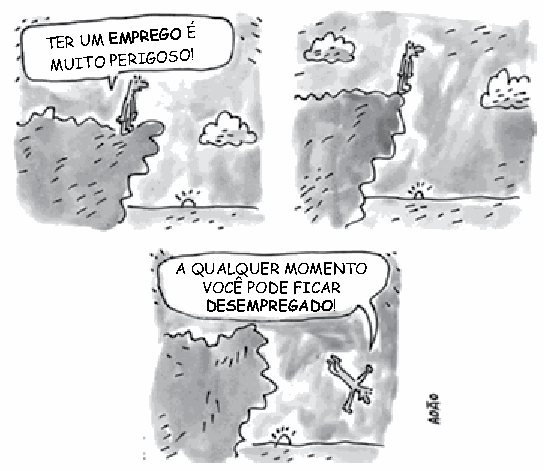
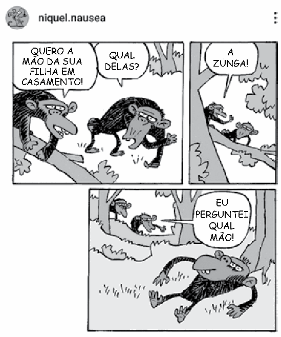
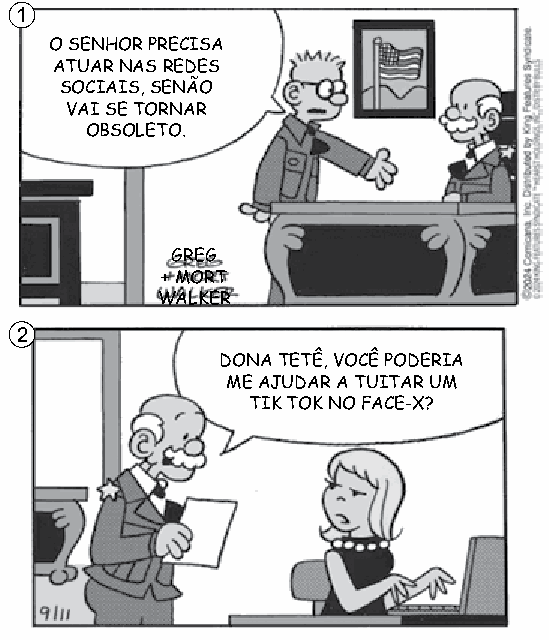
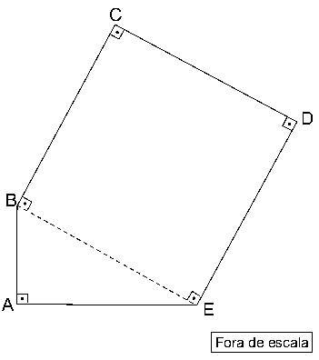
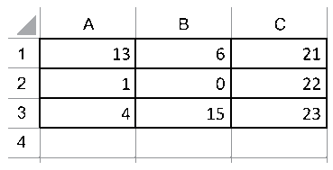
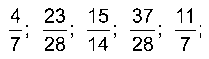
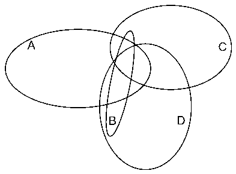

# TJ-SP 2024 (reaplicação) — Escrevente Técnico Judiciário (prova oficial)

Prova objetiva oficial do concurso de Escrevente Técnico Judiciário do TJ-SP — 2024 (reaplicação), banca Vunesp, com 100 questões e o gabarito oficial da versão 3.
As figuras foram recortadas do caderno original. O gabarito comentado está no fim do arquivo.

<!-- Gerado por tools/src/prova_to_md.py a partir de vunesp-2024-tj-sp-escrevente-tecnico-judiciario-reaplicacao-prova.pdf e 2024reaplicacao-gabarito.txt. -->

## Língua Portuguesa

> Leia a tira para responder às questões de números 01 e 02.

> (https://www.instagram.com/adaoiturrusgarai. Acesso em 20.09.2024)

**Q01.** Na perspectiva do personagem, ficar desempregado é visto como algo

- A) certeiro, consequência natural de ter emprego.
- B) possível, o que decorre do perigo de ter emprego.
- C) obrigatório, uma causa do fato de ter emprego.
- D) evitável, contrapondo-se ao perigo de ter emprego.
- E) inviável, pois se sente tranquilo sobre ter emprego.

**Q02.** A relação de sentido estabelecida entre as expressões “Ter um emprego” e “ficar desempregado” também ocorre entre os termos destacados em:

- A) A vítima citou traços genéricos da compleição física do bandido, enquanto alguns transeuntes, menos abalados, fizeram uma descrição minuciosa.
- B) A mulher ficou encantada pelo celular do marido e queria um igual, mas sabia da dificuldade de encontrar um semelhante porque o dele era importado.
- C) Todos decidiram pela professora de química como madrinha de formatura, mas ela não poderia ir; foi, entretanto, uma difícil decisão recusar aquele convite.
- D) A opção por produtos de qualidade é realmente importante para a saúde das pessoas, embora seus preços estejam certamente exagerados.
- E) A ideia da professora era ampliar a participação dos alunos nos jogos coletivos, prevendo com isso aumentar o interesse pelas competições entre turmas.

> Leia trecho do conto de Raul Pompeia para responder às questões de números 03 a 11.
>
> A andorinha da torre
>
> Desde muito tempo que o serviço da torre da Igreja de X estava confiado ao velho Emílio...
>
> Era aquele homem de barbas longas e brancas, espécie dessas figuras com que se costuma fazer a imagem mítica dos grandes rios, era aquele velho que via-se de tarde, à janela da torre sob a cúpula enorme do sino grande, olhando vagamente para o espaço, sem dar atenção ao burburinho da cidade, que circulava nas ruas lá embaixo...
>
> Os mais antigos moradores do lugar lembravam-se de que Emílio fora sempre o mesmo homem de barbas longas e brancas, o mesmo, como a ruína consagrada pelo tempo, que nunca fica mais velha. Respeitava-se muito ao velho sineiro. Era o mais honrado dos homens e, além disso, era o avô da mais galante criança que se tem visto.
>
> Por aqueles cinco quarteirões em volta não havia quem não gostasse da andorinha da torre. Festejavam muito aquela criança, davam a ela doces e beijos que não havia mãos a medir; sentiam só que ela fugisse tanto a meter-se na torre com o avô e esquecesse pelos velhos amigos de bronze que moravam lá no alto as pessoas da cidade que tanto a queriam.
>
> Mas como havia de ser se ela amava perdidamente os seus sinos e o seu avô?... Achava os sinos frios demais e pachorrentos como uns homens de idade, mas, em compensação, admirava-os, quando vovô Emílio despertava-lhes a sanha e os fazia pularem, voltearem como clowns*, precipitarem-se no espaço como se fossem desabar e ressurgirem para o alto, com a boca largamente aberta, como um sorriso de gigante satisfeito.
>
> A pequena Rita admirava os sinos. Esta admiração transformava-se em amorosa simpatia. Estranhava no fundo do espírito aqueles monstros boquiabertos que sabiam ser igualmente a imobilidade e o turbilhão, o silêncio e a trovoada; ajudava o avô a tratá-los, limpar-lhes o bojo profundo e escuro, clarear-lhes os dourados de fora, esgravatar-lhes os interstícios dos relevos que os enfeitavam...
>
> Havia amor de família naquele pequeno mundo que vivia na torre.
>
> (Raul Pompeia, A andorinha da torre.
>
> Em: https://www.biblio.com.br. Adaptado. Acesso em 12.09.2024) * palhaços

**Q03.** O narrador da história deixa claro que

- A) o velho Emílio desprezava o trabalho com os sinos da igreja, situação que se transformou depois que Rita passou a acompanhá-lo.
- B) o sentimento que a pequena Rita nutria pelos sinos da igreja era motivo para ela estar nos cuidados deles junto de seu amado avô.
- C) a pequena Rita e seu avô tinham como distração subir na torre da igreja, ficando lá desligados da cidade para aproveitar o silêncio.
- D) as pessoas da cidade se incomodavam com o sumiço da pequena Rita, sem saber que ela acompanhava o avô até a torre da igreja.
- E) o velho sineiro era indiferente às pessoas e à cidade, mas interessado na companhia da neta, a quem destinava os cuidados com os sinos.

**Q04.** Considere as passagens:

• ... o serviço da torre da Igreja de X estava confiado ao velho Emílio... (1o parágrafo)

• ... sob a cúpula enorme do sino grande... (2o parágrafo)

• ... sem dar atenção ao burburinho da cidade... (2o parágrafo)

Os termos destacados significam, correta e respectivamente:

- A) assegurado; cobertura retilínea; silêncio.
- B) transferido; varanda superior; sossego.
- C) prometido; varanda arredondada; espaço.
- D) entregue; cobertura abobadada; tumulto.
- E) destinado; aposento avarandado; movimento.

**Q05.** Identifica-se emprego de termo(s) em sentido figurado na passagem:

- A) ... os interstícios dos relevos que os enfeitavam... (6o parágrafo)
- B) ... ajudava o avô a tratá-los, limpar-lhes o bojo profundo... (6o parágrafo)
- C) Era aquele homem de barbas longas e brancas... (2o parágrafo)
- D) ... à janela da torre sob a cúpula enorme do sino grande... (2o parágrafo)
- E) ... davam a ela doces e beijos que não havia mãos a medir... (4o parágrafo)

**Q06.** Assinale a alternativa em que a reescrita do trecho – Festejavam muito aquela criança, davam a ela doces e beijos... (4o parágrafo) – está em conformidade com a norma-padrão.

- A) Festejavam-lhe muito, davam-lhe doces e beijos...
- B) Festejavam muito ela, davam-lhes doces e beijos...
- C) Festejavam-a muito, davam-a doces e beijos...
- D) Festejavam-na muito, davam-lhe doces e beijos...
- E) Festejavam-la muito, davam-lhe doces e beijos...

**Q07.** Na passagem – ... sentiam só que ela fugisse tanto a meter-se na torre com o avô e esquecesse pelos velhos amigos de bronze que moravam lá no alto as pessoas da cidade que tanto a queriam. (4o parágrafo), as preposições que iniciam as expressões destacadas estabelecem, correta e respectivamente, relações de sentido de

- A) finalidade, companhia e causa.
- B) lugar, modo e conformidade.
- C) causa, companhia e conformidade.
- D) causa, modo e consequência.
- E) finalidade, companhia e companhia.

**Q08.** O conto, escrito no século XIX, apresenta colocação pronominal desabonada pela norma-padrão atual. Isso se evidencia na passagem:

- A) ... espécie dessas figuras com que se costuma fazer a imagem mítica dos grandes rios... (2o parágrafo)
- B) Os mais antigos moradores do lugar lembravam-se de que Emílio fora sempre o mesmo homem... (3o parágrafo)
- C) ... era aquele velho que via-se de tarde, à janela da torre sob a cúpula enorme do sino grande... (2o parágrafo)
- D) ... sentiam só que ela fugisse tanto a meter-se na torre com o avô e esquecesse pelos velhos amigos de bronze... (4o parágrafo)
- E) A pequena Rita admirava os sinos. Esta admiração transformava-se em amorosa simpatia. (6o parágrafo)

**Q09.** Leia as passagens:

• Era aquele homem de barbas longas e brancas, espécie dessas figuras com que se costuma fazer a imagem mítica dos grandes rios... (2o parágrafo)

• Por aqueles cinco quarteirões em volta não havia quem não gostasse da andorinha da torre. (4o parágrafo)

Considerando-se os aspectos de sentido e de regência, as reescritas dos trechos destacados nas passagens atendem à norma-padrão, respectivamente, em:

- A) sobre que se apropria para fazer; agradasse na.
- B) de que se apela para fazer; se agradasse pela.
- C) a que se recorre para fazer; simpatizasse com a.
- D) com que se utiliza para fazer; se simpatizasse à.
- E) em que se vale para fazer; afeiçoasse da.

**Q10.** Predominam, no texto, as formas verbais do

- A) Presente do Modo Indicativo, em função das reflexões desenvolvidas pelo narrador sobre a relação do sineiro, da neta e dos sinos da igreja.
- B) Pretérito Imperfeito do Modo Indicativo, em função dos aspectos descritivos que contextualizam a rotina do sineiro e de sua neta.
- C) Futuro do Modo Subjuntivo, em função da perspectiva de curiosidade que o narrador propõe em razão da relação da neta do sineiro com os sinos.
- D) Pretérito Perfeito do Modo Indicativo, em função do relato de ações frequentemente realizadas pelo sineiro, sua neta e seus vizinhos.
- E) Pretérito Imperfeito do Modo Subjuntivo, em função das hipóteses levantadas ao longo do texto sobre os interesses do sineiro e de sua neta.

**Q11.** Conforme os sentidos expressos no texto e a norma-padrão de pontuação, a passagem – Achava os sinos frios demais e pachorrentos como uns homens de idade, mas, em compensação, admirava-os, quando vovô Emílio despertava-lhes a sanha e os fazia pularem... (5o parágrafo)

– está adequadamente reescrita em:

- A) Quando vovô Emílio despertava a sanha dos sinos, fazendo-os pularem em compensação, achava-os frios demais e vigilantes, como uns homens de idade uma vez que os admirava.
- B) Por mais que achasse os sinos frios demais, e impacientes como uns homens de idade, quando vovô Emílio despertava a sanha deles e os fazia pularem em compensação, admirava-os.
- C) Achava os sinos frios demais e calvos como uns homens de idade, em compensação, admirava-os portanto, quando a sanha destes, vovô Emílio despertava fazendo-os pularem.
- D) Achava os sinos frios demais e calmos como uns homens de idade; em compensação, admirava-os, no entanto, quando a sanha deles era despertada por vovô Emílio, que os fazia pularem.
- E) Ainda que achasse os sinos frios demais e lentos como uns homens de idade, admirava-os em compensação, quando a sanha deles, vovô Emílio fazia despertar e eles pulavam.

**Q12.** Leia a tira.

(Cartunista Fernando Gonzales. Em: https://www.instagram.com/niquelnausea. Acesso em 23.09.2024)

O efeito de humor da tira decorre

- A) do duplo sentido que os dois personagens atribuem ao termo “casamento”.
- B) do questionamento incoerente “qual delas?”, considerando que só há uma filha.
- C) da falta de interesse de Zunga pelo pedido de casamento que estava sendo feito.
- D) do entendimento do pai de que a filha estava sendo pedida em casamento.
- E) da interpretação equivocada que os personagens fazem dos termos “mão” e “filha”.

*Leia o texto para responder às questões de números 13 a 19.*
> Sensações apocalíticas
>
> Na capa do jornal Estado de terça-feira, uma foto mostra Brasília submersa em fumaça densa, quase opaca. Na TV, paredões de fogo se levantam e marcham. A olho nu, a fuligem se derrama sobre a cidade; filamentos de carvão vindos no vento aterrissam como libélulas no capô do automóvel de um milhão de reais. O desastre climático é um desastre social, que castiga antes os de baixo, mas quando se impõe para valer não respeita a segregação entre as classes. Não respeita nada, cobre até os astros no céu. A Lua fica vermelha, como se obedecesse ao Apocalipse (6:12): “Inteira como sangue”.
>
> Sol prata, chuva preta (isso quando chove). Aumentam as internações nos hospitais. Sobem os óbitos por problemas respiratórios. O noticiário dá conta de que um território equivalente ao Estado de Roraima já virou cinza. A realidade se mostra pior do que as previsões da teoria.
>
> O livro A Terra Inabitável, do jornalista americano David Wallace-Wells, passava por pessimista ao ser lançado, em 2017, mas agora parece brando. Seu alerta de que o descongelamento do solo do Alasca e da Sibéria liberaria gases de efeito estufa e ressuscitaria micro-organismos capazes de desencadear epidemias desconhecidas foi superado por cenários ainda mais assustadores.
>
> O cientista Carlos Nobre se declarou “apavorado”. Num artigo publicado no UOL, ele retomou o adjetivo que deu título ao livro de Wallace-Wells e sentenciou: “Se a temperatura global aumentar em 4º C até 2100, grande parte do planeta, incluindo o Brasil, pode se tornar inabitável”. O Rio Solimões se reduziu a um riacho fantasma, inabitável para peixes. As metrópoles estrebucham entre dois extremos: no primeiro, inundações infectas alagam as casas com doenças e lama; no segundo, a seca ameaça matar de sede os moradores.
>
> Para onde quer que se olhe, proliferam os sinais de esfacelamento generalizado.
>
> (Eugênio Bucci, Sensações Apocalíticas.
>
> Em: https://www.estadao.com.br/opiniao, 19.09.2024. Adaptado)

**Q13.** Na opinião do autor, a situação ambiental do país

- A) pode estar mudando a forma como os cidadãos interagem com as metrópoles, que, paradoxalmente, estão menos suscetíveis ao caos ambiental.
- B) vem superando os cenários mais negativos previstos, intensificados pela crescente destruição a que estão expostas as cidades nos últimos meses.
- C) promete mudar a segregação indesejada no país, criando elos entre as diferentes classes para evitar que todos sejam expostos às mudanças climáticas.
- D) está castigando seletivamente as pessoas, uma vez que os mais afortunados economicamente têm condições de evitar o desastre social.
- E) indica estar muito ruim com as recentes queimadas, o que ainda sugere ser insuficiente para dizer que o mundo esteja vivendo mudanças climáticas.

**Q14.** O autor usa a referência ao livro bíblico Apocalipse, ao livro A Terra Inabitável e ao artigo do cientista Carlos Nobre com a intenção de

- A) ratificar seu ponto de vista sobre os desastres ambientais.
- B) explicar as considerações falaciosas presentes nesses textos.
- C) condenar exageros prejudiciais à saúde mental da população.
- D) mostrar a situação atual como mais amena que as previsões.
- E) ironizar as previsões catastróficas que nunca se concretizaram.

**Q15.** Nas passagens –... mas quando se impõe para valer... (1o parágrafo) – e – As metrópoles estrebucham entre dois extremos... (4o parágrafo) –, as expressões destacadas significam, respectivamente:

- A) absolutamente; definham.
- B) por completo; desaparecem.
- C) intencionalmente; estremecem.
- D) de verdade; afligem-se.
- E) a sério; equilibram-se.

**Q16.** Na frase final do texto – Para onde quer que se olhe, proliferam os sinais de esfacelamento generalizado. –, a informação destacada permite inferir corretamente que

- A) a devastação é uma realidade subjetiva.
- B) a realidade do país supera dificuldades.
- C) a ruína é uma realidade incontestável.
- D) a realidade é melhor do que aparenta.
- E) a degradação humana supera a ambiental.

**Q17.** Considere as passagens:

• Não respeita nada, cobre até os astros no céu. (1o parágrafo)

• Seu alerta de que o descongelamento do solo... (3o parágrafo)

• ... ele retomou o adjetivo... (4o parágrafo)

As expressões destacadas mantêm relação coesiva, correta e respectivamente, com os termos:

- A) A Lua; O livro; inabitável.
- B) vermelha; David Wallace-Wells; assustadores.
- C) A Lua; David Wallace-Wells; apavorado.
- D) as classes; O livro; alerta.
- E) as classes; A Terra Inabitável; Terra.

**Q18.** A concordância verbal e a concordância nominal estão em conformidade com a norma-padrão na seguinte reescrita de informações do texto:

- A) Os dois extremos vividos recentemente vem fazendo as metrópoles estrebucharem, vítima de inundações infectas ou de seca.
- B) No Rio Solimões, faltam condições de sobrevivência aos peixes, pois as águas abundantes foram reduzidas a um riacho fantasma.
- C) Tornou-se uma realidade em muitas cidades do país filamentos de carvão e fumaça, que poderia ser visto a olho nu se espalhando.
- D) 4º C até 2100, segundo o cientista Carlos Nobre sentenciou, pode tornar todos os países do planeta Terra inabitável.
- E) Superaram-se com cenários ainda mais assustadores o alerta de David Wallace-Wells, como atesta os recentes extremos climáticos.

**Q19.** Considere as passagens:

• ... uma foto mostra Brasília submersa em fumaça densa... (1o parágrafo)

• ... que castiga antes os de baixo... (1o parágrafo)

• Sobem os óbitos por problemas respiratórios. (2o parágrafo)

• ... a seca ameaça matar de sede os moradores. (4o parágrafo)

De acordo com a norma-padrão e o sentido original, a reescrita de Brasília submersa em fumaça densa, o sinônimo de antes e as relações estabelecidas pelas preposições por e de são, respectivamente:

- A) Brasília com fumaça densa; provavelmente; modo; companhia.
- B) Brasília ante fumaça densa; primeiramente; consequência; modo.
- C) Brasília sobre fumaça densa; principalmente; causa; companhia.
- D) Brasília entre fumaça densa; preteritamente; consequência; modo.
- E) Brasília sob fumaça densa; preferencialmente; causa; causa.

**Q20.** Agora, o quadro se agravou. Os fatos nos põem frente \_\_\_\_\_\_ frente com o exaurimento não dos impérios, não da humanidade, mas do planeta Terra. Estamos presenciando \_\_\_\_\_\_ fadiga do material e do imaterial: fadiga da natureza e das narrativas sobre a natureza, fadiga do Corpo de Bombeiros e dos métodos incorpóreos de combate \_\_\_\_\_\_ queimadas. Fadiga da fadiga.

(Eugênio Bucci, Sensações Apocalíticas. Em: https://www.estadao.com.br/opiniao, 19.09.2024. Adaptado)

Em conformidade com a norma-padrão, as lacunas do texto devem ser preenchidas, respectivamente, com:

- A) a ... à ... às
- B) a ... a ... às
- C) à ... a ... a
- D) a ... à ... as
- E) à ... a ... à

*Leia o texto para responder às questões de números 21 a 24.*
> Recruta Zero – Mort Walker

> (Mort Walker, “Recruta Zero”.
>
> https://cultura.estadao.com.br/quadrinhos, 20.09.2024)

**Q21.** Com a frase do personagem no 2o quadro, conclui-se corretamente que ele decidiu

- A) demonstrar proficiência em relação às redes sociais.
- B) minimizar a sua presença nas redes sociais.
- C) dissentir da sugestão que recebeu do colega.
- D) desincompatibilizar-se com as redes sociais.
- E) assumir humildemente sua inépcia nas redes sociais.

**Q22.** O termo obsoleto (1o quadro) é antônimo de

- A) arcaico.
- B) anacrônico.
- C) hodierno.
- D) indecoroso.
- E) efêmero.

**Q23.** Conforme os sentidos expostos no 1o quadro e o respeito à norma-padrão, a frase do personagem admite a versão:

- A) Quem tornará-se obsoleto é quem não agir nas redes sociais. Desse modo, o senhor atua nelas.
- B) Se tornará obsoleto quem não atuar nas redes sociais. Entretanto, o senhor precisa agir nelas.
- C) Tem tornado-se obsoleto quem não age nas redes sociais. Assim, o senhor precisa atuar nelas.
- D) Caso não atue-se nas redes sociais, torna-se obsoleto. Apesar disso, o senhor precisa agir nelas.
- E) Tornar-se-á obsoleto quem não atuar nas redes sociais. Portanto, o senhor precisa agir nelas.

**Q24.** A regência nominal atende à norma-padrão em:

- A) Ao ser alertado que deveria atuar nas redes sociais, o chefe decidiu recorrer à ajuda de dona Tetê.
- B) O rapaz mostrava-se cioso da atuação do chefe nas redes sociais, razão pela qual lhe deu o conselho.
- C) O chefe decerto não tinha aspiração com uma grande atuação nas redes sociais, mas acatou o conselho.
- D) Com seu pedido, o chefe considerou que dona Tetê estaria apta de ajudá-lo com as redes sociais.
- E) A necessidade em uma atuação nas redes sociais fez o chefe prontamente pedir ajuda à dona Tetê.

## Conhecimentos em Direito

## Direito Penal

**Q25.** Tendo em conta as condutas criminalizadas no artigo 296, caput e parágrafos, do Código Penal (crime de falsificação de selo ou sinal público), é correto afirmar:

- A) todas as modalidades previstas exigem elemento subjetivo especial, consistente na finalidade de prejudicar terceiros, em benefício próprio ou alheio.
- B) a modalidade de falsificar, prevista no caput, tem por objeto material selo para autenticação de ato oficial da União e dos Estados, excluídos os Municípios.
- C) a modalidade de utilizar, prevista no inciso II, do parágrafo 1o, tem por objeto material selo ou sinal público verdadeiros.
- D) todas as modalidades previstas são crime de perigo abstrato, não se exigindo resultado naturalístico diverso da conduta realizada.
- E) todas as modalidades previstas são crimes próprios de funcionários públicos.

**Q26.** Caio, comerciante, contratou Mévia para trabalhar como recepcionista na loja de sua propriedade, tendo procedido à anotação do contrato de trabalho na carteira profissional, mas com remuneração menor à efetivamente paga. Tício alterou o número do chassi constante do documento de Certificado de Registro e Licenciamento de Veículo. Seprônia, em petição protocolizada em processo em que atua como advogada, afirmou de forma inverídica a hipossuficiência de Mévio, seu cliente, para o fim da concessão da justiça gratuita. Mévio, por sua vez, cliente de Seprônia, firmou declaração inverídica de hipossuficiência, para instruir pedido de justiça gratuita. Com base nas situações hipotéticas, assinale a alternativa correta.

- A) Tício, em tese, incorreu no crime de falsidade de documento público.
- B) Mévio, em tese, incorreu no crime de falsidade de documento particular.
- C) Mévia, em tese, ao permitir a anotação de informação não verdadeira em sua carteira profissional, incorreu no crime de falsidade ideológica, em coautoria com Caio.
- D) Caio, em tese, incorreu no crime de falsidade de documento particular, na modalidade omissiva, já que deixou de anotar a correta remuneração de Mévia.
- E) Seprônia, em tese, incorreu no crime de falsidade de documento público.

**Q27.** Caio, após finalizar e resolver prova para seleção em exame público, ao deixar o local, através de equipamento eletrônico (ponto de escuta), passa a divulgar o gabarito das questões a Mévia, sua namorada, que também prestava o exame. Contudo, Mévia, após assinalar algumas das respostas ditadas na folha própria, é flagrada pelo fiscal da prova, sendo imediatamente desclassificada. Caio também foi desclassificado, e o exame público foi mantido, sem a necessidade de anulação, dada a inocorrência de prejuízo.

Com base na situação hipotética e tendo em vista o crime de fraude em certames de interesse público, previsto no artigo 311-A do CP, assinale a alternativa correta.

- A) Caio e Mévia não incorreram no crime de fraude em certame de interesse público, que tem por objeto material apenas concurso público e processo seletivo para ingresso no ensino superior.
- B) Caio e Mévia não incorreram no crime de fraude em certame de interesse público, que, para se caracterizar, exige o recebimento de vantagem patrimonial indevida.
- C) Caio incorreu no crime de fraude em certame de interesse público, pois divulgou conteúdo sigiloso de certame público. Mévia, contudo, não incorreu nesse crime, pela atipicidade da conduta de utilizar conteúdo sigiloso em certame público.
- D) Caio e Mévia incorreram no crime de fraude em certame de interesse público; ele, por divulgar conteúdo sigiloso de certame público, e ela, por utilizar esse conteúdo.
- E) Caio e Mévia não incorreram no crime de fraude em certame de interesse público, que, para se caracterizar, exige a ocorrência de prejuízo à administração pública, o que inexistiu.

**Q28.** Considerando os crimes de concussão e de excesso de exação, previstos no caput e nos parágrafos do artigo 316 do Código Penal, é correto afirmar:

- A) são crimes formais.
- B) o crime de excesso de exação prevê a extinção da punibilidade, na hipótese de reparação do dano, até a sentença condenatória irrecorrível.
- C) admitem a modalidade culposa.
- D) são crimes materiais.
- E) o crime de concussão, previsto no caput, é formal, mas a figura qualificada, do crime de excesso de exação, previsto no parágrafo 2o, é material.

**Q29.** Caio, em aplicativo de namoro, apresenta-se como delegado de polícia, sem ser, ostentando foto de distintivo da Polícia Civil. Mévia, ao ser abordada por oficial de justiça para proceder sua citação, recusa-se a receber e assinar o mandado. Tício, intencionalmente, inutilizou o lacre colocado por perito criminal do Instituto Médico Legal para cerrar e preservar quarto de hotel em que fora praticado um crime. Seprônio inutilizou livro fiscal da empresa privada onde trabalhava. Tícia xingou o seu vizinho, que é funcionário público, de ignorante e agressor de mulheres.

Com base nas situações hipotéticas, assinale a alternativa correta.

- A) Mévia praticou o crime de resistência (artigo 329 do CP).
- B) Seprônio praticou o crime de subtração ou inutilização de livro ou documento (artigo 337 do CP).
- C) Tício praticou o crime de inutilização de edital ou sinal (artigo 336 do CP).
- D) Tícia praticou o crime de desacato (artigo 331 do CP).
- E) Caio praticou o crime de usurpação de função pública (artigo 328 do CP).

**Q30.** A respeito dos crimes contra a administração da justiça, assinale a alternativa correta.

- A) No crime de denunciação caluniosa, incidirá causa de aumento da pena se a imputação mentirosa for de crime.
- B) O crime de desobediência à decisão judicial sobre perda ou suspensão de direito admite a modalidade culposa.
- C) O crime de exploração de prestígio é material em todas as modalidades.
- D) No crime de falso testemunho ou falsa perícia, é extinta a punibilidade, se o agente se retrata ou declara a verdade, até sentença irrecorrível no processo instaurado para apurar aludido crime.
- E) O crime de fraude processual, para se caracterizar, exige o elemento subjetivo especial, consistente no especial fim de induzir a erro o juiz ou o perito.

## Direito Processual Penal

**Q31.** Tendo em vista as causas de impedimento, suspeição e incompatibilidade previstas no Código de Processo Penal, assinale a alternativa correta.

- A) O juiz que, anteriormente à investidura, atuou no processo como auxiliar da justiça não está impedido de exercer jurisdição no feito, já que a vedação é restrita às funções de advogado, promotor de justiça, delegado de polícia, perito e testemunha.
- B) O desembargador do Tribunal não poderá atuar em julgamento de recurso contra decisão proferida em processo em que ele próprio, atuando como juiz de primeiro grau, tenha se pronunciado sobre questão de fato ou de direito.
- C) A dissolução do casamento não faz cessar a causa de impedimento decorrente de parentesco por afinidade, ainda que ausente descendente. Contudo, faz cessar a causa de suspeição, ainda que sobrevier descendente.
- D) Nos juízos coletivos, não poderão servir no mesmo processo juízes que forem parentes consanguíneos entre si, em linha reta ou colateral, inexistindo proibição, contudo, quanto aos que forem parentes afins, em linha colateral.
- E) Uma vez que o Ministério Público, no processo penal, é titular da ação penal pública e atua como parte interessada, a ele não se aplicam as regras de suspeição e impedimento.

**Q32.** A respeito da figura do acusado e do defensor, é correto afirmar:

- A) o defensor público que, sem justo motivo, abandonar a defesa do acusado, responderá por infração disciplinar perante o próprio juízo criminal.
- B) a ausência do defensor à audiência previamente designada, ainda que justificada, não implicará adiamento do ato; entretanto, o juiz nomeará defensor dativo para representar o acusado.
- C) nenhum acusado ausente será processado ou julgado sem defensor; o foragido, contudo, sim.
- D) parente do juiz não poderá figurar como advogado do acusado; tal impedimento não se aplica, contudo, ao defensor público.
- E) em caso de abandono do processo pelo defensor, em não sendo localizado o acusado para constituir um novo, o juiz nomeará defensor público ou advogado dativo para a sua defesa.

**Q33.** Nos termos do Código de Processo Penal, Tício, diretor do cartório da 1a Vara Criminal da Comarca X, sendo amigo íntimo de Caio, réu em processo penal que tramita na respectiva Vara,

- A) não poderá atuar no feito, em razão de se tratar de causa de suspeição de juiz, extensiva aos serventuários e funcionários da Justiça.
- B) poderá atuar no feito, haja vista que apenas as causas de impedimento do juiz são extensivas aos serventuários e funcionários da Justiça.
- C) não poderá atuar no feito, em razão de se tratar de causa de impedimento de juiz, extensiva aos serventuários e funcionários da Justiça.
- D) poderá atuar no feito, haja vista que as causas de impedimento de juiz são extensivas apenas aos membros do Ministério Público e aos peritos oficiais.
- E) poderá atuar no feito, haja vista que as causas de suspeição e impedimento do juiz são extensivas apenas aos serventuários da justiça, e não aos funcionários da Justiça.

**Q34.** Caio teve recebida, pelo juiz, a denúncia ofertada pelo Ministério Público. Determinada sua citação pessoal, o oficial de justiça esteve, por diversas vezes, no endereço constante dos autos e, desconfiando de que Caio estava se ocultando para não receber a citação, citou-o por hora certa. Como Caio não constituiu defensor nem compareceu ao feito, o juiz suspendeu o processo e o prazo prescricional.

Com base na situação hipotética, assinale a alternativa correta.

- A) A citação por hora certa, embora sem previsão expressa no Código de Processo Penal, é admitida como forma de cientificar o réu da acusação e tem como consequência a suspensão do processo e da prescrição.
- B) É correta a suspensão do processo e do prazo prescricional, visto que a citação por hora certa é ficta e não comporta a nomeação de defensor dativo ou público, em caso de não comparecimento do acusado.
- C) A citação por hora certa não tem previsão no processo penal e, não sendo localizado o acusado no endereço constante dos autos e inexistindo informação a respeito de outro, a citação deveria ter se dado por edital.
- D) A citação por hora certa, embora ficta, não autoriza a suspensão do processo, devendo o juiz, na hipótese de não comparecimento do acusado, nomear defensor dativo, prosseguindo-se o processo.
- E) É correta a suspensão do processo, mas não a suspensão do prazo prescricional, que se aplica apenas à situação de citação por edital.

**Q35.** Mévio foi denunciado por crime apenado com pena máxima privativa de liberdade de 3 anos. Após 15 dias da devida citação, Mévio, tendo constituído advogado, apresentou resposta à acusação, pleiteando a absolvição sumária. Na mesma ocasião, arrolou oito testemunhas de defesa. O juiz, em decisão, afirmou que o procedimento previsto para o crime imputado não admite a possibilidade de absolvição sumária, dando prosseguimento à instrução processual. Ainda, reputando precluso o rol de testemunhas apresentado fora do prazo, designou audiência para oitiva das testemunhas de acusação e interrogatório. Intimado pessoalmente para o interrogatório, Mévio não compareceu ao ato. Seu defensor, presente à audiência, afirmou que, por se tratar de meio de defesa, Mévio poderia não participar do interrogatório, pleiteando a respectiva dispensa. O juiz decretou a revelia de Mévio e, dando prosseguimento ao processo, deu a palavra ao advogado de defesa e ao membro do Ministério Público, para debates orais.

Tendo em vista o crime imputado a Mévio, é correto afirmar que o procedimento a ser seguido deve ser

- A) o ordinário, sendo possível, por expressa disposição legal, a absolvição sumária, após a apresentação da resposta à acusação.
- B) o sumário, em que é vedada, por expressa disposição legal, a absolvição sumária, após a apresentação da resposta à acusação.
- C) o ordinário, em que se admite arrolar até oito testemunhas, no prazo legal para a resposta à acusação, mas, tratando-se de processo penal, é inviável reputar precluso o rol de testemunhas apresentado fora do prazo.
- D) o sumário, sendo vedada, por expressa disposição legal, a substituição dos debates orais por memoriais escritos.
- E) o sumário e, tendo o acusado não comparecido a ato do qual foi devidamente intimado, ainda que se trate do interrogatório, é possível a decretação da revelia, prosseguindo-se o feito sem sua presença.

**Q36.** Mévia foi denunciada pela prática do crime de homicídio simples, tentado. Finalizada a instrução preliminar, o juiz, convencido da materialidade do fato e da existência de indícios suficientes de autoria, a pronuncia, pela prática de crime de homicídio simples, tentado. Da decisão da pronúncia, o defensor constituído por Mévia foi intimado pelo órgão de imprensa oficial. Mévia, contudo, não foi pessoalmente intimada. Irresignado, o defensor de Mévia interpôs apelação, que não foi conhecida pelo Tribunal de Justiça. Posteriormente, noticiou-se nos autos que a vítima veio a falecer, tendo o juiz, de ofício, alterado a pronúncia anterior, para constar a prática de homicídio simples consumado.

Com base na situação hipotética, assinale a alternativa correta.

- A) A decisão de pronúncia, uma vez preclusa a impugnação, não comporta alteração, para seu aditamento, o que não impede, contudo, que a circunstância da morte da vítima seja apreciada em plenário do júri.
- B) Da decisão de pronúncia do acusado, cabe apelação, sendo possível, entretanto, impetrar habeas corpus.
- C) Embora seja possível alterar a pronúncia, ainda que preclusa a impugnação, por fato superveniente, não cabe ao juiz proceder, de ofício, devendo abrir vista ao Ministério Público para aditamento da denúncia.
- D) A intimação da decisão de pronúncia, tanto para o acusado quanto para o defensor constituído, deve se dar de forma pessoal.
- E) Uma vez que há defensor constituído, é dispensada a intimação pessoal do acusado quanto à decisão de pronúncia, sendo suficiente, para fins de cientificação, a intimação do causídico pelo órgão de imprensa oficial.

**Q37.** Tendo em vista a Lei no 9.099/95, na parte correspondente ao Juizado Especial Criminal, é correto afirmar:

- A) a pena restritiva aplicada em decorrência do acordo homologado judicialmente implicará reincidência, impedindo novamente o mesmo benefício no prazo de 5 anos.
- B) as obrigações a que ficará sujeito o acusado, em eventual acordo de suspensão condicional do processo, não se restringem às citadas na lei, podendo o juiz fixar outras, desde que adequadas ao fato e à condição pessoal do acusado.
- C) a possibilidade de aplicação imediata de pena restritiva de direito, em proposta formulada pelo Ministério Público, é cabível aos crimes processáveis por ação penal pública incondicionada e vedada aos crimes de ação pública condicionada.
- D) a composição dos danos civis entre o autor do fato e a vítima, homologada pelo juiz, implica renúncia ao direito de representação nos crimes de ação penal pública condicionada e extinção da punibilidade nos crimes de ação penal pública incondicionada.
- E) não aceita ou não sendo caso de proposta de aplicação imediata de pena restritiva de direito e tendo o Ministério Público oferecido denúncia, eventual rejeição, pelo juiz, poderá ser impugnada por recurso em sentido estrito.

## Direito Processual Civil

**Q38.** Na 2a Vara Cível da Comarca de São Bartolomeu, o juiz titular encaminha dois despachos, em dois processos diferentes, para publicação. O chefe da secretaria, Marcelo, é responsável pela organização dos processos e pela gestão dos prazos. O primeiro despacho recebido é relativo a uma ação de indenização decorrente de um acidente de trânsito proposta por Helena. O segundo despacho recebido, reconhecido pelo juiz em seu pronunciamento judicial como ato urgente, é relativo a uma ação proposta por João, buscando uma tutela antecipada em caráter de urgência para evitar a alienação de um imóvel. Marcelo, então, publica primeiro o despacho relativo ao processo de Helena e, no dia seguinte, publica o despacho do processo de João.

Com base na situação hipotética, assinale a alternativa correta.

- A) Marcelo agiu corretamente, uma vez que a lei estabelece que ele atenderá, obrigatoriamente, à ordem cronológica de recebimento para publicação e efetivação dos pronunciamentos judiciais.
- B) O juiz poderá, de ofício, requisitar informações a Marcelo sobre a obediência à ordem cronológica, que deverão ser prestadas no prazo de 5 (cinco) dias.
- C) Marcelo disponibilizará a lista de processos recebidos desde que mediante pedido fundamentado de João.
- D) Se for constatada a preterição de João, o juiz determinará o imediato cumprimento do ato e a instauração de processo administrativo disciplinar contra Marcelo.
- E) João, sentindo-se preterido, deverá reclamar ao juiz por meio de procedimento administrativo.

**Q39.** Na 1a Vara Cível da Comarca X, tramita uma ação de cobrança movida por Carlos contra a fictícia empresa ABC, referente a uma dívida de R$ 200.000,00 (duzentos mil reais). Terminada a fase de instrução, o juiz responsável recebeu o processo para prolatar a sentença. Passados 50 (cinquenta) dias sem qualquer decisão, a defesa de Carlos protocola uma petição cobrando o andamento do processo, alegando que a demora está causando prejuízos financeiros graves ao autor, que depende do valor da condenação para o seu sustento. Com base na situação hipotética, assinale a alternativa correta.

- A) Caso o juiz intimado a prolatar a sentença mantenha-se inerte, os autos serão remetidos ao seu substituto legal para decisão em 10 (dez) dias.
- B) Carlos não tem razão para representar ao corregedor do tribunal uma vez que o juiz tem prazo de 60 (sessenta) dias para proferir sentença.
- C) Carlos, o Ministério Público ou qualquer outro interessado no processo, ainda que não seja parte, poderá representar ao corregedor do tribunal contra o juiz que injustificadamente excedeu os prazos para proferir a sentença.
- D) Se não for o caso de arquivamento liminar da representação, o juiz será intimado, por meio de carta com aviso de recebimento, para, querendo, apresentar justificativa no prazo de 15 (quinze) dias.
- E) Sem prejuízo das sanções administrativas cabíveis, passado o prazo concedido para apresentação da justificativa pelo juiz, o corregedor do tribunal determinará a prolação da sentença em 15 (quinze) dias.

**Q40.** Na Vara Cível de Montanha Verde, Mariana move uma ação de cobrança contra João pelo não pagamento de um contrato de prestação de serviços de consultoria, no valor de R$ 10.000,00. Na petição inicial, Mariana junta o contrato assinado por ambos, notas fiscais dos serviços prestados e e-mails nos quais João reconhece a dívida. João, por sua vez, apresenta contestação, alegando apenas dificuldades financeiras, sem opor prova capaz de gerar dúvida razoável.

Com base na situação hipotética, é correto afirmar que o juiz poderá conceder tutela

- A) antecipada em caráter incidental.
- B) cautelar em caráter incidental.
- C) da evidência.
- D) antecipada em caráter antecedente.
- E) cautelar em caráter antecedente.

**Q41.** Na 1a Vara Cível de Nova Esperança, Pedro move uma ação contra a fictícia construtora Move Ltda. alegando vícios de construção no imóvel adquirido. Pedro pede indenização por danos materiais, referente aos custos de reparos, e indenização por danos morais, alegando que o estresse com a situação impactou sua saúde. Após a fase de instrução, o juiz verifica que o pedido de danos materiais já pode ser julgado de imediato, pois a perícia técnica comprovou os defeitos de construção e os valores necessários para o conserto, não havendo necessidade de mais provas. Entretanto, quanto ao pedido de danos morais, o juiz entende que ainda é necessária a produção de prova testemunhal, para verificar o impacto emocional sobre Pedro, e decide adiar essa parte do julgamento, proferindo decisão condenando a construtora Move Ltda. a pagar o valor relativo aos danos materiais que será posteriormente liquidado.

Com base na situação hipotética, assinale a alternativa correta.

- A) Apenas no caso em que a construtora Move Ltda. não interponha recurso contra a decisão, Pedro poderá executar desde logo a obrigação.
- B) O cumprimento da decisão deverá ser processado nos mesmos autos.
- C) A decisão do juiz está incorreta, uma vez que a matéria não comporta o julgamento parcial do mérito, devendo todo o objeto do processo ser abrangido por uma única sentença.
- D) A decisão do juiz é impugnável por meio de agravo de instrumento.
- E) Pedro poderá executar desde logo a obrigação reconhecida na decisão, desde que mediante caução.

**Q42.** Em uma ação de indenização movida por Cleide contra o Banco X, na qual Cleide pagou as custas processuais, o relator do caso no Tribunal de Justiça, desembargador Roberto, decide monocraticamente negar o agravo de instrumento interposto por Cleide, alegando falta de urgência. Cleide, insatisfeita com a decisão monocrática, entende que a urgência estava claramente demonstrada, já que sua conta bancária foi indevidamente bloqueada. Assim, ela interpõe um agravo interno, requerendo que a Câmara Cível reconsidere a decisão, submetendo-a à análise colegiada. O órgão colegiado, por sua vez, em votação unânime, julga improcedente o agravo interno interposto.

Com base na situação hipotética, é correto afirmar que Cleide

- A) não será condenada a pagar multa, uma vez que, para isso, seria necessário que o agravo interno fosse manifestamente inadmissível.
- B) será condenada a pagar multa no valor de até 10% (dez por cento) sobre o valor atualizado da causa.
- C) será condenada a pagar multa, cujo valor será revertido ao próprio Tribunal de Justiça.
- D) deverá ser condenada ao pagamento da multa fixada entre 1% e 5% por cento do valor atualizado da causa, que poderá ser paga ao final do processo.
- E) apenas poderá interpor qualquer outro recurso se depositar previamente o valor da multa a ela fixada.

**Q43.** Com base nas situações hipotéticas apresentadas a seguir, acerca das partes no Juizado Especial Cível, assinale a alternativa correta.

- A) Teresa decide propor ação contra Elis por danos morais em razão de uma publicação ofensiva em suas redes sociais. Para tanto, contrata advogado e concede a ele um mandato verbal com poderes gerais.
- B) Se Raquel propuser ação contra uma pessoa jurídica, deverá ter assistência judiciária prestada por órgão instituído pelo Juizado Especial, na forma da lei local.
- C) Cláudia processa Ricardo por danos materiais após um acidente de carro. Ricardo contesta, alegando que a colisão ocorreu por uma falha mecânica em seu veículo, causada pela fictícia oficina mecânica Boa Vista, que fez a manutenção recente. Ricardo pede a denunciação da lide, solicitando que a oficina seja incluída no processo, já que ela é a responsável pelos danos.
- D) Alexandre propôs ação contra a fictícia empresa Flores do Amanhã S.A. perante uma Vara do Juizado Especial Cível da Capital, cobrando indenização por danos morais em razão do atraso na entrega de flores para o seu casamento. A empresa Flores do Amanhã S.A. poderá ser representada por preposto, desde que com vínculo empregatício, munido de carta de preposição com poderes para transigir.
- E) Vinícius, de dezesseis anos, independentemente de assistência, propõe ação contra Manuel, requerendo o cumprimento do contrato firmado para a pintura da sua sala de estudos, sendo possível a conciliação entre as partes.

**Q44.** Acerca do pedido de uniformização de interpretação de lei quando houver divergência entre decisões proferidas por Turmas Recursais nos Juizados Especiais da Fazenda Pública, assinale a alternativa correta.

- A) Se necessário, nos casos em que a orientação acolhida pelas Turmas de Uniformização foi objeto de pedido de manifestação perante o Superior Tribunal de Justiça, o relator pedirá informações ao Presidente da Turma Recursal ou ao Presidente da Turma de Uniformização e, nos casos previstos em lei, ouvirá o Ministério Público, no prazo de 15 (quinze) dias.
- B) O pedido fundado em divergência entre Turmas do mesmo Estado será julgado em reunião conjunta das Turmas em conflito, sob a presidência de desembargador indicado pelo Tribunal de Justiça.
- C) Caberá pedido de uniformização sobre questões de direito processual.
- D) Quando as Turmas de diferentes Estados derem a lei federal interpretações divergentes, o pedido será julgado pelo Supremo Tribunal Federal.
- E) Eventuais pedidos de uniformização fundados em questões idênticas e recebidos subsequentemente em quaisquer das Turmas Recursais, nos casos em que a orientação acolhida pelas Turmas de Uniformização foi objeto de pedido de manifestação perante o Supremo Tribunal Federal, ficarão retidos nos autos, aguardando pronunciamento deste.

## Direito Constitucional

**Q45.** No tocante aos direitos e deveres individuais e coletivos, a Constituição Federal estabelece que

- A) nenhuma pena passará da pessoa do condenado, sendo vedada a pena de trabalhos forçados e de perdimento de bens.
- B) a lei considerará crimes inafiançáveis e insuscetíveis de graça ou anistia, entre outros, o tráfico ilícito de entorpecentes e os homicídios culposos contra a vida.
- C) é reconhecida a instituição do júri, com a organização que lhe der a lei, assegurados, entre outros, a plenitude de defesa e o sigilo dos veredictos.
- D) o preso tem direito à identificação dos responsáveis por sua prisão ou por seu interrogatório policial.
- E) constitui crime inafiançável e imprescritível a ação de grupos armados, civis ou militares, contra o Estado brasileiro e a Administração Pública.

**Q46.** A Constituição Federal estabelece que ficará o seu autor, salvo comprovada má-fé, isento de custas judiciais e do ônus da sucumbência, quando da propositura da seguinte ação judicial:

- A) habeas corpus.
- B) ação popular.
- C) ação civil pública.
- D) mandado de segurança.
- E) habeas data.

**Q47.** Conforme o disposto expressamente na Constituição Federal, o mandado de segurança coletivo pode ser impetrado, entre outros, por

- A) partido político com representação no Congresso Nacional e por associação legalmente constituída e em funcionamento há pelo menos um ano, em defesa dos interesses de seus membros.
- B) entidade de classe legalmente constituída há pelo menos um ano, em defesa da sociedade, e pelo Ministério Público, em defesa do interesse público.
- C) qualquer partido político e pelo Conselho Federal da Ordem dos Advogados do Brasil, em defesa do interesse público e da sociedade.
- D) partido político com representação no Congresso Nacional e por associação legalmente constituída há pelo menos dois anos, em defesa do interesse público.
- E) organização sindical legalmente constituída e em funcionamento há pelo menos dois anos, em defesa dos interesses de seus membros, e pela Ordem dos Advogados do Brasil, em defesa da sociedade.

**Q48.** Sumaia, de 18 anos de idade, foi contratada para trabalhar em uma empresa, em função considerada insalubre, durante o horário noturno.

Considerando o disposto na Constituição Federal a respeito dos direitos dos trabalhadores, é correto afirmar que Sumaia

- A) deverá receber o adicional pelo trabalho noturno com remuneração superior à do horário diurno em, no mínimo, 20 (vinte) por cento e o adicional de insalubridade de 50 (cinquenta) por cento.
- B) não poderá exercer função considerada insalubre durante o horário noturno, por expressa vedação do texto constitucional.
- C) terá direito à irredutibilidade do salário, salvo o disposto em convenção ou acordo coletivo, e ao adicional de remuneração para a atividade insalubre.
- D) terá o direito ao adicional noturno com remuneração superior a, no mínimo, 50 (cinquenta) por cento à do normal e ao adicional de insalubridade, na forma da lei.
- E) terá direito de ação, quanto a eventuais créditos trabalhistas, com prazo prescricional de dois anos, até o limite de três anos após a extinção do contrato de trabalho.

**Q49.** A Constituição Federal dispõe, sobre a administração pública, que

- A) as administrações tributárias da União, dos Estados, do Distrito Federal e dos Municípios, exercidas por servidores de carreiras específicas, terão recursos prioritários para a realização de suas atividades e atuarão de forma autônoma, ficando vedado o compartilhamento de cadastros e de informações fiscais.
- B) a remuneração dos servidores públicos somente poderá ser fixada ou alterada por lei específica, observada a iniciativa privativa em cada caso, assegurada revisão geral anual, sempre na mesma data, com a necessária distinção e variação de índices, a ser arbitrada pela respectiva lei.
- C) a lei estabelecerá os prazos de prescrição para ilícitos praticados por qualquer agente, servidor ou não, que causem prejuízos ao erário, incluídas as respectivas ações de ressarcimento, cujo prazo máximo de prescrição não poderá ultrapassar cinco anos, contados da data do ilícito.
- D) os atos de improbidade administrativa importarão a perda dos direitos políticos, a pena de reclusão do agente, a perda da função pública, a indisponibilidade dos bens e o ressarcimento ao erário, na forma e na gradação previstas em lei.
- E) os vencimentos dos cargos do Poder Legislativo e do Poder Judiciário não poderão ser superiores aos pagos pelo Poder Executivo, e, para efeito de remuneração de pessoal do serviço público, é vedada a vinculação ou equiparação de quaisquer espécies remuneratórias.

**Q50.** José Inocêncio trabalha para uma empresa de direito privado, que presta serviço público, e, durante o exercício das suas funções, veio a causar danos a Maria das Dores, que é uma usuária do serviço.

Nessa situação hipotética, considerando o disposto na Constituição Federal, é correto afirmar que José Inocêncio

- A) responderá diretamente pelos danos causados a Maria, ainda que não tenha agido com dolo ou culpa, devendo a empresa ressarcir os prejuízos no caso de José Inocêncio não possuir patrimônio suficiente para reparar os danos.
- B) deverá responder em ação regressiva, no caso de ter agido com dolo ou culpa, se a empresa for responsabilizada pelos danos causados a Maria.
- C) deverá ser responsabilizado diretamente pelos danos causados a Maria das Dores, desde que tenha agido com dolo, mas a empresa não será responsabilizada, por ser uma empresa privada.
- D) deverá responder em ação regressiva, se a empresa for responsabilizada pelos danos causados a Maria, desde que tenha havido dolo, não podendo José Inocêncio responder no caso de mera culpa.
- E) não responderá pelos danos, nem mesmo de forma regressiva, uma vez que, nesse caso, a responsabilidade é integral da empresa prestadora do serviço, que deverá ressarcir os prejuízos causados a Maria.

**Q51.** Ester é professora universitária ativa em Universidade Estadual, e o marido dela, Hermes, é agente socioeducativo, ocupante de cargo de provimento efetivo, e exerce suas funções regularmente em uma fundação pública que presta serviços de acolhimento e internação de adolescentes.

Considerando o disposto na Constituição Federal a respeito do regime jurídico dos servidores públicos, é correto afirmar que Ester

- A) tem direito à aposentadoria com a idade mínima reduzida em 5 (cinco) anos em relação aos demais servidores em geral, e Hermes poderá se aposentar, com adicional de periculosidade.
- B) não tem direito à redução da idade mínima para obtenção da aposentadoria, e a Constituição não prevê para Hermes aposentadoria por critérios diferenciados.
- C) e Hermes têm direito à aposentadoria com a idade mínima reduzida em 5 (cinco) anos em relação aos demais servidores em geral, em razão dos cargos, por meio de lei complementar estadual.
- D) não tem direito à aposentadoria por redução da idade mínima, mas Hermes poderá ter direito à aposentadoria por critérios diferenciados por meio de lei complementar estadual.
- E) tem direito à aposentadoria com a idade mínima reduzida em 5 (cinco) anos em relação aos demais servidores em geral, mas Hermes não tem direito à aposentadoria especial pelo seu cargo.

## Direito Administrativo

**Q52.** Segundo o disposto na Lei no 10.261/68, verificada a ocorrência de faltas ao serviço que caracterizem inassiduidade do funcionário público, é correto afirmar que

- A) o seu superior imediato deve instaurar o competente processo administrativo disciplinar, podendo propor o desconto dos respectivos dias de falta.
- B) a defesa do funcionário no processo somente poderá versar sobre força maior, coação ilegal ou motivo legalmente justificável que impeça o comparecimento ao trabalho.
- C) o funcionário poderá celebrar acordo com a Administração, no qual deverá se comprometer ao pagamento de multa correspondente ao valor dos dias de ausência ao serviço.
- D) deverá ser instaurado o respectivo processo administrativo para apurar a inassiduidade do funcionário, ainda que este venha a apresentar pedido de exoneração.
- E) instaurado o processo exclusivamente para apurar inassiduidade, e o indiciado pedir exoneração até o interrogatório, esse pedido implicará em confissão.

**Q53.** O processo administrativo, regido pela Lei no 10.261/68, estabelece que, encerrada a fase probatória, dar-se-á vista dos autos à defesa, que poderá apresentar alegações finais no prazo de 7 (sete) dias. Contudo, não apresentadas as alegações finais no prazo,

- A) o presidente designará advogado dativo, assinando-lhe novo prazo.
- B) o processo terá regular prosseguimento para a prolação da sentença.
- C) o processo ficará suspenso por 30 dias, aguardando a manifestação da defesa dentro desse prazo.
- D) o funcionário deverá ser intimado pessoalmente para que se manifeste em até 5 (cinco) dias.
- E) deverá ser certificado esse fato e o funcionário ficará impedido de apresentar as alegações finais.

**Q54.** Virgílio é funcionário público estadual e, sem justa causa, deixou de atender a uma exigência para cujo cumprimento havia sido marcado prazo certo. Nessa situação hipotética, a Lei no 10.261/68 estabelece que Virgílio

- A) será intimado a cumprir a exigência, no prazo de 30 (trinta) dias, sob pena de multa e suspensão do vencimento ou remuneração, ainda que aposentado ou em disponibilidade.
- B) ficará sujeito à multa diária, até que satisfaça a exigência, salvo se aposentado ou em disponibilidade.
- C) ficará sujeito à multa diária, até que satisfaça a exigência, ainda que aposentado ou em disponibilidade.
- D) terá suspenso o pagamento de seu vencimento ou remuneração, até que satisfaça a exigência, ainda que aposentado ou em disponibilidade.
- E) terá suspenso o pagamento de seu vencimento ou remuneração, até que satisfaça a exigência, salvo se for aposentado ou estiver em disponibilidade.

**Q55.** Considerando o disposto na Lei no 10.261/68, assinale a alternativa correta a respeito da revisão da punição disciplinar do servidor público estadual.

- A) O ônus da prova cabe ao requerente, que, no entanto, ficará sujeito ao agravamento da sanção disciplinar imposta, na hipótese de ser julgada improcedente a sua revisão.
- B) Ela será admitida, a qualquer tempo, desde que não caiba mais recurso da punição disciplinar, sendo um dos seus fundamentos a alegação da injustiça da decisão objeto da revisão.
- C) Ela caberá se surgirem fatos ou circunstâncias ainda não apreciados ou vícios insanáveis de procedimento, que possam justificar redução ou anulação da pena aplicada.
- D) Deferido o processamento da revisão, será este realizado pelo Procurador de Estado que já tenha atuado no procedimento disciplinar de que resultou a punição do requerente.
- E) A instauração de processo revisional poderá ser requerida pelo interessado ou, se falecido, pelo cônjuge, companheiro, ascendente ou descendente, sem necessidade de advogado.

**Q56.** No tocante às disposições sobre o processo administrativo, em havendo denunciante, a Lei no 10.261/68 estabelece que

- A) o acusado terá o direito de estar presente na audiência de oitiva do denunciante, mas não poderá manifestar-se.
- B) o denunciante terá o direito de escolher o dia e a hora em que será ouvido em audiência.
- C) a oitiva do denunciante deverá ser acompanhada pelo advogado do acusado, próprio ou dativo.
- D) se a versão do denunciante for contraditória com os fatos comprovados pela defesa, será realizada a acareação.
- E) o denunciante deverá prestar as suas declarações logo após a data do interrogatório do acusado.

**Q57.** Suponha que Arquibaldo, funcionário público estadual, no exercício da função pública, tenha dolosamente deixado de prestar contas quando estava obrigado a fazê-lo, e tinha as condições para isso, com vistas a ocultar irregularidades. Analisando a referida conduta, nos termos da Lei no 8.429/92, é correto afirmar que Arquibaldo

- A) cometeu ato de improbidade administrativa que causa lesão ao erário, independentemente de ter havido enriquecimento ilícito.
- B) cometeu ato de improbidade, por omissão, que, para ser sancionado, exige que tenha ocorrido enriquecimento ilícito do agente público.
- C) não cometeu ato de improbidade administrativa, uma vez que, após a alteração da lei, a conduta omissiva do agente público não caracteriza a improbidade.
- D) cometeu ato de improbidade, por omissão, que, no entanto, depende do reconhecimento da produção de danos ao erário.
- E) cometeu ato de improbidade administrativa, que exige lesividade relevante ao bem jurídico tutelado para ser passível de sancionamento.

**Q58.** A Lei no 8.429/92 estabelece que, da decisão do juiz que determinar a indisponibilidade de bens do réu,

- A) caberá recurso de apelação.
- B) caberá recurso inominado.
- C) caberá agravo de instrumento.
- D) não caberá recurso.
- E) caberá embargos de divergência.

**Q59.** Assinale a alternativa que está em conformidade com a Lei no 8.429/92.

- A) A perda da função pública e a suspensão dos direitos políticos só se efetivam com o trânsito em julgado da sentença condenatória.
- B) Haverá condenação em honorários sucumbenciais em caso de improcedência da ação de improbidade, ainda que não tenha havido má-fé.
- C) A ação para a aplicação das sanções previstas nessa Lei prescreve em 5 (cinco) anos, contados a partir da ocorrência do fato.
- D) O prazo da prescrição legal não se interrompe pelo ajuizamento da ação de improbidade administrativa.
- E) As sentenças civis e penais produzirão efeitos em relação à ação de improbidade quando concluírem pela ausência de provas.

## Normas da Corregedoria Geral da Justiça

**Q60.** João foi recentemente empossado no cargo de escrevente judiciário e, em conversa com colegas de trabalho, soube que, em breve, o Juiz Corregedor Permanente comparecerá à unidade, para apurar em termos gerais a regularidade das rotinas do cartório e dos serventuários. Com base na situação hipotética e no disposto nas Normas da Corregedoria Geral de Justiça, é correto afirmar que caso

- A) compareça no contexto de uma visita correcional, o Juiz deverá comunicar, previamente, à unidade, o dia e horário, devendo também fazer um relato suscinto no livro de visitas e correições.
- B) se trate de unidade responsável pelo recolhimento de pessoas, João pode concluir que visitas dessa natureza podem ser realizadas mensalmente.
- C) compareça durante serviços correcionais, todos os serventuários permanecerão à disposição do Juiz Corregedor Permanente, caso haja a anuência do Juiz Titular responsável pela unidade.
- D) o comparecimento aconteça no contexto de uma correição ordinária, o Juiz elaborará uma ata de correição em até 15 dias, em que descreverá todos os eventos relevantes ocorridos.
- E) o comparecimento se dê no contexto de um ato correcional, o contato do Juiz Corregedor Permanente com a unidade deve ocorrer preferencialmente de forma presencial, pois são vedadas correições virtuais.

**Q61.** A respeito da atividade de escrituração, com base nas Normas da Corregedoria Geral de Justiça, assinale a alternativa correta.

- A) Na escrituração é vedada, em qualquer hipótese, a utilização de abreviaturas, abreviações, acrônimos, siglas ou símbolos, bem como a assinatura de atos ou termos em branco, total ou parcialmente.
- B) O Ofício que contenha a determinação para o desconto de pensão alimentícia poderá ser assinado pelos escrivães.
- C) A emissão de cartas postais, expedidas de forma física ou eletrônica, depende da assinatura do escrivão ou dos escreventes e de que no documento conste o nome e o cargo do funcionário signatário.
- D) Na escrituração de atos processuais é vedada a utilização de chancela ou de qualquer recurso que propicie a reprodução mecânica da assinatura do juiz.
- E) Os instrumentos de ordens, ofícios e autorizações judiciais, bem como dos demais atos e termos processuais (sentenças, decisões e despachos), conterão, de forma legível, o nome completo, o cargo ou função da autoridade judiciária, facultada a inclusão da qualificação dos servidores que os lavrem, confiram e subscrevam.

**Q62.** A respeito do protocolo de petições intermediárias em processos eletrônicos, com base nas Normas da Corregedoria Geral de Justiça, assinale a alternativa correta.

- A) É vedado protocolo de petições físicas direcionadas a processos eletrônicos, bem como a materialização de processos eletrônicos.
- B) Caso o Setor de Protocolo receba indevidamente petição em papel, dirigida a processo que tramita eletronicamente, deverá cancelar o protocolo e intimar o peticionário por carta, para retirada da petição.
- C) Caso haja materialização do processo, cuja tramitação era em meio eletrônico, passarão a ser admitidas petições em meio físico. Retomada a tramitação no meio eletrônico, não mais serão admitidas petições em meio físico.
- D) O peticionamento intermediário, em processo eletrônico, pode ocorrer de maneira física na hipótese em que o advogado alegar, no setor de protocolo, ter tido dificuldade de acesso ao sistema.
- E) Em caso de indisponibilidade do serviço de peticionamento eletrônico, a petição intermediária, desde que observados determinados requisitos, será recebida em papel. Após o retorno do funcionamento do sistema, caberá à parte interessada retirar a petição física em cartório e proceder à sua inserção no processo eletrônico.

**Q63.** Considere que Maria propôs uma ação de reparação de danos em face de duas empresas, localizadas em cidades distintas, e que o processo tramitou perante a comarca de Várzea Paulista/SP, mas o cumprimento de sentença se deu na comarca de Campinas/SP. Após a conclusão do processo e seu arquivamento, Maria deseja ter novamente acesso aos autos, pois precisa retirar cópia de parte dos documentos. Com base na situação hipotética e no disposto nas Normas da Corregedoria Geral de Justiça, é correto afirmar que

- A) caso o processo tenha tramitado em segredo de justiça, após o seu desarquivamento, Maria somente poderá extrair cópia reprográfica com autorização do juiz competente, por despacho.
- B) após o desarquivamento, Maria poderá consultar o processo na Comarca de Campinas/SP, devendo o cartório intimá-la de que o processo chegou ao cartório e do prazo de 15 (quinze) dias para manifestação.
- C) o arquivamento do processo foi promovido pelo ofício da Comarca de Várzea Paulista/SP.
- D) Maria poderá, por meio de seu advogado, retirar o processo diretamente nos depósitos do Arquivo Terceirizado.
- E) o requerimento de desarquivamento dos autos prescinde, em regra, o recolhimento de taxa, devendo o ofício requisitar o processo arquivado por informação dentro do sistema da empresa terceirizada responsável pela gestão do arquivo.

**Q64.** A respeito do Sistema Informatizado Oficial, com base nas Normas da Corregedoria Geral de Justiça, assinale a alternativa correta.

- A) Os escrivães judiciais do serviço de distribuição e dos ofícios de justiça realizarão auditoria mensal no sistema SAJ/PG, de acordo com os níveis de criticidade definidos, comunicando à Corregedoria Geral da Justiça qualquer irregularidade.
- B) O segredo de justiça não poderá ser gerado automaticamente pelo sistema informatizado, sendo necessário que as partes façam a solicitação para que o processo judicial tramite nessa condição e haja autorização judicial.
- C) Nos ofícios de justiça, o registro e controle da movimentação dos feitos realizar-se-ão preferencialmente pelo sistema informatizado oficial, autorizadas a elaboração de fichário por nome de autor e a utilização de fichas individuais materializadas em papel ou constantes de outros sistemas informatizados, quando conveniente à unidade e por ordem do juiz.
- D) Quando a mesma parte estiver vinculada a processos que tramitam em outros ofícios de justiça, as eventuais retificações de seus dados serão aplicadas, por economia e eficiência, aos feitos de outro juízo.
- E) É vedado ao funcionário credenciado para operação do SAJ/PG ceder a respectiva senha ou permitir que outrem, ainda que funcionário do mesmo setor, use-a para acessar indevidamente o sistema informatizado. Além disso, a inserção de dados no sistema informatizado oficial será a mais completa e abrangente possível, de modo que todas as ocorrências do processo físico constem do ambiente virtual, formando banco de dados que servirá de memória permanente.

## Conhecimentos Gerais

## Atualidades

**Q65.** De acordo com o Serviço Geológico dos Estados Unidos, no dia 20 de janeiro de 2024, aconteceu o maior abalo sísmico já registrado no Brasil. Segundo a entidade americana, foram 6,6 graus na Escala Richter. O terremoto ocorreu a 614,5 quilômetros de profundidade, o que garante a dissipação da energia, sem causar transtornos para a população.

(Veja. Disponível em: https://shre.ink/gySg. Acesso em 28.09.2024. Adaptado) O fenômeno ocorreu

- A) na Serra do Mar.
- B) na Serra da Mantiqueira.
- C) no Pantanal.
- D) na Chapada dos Veadeiros.
- E) na Amazônia.

**Q66.** O Plenário do Supremo Tribunal Federal decidiu, em 13.03.2024, que a mãe não gestante em união homoafetiva também tem direito a uma licença em decorrência do parto.

(ebc. Disponível em https://shre.ink/gKtB. Acesso em 28.09.2024. Adaptado)

Segundo o STF,

- A) a mãe não gestante deve ser beneficiada com uma licença de 90 dias para assegurar especial proteção ao vínculo maternal.
- B) deve ser concedida à mãe não gestante licença pelo período equivalente ao da licença-paternidade.
- C) deve ser concedida à mãe não gestante licença pelo período equivalente ao da licença-maternidade.
- D) a mãe não gestante deverá ter o mesmo período da licença-maternidade quando submetida a tratamento para ter condições de aleitamento.
- E) o período de licença da mãe não gestante deve equivaler à metade do período da licença-maternidade da mãe gestante.

**Q67.** No dia 25 de junho de 2024, uma normativa da Agência Nacional de Vigilância Sanitária (Anvisa) passou a proibir a venda e o uso de uma substância que causou a morte de uma pessoa submetida a tratamento estético com produto que continha a substância química proibida, muito usada na técnica de peeling.

(Veja. Disponível em https://shre.ink/gy5q. Acesso em 28.09.2024. Adaptado)

A Anvisa proibiu a comercialização de produtos à base de

- A) enxofre.
- B) iodo.
- C) amônia.
- D) fenol.
- E) cloro.

**Q68.** No dia 14 de agosto de 2024, a Organização Mundial de Saúde (OMS) declarou a mpox como uma emergência de saúde pública de interesse internacional. Segundo o noticiário, não há risco de pandemia como a de covid-19, mas a doença não deve ser subestimada.

(g1. Disponível em https://shre.ink/gyGm. Acesso em 28.09.2024. Adaptado)

Há uma variante do vírus (conhecida como Clado 1b) que causa maior mortalidade, afetando principalmente crianças e que está circulando em países da

- A) Europa.
- B) América Central.
- C) África.
- D) América do Sul.
- E) Ásia.

**Q69.** Simplício, que é pessoa com deficiência, e Maria Auxiliadora, sua regular acompanhante, que lhe ajuda em suas tarefas, compareceram ao Cartório de uma Vara Judicial e solicitaram atendimento prioritário para eles, querendo saber, ainda, se teriam direito à prioridade na tramitação de ações judiciais, como autores, que ambos acabaram de ajuizar naquele Fórum.

Nesse sentido, com base nesses fatos, e tendo em vista o disposto na Lei no 13.146/2015, é correto afirmar que Simplício tem direito ao atendimento prioritário,

- A) bem como à prioridade processual, podendo o funcionário exigir documento comprobatório da deficiência, tendo Maria direito ao atendimento prioritário, mas não à prioridade processual.
- B) bem como à prioridade processual, mas o funcionário do Cartório pode exigir o documento comprobatório da sua deficiência, e Maria não tem direito ao atendimento prioritário nem à prioridade processual.
- C) mas não à prioridade processual, não podendo o funcionário exigir documento de identificação da deficiência, e Maria tem direito ao atendimento prioritário e, também, à prioridade processual.
- D) bem como à prioridade processual, podendo o funcionário exigir o documento de identificação da deficiência, tendo Maria direito ao atendimento prioritário e à prioridade processual.
- E) mas não à prioridade processual, não podendo o funcionário exigir documento de identificação da deficiência, desde que Simplício esteja usando o cordão identificador previsto na Lei, não tendo Maria direito a qualquer tipo de prioridade.

**Q70.** Considerando o disposto na Lei no 13.146/2015, assinale a alternativa correta no tocante ao direito à vida.

- A) É vedada a realização de pesquisa científica envolvendo pessoa com deficiência em situação de tutela ou curatela.
- B) O consentimento da pessoa com deficiência em situação de curatela, para fins de tratamento médico, não poderá ser suprido.
- C) O consentimento prévio, livre e esclarecido da pessoa com deficiência é indispensável, entre outros casos, para a realização de pesquisa científica.
- D) A pessoa com deficiência poderá ser obrigada a se submeter à intervenção cirúrgica, quando provado que ela será o meio mais benéfico para a sua saúde.
- E) A pessoa com deficiência não será atendida sem seu consentimento prévio, livre e esclarecido, ainda que se trate de emergência em saúde.

## Matemática

**Q71.** Uma sala possui uma lâmpada que, após ser ligada, alterna entre as cores azul, amarela e vermelha, emitindo ininterruptamente uma mesma cor até que mude para outra. Quando a lâmpada é ligada, a luz emitida é a azul e, a partir desse momento, a cor emitida muda desde o seu acionamento, em minutos, de acordo com o tempo decorrido desde o seu acionamento, respeitando os seguintes critérios:

• caso o tempo decorrido seja múltiplo de 3 e de 4, a cor emitida é a azul;

• caso o tempo decorrido seja múltiplo de 3, mas não de 4, a cor emitida é a amarela;

• caso o tempo decorrido seja múltiplo de 4, mas não de 3, a cor emitida é a vermelha.

A partir do momento em que a lâmpada é ligada até se completarem 2 horas e 43 minutos, o número de minutos a mais que a lâmpada emitiu a cor amarela em relação ao tempo em que emitiu a cor vermelha é:

- A) 40.
- B) 39.
- C) 38.
- D) 36.
- E) 37.

**Q72.** Trabalhavam em uma empresa 1 250 funcionários, sendo que a razão entre o número de homens e o número de mulheres era igual a 7/3. Durante alguns meses, a empresa resolveu demitir, mês a mês, o mesmo número de homens. Ao mesmo tempo, também mês a mês, a empresa admitiu o mesmo número de mulheres, de modo a manter sempre os 1 250 funcionários. A empresa executou essa política durante cinco meses e conseguiu que a razão entre o número de homens funcionários e o número de mulheres funcionárias se tornasse 1/4. Após as demissões e contratações do terceiro mês no qual essa política foi executada, essa razão, entre número de homens e número de mulheres era igual a

- A) 13/7
- B) 11/5
- C) 6/7
- D) 3/4
- E) 2/3

**Q73.** Os funcionários de uma empresa votaram para escolher seus representantes junto à diretoria. No dia da votação, foram determinados 3 horários para que os funcionários fossem votar. No primeiro horário, 15% dos funcionários votaram, no segundo horário, votaram 20% daqueles que ainda não haviam votado, no terceiro horário, votaram 6 em cada 17 daqueles que ainda não havia votado, e os demais não votaram.

A porcentagem de funcionários dessa empresa que não votaram é:

- A) 56%
- B) 68%
- C) 24%
- D) 44%
- E) 32%

**Q74.** Uma fábrica de elementos de fixação produz parafusos de alta qualidade. Essa fábrica recebeu um pedido de 61 103 parafusos iguais. A fábrica dispõe de 13 máquinas iguais para essa produção e utilizou-as na produção de 22 295 desses parafusos em 7 dias, trabalhando 5 horas por dia. Após essa etapa de produção, 4 dessas máquinas apresentaram defeito e foram utilizadas apenas as restantes para a finalização do pedido. Por conta da diminuição das máquinas disponíveis, o trabalho continuou com uma operação de 8 horas por dia.

Dessa maneira a produção desse pedido foi completada em mais

- A) 11 dias.
- B) 13 dias.
- C) 10 dias.
- D) 9 dias.
- E) 7 dias.

**Q75.** Quatro amigos foram ao mesmo supermercado e compraram os mesmos itens, com os mesmos preços unitários, mas com alguma diferença na quantidade de cada item. Félix comprou 5 potes de molho de tomate, 3 dúzias de ovos e um pacote de macarrão e pagou por esses produtos a quantia de R$ 76,60. Mateus comprou um pote de molho de tomate, 5 dúzias de ovos e um pacote de macarrão e pagou a quantia de R$ 79,00. Paulo comprou dois potes de molho de tomate, uma dúzia de ovos e 3 pacotes de macarrão e pagou R$ 63,60.

Tiago comprou 3 potes de molho de tomate, 4 dúzias de ovos e um pacote de macarrão e pagou por esses produtos a quantia de

- A) R$ 79,40.
- B) R$ 80,80.
- C) R$ 77,80.
- D) R$ 78,40.
- E) R$ 79,00.

**Q76.** A figura a seguir representa um terreno no qual será construído um depósito. Sabe-se que BCDE é um quadrado de 2 601 m2 de área e que a medida de AB é 21 metros menor do que a medida de AE.

Desse modo, é correto afirmar que a área total do terreno é igual a

- A) 3 423 m2
- B) 2 850 m2
- C) 3 638 m2
- D) 3 141 m2
- E) 3 257 m2

## Informática

**Q77.** Um usuário de um computador com o sistema operacional Windows 11, em sua configuração padrão, criou um atalho para o arquivo dados.docx. Posteriormente, não tendo mais necessidade desse arquivo, deletou-o, acarretando sua colocação na Lixeira do Windows 11. Sobre essa ação, é correto afirmar que

- A) quando o usuário deletou o arquivo, uma janela surgiu na tela, perguntando se ele desejava também deletar o atalho desse arquivo.
- B) o atalho não funcionará mais até o arquivo dados.docx ser restaurado no mesmo local em que foi excluído.
- C) quando um arquivo é deletado, o seu atalho é deletado automaticamente.
- D) o atalho passará a apontar para o arquivo dados.docx na Lixeira do Windows 11.
- E) caso o usuário clique no atalho, uma caixa de mensagem será exibida, com o texto “Erro – arquivo não encontrado”.

**Q78.** Um usuário de um computador com o sistema operacional Windows 11, em sua configuração padrão, utilizou o atalho Windows + Tab, que abriu

- A) a Assistência Rápida.
- B) o menu Iniciar.
- C) as definições de Facilidade de Acesso.
- D) a aba do Narrador.
- E) a Visão de Tarefas.

**Q79.** Um usuário do MS-Word, aplicativo presente no Microsoft 365, em português e em configuração padrão (tendo como base a versão 2016), selecionou a palavra “maçã” de um parágrafo de um documento que estava sendo editado, sendo que essa palavra estava com o estilo de fonte Normal. Em seguida, aplicou a essa palavra o estilo de fonte Sublinhado e, posteriormente, o efeito de fonte Tachado.

Caso o atalho de teclado Ctrl+Z seja aplicado imediatamente após essa última ação, é correto afirmar que a palavra “maçã”, inicialmente selecionada,

- A) permanecerá com o efeito Tachado e ficará sem o estilo de fonte Sublinhado.
- B) permanecerá com o estilo de fonte Sublinhado e ficará sem o efeito Tachado.
- C) ficará com um tamanho de fonte menor.
- D) ficará com um tamanho de fonte maior.
- E) ficará sem o estilo de fonte Sublinhado e sem o efeito Tachado.

**Q80.** Um usuário do MS-Word do Microsoft 365, em português e em sua configuração padrão (tendo como base a versão 2016), inseriu em um documento um objeto Caixa de Texto do tipo Simples, a partir da guia Inserir, grupo Texto.

É correto afirmar que, uma vez selecionada essa caixa de texto já inserida no documento em edição, pode-se

- A) rotacioná-la no sentido horário ou anti-horário.
- B) transformá-la em uma caixa de texto criptografada.
- C) alterar sua aparência para uma caixa de texto do tipo piscante.
- D) enviá-la diretamente por e-mail.
- E) mudar seu formato retangular para um círculo ou elipse.

**Q81.** Foi criada a seguinte planilha, no MS-Excel presente no Microsoft-365 (tendo como referência a versão 2016), em português e em sua configuração padrão.

Posteriormente, na célula C4, foi inserida a seguinte fórmula:

=MAIOR(A1:C3;8)+SOMA(A2:C2)+1

O resultado produzido em C4 é:

- A) 23
- B) 21
- C) 24
- D) 22
- E) 25

**Q82.** No MS-Excel, presente no Microsoft-365 (tendo como referência a versão 2016), em português e em sua configuração, uma planilha possui os seguintes valores nas células a seguir.

B2: abC

C3: ABC

Considere que as seguintes fórmulas foram inseridas nas células C5, C6 e C7:

C5: =MAIÚSCULA(B2)

C6: =MINÚSCULA(C3)

C7: =CONCATENAR(C5;C6)

Assinale a alternativa que apresenta o resultado produzido em C7.

- A) AbCaBC
- B) ABcabc
- C) ABCabc
- D) abcabc
- E) abcABC

**Q83.** Uma mensagem de e-mail teve seus destinatários especificados da seguinte maneira:

Para: a@a.com.br

Cc: b@b.com.br

Cco: c@c.com.br

Suponha que todos os destinatários sejam válidos e não tenham problemas para receber a mensagem, tais como filtros de antispam, caixa postal cheia, etc.

Com base nessas informações, é correto afirmar que

- A) c@c.com.br só recebe a mensagem após a@a.com.br e b@b.com.br excluí-la de suas caixas postais.
- B) a@a.com.br recebe a mensagem, mas não consegue visualizar que b@b.com.br e c@c.com.br também eram destinatários.
- C) b@b.com.br recebe a mensagem e consegue visualizar que c@c.com.br também era um destinatário.
- D) c@c.com.br recebe a mensagem e consegue visualizar que b@b.com.br também era um destinatário.
- E) c@c.com.br só recebe a mensagem após b@b.com.br excluí-la de sua caixa postal, mas a@a.com.br não precisa excluí-la.

**Q84.** Quando uma mensagem de e-mail é recebida, os aplicativos de e-mail permitem a execução de diversas ações. Tomando como referência o aplicativo Microsoft Outlook ou a interface web do Gmail, aplicações típicas de correio eletrônico, assinale a alternativa correta.

- A) Na ação “encaminhar”, os anexos incluídos na mensagem original são incluídos automaticamente, por padrão, na nova mensagem.
- B) Na ação “responder para todos”, os anexos incluídos na mensagem original são incluídos automaticamente, por padrão, na nova mensagem.
- C) Na ação “encaminhar”, o assunto da nova mensagem é preenchido com o prefixo “RE:”, por padrão, seguido do assunto da mensagem original.
- D) Na ação “marcar como não lido”, uma cópia da mensagem original é reenviada de volta ao remetente original, contendo os mesmos anexos.
- E) Na ação “excluir” ou “enviar para lixeira”, o remetente da mensagem é marcado como fonte de spam, e novas mensagens do mesmo remetente não podem mais ser recebidas.

**Q85.** Analise a seguinte URL (Uniform Resource Locator): https://www.site.com:8080/pasta/arquivo.html?id=123#section1 Sobre as partes que a compõem:

- A) www.site.com.br é o caminho, e https é o protocolo.
- B) 8080 é a porta no servidor na qual o navegador deve se conectar, e id=123 é a palavra passe.
- C) section1 é o fragmento, e www.site.com é o nome do domínio.
- D) https é o programa, e /pasta/arquivo.html é o arquivo.
- E) id=123 é o parâmetro de consulta, e section1 é o número da sessão solicitada.

**Q86.** Um desenvolvedor deseja criar um site para uma empresa e precisa decidir se o site a ser criado deve ser estático ou dinâmico.

Sobre esses tipos de sites, é correto afirmar que

- A) uma desvantagem dos sites estáticos é que eles não podem conter imagens.
- B) uma desvantagem dos sites dinâmicos é a maior dificuldade na sua atualização.
- C) uma desvantagem dos sites dinâmicos é a falta de interatividade com o usuário.
- D) uma vantagem dos sites dinâmicos é que as suas páginas tendem a serem carregadas mais rapidamente do que as páginas de um site estático.
- E) um site dinâmico gera o conteúdo das páginas em tempo real, com base nas interações do usuário e em dados armazenados em um banco de dados.

**Q87.** A realização de reuniões no Microsoft Teams é feita por meio de uma tela, na qual há diversos ícones em sua barra de ferramentas. Um desses ícones recebe a denominação de “Exibição”, para a personalização da forma de exibição dos participantes na reunião. Dentre as opções disponibilizadas por meio do acionamento desse ícone está

- A) Destaque.
- B) Galeria.
- C) Série.
- D) Filtro.
- E) Oculto.

**Q88.** O Microsoft Teams apresenta os seguintes tipos de canais: padrão, privado e compartilhado. Dentre esses tipos de canais, o recurso conhecido como “Moderação” aplica-se apenas

- A) aos canais padrão e privado.
- B) aos canais privado e compartilhado.
- C) ao canal compartilhado.
- D) ao canal padrão.
- E) ao canal privado.

**Q89.** Na tela “Sincronizar e fazer backup” do Microsoft OneDrive, há a possibilidade de ajustar as chamadas “Configurações avançadas”, que apresentam como opção, limitar, especificamente, as taxas de

- A) modificação e criptografia.
- B) compactação e captura.
- C) download e carregamento.
- D) upload e exclusão.
- E) monitoramento e identificação.

**Q90.** O Microsoft OneDrive conta com uma pasta denominada Cofre Pessoal, que tem como uma de suas propriedades:

- A) possuir uma camada extra de proteção para seu acesso.
- B) não permitir armazenamento de arquivos maiores do que 1 Megabyte.
- C) armazenar, exclusivamente, arquivos de mídia, como mp4.
- D) armazenar, exclusivamente, arquivos com camada dupla de criptografia.
- E) ser acessível, exclusivamente, a partir de tablets e celulares.

## Raciocínio Lógico

**Q91.** Uma empresa presenteou os cinco atendentes mais bem avaliados com uma viagem de fim de semana com tudo pago. Os cinco destinos (Salvador, Maceió, Recife, Natal e Fortaleza) foram sorteados entre os vencedores (Felipe, Juliana, Pedro, Rafaela e Manuela). No dia da divulgação do resultado do sorteio, cada um dos vencedores escreveu um palpite sobre qual teria sido o resultado. Felipe achava que Juliana iria para Natal ou Maceió. Pedro disse que Rafaela viajaria para Fortaleza ou Recife. Rafaela, confiante, disse: “acho que vou para Natal”. Manuela falou que para Maceió iria o Felipe ou ela mesma; e, por fim, Juliana prognosticou: “acho que para Salvador vai o Felipe, ou que Rafaela vai para Maceió, ou que Manuela vai para Natal, ou que eu vou para Fortaleza”. Os organizadores disseram que todos os palpites dados estavam incorretos.

Ciente dessa informação, é correto afirmar que

- A) Juliana vai para Salvador.
- B) Manuela vai para Recife.
- C) Pedro vai para Maceió.
- D) Felipe não vai para Natal.
- E) Rafaela não vai para Salvador.

**Q92.** O padrão lógico de formação de uma sequência de números inteiros, cujo primeiro elemento é um inteiro aleatório, é definido por uma regra específica, aplicada a todos os seus termos, para a determinação do termo seguinte. Essa regra estabelece, conforme sua satisfação ou violação, qual operação deve ser realizada no termo atual para determinar o termo seguinte.

Os primeiros 11 termos de uma sequência, que possui 21 termos e que segue esse padrão, são:

400002, 66667, 66666, 11111, 11110, 11109, 11108, 11107, 11106, 1851, 1850, …

Nessa sequência, a diferença entre o antepenúltimo e o último termos é igual a

- A) 40.
- B) 41.
- C) 42.
- D) 38.
- E) 39.

**Q93.** Em uma comunidade, todas as pessoas foram identificadas como possuindo uma ou mais que uma dentre as características A, B, C ou D. Em relação a essas características, sabe-se:

• todos que possuem a A também possuem a B.

• alguns que possuem a C também possuem a B e também a A.

• há quem possua apenas a D, mas não há quem possua apenas a C e a D.

A partir dessas informações, é logicamente verdadeiro que

- A) há quem possua a A e não possua a C.
- B) aqueles que possuem a C e a B também possuem a A.
- C) todos os que não possuem a D e a B possuem a A ou a C.
- D) qualquer um que possua a C e que não possua a D também possui a B ou a A.
- E) todos aqueles que possuem a D e a C também possuem a B.

**Q94.** Considere a sequência de números racionais criada com um padrão lógico:

Nessa sequência, o primeiro termo que é maior do que 4 ocupa a posição

- A) 16a.
- B) 15a.
- C) 14a.
- D) 20a.
- E) 21a.

**Q95.** Considere a afirmação:

Os garfos têm quatro pontas ou as facas não são afiadas.

Uma afirmação logicamente equivalente a essa é:

- A) Se as facas não são afiadas, então os garfos não têm quatro pontas.
- B) Se as facas são afiadas, então os garfos não têm quatro pontas.
- C) Se os garfos não têm quatro pontas, então as facas não são afiadas.
- D) Os garfos têm quatro pontas se, e somente se, as facas são afiadas.
- E) Os garfos têm quatro pontas e as facas não são afiadas.

**Q96.** No diagrama lógico a seguir, há elementos em todos os subconjuntos.

Dessa maneira, é correto afirmar que

- A) há elementos de B que são apenas elementos de B.
- B) qualquer elemento de D que não seja elemento de A é elemento de B ou de C.
- C) existe elemento de B que é apenas elemento de B e de A.
- D) não há elemento que seja apenas elemento de A e de B e de C.
- E) algum elemento de C que é elemento de D não é elemento de A e de B.

**Q97.** A gerência de uma loja quer planejar a distribuição das férias de seis de seus funcionários. Questionou-os sobre o interesse de tirar férias em dezembro do ano vigente. Os funcionários responderam de forma enigmática com as seguintes afirmações seguidas do respectivo valor lógico:

I. Bianca está interessada ou Enzo está interessado. VERDADE.

II. Fernando está interessado ou Aline está interessada. VERDADE.

III. Carolina está interessada se, e somente se, Davi está interessado. VERDADE.

IV. Aline está interessada e Bianca está interessada. FALSIDADE.

V. Ou Carolina está interessada ou Bianca está interessada. VERDADE.

VI. Enzo está interessado. FALSIDADE.

A partir dessas afirmações, é logicamente verdadeiro que o número desses funcionários que estão interessados em tirar férias em dezembro é igual a

- A) 4.
- B) 5.
- C) 3.
- D) 2.
- E) 1.

**Q98.** A negação lógica da afirmação “A isca é boa ou se a pesca não aconteceu, então não tinha peixe.” é:

- A) Se a isca é boa, então a pesca aconteceu e não tinha peixe.
- B) A isca não é boa e a pesca não aconteceu e tinha peixe.
- C) A isca não é boa ou se tinha peixe, então a pesca aconteceu.
- D) A pesca aconteceu e tinha peixe e a isca não é boa.
- E) Se a isca não é boa, então a pesca não aconteceu e tinha peixe.

**Q99.** Uma enquete realizada com 39 pessoas, todas leitoras dos blogs A ou B ou C, mostrou os seguintes dados:

• Há 4 pessoas que leem os blogs A e B e C.

• São 15 as pessoas que leem apenas o blog A.

• Leem apenas dois desses blogs: 8 os blogs A e B e 7 os blogs B e C.

• Não há outros leitores do blog A.

A partir dessas informações, é logicamente verdadeiro que

- A) se os leitores do blog C são 17, então os leitores do blog B são 25.
- B) ou os leitores do blog C são 13 ou os leitores do blog B são 22.
- C) os leitores do blog A são 28 e os leitores do blog B são 19.
- D) o número de leitores do blog A supera o número de leitores dos blogs B e C em 4 unidades.
- E) são 24 os leitores do blog B e são 12 os leitores do blog C.

**Q100.** Considere a sequência de letras, criada com cinco letras e um único padrão lógico:

J K L N J K M N J L M N K L M J K L N J K M N J L M N K L M J K L N...

Considerando da 99a letra da sequência até a 158a, a quantidade de vezes que aparece a letra M é igual a

- A) 11.
- B) 9.
- C) 10.
- D) 13.
- E) 12.

---

# ✅ Gabarito comentado

## Gabarito oficial

| Q | Resposta | Por quê |
|---|---|---|
| Q01 | **B** | Gabarito oficial da Vunesp. |
| Q02 | **A** | Gabarito oficial da Vunesp. |
| Q03 | **B** | Gabarito oficial da Vunesp. |
| Q04 | **D** | Gabarito oficial da Vunesp. |
| Q05 | **E** | Gabarito oficial da Vunesp. |
| Q06 | **D** | Gabarito oficial da Vunesp. |
| Q07 | **A** | Gabarito oficial da Vunesp. |
| Q08 | **C** | Gabarito oficial da Vunesp. |
| Q09 | **C** | Gabarito oficial da Vunesp. |
| Q10 | **B** | Gabarito oficial da Vunesp. |
| Q11 | **D** | Gabarito oficial da Vunesp. |
| Q12 | **E** | Gabarito oficial da Vunesp. |
| Q13 | **B** | Gabarito oficial da Vunesp. |
| Q14 | **A** | Gabarito oficial da Vunesp. |
| Q15 | **D** | Gabarito oficial da Vunesp. |
| Q16 | **C** | Gabarito oficial da Vunesp. |
| Q17 | **A** | Gabarito oficial da Vunesp. |
| Q18 | **B** | Gabarito oficial da Vunesp. |
| Q19 | **E** | Gabarito oficial da Vunesp. |
| Q20 | **B** | Gabarito oficial da Vunesp. |
| Q21 | **Anulada** | Questão anulada pela banca: o ponto é atribuído a todos. |
| Q22 | **C** | Gabarito oficial da Vunesp. |
| Q23 | **E** | Gabarito oficial da Vunesp. |
| Q24 | **B** | Gabarito oficial da Vunesp. |
| Q25 | **C** | Gabarito oficial da Vunesp. |
| Q26 | **A** | Gabarito oficial da Vunesp. |
| Q27 | **D** | Gabarito oficial da Vunesp. |
| Q28 | **E** | Gabarito oficial da Vunesp. |
| Q29 | **C** | Gabarito oficial da Vunesp. |
| Q30 | **E** | Gabarito oficial da Vunesp. |
| Q31 | **B** | Gabarito oficial da Vunesp. |
| Q32 | **E** | Gabarito oficial da Vunesp. |
| Q33 | **A** | Gabarito oficial da Vunesp. |
| Q34 | **D** | Gabarito oficial da Vunesp. |
| Q35 | **E** | Gabarito oficial da Vunesp. |
| Q36 | **C** | Gabarito oficial da Vunesp. |
| Q37 | **B** | Gabarito oficial da Vunesp. |
| Q38 | **D** | Gabarito oficial da Vunesp. |
| Q39 | **A** | Gabarito oficial da Vunesp. |
| Q40 | **C** | Gabarito oficial da Vunesp. |
| Q41 | **D** | Gabarito oficial da Vunesp. |
| Q42 | **E** | Gabarito oficial da Vunesp. |
| Q43 | **A** | Gabarito oficial da Vunesp. |
| Q44 | **B** | Gabarito oficial da Vunesp. |
| Q45 | **D** | Gabarito oficial da Vunesp. |
| Q46 | **B** | Gabarito oficial da Vunesp. |
| Q47 | **A** | Gabarito oficial da Vunesp. |
| Q48 | **C** | Gabarito oficial da Vunesp. |
| Q49 | **E** | Gabarito oficial da Vunesp. |
| Q50 | **B** | Gabarito oficial da Vunesp. |
| Q51 | **D** | Gabarito oficial da Vunesp. |
| Q52 | **B** | Gabarito oficial da Vunesp. |
| Q53 | **A** | Gabarito oficial da Vunesp. |
| Q54 | **D** | Gabarito oficial da Vunesp. |
| Q55 | **C** | Gabarito oficial da Vunesp. |
| Q56 | **C** | Gabarito oficial da Vunesp. |
| Q57 | **E** | Gabarito oficial da Vunesp. |
| Q58 | **C** | Gabarito oficial da Vunesp. |
| Q59 | **A** | Gabarito oficial da Vunesp. |
| Q60 | **B** | Gabarito oficial da Vunesp. |
| Q61 | **D** | Gabarito oficial da Vunesp. |
| Q62 | **C** | Gabarito oficial da Vunesp. |
| Q63 | **A** | Gabarito oficial da Vunesp. |
| Q64 | **E** | Gabarito oficial da Vunesp. |
| Q65 | **E** | Gabarito oficial da Vunesp. |
| Q66 | **B** | Gabarito oficial da Vunesp. |
| Q67 | **D** | Gabarito oficial da Vunesp. |
| Q68 | **C** | Gabarito oficial da Vunesp. |
| Q69 | **A** | Gabarito oficial da Vunesp. |
| Q70 | **C** | Gabarito oficial da Vunesp. |
| Q71 | **B** | Gabarito oficial da Vunesp. |
| Q72 | **E** | Gabarito oficial da Vunesp. |
| Q73 | **D** | Gabarito oficial da Vunesp. |
| Q74 | **A** | Gabarito oficial da Vunesp. |
| Q75 | **C** | Gabarito oficial da Vunesp. |
| Q76 | **D** | Gabarito oficial da Vunesp. |
| Q77 | **B** | Gabarito oficial da Vunesp. |
| Q78 | **E** | Gabarito oficial da Vunesp. |
| Q79 | **B** | Gabarito oficial da Vunesp. |
| Q80 | **Anulada** | Questão anulada pela banca: o ponto é atribuído a todos. |
| Q81 | **E** | Gabarito oficial da Vunesp. |
| Q82 | **C** | Gabarito oficial da Vunesp. |
| Q83 | **D** | Gabarito oficial da Vunesp. |
| Q84 | **A** | Gabarito oficial da Vunesp. |
| Q85 | **C** | Gabarito oficial da Vunesp. |
| Q86 | **E** | Gabarito oficial da Vunesp. |
| Q87 | **B** | Gabarito oficial da Vunesp. |
| Q88 | **D** | Gabarito oficial da Vunesp. |
| Q89 | **C** | Gabarito oficial da Vunesp. |
| Q90 | **A** | Gabarito oficial da Vunesp. |
| Q91 | **C** | Gabarito oficial da Vunesp. |
| Q92 | **B** | Gabarito oficial da Vunesp. |
| Q93 | **E** | Gabarito oficial da Vunesp. |
| Q94 | **B** | Gabarito oficial da Vunesp. |
| Q95 | **C** | Gabarito oficial da Vunesp. |
| Q96 | **E** | Gabarito oficial da Vunesp. |
| Q97 | **D** | Gabarito oficial da Vunesp. |
| Q98 | **B** | Gabarito oficial da Vunesp. |
| Q99 | **A** | Gabarito oficial da Vunesp. |
| Q100 | **E** | Gabarito oficial da Vunesp. |
