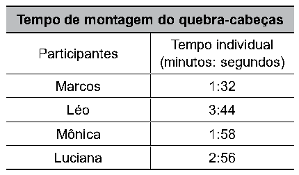
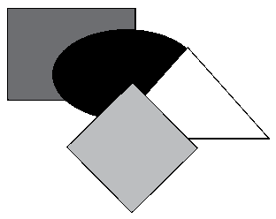
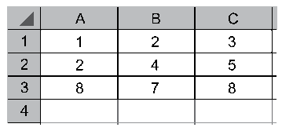
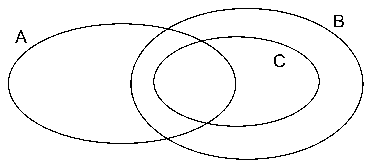

# TJ-SP 2024 — Escrevente Técnico Judiciário (prova oficial)

Prova objetiva oficial do concurso de Escrevente Técnico Judiciário do TJ-SP — 2024, banca Vunesp, com 100 questões e o gabarito oficial da versão 1.
As figuras foram recortadas do caderno original. O gabarito comentado está no fim do arquivo.

<!-- Gerado por tools/src/prova_to_md.py a partir de 2024tj-sp-2024.pdf e 2024vunesp-2024-tj-sp-escrevente-tecnico-judiciario-gabarito.pdf. -->

## Língua Portuguesa

**Q01.** Leia a tira.

(https://www.instagram.com/tirinhadearmandinho)

Na frase – Sou muito conciso! –, o antônimo do adjetivo é:

- A) sucinto.
- B) prolixo.
- C) ambivalente.
- D) lacônico.
- E) coerente.

*Leia o texto para responder às questões de números 02 a 10.*
> Aliança de delinquentes
>
> Após a visita do ditador Kim Jong-un à Rússia em 2023, Vladimir Putin retribuiu a gentileza e viajou, pela primeira vez em 24 anos, à Coreia do Norte. Os frutos imediatos são mais munição para Moscou em troca de um arremedo de legitimidade para o tirano mais isolado do mundo. Há mais coisas no escambo. Os dois anunciaram uma “parceria estratégica ampla”, cujos detalhes são desconhecidos. Mas, apesar das declarações de Putin sobre os laços históricos dos dois países e das juras de Kim por um “relacionamento inquebrantável de companheiros de armas”, a profundidade dessa parceria tem limites, e China e Coreia do Sul não deixarão de enfatizá-los.
>
> Uma das poucas coisas que Pyongyang* tem em abundância são granadas e mísseis a granel para municiar a guerra de atrito da Rússia na Ucrânia. Moscou expandiu as exportações de combustíveis e alimentos à Coreia do Norte, que ademais serve a Putin como laboratório para testar mecanismos para burlar sanções e sabotar instituições multilaterais. O risco maior e mais opaco é a transferência de tecnologias militares russas ligadas a satélites, submarinos, foguetes hipersônicos e, sobretudo, arsenais nucleares.
>
> À China interessa o prolongamento da guerra na Europa, mas não sua escalada; interessa a sustentação do regime de Kim, mas não seu empoderamento; interessa o confronto com o Ocidente, mas não a percepção de que ela compõe um “bloco” ou “eixo” com Rússia e Coreia do Norte.
>
> Nem por isso o Ocidente pode negligenciar a necessidade de fortalecer parcerias no Pacífico e explorar as dissensões entre os “amigos” autocratas. Os dois parecem cada vez mais desesperados, isolados e acuados. Mas tudo isso os torna mais, não menos perigosos.
>
> (Opinião. https://www.estadao.com.br/opiniao, 20.06.2024. Adaptado)
>
> * Capital da Coreia do Norte

**Q02.** O título do texto permite compreender corretamente que o editorial

- A) reconhece a necessidade de uma coalizão forte entre Coreia do Norte, Rússia, China e Coreia do Sul.
- B) considera a aliança estabelecida entre Coreia do Norte e Rússia como algo temerário e criminoso.
- C) pondera sobre a necessidade de o Ocidente tratar com mais tolerância Coreia do Norte e Rússia.
- D) recrimina a união entre Coreia do Norte e Rússia, porque ambas têm escassez de materiais bélicos.
- E) aprova a intenção da China de formar um bloco com Coreia do Norte e Rússia, após coalizão destes países.

**Q03.** O editorial defende como medida benéfica para o Ocidente que

- A) a Coreia do Norte tire proveito da transferência de tecnologias militares russas previstas no acordo e compartilhe conhecimentos com países vizinhos.
- B) a Rússia fortaleça a parceria com a Coreia do Norte, com as exportações de combustíveis e alimentos, podendo superar, assim, as restrições que sofre.
- C) o isolamento imposto à Rússia seja estendido à Coreia do Norte e à China, para evitar novas dissensões entre países e guerras indesejadas.
- D) os países ocidentais monitorem as ações entre a Coreia do Norte e a Rússia e não menosprezem as ameaças que essas nações representam.
- E) a China e a Coreia do Sul sejam capazes de empreender uma guerra contra a Coreia do Norte e a Rússia, limitando as ações do acordo estabelecido.

**Q04.** Considere as passagens do texto.

• … um arremedo de legitimidade para o tirano mais isolado do mundo. (1o parágrafo)

• Mas tudo isso os torna mais, não menos perigosos. (4o parágrafo)

As passagens permitem, correta e respectivamente, as seguintes interpretações:

- A) o governo norte-coreano é legitimo por ser tirano; Kim Jong-un e Vladimir Putin representam incertezas para o mundo, sobretudo porque estão desesperados, isolados e acuados.
- B) a legitimidade do governo norte-coreano é atemporal; Kim Jong-un e Vladimir Putin representam mudanças obscuras no mundo, fruto da temerária tensão nuclear.
- C) o governo norte-coreano carece de legitimidade; Kim Jong-un e Vladimir Putin representam perigo, o que decorre em parte do isolamento e da perseguição que enfrentam.
- D) o isolamento norte-coreano fortalece a legitimidade do país; Kim Jong-un e Vladimir Putin representam menos perigo, pois estão desesperados, isolados e acuados.
- E) a tirania do governo mina a legitimidade da Coreia do Norte; Kim Jong-un e Vladimir Putin representam um poder novo, que pretende se aliar ao Ocidente sem pressões.

**Q05.** Na passagem – Mas, apesar das declarações de Putin sobre os laços históricos dos dois países e das juras de Kim por um “relacionamento inquebrantável de companheiros de armas”… (1o parágrafo) –, as aspas estão empregadas com o objetivo de

- A) inserir trecho da fala de Kim Jong-un.
- B) destacar as visitas de Putin à Coreia.
- C) enfatizar a parceria entre as Coreias.
- D) alocar comentário de Vladimir Putin.
- E) minimizar o impacto do acordo.

**Q06.** No editorial, afirma-se que a parceria estratégica entre Coreia do Norte e Rússia contém detalhes desconhecidos. Essa ideia é ratificada pela seguinte informação do texto:

- A) Moscou expandiu as exportações de combustíveis e alimentos à Coreia do Norte… (2o parágrafo)
- B) À China interessa o prolongamento da guerra na Europa, mas não sua escalada… (3o parágrafo)
- C) … Vladimir Putin retribuiu a gentileza e viajou, pela primeira vez em 24 anos, à Coreia do Norte. (1o parágrafo)
- D) O risco maior e mais opaco é a transferência de tecnologias militares russas ligadas a satélites… (2o parágrafo)
- E) Uma das poucas coisas que Pyongyang tem em abundância são granadas e mísseis a granel… (2o parágrafo)

**Q07.** Está empregado em sentido figurado o termo destacado em:

- A) visita do ditador (1o parágrafo).
- B) granadas e mísseis (2o parágrafo).
- C) guerra na Europa (3o parágrafo).
- D) regime de Kim (3o parágrafo).
- E) laços históricos (1o parágrafo).

**Q08.** A coesão e o sentido das frases – Os dois anunciaram uma “parceria estratégica ampla”, cujos detalhes são desconhecidos. (1o parágrafo) – e – … que ademais serve a Putin como laboratório… (2o parágrafo) – mantêm-se, correta e respectivamente, com as reescritas:

- A) Os dois anunciaram uma “parceria estratégica ampla”, que os detalhes são desconhecidos. / … que, apesar disso, serve a Putin como laboratório…
- B) Os dois anunciaram uma “parceria estratégica ampla”, com que os detalhes dela são desconhecidos. / … que, por certo, serve a Putin como laboratório…
- C) Os dois anunciaram uma “parceria estratégica ampla”, da qual os detalhes são desconhecidos. / … que, além disso, serve a Putin como laboratório…
- D) Os dois anunciaram uma “parceria estratégica ampla”, quais os seus detalhes são desconhecidos. / … que, por isso, serve a Putin como laboratório…
- E) Os dois anunciaram uma “parceria estratégica ampla”, de cujos os detalhes dela são desconhecidos. / … que, de fato, serve a Putin como laboratório…

**Q09.** Nas passagens – Há mais coisas no escambo. (1o parágrafo) – e – Uma das poucas coisas que Pyongyang tem em abundância são granadas e mísseis a granel… (2o parágrafo) –, as expressões destacadas significam, correta e respectivamente:

- A) no convívio; à disposição plena.
- B) na permuta; em grande quantidade.
- C) na negociata; de valor vultoso.
- D) na troca; de potencial letal.
- E) no conluio; em números parcos.

**Q10.** Considere as passagens do texto.

• … a profundidade dessa parceria tem limites… (1o parágrafo)

• À China interessa o prolongamento da guerra na Europa […]; interessa a sustentação do regime de Kim… (3o parágrafo)

• …mas não a percepção de que ela compõe um “bloco” ou “eixo” com Rússia e Coreia do Norte. (3o parágrafo)

Em conformidade com a norma-padrão de concordância verbal, as passagens permitem, respectivamente, as reescritas:

- A) Devem haver limites para a profundidade dessa parceria. / Interessam à China o prolongamento da guerra na Europa e a sustentação do regime de Kim. / Mas não a percepção de que Rússia, Coreia do Norte e ela compõe um “bloco” ou “eixo”.
- B) Deve existir limites para a profundidade dessa parceria. / O prolongamento da guerra na Europa e a sustentação do regime de Kim interessam à China. / Mas não a percepção de que compõem um “bloco” ou “eixo” Rússia, Coreia do Norte e ela.
- C) Existem limites para a profundidade dessa parceria. / Interessa à China o prolongamento da guerra na Europa e a sustentação do regime de Kim. / Mas não a percepção de que Rússia, Coreia do Norte e ela compõem um “bloco” ou “eixo”.
- D) Há limites para a profundidade dessa parceria. / O prolongamento da guerra na Europa e a sustentação do regime de Kim interessa à China. / Mas não a percepção de que compõe um “bloco” ou “eixo” Rússia, Coreia do Norte e ela.
- E) Hão de haver limites para a profundidade dessa parceria. / Interessam à China o prolongamento da guerra na Europa e a sustentação do regime de Kim. / Mas não a percepção de que Rússia, Coreia do Norte e ela compõe um “bloco” ou “eixo”.

*Leia o texto para responder às questões de números 11 a 18.*
> Liberdade adiada
>
> Sentia-se cansada. A barriga, as pernas, a cabeça, o corpo todo era um enorme peso que lhe caía irremediavelmente em cima. Esperava que a qualquer momento o coração lhe perfurasse o peito, lhe rasgasse a blusa.
>
> Como seria o coração?
>
> Teria mesmo aquela forma bonita dos postais coloridos?
>
> … Será que as dores deformam os corações?
>
> Pensou em atirar a lata de água ao chão, esparramar-se no líquido, encharcar-se, fazer-se lama, confundir-se com aqueles caminhos que durante anos e mais anos lhe comiam as solas dos pés, lhe queimavam as veias, lhe roubavam as forças.
>
> Imaginou os filhos que aguardavam e já deviam estar acordados. Os filhos que ela odiava!
>
> Não. Não voltaria para casa.
>
> O barranco olhava-a, boca aberta, num sorriso irresistível, convidando-a para o encontro final.
>
> Conhecia aquele tipo de sorriso e não tinha boas recordações dos tempos que vinham depois. Mas um dia havia de o eternizar. E se fosse agora, no instante que madrugava? A lata e ela, para sempre, juntas no sorriso do barranco.
>
> Gostava de sua lata de carregar água. Tratava bem a lata. Às vezes, em momentos de raiva ou simplesmente indefinidos, areava uma, dez, mil vezes, até que sua lata ficava a luzir e a cólera, ou a indefinição se perdiam no brilho prateado. Com o fundo de madeira que tivera que mandar colocar, ficou mais pesada, mas não eram daí os seus tormentos.
>
> À borda do barranco, com a lata de água à cabeça e a saia batida pelo vento, pensou nos filhos e levou as mãos ao peito.
>
> O que tinha a ver os filhos com o coração? Os filhos… Como ela os amava, Nossenhor!
>
> Apressou-se a ir ao encontro deles. O mais novito devia estar a chamar por ela.
>
> Correu deixando o barranco e o sonho de liberdade para trás.
>
> (Dina Salústio. Mornas eram as noites. Adaptado)

**Q11.** A história narrada apresenta a personagem em uma situação de

- A) extrema tensão existencial, provocada pelos sofrimentos da vida difícil que levava.
- B) melancolia e reflexão sobre os filhos, que cresciam e logo seriam independentes.
- C) irritação e vontade de chorar, decorrente da perda da lata estimada no barranco.
- D) incontrolável tristeza e desesperança, fruto da saudade dos caminhos já trilhados.
- E) pleno equilíbrio emocional, com ponderações coerentes sobre a maternidade.

**Q12.** Pela passagem – Pensou em atirar a lata de água ao chão, esparramar-se no líquido, encharcar-se, fazer-se lama… (5o parágrafo) – é correto afirmar que a personagem

- A) está fraca para carregar latas cheias de água.
- B) evita os caminhos que ladeiam o barranco.
- C) precisa molhar-se para suportar o calor.
- D) deseja fugir da realidade que tanto a oprime.
- E) quer saber exatamente como funciona o coração.

**Q13.** O parágrafo final do texto permite concluir que a personagem optou por

- A) aceitar o convite feito pelo barranco.
- B) se espalhar na lama contida no barranco.
- C) ignorar o chamado do filho mais novo.
- D) buscar novos desafios longe dos filhos.
- E) se manter na companhia dos filhos.

**Q14.** Na passagem – Com o fundo de madeira que tivera que mandar colocar, ficou mais pesada, mas não eram daí os seus tormentos. (10o parágrafo) –, o sentido expresso pela preposição Com e pela conjunção mas e o referente da expressão daí são, correta e respectivamente:

- A) causa; conclusão; o peso da lata.
- B) causa; oposição; o peso da lata.
- C) lugar; conclusão; o fundo da lata.
- D) consequência; adição; a lata.
- E) lugar; oposição; o fundo da lata.

**Q15.** A regência verbal e a regência nominal estão em conformidade com a norma-padrão em:

- A) Ela lembrou que tinha a lata, que preferia mais manter bem areada que nutrir a raiva, em certos momentos. Na verdade, ficava ansiosa para ver aquele objeto luzindo.
- B) Ela lembrou de que tinha a lata, que preferia manter bem areada do que nutrir a raiva, em certos momentos. Na verdade, ficava ansiosa em ver aquele objeto luzindo.
- C) Ela lembrou-se de que tinha a lata, que preferia manter bem areada a nutrir a raiva, em certos momentos. Na verdade, ficava ansiosa por ver aquele objeto luzindo.
- D) Ela lembrou-se que tinha a lata, que preferia manter bem areada a nutrir a raiva, em certos momentos. Na verdade, ficava ansiosa de ver aquele objeto luzindo.
- E) Ela lembrou-se de que tinha a lata, que preferia manter bem areada do que nutrir a raiva, em certos momentos. Na verdade, ficava ansiosa a ver aquele objeto luzindo.

**Q16.** Considere as passagens:

• Imaginou os filhos que aguardavam e já deviam estar acordados. Os filhos que ela odiava! (6o parágrafo)

• Tratava bem a lata. (10o parágrafo)

Quanto ao emprego de pronomes e à colocação pronominal, as reescritas das passagens atendem à norma-padrão em:

- A) Imaginou os filhos que a aguardavam e já deviam estar acordados. Odiava-os! / Tratava-a bem.
- B) Imaginou os filhos que aguardavam-na e já deviam estar acordados. Lhes odiava! / Tratava ela bem.
- C) Imaginou os filhos que lhe aguardavam e já deviam estar acordados. Os odiava! / A tratava bem.
- D) Imaginou os filhos que aguardavam-lhe e já deviam estar acordados. Odiava-lhes! / Tratava-na bem.
- E) Imaginou os filhos que aguardavam-la e já deviam estar acordados. Odiava-os! / Tratava-a bem.

**Q17.** Os termos destacados são, correta e respectivamente, pronome possessivo e advérbio em:

- A) Gostava de sua lata de carregar água. (10o parágrafo) / Como ela os amava, Nossenhor! (12o parágrafo)
- B) … que lhe caía irremediavelmente em cima. (1o parágrafo) / Correu deixando o barranco e o sonho de liberdade para trás. (14o parágrafo)
- C) Sentia-se cansada. (1o parágrafo) / A lata e ela, para sempre, juntas no sorriso do barranco. (9o parágrafo)
- D) Os filhos que ela odiava! (6o parágrafo) / Esperava que a qualquer momento… (1o parágrafo)
- E) Apressou-se a ir ao encontro deles. (13o parágrafo) / O barranco olhava-a, boca aberta, num sorriso irresistível… (8o parágrafo)

**Q18.** Considere as reescritas de informações do texto.

• Esperava que \_\_\_\_\_\_ qualquer hora o coração lhe perfurasse o peito, lhe rasgasse a blusa.

• O coração corresponderia mesmo \_\_\_\_\_\_ forma bonita dos postais coloridos?

• Pensou em jogar \_\_\_\_\_\_ lata de água ao chão, esparramar-se no líquido, fazer-se lama.

• O barranco dirigia \_\_\_\_\_\_ ela um sorriso irresistível, convidando-a para o encontro final.

De acordo com a norma-padrão, as lacunas devem ser preenchidas, respectivamente, com:

- A) à … àquela … a … a
- B) à … aquela … a … a
- C) a … aquela … a … à
- D) a … àquela … a … a
- E) a … àquela … à … à

*Leia o texto para responder às questões de números 19 a 23.*
> Recuemos cinco séculos no tempo. Vemos uma Europa, que então era o mundo, saída da Idade Média, possuída pela febre tão inquietante quanto bela e fértil do Renascimento, e paradoxalmente, envolta em guerras religiosas e conquistas.
>
> Na Península Ibérica, a inquietação criadora tomou outra forma. Povos de navegadores não mais se conformavam em olhar e apenas imaginar o que haveria além do horizonte atlântico. Pagaram para ver, com risco de suas próprias vidas. Tomando o rumo oeste em pequenas embarcações, Colombo (1492) e Cabral (1500) descobriram o Novo Mundo.
>
> Havia, no entanto, muito a descobrir. Desde o fim do século XIII, os europeus sabiam da existência do Grande Império da China, através da narrativa de Marco Polo que lá vivera cerca de 20 anos. Em seu livro, ele fazia referência ao Japão como um país fantasticamente rico, inatingido, localizado ao lado da costa chinesa. Todavia, dois séculos e meio transcorreriam antes que um europeu pisasse em território dos japoneses.
>
> Com a chegada a Tanegashima, praticamente os portugueses completaram seus postulados, desenhos dos continentes e mares, que constituíam os primeiros mapas de navegação.
>
> No primeiro encontro em Tanegashima, os japoneses conheceram a espingarda, que iria alterar profundamente o comportamento bélico de um povo exímio no uso da espada e do arco e flecha. Em 1546, três anos após o primeiro encontro, três naus portuguesas chegaram a Kyushu, dando início ao intercâmbio comercial com o Japão. Durante quatro décadas, até 1587 (quando chegam os espanhóis), os portugueses foram os únicos parceiros europeus no intercâmbio com o Japão.
>
> (Aliança Cultural Brasil-Japão.
>
> Cultura Japonesa: São Paulo, Rio de Janeiro, Curitiba. Adaptado)

**Q19.** As informações textuais permitem concluir corretamente que

- A) as transformações por que passava a Europa inspiraram os navegadores portugueses a explorar outros lugares, do que resultou a chegada ao Japão, país com o qual iniciaram as relações comerciais.
- B) os navegadores portugueses, cansados de guerras religiosas, empreenderam um novo modelo de desenvolvimento comercial, baseado nas relações amigáveis com países asiáticos, sobretudo a China e o Japão.
- C) as mudanças religiosa e política na Europa corresponderam a uma forma de contra-atacar o Grande Império da China que, junto com o rico Japão, constituíam uma ameaça ao poder econômico da Espanha e de Portugal.
- D) as intenções de Portugal com a relação comercial com o Japão eram buscar um mercado alternativo de armas para o fortalecimento do poderio bélico e o estabelecimento da China como novo parceiro comercial.
- E) as vantajosas relações comerciais estabelecidas com o Japão fizeram com que Portugal impusesse aos japoneses, a partir de 1546, o fim do intercâmbio comercial desse povo com outros países europeus.

**Q20.** Nas passagens– Vemos uma Europa, que então era o mundo… (1o parágrafo) – e – Pagaram para ver, com risco de suas próprias vidas. (2o parágrafo) –, as expressões grifadas significam, contextual e respectivamente:

- A) o que se via fisicamente; desistiram.
- B) o que se imaginava sempre; resignaram-se.
- C) o que se impunha totalmente; abstiveram-se.
- D) o que funcionava melhor; duvidaram.
- E) o que se conhecia mais; arriscaram-se.

**Q21.** Considere as passagens:

• Recuemos cinco séculos no tempo. (1o parágrafo)

• … através da narrativa de Marco Polo que lá vivera cerca de 20 anos. (3o parágrafo)

Em conformidade com a norma-padrão, substituindo-se o primeiro verbo por Retroceder, e o segundo pela forma verbal do pretérito mais-que-perfeito composto, obtêm-se, respectivamente:

- A) Retrocedemos: tivera vivido.
- B) Retrocedamos; tinha vivido.
- C) Retrocedamos; tivera vivido.
- D) Retrocedemos; tinha vivido.
- E) Retrocedermos; teria vivido.

**Q22.** No texto, identifica-se uma relação de coesão e de sentido entre as seguintes expressões:

- A) povo exímio – os portugueses (5o parágrafo)
- B) Península Ibérica – Novo Mundo (2o parágrafo)
- C) Tanegashima – seus postulados (4o parágrafo)
- D) a narrativa de Marco Polo – Em seu livro (3o parágrafo)
- E) Idade Média – febre tão inquietante (1o parágrafo)

**Q23.** A concordância nominal atende à norma-padrão em:

- A) Os portugueses tinham bastantes interesses comerciais com os japoneses, parceiros desde 1546.
- B) Apesar da frenesi renascentista bela e fértil, guerras religiosas e conquistas ainda aconteciam.
- C) Foi narrado por Marco Polo, que morou cerca de vinte anos na China, a existência desse lugar.
- D) Colombo e Cabral viram como necessário a busca de novas terras e chegaram ao Novo Mundo.
- E) Um e outro países europeus estabeleceram relações comerciais com o Japão a partir do século XVI.

**Q24.** Considere as frases.

• A relação cultural \_\_\_\_\_\_ não é similar \_\_\_\_\_\_ estabelecida entre Portugal e Brasil.

• Atualmente, o comércio \_\_\_\_\_\_ está bem aquecido, pois o país asiático tornou-se o primeiro a comprar mais de US$ 100 bilhões em produtos brasileiros em um ano (US$ 104,3 bilhões).

De acordo com a norma-padrão, as lacunas das frases devem ser preenchidas, respectivamente, com:

- A) nipo-portuguesa … a … chino-brasileiro
- B) lusitano-nipônica … com a … china-brasileiro
- C) luso-japonesa… à … sino-brasileiro
- D) luso-nipônica… da … chino-brasileira
- E) japonesa-portuguesa … ante à … chinês-brasileiro

## Conhecimentos em Direito

## Direito Penal

**Q25.** A respeito do crime de petrechos de falsificação, previsto no artigo 294 do Código Penal, assinale a alternativa correta.

- A) É crime próprio de funcionário público.
- B) É crime de ação múltipla ou de conteúdo variado.
- C) Tem por objeto material o objeto (instrumento) destinado à falsificação de papéis públicos e particulares.
- D) Admite a modalidade culposa.
- E) É crime instantâneo e inadmite tentativa.

**Q26.** Tício, a fim de se habilitar a uma vaga de emprego, fabricou diploma de instituição de Ensino Superior privada e o utilizou, apresentando-o como requisito para participar da seleção.

Diante da situação hipotética, é correto dizer que Tício, em tese, praticou o crime de

- A) falsidade ideológica.
- B) falsificação de papéis públicos.
- C) certidão ou atestado ideologicamente falso.
- D) falsificação de documento público.
- E) falsidade material de atestado ou certidão.

**Q27.** Mévia, advogada, cedeu a Tícia, sua irmã gêmea, a carteira profissional da OAB, para ela ingressar no presídio, passando-se por advogada, a fim de visitar, quando quisesse, o namorado que se encontrava preso. Tícia, de fato, usou o documento profissional de Mévia, por várias vezes, sendo descoberta na última vez.

Diante da situação hipotética, assinale a alternativa correta.

- A) Tícia incorreu no crime do artigo 308, do Código Penal (uso de documento de identidade alheia). Mévia não incorreu em qualquer crime, por ausência de previsão típica para a cessão de documento de identidade a outrem.
- B) Tícia incorreu no crime do artigo 307, do Código Penal (falsa identidade). Mévia não incorreu em qualquer crime, por ausência de previsão típica para a cessão de documento de identidade a outrem.
- C) Mévia e Tícia não incorreram em qualquer crime, visto que o uso de documento de identidade alheia e falsa identidade, para se caracterizar como crime, exige vantagem patrimonial indevida.
- D) Mévia e Tícia incorreram no crime do artigo 307, do Código Penal (falsa identidade).
- E) Mévia e Tícia incorreram no crime do artigo 308, do Código Penal (uso de documento de identidade alheia).

**Q28.** Tendo em conta o crime de fraudes em certames de interesse público, é correto afirmar:

- A) é crime próprio de funcionário público ou de pessoas que tenham por função atuar na elaboração e na aplicação de concursos, processos seletivos, avaliações e exames.
- B) é qualificado quando praticado por funcionário público.
- C) tem por objeto material conteúdo sigiloso de concurso público; de processo seletivo para ingresso no Ensino Superior, pouco importando se em instituição pública ou privada; de avaliação ou exame públicos e de exame ou processo seletivo previstos em lei.
- D) o dano à administração pública enseja causa de aumento da pena.
- E) só se caracteriza se resultar comprometimento à credibilidade do certame.

**Q29.** A respeito da reparação do dano no crime de peculato, assinale a alternativa correta.

- A) Extingue a punibilidade, no peculato culposo, quando feita antes da sentença irrecorrível. Se feita posteriormente, implica diminuição da pena, da metade.
- B) Extingue a punibilidade, no peculato culposo, e implica diminuição da pena, da metade, no peculato mediante erro de outrem, desde que feita antes da sentença irrecorrível.
- C) Extingue a punibilidade, no peculato culposo, e implica diminuição da pena, da metade, no peculato mediante erro de outrem, desde que feita antes da denúncia.
- D) Extingue a punibilidade, no peculato culposo e no peculato mediante erro de outrem, desde que feita antes da sentença irrecorrível.
- E) Extingue a punibilidade, no crime de peculato mediante erro de outrem, desde que feita antes da denúncia. Se feita posteriormente, implica diminuição da pena, da metade.

**Q30.** A respeito dos crimes contra a administração pública e contra a administração da justiça, assinale a alternativa correta.

- A) Caio, ao dar ensejo à instauração de procedimento administrativo contra Tício, funcionário público, imputando infração disciplinar que o sabe inocente, em tese, incorre no crime de denunciação caluniosa.
- B) Mévio, ao praticar o crime de exercício arbitrário das próprias razões, empregando violência, somente será processado mediante ação penal pública condicionada à representação da vítima.
- C) Caio, por pagar Tício para prestar falso testemunho, e Tício, por aceitar e efetivamente prestar falso testemunho, incorrem, em tese, no crime de falso testemunho.
- D) Tício, ao afirmar falsamente à autoridade policial, a fim de isentar o filho, ser o responsável pelo jogo de bicho (contravenção penal), em tese, incorre no crime de autoacusação falsa.
- E) Tício, funcionário público, ao deixar de punir Mévio, seu subordinado, por falta funcional, em razão de ter sido presenteado por ele com uma caixa de vinho, em tese, incorre no crime de condescendência criminosa.

## Direito Processual Penal

**Q31.** Caio, magistrado, casou-se, em abril de 2024, com Mévia, filha de Tércio, perito judicial. Posteriormente ao casamento, Caio verificou que Tércio atuou como perito judicial em processos que estão sob sua jurisdição. Com base na situação hipotética, assinale a alternativa correta.

- A) Caio, por expressa previsão legal, é impedido de exercer jurisdição nos processos em que o sogro funciona como perito judicial, inexistindo, contudo, impedimento nos feitos em que a atuação já se encerrou.
- B) Caio, por expressa previsão legal, deverá se declarar suspeito para exercer jurisdição nos processos em que o sogro atua como perito judicial, inexistindo, contudo, impedimento nos feitos em que a atuação já se encerrou.
- C) Ainda que venha a se divorciar de Mévia, Caio não poderá exercer jurisdição nos processos em que Tércio funcionou como perito judicial.
- D) Caio, por expressa previsão legal, é impedido de exercer jurisdição nos processos em que o sogro funcionou como perito judicial.
- E) Caio, por expressa previsão legal, deverá se declarar suspeito para exercer jurisdição nos processos em que o sogro atuou como perito judicial.

**Q32.** Tendo em vista os atos de comunicação, previstos no Código de Processo Penal, assinale a alternativa correta.

- A) Citado por hora certa ou por Edital, não comparecendo o réu nem constituindo advogado, suspendem-se o processo e o prazo prescricional.
- B) Determinada a citação por carta rogatória, o processo e o prazo prescricional serão suspensos, até o cumprimento. Já a citação por carta precatória implicará suspensão do processo e prazo prescricional, se o cumprimento ultrapassar 30 dias.
- C) A citação por mandado é a regra, mas, por expressa previsão legal, o acusado militar será citado por intermédio do chefe do respectivo serviço.
- D) A citação, ato pelo qual o réu toma ciência da acusação, pode ser real ou ficta. A real é feita por oficial de justiça, pessoalmente ou por hora certa; a ficta, por Edital.
- E) O réu que deixar de atender a ato judicial do qual foi devidamente intimado será declarado revel, prosseguindo-se o feito sem sua presença e intimação para demais atos, inclusive a sentença.

**Q33.** A respeito do procedimento comum ordinário e sumário, é correto afirmar:

- A) a resposta à acusação é prevista para ambos os ritos, ordinário e sumário, mas os prazos são distintos, sendo 10 dias para o primeiro e 5 dias para o segundo.
- B) oferecida a denúncia, a possibilidade de rejeição da denúncia pelo juiz aplica-se ao rito ordinário, mas não ao sumário.
- C) encerrada a instrução, tanto no rito ordinário quanto no sumário, há previsão expressa quanto à possibilidade de memorais, por escrito, e diligências complementares.
- D) no rito sumário, não localizado o acusado, para citação pessoal, o rito será convertido para o ordinário, a fim de se proceder a citação por Edital.
- E) a absolvição sumária, após a apresentação de resposta à acusação, aplica-se tanto no rito ordinário quanto no sumário.

**Q34.** A respeito da composição do Tribunal do Júri e da formação do conselho de sentença, assinale a alternativa correta.

- A) São impedidos de servir no mesmo conselho marido e mulher, descendente e ascendente, irmãos e amigos íntimos.
- B) O mesmo conselho de sentença poderá conhecer de mais de um processo, no mesmo dia, se as partes aceitarem.
- C) Aos jurados não se aplicam as regras de impedimento, suspeição e incompatibilidades previstas para os juízes togados.
- D) Os jurados excluídos por impedimento em razão de parentesco não serão considerados para a constituição do número legal exigível para a realização da sessão.
- E) Não poderá servir o jurado que tiver funcionado em julgamento anterior, anulado por qualquer motivo; pode servir o jurado que tiver integrado o conselho de sentença que julgou o outro acusado, em caso de concurso de pessoas.

**Q35.** Tendo em conta as seguintes situações hipotéticas, bem como as disposições referentes aos recursos e às ações de impugnação, assinale a alternativa correta.

- A) Tício, pronunciado por crime doloso contra a vida, caso queira recorrer, deverá interpor recurso de apelação.
- B) Mévio, tendo a homologação do acordo de não persecução penal recusada, poderá interpor recurso de apelação.
- C) Caio, representante do órgão de acusação, caso queira recorrer da decisão que reconheceu a prescrição, extinguindo a punibilidade do réu, deverá interpor recurso em sentido estrito.
- D) Mévia, a fim de sanar omissão em Acórdão proferido em sede do recurso de apelação por ela interposto, poderá opor embargos de declaração, no prazo de três dias.
- E) Tícia, se condenada definitivamente com base em documentos que posteriormente se comprovem falsos, poderá ingressar com revisão, desde que a pena não tenha sido extinta.

**Q36.** A respeito do habeas corpus, assinale a alternativa correta.

- A) A decisão do habeas corpus, no Tribunal, será por maioria dos votos. Em caso de empate, prevalecerá o voto do presidente, se tiver participado da votação. Se o presidente não tiver tomado parte, proferirá o voto de desempate.
- B) A concessão de habeas corpus implicará condenação da autoridade que tiver determinado a coação à indenização civil, se decorrente de negligência.
- C) No caso de petição de habeas corpus, não será concedida a ordem antes de prestadas as informações pela autoridade apontada como coautora.
- D) O habeas corpus poderá ser impetrado por qualquer pessoa, em seu próprio favor ou de outrem, bem como pelo Ministério Público.
- E) A ordem de habeas corpus pode ser concedida de ofício pelo juiz ou pelo tribunal, seja em processo de competência originária ou recursal, desde que conhecidos a ação ou o recurso em que veiculado o pedido de cessação da coação.

**Q37.** Caio, na condução de um veículo, causou lesão corporal culposa (crime processável por ação penal pública condicionada à representação) em Mévio. Lavrado Termo Circunstanciado e encaminhados os autos para o Juizado Especial Criminal, foi designada audiência preliminar. Na audiência, Caio propôs pagar a Mévio o valor de R$ 10.000,00 (dez mil reais), a título de composição de dano. Mévio aceitou a proposta, tendo o acordo por eles entabulado sido reduzido a termo e homologado pelo juiz. Caio, no entanto, pagou apenas metade do valor acordado.

Com base na situação hipotética, assinale a alternativa correta.

- A) A composição de dano, homologada pelo juiz, não impede que Mévio represente criminalmente contra Caio, pois a reparação do dano implica renúncia apenas ao direito de queixa.
- B) A composição de dano, homologada pelo juiz, implicou renúncia ao direito de representação, pouco importando a inadimplência de Caio. Mévio poderá executar a decisão homologatória, que tem força de título executivo, no juízo cível competente.
- C) A composição do dano, homologada pelo juiz, não impede que Mévio represente criminalmente contra Caio, mas, dado o inadimplemento, impede que o Ministério Público proponha a aplicação imediata de pena restritiva de direito.
- D) A composição de dano, homologada pelo juiz, não impede que Mévio represente criminalmente contra Caio, mas, caso haja a representação, vincula o Ministério Público a propor a aplicação imediata de pena restritiva de direito, pouco importando a inadimplência.
- E) A composição de dano, homologada pelo juiz, implicou renúncia ao direito de representação, pouco importando a inadimplência de Caio. Mévio poderá executar a decisão homologatória, que tem força de título executivo, no próprio juízo criminal.

## Direito Processual Civil

**Q38.** Douglas, chefe de secretaria de uma das varas da Fazenda Pública da Capital, é responsável pela organização e pelo funcionamento da secretaria, supervisionando o trabalho dos servidores e zelando pela eficiência dos serviços prestados. Em um dia de grande movimento na vara, Douglas, pressionado pelo acúmulo de tarefas e pela necessidade de atender a diversas demandas simultâneas, comete um grave erro ao enviar uma intimação para o endereço errado da parte ré em um processo de execução fiscal. A intimação, que informa sobre a penhora de um veículo do réu, é enviada para um endereço antigo, onde o réu já não reside há mais de 2 anos. Devido ao erro no envio da intimação, o réu não toma conhecimento da penhora de seu veículo e não tem a oportunidade de apresentar defesa, razão pela qual seu carro é penhorado, causando-lhe grande prejuízo financeiro e moral.

Diante da situação hipotética, considerando o previsto no Código de Processo Civil, é correto afirmar que Douglas

- A) é responsável pelo ocorrido de forma solidária com o juiz titular da vara.
- B) só seria responsabilizado caso restasse demonstrado que o ato foi praticado mediante dolo.
- C) deve ser responsabilizado civil e regressivamente pelo ocorrido.
- D) é responsável de forma subsidiária, caso o juiz titular da vara não seja responsabilizado.
- E) não deve ser responsabilizado pessoalmente pelo ocorrido, devendo o Estado responder pelo prejuízo, sem direito de regresso.

**Q39.** Acerca das intimações no Código de Processo Civil, assinale a alternativa correta.

- A) Sob pena de nulidade, é indispensável que da publicação constem os nomes das partes e de seus advogados, com o respectivo número de inscrição na Ordem dos Advogados do Brasil, ou, se assim requerido, da sociedade de advogados.
- B) A grafia dos nomes das partes pode conter abreviaturas, desde que não prejudique a identificação das partes.
- C) Ainda que conste pedido expresso para que as comunicações processuais sejam feitas em nome de advogados indicados, o seu desatendimento não implicará nulidade quando for comprovado que na publicação há a indicação de advogado com poderes para representação da parte.
- D) A retirada dos autos do cartório ou da secretaria em carga pelo advogado, por pessoa credenciada a pedido do advogado ou da sociedade de advogados, pela Advocacia Pública, pela Defensoria Pública ou pelo Ministério Público implicará intimação de qualquer decisão contida no processo retirado, desde que já publicada em órgão oficial.
- E) A retirada de autos por meio de preposto independe de credenciamento por parte do advogado e da sociedade de advogados.

**Q40.** Carmem, uma profissional autônoma que trabalha de casa, depende da internet para realizar suas atividades profissionais. Em determinado dia, a empresa de telecomunicações X corta o serviço de internet de Carmem sem prévio aviso, alegando inadimplência. Carmem busca atendimento com X afirmando que o débito cobrado pela empresa é indevido e que o pagamento da fatura já havia sido realizado, mas, mesmo assim, o serviço de internet não é religado. Inconformada, Carmem propõe uma ação judicial contra a empresa X, solicitando a tutela antecipada antecedente para determinar a imediata restauração do serviço de internet e demonstrando o perigo de dano na demora. O juiz concede a tutela antecipada, e a empresa X não apresenta recurso.

Diante da situação hipotética, é correto afirmar:

- A) ocorre o trânsito em julgado da decisão e a formação de coisa julgada material.
- B) considerando a não interposição do recurso por parte da empresa X, apenas Carmem poderá requerer o desarquivamento dos autos em que foi concedida a tutela antecipada antecedente, para instruir eventual petição inicial.
- C) o direito de rever, reformar ou invalidar a tutela antecipada extingue-se após 2 (dois) anos, contados da data em que a decisão que extinguiu o processo foi proferida.
- D) a decisão que concede a tutela não fará coisa julgada, mas a estabilidade dos respectivos efeitos só será afastada após o trânsito em julgado de decisão que a revir, reformar ou invalidar.
- E) a tutela antecipada conservará seus efeitos enquanto não revista, reformada ou invalidada por decisão de mérito proferida na ação proposta por qualquer das partes que tenha por intuito rever, reformar ou invalidar a tutela antecipada estabilizada.

**Q41.** Mariana e Romeu mantinham um relacionamento amoroso há cerca de 6 meses quando Mariana engravidou. Apesar da gravidez, o casal não estava em um relacionamento sério, e Romeu não demonstrava interesse em assumir a paternidade, alegando que não tinha certeza de que a criança era dele e que não estava pronto para ser pai. Diante da recusa espontânea, ainda durante a gravidez, Mariana propôs ação de reconhecimento de paternidade em face de Romeu, manifestando, expressamente, desinteresse na composição consensual. Romeu, devidamente citado, manifestou interesse na realização da audiência de conciliação e mediação entre as partes. Diante da situação hipotética, é correto afirmar que a audiência de conciliação e mediação

- A) não será realizada.
- B) deverá ser realizada, podendo qualquer das partes constituir representante, por meio de procuração específica, com poderes para negociar e transigir.
- C) deverá ser realizada, sendo certo que o não comparecimento injustificado de Mariana é considerado ato atentatório à dignidade da justiça e será sancionado com multa que será convertida em favor de Romeu.
- D) deverá ser designada pelo juiz com antecedência mínima de 30 (trinta) dias, devendo Romeu ser citado com pelo menos 15 (quinze) dias de antecedência.
- E) deverá ser realizada, não sendo necessária a participação dos advogados.

**Q42.** João, portador de doença crônica, é beneficiário de um plano de saúde há mais de 10 anos. Em 2024, o plano negou a cobertura de um procedimento cirúrgico considerado essencial para o tratamento da doença de João, alegando que o procedimento não estava previsto no rol de procedimentos da Agência Nacional de Saúde. Inconformado, João procurou um advogado e ingressou com uma ação judicial contra o plano de saúde, solicitando a tutela provisória de urgência para obrigá-lo a cobrir o procedimento cirúrgico. O juiz deferiu a tutela provisória de urgência e determinou que o plano de saúde cobrisse o procedimento cirúrgico de João no prazo de 5 dias, sob pena de multa diária. Após a análise do mérito da ação, o juiz proferiu a sentença que confirmou a tutela provisória de urgência. O plano de saúde interpõe apelação. Diante do caso hipotético, é correto afirmar que

- A) a sentença poderá começar a produzir efeitos após a interposição de requerimento fundamentado, dirigido ao juiz da causa.
- B) a apelação, como regra, terá efeito suspensivo.
- C) não é possível a concessão de efeito suspensivo depois de publicada a sentença.
- D) o pedido de concessão de efeito suspensivo poderá ser formulado por requerimento dirigido ao relator, no período compreendido entre a interposição da apelação e sua distribuição, ficando o relator designado para seu exame prevento para julgá-la.
- E) João poderá promover o pedido de cumprimento provisório depois de publicada a sentença.

**Q43.** Assinale a alternativa que corresponde a uma situação hipotética que é de competência do Juizado Especial Cível.

- A) Renata estava dirigindo seu veículo quando colidiu com o carro de Regina. Regina propôs ação de indenização em face de Renata no valor de cinquenta salários mínimos. A audiência de conciliação restou frutífera, e Regina deverá renunciar parte do valor para que seja de competência do juizado especial.
- B) Pedro, menor de idade, representado por sua mãe, Carolina, propõe ação de alimentos em face de seu pai, Lucas, requerendo o pagamento de trinta salários mínimos.
- C) Matheus comprou uma fazenda em uma cidade do interior do Estado de São Paulo. Dois meses depois de iniciar uma reforma na casa sede, foi surpreendido ao encontrar Marcos residindo na fazenda e alegando ser o legítimo inquilino do imóvel. Matheus propôs então uma ação de reintegração de posse em face de Marcos no valor de quarenta salários mínimos.
- D) Sr. Almeida e Carlos firmaram contrato de locação de imóvel pelo período de trinta meses, sendo o valor da locação de dois salários mínimos mensais. Após doze meses, Carlos deixou de pagar os valores devidos, razão pela qual Sr. Almeida propôs ação de despejo por falta de pagamento, com valor da causa estabelecido em doze meses de aluguel.
- E) Mariana prestou serviços para a empresa ABC no valor de dez salários mínimos. A empresa ABC não pagou a dívida e atualmente se encontra em processo de falência. Mariana tentou cobrar a dívida amigavelmente, mas a empresa ABC não pagou, razão pela qual Mariana propôs ação de cobrança em face da massa falida da empresa ABC.

**Q44.** Considerando o disposto na lei do Juizado Especial da Fazenda Pública, assinale a alternativa correta.

- A) Os representantes judiciais dos réus presentes à audiência poderão conciliar, transigir ou desistir nos processos da competência dos Juizados Especiais, nos termos e nas hipóteses previstas na lei do respectivo ente da Federação.
- B) Por ter o Juizado Especial da Fazenda Pública competência para conciliação, processo e julgamento das causas de menor complexidade, não é possível a realização de exame técnico.
- C) Haverá reexame necessário nas causas em que a condenação ou o proveito econômico obtido na causa for de valor certo e líquido superior a 40 (quarenta) salários mínimos, quanto aos Estados e ao Distrito Federal, e 30 (trinta) salários mínimos, quanto aos Municípios.
- D) Não haverá prazo diferenciado para a prática de qualquer ato processual pelas pessoas jurídicas de direito público, exceto para a interposição de recursos, devendo a citação para a audiência de conciliação ser efetuada com antecedência mínima de trinta dias.
- E) A entidade ré deverá fornecer ao Juizado a documentação de que disponha para o esclarecimento da causa, apresentando-a no prazo de até dez dias antes da instalação da audiência de conciliação.

## Direito Constitucional

**Q45.** No tocante aos direitos e deveres individuais e coletivos, é correto afirmar que a Constituição Federal garante a

- A) inviolabilidade da liberdade de consciência e de crença, sendo dever do Estado incentivar o exercício dos cultos religiosos, bem como proteger os locais de culto e as suas liturgias.
- B) criação de associações, independentemente de autorização, as quais somente poderão ter suas atividades suspensas por intermédio de decisão judicial, com trânsito em julgado.
- C) livre expressão da atividade intelectual, artística, científica e de comunicação, com a devida licença, e o acesso à informação, com resguardo do sigilo da fonte, se necessário ao exercício profissional.
- D) gratuidade, aos reconhecidamente pobres, na forma da lei, do registro civil de nascimento e da certidão de óbito, bem como as ações de habeas corpus e habeas data.
- E) livre manifestação do pensamento, com o devido anonimato, bem como o direito de resposta, proporcional ao agravo, além de indenização por dano material, moral ou à imagem.

**Q46.** Assinale a alternativa que está de acordo com o texto constitucional em relação aos direitos sociais dos trabalhadores.

- A) A Constituição Federal prevê o princípio da irredutibilidade do salário, que pode sofrer ressalva pelo disposto em convenção ou acordo coletivo.
- B) É garantido ao trabalhador menor de idade, urbano ou rural, remuneração do trabalho noturno superior à do diurno.
- C) Toda pessoa com deficiência tem direito a uma renda básica familiar, garantida pelo poder público em programa permanente de transferência de renda.
- D) O salário do trabalhador tem a proteção expressa na Constituição, na forma da lei, constituindo crime sua retenção culposa ou dolosa.
- E) A Carta Federal estabelece a jornada de seis horas para o trabalho realizado em turnos ininterruptos de revezamento, que não pode ser alterada por negociação coletiva.

**Q47.** Brigite é cidadã portuguesa, e Joaquim é francês. Ambos têm comprovada idoneidade moral, residem no Brasil, pretendem adquirir a nacionalidade brasileira e, oportunamente, assumir cargos públicos.

Segundo as regras dispostas na Constituição da República Federativa do Brasil, é correto afirmar que Brigite poderá obter a nacionalidade brasileira por naturalização

- A) se residir no Brasil por um ano ininterrupto, podendo assumir, entre outros, o cargo da carreira diplomática, e Joaquim poderá requerer a naturalização se residir no Brasil há mais de quinze anos ininterruptos e sem condenação penal, e poderá assumir, entre outros, o cargo de prefeito municipal.
- B) se residir no Brasil por um ano ininterrupto, podendo assumir, entre outros, o cargo de senador, e Joaquim poderá requerer a naturalização se residir no Brasil há mais de quinze anos ininterruptos e sem condenação penal, e não poderá assumir, entre outros, o cargo de oficial das forças armadas.
- C) por simples requerimento, comprovando que reside no Brasil há pelo menos seis meses, mas não poderá assumir, entre outros, o cargo de ministro do STF, e Joaquim deverá comprovar um ano ininterrupto de residência no país, podendo assumir, entre outros, o cargo de deputado ou senador.
- D) se residir no Brasil há mais de quinze anos ininterruptos e sem condenação penal, e poderá assumir, entre outros, o cargo de governador, e Joaquim, também, deve atender ao mesmo requisito, com a diferença de que não poderá assumir, entre outros, o cargo de presidente da República.
- E) se residir no Brasil por um ano ininterrupto, podendo assumir, entre outros, o cargo de senador, e Joaquim poderá requerer a naturalização se residir no Brasil há mais de quinze anos ininterruptos e sem condenação penal, e não poderá assumir, entre outros, o cargo de governador.

**Q48.** Tito e Tércio são empregados sindicalizados. O primeiro se aposentou, mas pretende se candidatar a um cargo de direção no sindicato de sua categoria, enquanto o segundo, ainda na ativa, foi eleito para o cargo de representação sindical, apenas como suplente, no sindicato ao qual é filiado.

Considerando tão somente essas informações, bem como o disposto na Constituição Federal sobre a matéria, é correto afirmar que

- A) Tito tem o direito de votar como filiado, mas não poderá se candidatar a nenhum cargo de direção sindical, pois ele não poderá ser votado em razão de ser aposentado.
- B) Tércio não pode ser dispensado do emprego a partir da data da posse, até um ano após o final do mandato, salvo por falta grave nos termos da lei.
- C) Tito poderá se candidatar apenas a cargo de suplente, uma vez que o exercício da direção do sindicato exige a eleição de empregado na ativa.
- D) Tércio não pode ser dispensado do emprego a partir do registro da candidatura, até o final do mandato, salvo por falta grave nos termos da lei.
- E) Tércio não pode ser dispensado do emprego a partir do registro da candidatura, até um ano após o final do mandato, salvo por falta grave nos termos da lei.

**Q49.** Herculano exerce um emprego de técnico em uma sociedade controlada pelo poder público e pretende assumir cargo na Administração Pública, que teria compatibilidade de horário com o emprego que ocupa.

Segundo o que dispõe a Constituição Federal a respeito da acumulação remunerada de cargos públicos, é correto afirmar que Herculano poderá assumir o cargo pretendido, apenas se

- A) este for privativo de profissional da saúde, com profissão regulamentada.
- B) este for da Administração Indireta.
- C) este for de professor.
- D) a sociedade em que trabalha for controlada apenas indiretamente pelo poder público.
- E) este for de natureza técnica ou científica.

**Q50.** Segundo o disposto na Constituição Federal, na hipótese de servidor público da administração direta que venha a exercer mandato eletivo

- A) e seja segurado de regime próprio de previdência social, o servidor permanecerá filiado a esse regime, no ente federativo de origem.
- B) que exija o afastamento para o exercício do mandato, seu tempo de serviço será contado para todos os efeitos legais, salvo para promoção por antiguidade.
- C) de deputado estadual, ele ficará afastado do cargo, emprego ou função, sendo-lhe facultado optar pela sua remuneração.
- D) de prefeito, ele ficará afastado do cargo, emprego ou função, sendo-lhe vedado optar pela remuneração do cargo.
- E) de vereador, ele deverá renunciar à remuneração do cargo eletivo, ainda que haja compatibilidade de horários, se optar pelas vantagens de seu cargo, emprego ou função.

**Q51.** Nos termos da Constituição Federal, a respeito da aposentadoria por incapacidade permanente para o trabalho do servidor abrangido por regime próprio de previdência social, na forma da lei do respectivo ente federativo, é correto afirmar que

- A) acarretará a perda de vínculo de segurado do servidor, que ficará desobrigado do recolhimento das contribuições da previdência social do respectivo ente federativo.
- B) ela ocorrerá mesmo que o servidor seja suscetível de readaptação e que ele opte pela inatividade, com proventos proporcionais.
- C) ela acarreta a disponibilidade do servidor, com remuneração proporcional ao tempo de serviço, mas que, oportunamente, poderá ser aproveitado em outro cargo.
- D) serão obrigatórias avaliações periódicas sobre as condições da sua concessão, se insuscetível a readaptação.
- E) não poderá, uma vez concedida, submeter o servidor beneficiário a novas avaliações sobre as condições que ensejaram a sua concessão.

## Direito Administrativo

**Q52.** Policarpo é funcionário público estadual e, com a finalidade de arrecadar fundos para o tratamento médico de uma criança da sua família que está gravemente enferma, teve a iniciativa de promover uma lista de donativos dentro da repartição em que trabalha. Adelaide foi uma das colegas que subscreveu a referida lista. Nessa situação hipotética, segundo o disposto na Lei no 10.261/68 (Estatuto dos Funcionários Públicos do Estado de São Paulo), é correto afirmar que Policarpo

- A) e Adelaide não cometeram infração ao Estatuto, se a promoção da lista contou com a prévia e devida autorização da chefia da repartição.
- B) e Adelaide violaram o Estatuto, pois ambos praticaram conduta proibida pela Lei.
- C) não violou o Estatuto, pois a promoção de lista de donativos em favor de pessoa enferma, que seja da própria família, é permitida pela Lei.
- D) cometeu uma infração ao promover a lista de donativos, conduta proibida pelo Estatuto, mas Adelaide não cometeu qualquer infração.
- E) não violou o Estatuto, pois a promoção de lista de donativos em favor de pessoa enferma é permitida pela Lei, baseada no princípio da dignidade humana.

**Q53.** Aquiles, funcionário público estadual, está respondendo processo administrativo em razão de infração administrativa cuja pena aplicável é a de demissão. Contudo, paralelamente, a mesma conduta de Aquiles está sendo apurada em processo judicial criminal. Nessa situação hipotética, considerando o que dispõe a Lei no 10.261/68, é correto afirmar que Aquiles

- A) poderá ter o processo administrativo sobrestado para aguardar decisão judicial por despacho motivado da autoridade competente para aplicar a pena.
- B) terá o processo administrativo extinto, devendo aguardar e se submeter à oportuna decisão do processo judicial, que tem prevalência sobre o administrativo.
- C) deverá ser responsabilizado ou absolvido pela decisão que for proferida no primeiro processo que for julgado, com base no princípio da precedência das decisões.
- D) poderá ser responsabilizado tanto na esfera administrativa quanto na esfera judicial, não podendo esta interferir naquela, pois ambas são independentes.
- E) não sofrerá punição no âmbito administrativo se a decisão judicial for de absolvição por falta de provas ou por negativa de autoria.

**Q54.** Tendo em vista o que estabelece a Lei no 10.261/68 (Estatuto dos Funcionários Públicos do Estado de São Paulo), assinale a alternativa correta a respeito das penas disciplinares.

- A) Na aplicação das penas disciplinares, salvo a de multa, serão consideradas a natureza e a gravidade da infração e os danos que dela provierem para o serviço público.
- B) A autoridade que aplicar a pena de suspensão poderá converter essa penalidade em multa, na base de 50% (cinquenta por cento) por dia de vencimento ou remuneração, devendo o funcionário, nesse caso, ser afastado do serviço.
- C) A pena de suspensão será aplicada em caso de falta grave ou de reincidência, e o funcionário suspenso perderá todas as vantagens e direitos decorrentes do exercício do cargo.
- D) Extingue-se a punibilidade pela prescrição em 1 (um) ano, a falta sujeita à pena de repreensão, multa ou suspensão, e em 5 (cinco) anos, a falta sujeita à pena de demissão, de demissão a bem do serviço público e de cassação de aposentadoria e disponibilidade.
- E) Será aplicada a pena de cassação de aposentadoria ou disponibilidade se ficar provado que o inativo praticou qualquer conduta proibida pelo Estatuto quando em exercício no serviço público.

**Q55.** Afrodite, na condição de Chefe de Gabinete, por despacho fundamentado, determinou a instauração de sindicância e, no seu curso, entendendo que seria conveniente para o serviço público, ordenou que o servidor acusado fosse designado para o exercício de atividades exclusivamente burocráticas até decisão final do procedimento. Considerando o que estabelece a Lei no 10.261/68 (Estatuto dos Funcionários Públicos do Estado de São Paulo), é correto afirmar que a ordem dada por Afrodite, no caso,

- A) não tem previsão legal, mas poderia ter sido ordenado o comparecimento obrigatório e periódico do servidor acusado, para tomar ciência dos atos do procedimento.
- B) é vedada por lei, mas poderia ter sido ordenada a proibição do porte de armas.
- C) tem amparo legal, mas não poderia, por exemplo, ter sido ordenado o recolhimento de carteira funcional, distintivo, armas e algemas.
- D) somente poderia ter sido autorizada se houvesse conveniência para a instrução da sindicância, mas não com base na conveniência do serviço público.
- E) tem amparo legal, e poderia, ainda, ter sido determinado o afastamento preventivo do servidor, para a devida apuração do fato.

**Q56.** Segundo a Lei no 10.261/68 (Estatuto dos Funcionários Públicos do Estado de São Paulo), na apuração de irregularidade, com a instauração de sindicância ou processo administrativo, o Procurador do Estado responsável por sua condução, ou a autoridade competente, poderá propor práticas autocompositivas, a celebração de termo de ajustamento de conduta e a suspensão condicional da sindicância. A respeito dessas medidas, é correto afirmar que

- A) o Termo de Ajustamento de Conduta, para ser homologado, deverá contar com prévia manifestação da Consultoria Jurídica da Procuradoria Geral do Estado.
- B) as sessões serão conduzidas e realizadas de forma a prevalecer a publicidade e transparências das manifestações do funcionário acusado.
- C) a participação do funcionário interessado será voluntária, mas a eventual recusa será considerada em seu desfavor.
- D) o Termo de Ajustamento de Conduta não poderá ser adotado nos casos de extravio ou dano a bem público.
- E) a proposta de celebração do termo de ajustamento de conduta poderá ser feita de ofício, mas não a pedido do próprio funcionário interessado.

**Q57.** Narciso, autoridade competente em sua repartição pública, veio a tomar conhecimento de indício de ato cometido por Cícero que configura improbidade administrativa que causou dano ao erário. Consequentemente, nessa hipótese, segundo o que reza a Lei de Improbidade Administrativa (Lei no 8.429/92), Narciso deverá representar ao

- A) Juízo competente, para as providências necessárias, e se Cícero vier a falecer, seus herdeiros ou sucessores ficarão sujeitos à obrigação de reparar o dano até o limite do valor da herança ou do patrimônio transferido.
- B) Ministério Público competente, para as providências necessárias, e se Cícero vier a falecer, seus herdeiros ou sucessores ficarão sujeitos à obrigação de reparar o dano até o limite do valor da herança ou do patrimônio transferido.
- C) Delegado de Polícia, para apuração dos fatos, e se Cícero vier a falecer, seus herdeiros ou sucessores ficarão sujeitos à obrigação de reparar o dano até o limite do valor do prejuízo causado.
- D) Ministério Público competente, para as providências necessárias, e se Cícero vier a falecer, seus herdeiros ou sucessores ficarão sujeitos à obrigação de reparar o dano até o limite do valor do prejuízo causado.
- E) Juízo competente, para as providências necessárias e se Cícero vier a falecer, seus herdeiros ou sucessores ficarão sujeitos à obrigação de reparar o dano até o limite do valor do prejuízo causado.

**Q58.** No caso de aplicação de multa, com base na Lei de Improbidade Administrativa (Lei no 8.429/92), é correto afirmar que se o juiz considerar que, em virtude da situação econômica do réu, ela seria ineficaz para reprovação e prevenção do ato de improbidade, essa sanção

- A) deve ser acompanhada de bloqueio de bens.
- B) pode ser aumentada até atingir o patrimônio integral do réu.
- C) deve ser majorada, a livre critério do juiz.
- D) pode ser aumentada até o dobro.
- E) pode ser aumentada em até 10 vezes.

**Q59.** Assinale a alternativa correta sobre o procedimento administrativo e o processo judicial da Lei de Improbidade Administrativa (Lei no 8.429/92).

- A) Ao réu será assegurado o direito de ser interrogado sobre os fatos de que trata a ação, mas a sua recusa ou o seu silêncio implicará em confissão.
- B) Em qualquer momento do processo, verificada a inexistência do ato de improbidade, o juiz julgará a demanda improcedente.
- C) Desde que representada por advogado, qualquer pessoa poderá representar à autoridade competente para que seja instaurada investigação para apurar a prática de ato de improbidade.
- D) Na ação por improbidade administrativa, poderá ser formulado pedido de prisão dos réus, a fim de garantir a integral recomposição do erário resultante de enriquecimento ilícito.
- E) A comissão processante dará conhecimento à Autoridade Policial e ao Tribunal de Contas da existência de procedimento administrativo para apurar a prática de ato de improbidade.

## Normas da Corregedoria Geral da Justiça

**Q60.** Considerando o que estabelecem as Normas da Corregedoria Geral de Justiça a respeito da Corregedoria Permanente e das Correições Ordinárias, Extraordinárias e Visitas Correcionais, é correto afirmar que

- A) as atas das correições serão encaminhadas à Corregedoria Geral da Justiça nos prazos de até 60 (sessenta) dias para a ordinária e até 15 (quinze) dias para a extraordinária, após realizadas.
- B) o Corregedor Geral da Justiça, após consulta ao Presidente do Tribunal de Justiça, visando o princípio da eficiência e o interesse da administração, poderá alterar a designação do Corregedor Permanente.
- C) a correição extraordinária consiste em fiscalização excepcional, realizada a qualquer momento e com prévio anúncio, e poderá ser geral ou parcial.
- D) a correição ordinária será realizada uma vez por ano, de preferência no mês de fevereiro, em todas as serventias, repartições e demais estabelecimentos sujeitos à sua fiscalização correcional.
- E) o escrivão auxiliará o Juiz Corregedor Permanente nas diligências correcionais, vedada a nomeação de escrivão ‘ad hoc’ entre outros servidores da unidade.

**Q61.** No tocante aos procedimentos administrativos previstos nas Normas Judiciais da Corregedoria Geral de Justiça, na hipótese de ser constatada uma falta disciplinar, quando, por sua natureza, possa determinar a pena de suspensão, mas não definida a sua autoria, é correto afirmar que deve ser instaurada

- A) sindicância, por meio de portaria.
- B) apuração preliminar, por meio de resolução.
- C) apuração preliminar, por meio de portaria.
- D) processo administrativo, por meio de portaria.
- E) sindicância, por meio de resolução.

**Q62.** As Normas Judiciais da Corregedoria Geral da Justiça estabelecem que a qualificação das partes será lançada no sistema informatizado oficial da forma mais completa possível. Nesse sentido, na hipótese de uma testemunha em processo criminal pedir que, por receio de coação ou grave ameaça, os seus dados de qualificação e seu endereço não sejam lançados no sistema oficial, é correto afirmar que

- A) é possível atender ao pedido da testemunha de forma parcial, sendo permitido omitir apenas os dados de sua qualificação.
- B) não é possível deixar de haver identificação de dados de partes ou testemunhas no sistema, sob pena de nulidade processual.
- C) é possível atender ao pedido da testemunha de forma parcial, sendo permitido omitir apenas o seu endereço.
- D) não é possível atender ao pedido da testemunha, pois somente as testemunhas de acusação podem ter seus dados e endereços omitidos.
- E) o pedido da testemunha pode ser atendido integralmente, desde que deferido pelo juiz.

**Q63.** A respeito das certidões, as Normas Judiciais da Corregedoria Geral da Justiça estabelecem que

- A) as certidões serão expedidas com base nos autos judiciais físicos, subscritas pelo Escrivão, e, nos processos eletrônicos, com base no sistema informatizado, sendo, nesse caso, dispensada a fé pública.
- B) a expedição de certidão de processos que correm em segredo de justiça dependerá de despacho do juiz competente, após parecer favorável do Ministério Público.
- C) a expedição de certidão de processos que correm em segredo de justiça dependerá de despacho do juiz e somente poderão ser entregues no balcão do Cartório mediante termo de responsabilidade.
- D) as certidões serão expedidas no prazo de 5 (cinco) dias, contados da data do recebimento do pedido pelo ofício de justiça, fornecido ao interessado protocolo de requerimento.
- E) não serão admitidos pedidos de certidões de objeto e pé formulados pelo correio eletrônico (e-mail) institucional de um ofício de justiça para outro.

**Q64.** As Normas Judiciais da Corregedoria Geral da Justiça dispõem a respeito do peticionamento do processo eletrônico que

- A) a suspensão dos prazos processuais suspenderá, também, o encaminhamento de petições e a movimentação de processos eletrônicos, salvo casos urgentes a serem despachados diretamente com o Juízo competente.
- B) as medidas cautelares criminais e da Infância e da Juventude infracional tramitarão digitalmente com numeração própria e independente, sendo vedada a apresentação de pedido cautelar através de petição intermediária ou no relatório final.
- C) o sistema de processamento eletrônico do Tribunal de Justiça do Estado de São Paulo estará disponível para acesso todos os dias úteis, vinte e quatro horas por dia, ficando indisponível nos sábados e domingos.
- D) a petição será considerada tempestiva se recebida até às 24 (vinte e quatro horas) do último dia do prazo, e nos dias sem expediente forense elas deverão ser protocoladas somente no primeiro dia útil seguinte.
- E) os termos eletrônicos de oitivas e interrogatórios da fase policial serão assinados digitalmente pela autoridade policial e os termos físicos assinados por todos deverão ser encaminhados ao respectivo cartório no prazo de até 48 horas do peticionamento eletrônico.

## Conhecimentos Gerais

## Atualidades

**Q65.** Donald Trump se tornou, em 30 de maio de 2024, o primeiro ex-presidente dos Estados Unidos a ser condenado por um crime. Candidato novamente à Casa Branca neste ano, Trump foi condenado por fraude contábil ao ocultar um pagamento de US$ 130 mil para comprar o silêncio de uma atriz pornô na eleição de 2016, quando derrotou Hillary Clinton, do Partido Democrata. (G1. Disponível em https://shre.ink/DP4W. Acesso em 01.06.2024. Adaptado) A condenação

- A) pode impedir Trump de votar porque seu registro de eleitor é da Flórida, estado em que os condenados não podem votar até que cumpram totalmente sua pena.
- B) poderá gerar um ano de prisão para cada uma das 34 acusações consideradas gravíssimas no estado de Nova York, onde os crimes foram perpetrados.
- C) obriga o ex-presidente a devolver os documentos sigilosos que levou indevidamente quando deixou a Casa Branca no final de seu mandato.
- D) anula a possibilidade de o ex-presidente ser acusado criminalmente na Justiça da Geórgia de ter tentado reverter o resultado da eleição naquele estado.
- E) também atingiu o jornalista David Pecker, diretor do tabloide National Enquirer, por comprar o silêncio de fontes que tinham notícias negativas sobre Trump.

**Q66.** O mandato do presidente Volodymyr Zelensky como presidente da Ucrânia, de acordo com a Constituição, terminou no dia 20 de maio deste ano (2024), mas ele continua no cargo porque

(G1. Disponível em: https://shre.ink/DP4T. Acesso em 01.06.2024. Adaptado)

- A) o país está sob Lei Marcial, o que inviabiliza a realização de eleições no país.
- B) houve um golpe de estado em novembro do ano passado (2023) que conferiu ao presidente mais 5 anos de mandato.
- C) foi reeleito presidente no pleito que ocorreu no dia 31 de março deste ano (2024).
- D) em um plebiscito ocorrido em março deste ano, 69% dos eleitores apoiaram a sua permanência até o final da guerra.
- E) as forças russas destruíram toda a infraestrutura do tribunal encarregado de realizar as eleições no país.

**Q67.** O presidente da República sancionou, com vetos, a lei aprovada pelo Congresso para restringir a chamada “saidinha” dos presos em regime semiaberto, que têm o direito de cinco saídas anuais, incluindo para visita a familiares.

(ebc. Disponível em https://shre.ink/DP4Q. Acesso em 01.06.2024. Adaptado) A situação que está em desacordo com a lei sancionada é:

- A) entre os critérios a serem observados estão os seguintes: comportamento adequado na prisão; cumprimento mínimo de 1/6 da pena, se for primário, e 1/4, se reincidente.
- B) ficam proibidas as saídas temporárias para presos no regime semiaberto que tenham cometido crimes hediondos ou com violência ou grave ameaça, como estupro ou homicídio.
- C) passa a ser obrigatória a realização de exame criminológico para que o preso possa progredir do regime fechado para o semiaberto, e assim ter acesso ao direito às saidinhas.
- D) os presos que progridem do regime semiaberto para o aberto estão dispensados da obrigatoriedade de monitoramento eletrônico, por meio de tornozeleiras.
- E) para ter direito ao benefício, o preso precisa obter autorização do juiz responsável por sua execução penal e parecer positivo do Ministério Público e da administração prisional.

**Q68.** A Petrobras confirmou, no dia 29 de maio de 2024, a venda de Gás Natural Liquefeito (GNL) para o governo argentino. A Energia Argentina Sociedad Anonima (Enarsa), estatal que explora o petróleo e o gás natural, recorreu à compra emergencial da petrolífera brasileira para contornar uma crise no abastecimento.

(ebc. Disponível em https://shre.ink/DP4a. Acesso em 01.06.2024. Adaptado) A falta de GNL no mercado argentino foi causada por

- A) ação do presidente Javier Milei que tabelou o gás a preço inferior ao custo de exploração.
- B) aumento do consumo por causa da queda de temperatura no mês de maio.
- C) problemas financeiros que impedem a manutenção dos equipamentos de extração de óleo e gás da petroleira portenha.
- D) aumento da demanda de energia pela indústria com a migração de montadoras de veículos que saíram do Brasil.
- E) greve dos trabalhadores da empresa estatal que explora a produção de petróleo e gás.

**Q69.** Assinale a alternativa que está em conformidade com o disposto na Lei no 13.146/2015 (Estatuto da Pessoa com Deficiência).

- A) A deficiência da pessoa não afeta o seu direito à guarda, à tutela, à curatela e à adoção, tendo, inclusive, preferência como adotante em relação às demais pessoas.
- B) A pessoa com deficiência e o seu acompanhante têm direito prioritário, entre outros, ao recebimento da restituição de imposto de renda e na tramitação processual.
- C) A avaliação da deficiência, quando necessária, será biopsicossocial e considerará, entre outros fatores, a limitação no desempenho de atividades e a restrição de participação.
- D) Será instituído o berloque no formato clássico de fita em azul e amarelo como símbolo nacional de identificação de pessoas com deficiências ocultas.
- E) Se, no exercício de suas funções, os juízes tiverem conhecimento de violações contra pessoas com deficiência, devem instaurar inquérito policial para as averiguações.

**Q70.** No tocante ao direito ao trabalho das pessoas com deficiência, a Lei no 13.146/2015 (Estatuto da Pessoa com Deficiência) estabelece que

- A) a pessoa com deficiência tem direito ao trabalho de sua livre escolha e aceitação, em ambiente acessível e inclusivo, de forma prioritária e preferencial em relação às demais pessoas.
- B) os serviços de habilitação profissional, de reabilitação profissional e de educação profissional deverão ser oferecidos em ambientes de trabalho comuns às pessoas com deficiência e aos demais trabalhadores.
- C) é vedada restrição ao trabalho da pessoa com deficiência e qualquer discriminação em razão de sua condição, inclusive quanto ao salário, podendo, no entanto, ser exigida a aptidão plena quando das etapas de recrutamento e seleção ao emprego.
- D) as pessoas jurídicas de direito público ou privado são obrigadas a garantir ambientes de trabalho acessíveis e inclusivos, com espaços de descanso e lazer destinados especificamente às pessoas com deficiência.
- E) a pessoa com deficiência tem direito à participação e ao acesso a cursos, treinamentos, educação continuada, planos de carreira, entre outros, oferecidos pelo empregador, em igualdade de oportunidades com os demais empregados.

## Matemática

**Q71.** De um terreno, em formato de um quadrado, de medida x metros de lado, foi separado um setor retangular com medidas de (x – 60) metros de largura e (x – 20) metros de comprimento, configurando uma área de 3 200 m2, destinado à construção de um depósito. Restou, do terreno original, para outras finalidades, uma área igual a

- A) 7 200 m2.
- B) 5 400 m2.
- C) 6 800 m2.
- D) 6 000 m2.
- E) 6 300 m2.

**Q72.** Em uma escola de ensino médio, a razão entre o número de alunos do 2o ano e o número de alunos do 1o ano é 4/7. Já a razão entre o número de alunos do 3o ano e o número de alunos do 2o ano é 5/8. Sabendo que a diferença entre o número de alunos do 2o ano e o número de alunos do 3o ano é 27, é correto afirmar que o número de alunos do 1o ano supera a soma do número de alunos do 2o e 3o anos em

- A) 9.
- B) 12.
- C) 6.
- D) 5.
- E) 11.

**Q73.** Um lojista oferece desconto de 15% no produto A, e esse desconto equivale a uma redução de R$ 18,00 do preço desse produto A. O lojista oferece também o produto B com desconto de 20%, e esse desconto equivale a uma redução de R$ 30,00 do preço do produto B. Considerando os preços desses dois produtos, antes da incidência dos descontos, o aumento que deve ser aplicado sobre o produto de menor preço, de modo que esse passe a custar o mesmo que o produto de maior preço, é de

- A) 20%
- B) 15%
- C) 10%
- D) 25%
- E) 5%

**Q74.** Uma brincadeira de montagem de quebra-cabeças foi executada por seis pessoas. A tabela mostra o tempo gasto pelas primeiras quatro pessoas que montaram o quebra-cabeças.

Sabendo que o tempo somado dos seis participantes para a montagem do quebra-cabeças foi de exatos 14 minutos e 1 segundo, e que o tempo gasto pela Marcela foi a metade do tempo gasto pelo Lucas, é correto afirmar que o tempo gasto por Lucas, para montar o quebra-cabeça, foi de

- A) 3:43.
- B) 2:34.
- C) 1:12.
- D) 1:17.
- E) 2:51.

**Q75.** Três vendedores de automóveis competiam entre si e fechavam a competição ao final de cada mês de vendas. Em um determinado mês, o total de vendas desses três vendedores foi de 170 automóveis. Pedro vendeu 10 automóveis a mais do que a metade do que Igor vendera. Já Marcelo vendeu 15 automóveis a mais do que o dobro da quantidade que Pedro vendera. O número de automóveis que Marcelo vendeu a mais do que Pedro foi

- A) 40.
- B) 45.
- C) 55.
- D) 35.
- E) 50.

**Q76.** O elenco de um time de futebol é composto por 25 jogadores. Há 3 anos, a média aritmética simples da idade dos jogadores desse elenco, em anos, era igual a 25,6. Naquela ocasião, a idade dos três jogadores mais velhos do elenco era 30 anos. Hoje, a direção do time dispensará esses três jogadores mais velhos e contratará outros três jogadores, respectivamente, com 18, 20 e 21 anos. Desse modo, hoje, após as dispensas e as contratações, a média aritmética simples da idade dos jogadores do elenco, em anos, é igual a

- A) 26,75.
- B) 24,3.
- C) 27,0.
- D) 25,8.
- E) 28,14.

## Informática

**Q77.** Assinale a alternativa correta em relação à Área de Transferência do sistema operacional Windows 11.

- A) Uma novidade do Windows 11 é a cópia de textos e imagens da Área de Transferência de um computador para outro, transferidos por meio de e-mails.
- B) O histórico da Área de Transferência permite fixar itens usados com frequência.
- C) Diferentemente da versão presente no Windows 10, no Windows 11 foram criadas duas Áreas de Transferência: uma para textos (ATText) e outra para imagens (ATFig).
- D) Fixar um item na Área de Transferência não impede que ele seja removido do seu histórico para dar espaço a novos itens.
- E) Para se chegar ao histórico da Área de Transferência, deve-se pressionar a tecla do logotipo Windows + H.

**Q78.** O sistema operacional Windows 11, em sua configuração padrão, permite diversas ações em uma pasta selecionada, entre elas:

- A) Copiar como caminho e Copiar como atalho.
- B) Fixar no Acesso rápido e Fixar em Iniciar.
- C) Abrir em nova Área de Trabalho e Abrir em nova guia.
- D) Abrir em nova Janela e Enviar pasta por e-mail.
- E) Fixar na Área de Trabalho e Compactar para arquivo ZIP.

**Q79.** No MS-Word, presente no Microsoft 365, em português e em sua configuração padrão (tendo como base a versão 2016), um usuário deseja proteger um documento contendo informações sigilosas, colocando senha nesse documento, para que somente pessoas de posse dessa senha consigam abrir o arquivo e visualizar as informações nele presentes.

Uma forma de se inserir senha em um arquivo desse aplicativo é, na guia Arquivo, selecionar o item

- A) Opções, e indicar na janela que se abre o item Segurança, em seguida, a opção Senha e, posteriormente, inserir a senha desejada.
- B) Senha, e indicar na janela que se abre a senha desejada.
- C) Segurança, e na janela que se abre escolher o tipo de senha desejado e se o arquivo também deverá ser compactado.
- D) Salvar como, e indicar na janela que se abre a pasta e o nome do arquivo desejados; em seguida, selecionar na janela o botão Ferramentas e, posteriormente, o item Opções Gerais, para inserir a senha desejada.
- E) Exportar, e indicar na janela que se abre a pasta e o nome do arquivo desejados; em seguida, selecionar nessa janela a opção Senha e, posteriormente, inserir a senha desejada.

**Q80.** Um usuário do MS-Word do Microsoft 365, em português e em sua configuração padrão (tendo como base a versão 2016), inseriu, na sequência, os seguintes objetos do tipo forma, todos com preenchimento: retângulo, elipse, triângulo e losango. Cada um desses objetos sobrepõe parcialmente o anteriormente inserido, conforme figura.

Caso o botão Avançar seja pressionado, estando selecionado(a)

- A) o retângulo, ele passará a ficar à frente da elipse e atrás do triângulo e do losango.
- B) o triângulo, ele ficará à frente do retângulo e atrás das demais formas.
- C) a elipse, ela permanecerá à frente do retângulo e atrás das demais formas.
- D) o losango, ele passará a ficar atrás de todas as demais formas.
- E) a elipse, ela passará a ficar à frente de todas as demais formas.

**Q81.** Foi criada a seguinte planilha no MS-Excel, presente no Microsoft-365 (tendo como referência a versão 2016), em português e em sua configuração padrão.

Posteriormente, na célula A4 foi inserida a seguinte fórmula:

=SE(OU(A1>A2;A3>A1);SOMA(B1;C3;A2);SOMA(B1:C3;A2))

O resultado produzido em A4 é:

- A) 18
- B) 29
- C) 12
- D) 31
- E) 40

**Q82.** No MS-Excel, presente no Microsoft-365 (tendo como referência a versão 2016), em português e em sua configuração, uma planilha possui as células A1, A2 e A3, respectivamente, com os seguintes conteúdos, sem as aspas:

A1: “casa”

A2: “de”

A3: “barro”

Na célula B1, está presente a seguinte fórmula:

=CONCATENAR(A1;A2;A3)

Assinale a alternativa que apresenta o resultado produzido em B1.

- A) casa de barro
- B) casa,de,barro
- C) casa;de;barro
- D) casa-de-barro
- E) casadebarro

**Q83.** Um usuário de correio eletrônico recebeu um e-mail em sua conta do Gmail, uma aplicação web típica de correio eletrônico. Esse e-mail apresenta o seguinte aviso:

“Aviso de anexo criptografado – Cuidado com este anexo. Esta mensagem tem 1 anexo criptografado e não é possível verificar a presença de conteúdo malicioso. Não faça o download desse arquivo se você não conhecer o remetente ou não tiver certeza de que este e-mail foi enviado por essa pessoa.”

Na prática, isso significa que

- A) o usuário precisa utilizar um aplicativo descompactador para conseguir abrir o arquivo anexo.
- B) o arquivo anexo contém algum tipo de malware, mas seu tipo exato não pôde ser identificado pelo sistema de segurança do Gmail, devendo-se utilizar um software antivírus para removê-lo.
- C) o arquivo anexo não pode ser baixado do Gmail via web, devendo-se usar um software especializado que suporta os protocolos POP ou IMAP.
- D) o conteúdo do arquivo anexo é ininteligível para o Gmail, mas pode ser baixado normalmente pelo usuário que o recebeu por meio da interface web dessa plataforma de correio eletrônico.
- E) para que o download do arquivo anexo possa ser realizado, o remetente da mensagem deve prover sua liberação por meio do fornecimento de um código enviado por SMS ao destinatário, fazendo com que o remetente seja consultado antes do download. Por isso, o remetente deve ser previamente conhecido pelo destinatário.

**Q84.** Um e-mail recebido por um usuário de uma empresa possui o seguinte assunto:

“Fwd: Enc: Re: **Cancelamento de contrato processado**”

De acordo com padrões de preenchimento de aplicativos típicos de correio eletrônico, trata-se de uma mensagem

- A) classificada como spam pelo servidor de e-mails do destinatário da mensagem, o que é sinalizado pelos asteriscos presentes no assunto.
- B) gerada automaticamente por um sistema, que não deve ser respondida diretamente ao endereço do remetente, o que é sinalizado pelo prefixo “Fwd:”.
- C) que resultou de dois encaminhamentos de uma resposta a um e-mail original.
- D) que contém, no total, três endereços de destinatários nos campos “To:” (“Para:”) ou “Cc:”.
- E) que contém pelo menos um arquivo anexo, o que é indicado pela menção a um contrato.

**Q85.** O URL (Uniform Resource Locator) é o formato para designar um endereço na Internet. Sobre o URL, é correto afirmar que

- A) o nome de um arquivo no URL pode ser seguido por um ponto de interrogação e dados no formato ASCII.
- B) um dos campos do URL é o domínio, que é o lugar onde o recurso está situado (o diretório e o nome do arquivo solicitado).
- C) protocolos como o HTTP e o FTP podem ser utilizados no URL. Já o Telnet e Mailto não são aceitos.
- D) um dos campos do URL é o caminho, que é o endereço da máquina que designa o servidor que disponibiliza o documento ou o recurso solicitado.
- E) a porta associada por padrão ao protocolo é a porta número 800.

**Q86.** Um Técnico Judiciário deseja realizar uma busca na Internet, utilizando o Google, com as seguintes características:

1. Buscar informações sobre o Estado de São Paulo.

2. Eliminar da busca informações relativas a clubes.

3. Incluir na busca informações sobre processos diversos (administrativos, judiciários, etc.).

Uma busca que atende ao desejado pelo técnico é:

- A) buscar São Paulo, processos excluir clubes
- B) São Paulo processos sem clubes
- C) related: São Paulo estado processos diversos unrelated: clubes
- D) intitle: São Paulo and estado or clube and processos
- E) São Paulo estado -clube processos *

**Q87.** Assinale a alternativa que apresenta um recurso existente para canais privados na ferramenta Microsoft Teams.

- A) Reuniões agendadas.
- B) A associação ao canal pode ser limitada a um subconjunto da equipe.
- C) Bots, conectores e extensões de mensagens.
- D) O canal pode ser compartilhado diretamente com outras equipes.
- E) Participantes externos podem participar do canal.

**Q88.** Verificando o Microsoft Teams, é possível personalizar o visual exibido para chamadas de vídeo, bem como para os chats. Dessa forma, considerando a opção Aparência e acessibilidade, disponibilizada por meio das Configurações desse aplicativo, é correto afirmar que

- A) é possível configurar a densidade do chat entre as opções Suave e Alto contraste.
- B) entre as opções de temas disponibilizadas, está Seguir tema do sistema operacional.
- C) uma das opções disponibilizadas em Aparência e acessibilidade é Privacidade.
- D) uma das opções de temas disponibilizadas é Suave.
- E) entre as opções disponibilizadas em Aparência e acessibilidade, inclui-se a opção Duração.

**Q89.** No Explorador de Arquivos do Microsoft Windows 11, ao se selecionar a opção Configurações da pasta do OneDrive, abre-se uma janela com as seguintes opções:

- A) Layout, Autorizar, Versão e Conta.
- B) Excluir, Cofre pessoal, Layout e Criptografar.
- C) Exibir, Compactar, Inserir usuário e Cofre pessoal.
- D) Sincronizar e fazer backup, Conta, Notificações e Sobre.
- E) Criptografar, Compartilhar, Sincronizar e Compactar.

**Q90.** Considerando a pasta denominada Cofre Pessoal, disponibilizada por meio do OneDrive, é correto afirmar que

- A) ela funciona exclusivamente na plataforma Windows.
- B) ela não permite o compartilhamento direto de arquivos nela inseridos.
- C) ela comporta somente arquivos editados e salvos por meio do Windows Office.
- D) considerando o modo gratuito do OneDrive, podem ser adicionados até 5 arquivos em Cofre Pessoal.
- E) uma vez bloqueada, ela é desbloqueada automaticamente após um intervalo de 2 horas.

## Raciocínio Lógico

**Q91.** Considere verdadeiras as afirmações:

Todo jogador é esportista.

Algum jogador é jogador de futebol.

A partir dessas afirmações, é logicamente verdadeiro:

- A) Todo esportista é jogador de futebol.
- B) Nenhum esportista é jogador.
- C) Todo jogador é jogador de futebol.
- D) Nenhum esportista é jogador de futebol.
- E) Algum jogador de futebol é esportista.

**Q92.** Considere o diagrama lógico a seguir, no qual há elementos em todos os seus subconjuntos.

A partir das informações obtidas no diagrama, é logicamente correto afirmar que

- A) não há elemento que seja apenas elemento de A e B.
- B) há pelo menos um elemento de C que é elemento de A e não é elemento de B.
- C) qualquer elemento de A que não seja apenas de A é elemento de B ou de C.
- D) os elementos de B que são elementos de A não são elementos de C.
- E) não há elemento de C que não seja elemento de A e de B.

**Q93.** A sequência de letras a seguir foi criada com um padrão lógico de formação e utiliza apenas as cinco primeiras letras do alfabeto.

A B C D E E D C B B C D E A A E D C C D E A B B A E D D E A B C …

As quatro letras que ocupam as posições de 60a a 63a são, nesta ordem,

- A) A E D C
- B) B A E D
- C) C B A E
- D) D C B A
- E) E D C B

**Q94.** Assinale a alternativa que seja logicamente equivalente à afirmação:

Se o esforço é recompensado, então desistir não é a escolha.

- A) Desistir não é a escolha ou o esforço é recompensado.
- B) Se desistir é a escolha, então o esforço não é recompensado.
- C) Se desistir não é a escolha, então o esforço é recompensado.
- D) O esforço não é recompensado e desistir é a escolha.
- E) O esforço não é recompensado ou desistir é a escolha.

**Q95.** Em relação a estar ou não estar APTO para exercer determinada função, seguem algumas afirmações:

I. Maria está ou Nelson está.

II. Se Paulo está, então Nelson está.

III. Rute está ou Paulo está.

IV. Se Osvaldo está, então Solange está.

V. Nelson está se, e somente se, Solange está.

VI. Solange não está.

Com essas informações, é logicamente verdadeiro afirmar que a diferença entre o número daqueles que não estão aptos e o número dos que estão é

- A) 1.
- B) 4.
- C) 6.
- D) 2.
- E) 0.

**Q96.** Assinale a alternativa que corresponde à negação lógica da afirmação:

Corro todos os dias e, se jogo bola, então não tenho disposição.

- A) Jogo bola e tenho disposição ou não corro todos os dias.
- B) Não tenho disposição ou não jogo bola ou não corro todos os dias.
- C) Se tenho disposição, então jogo bola e corro todos os dias.
- D) Se não corro todos os dias, então tenho disposição e jogo bola.
- E) Não corro todos os dias e, se não jogo bola, então tenho disposição.

**Q97.** Uma enquete foi realizada com um grupo de pessoas. Perguntou-se se elas já haviam visitado as cidades: Ouro Preto, Cabo Frio e Vila Velha. Alguns resultados são apresentados a seguir:

• 7 pessoas já haviam visitado as três cidades, mesmo número de pessoas que visitaram apenas Cabo Frio, cidade visitada por 20 dessas pessoas.

• Das 13 pessoas que visitaram Ouro Preto, apenas uma delas havia visitado apenas Ouro Preto.

• Dentre as 18 pessoas que já haviam visitado Vila Velha, o número daquelas que haviam visitado apenas Vila Velha e daquelas que haviam visitado apenas Vila Velha e Cabo Frio é exatamente igual.

Com essas informações, é correto afirmar que o número de pessoas que visitaram duas, e apenas duas, dessas cidades é

- A) 10.
- B) 15.
- C) 12.
- D) 16.
- E) 9.

**Q98.** As afirmações a seguir são verdades.

I. Se Amanda não é professora, então Bruno é diretor.

II. Se Bruno é diretor, então Caio não é vigia.

III. Caio é vigia ou Denise é coordenadora.

IV. Ou Denise é coordenadora ou Eliane é orientadora.

V. Se Fernando é inspetor, então Eliane não é orientadora.

VI. Eliane é orientadora.

A partir dessas informações, é logicamente verdadeiro afirmar:

- A) Bruno não é diretor se, e somente se, Fernando é inspetor.
- B) Bruno não é diretor e Denise é coordenadora.
- C) Se Caio não é vigia, então Amanda não é professora.
- D) Se Caio é vigia, então Fernando não é inspetor.
- E) Denise não é coordenadora e Amanda não é professora.

**Q99.** Considere a sequência de números a seguir:

400, 420, 361, 380, 324, 342, 289, …, 9, 12, 4, 6, 1, 2, 0, 0.

Seguindo o mesmo padrão lógico de formação, o décimo nono termo menos o vigésimo quarto termo é igual a

- A) 34.
- B) 31.
- C) 25.
- D) 37.
- E) 28.

**Q100.** Fernanda, Luana e Rafaela são três professoras que se apresentam para o primeiro dia de trabalho. Elas lecionam, não necessariamente nesta ordem: espanhol, francês e inglês. Cada uma mora em um bairro diferente da outra e que são, não necessariamente nesta ordem: Perdizes, Moema e Tatuapé. Sabendo que Luana mora em Perdizes, que a professora de francês mora no Tatuapé e que Fernanda é professora de inglês, é logicamente verdadeiro afirmar:

- A) Rafaela é professora de francês ou Fernanda não mora em Moema.
- B) Fernanda mora em Moema e Luana é professora de francês.
- C) Luana não mora em Perdizes e Rafaela mora em Moema.
- D) Ou Fernanda é professora de inglês ou Luana mora em Perdizes.
- E) Se Rafaela é professora de francês, então Luana não mora em Perdizes.

---

# ✅ Gabarito comentado

## Gabarito oficial

| Q | Resposta | Por quê |
|---|---|---|
| Q01 | **B** | Gabarito oficial da Vunesp. |
| Q02 | **B** | Gabarito oficial da Vunesp. |
| Q03 | **D** | Gabarito oficial da Vunesp. |
| Q04 | **C** | Gabarito oficial da Vunesp. |
| Q05 | **A** | Gabarito oficial da Vunesp. |
| Q06 | **D** | Gabarito oficial da Vunesp. |
| Q07 | **E** | Gabarito oficial da Vunesp. |
| Q08 | **C** | Gabarito oficial da Vunesp. |
| Q09 | **B** | Gabarito oficial da Vunesp. |
| Q10 | **C** | Gabarito oficial da Vunesp. |
| Q11 | **A** | Gabarito oficial da Vunesp. |
| Q12 | **D** | Gabarito oficial da Vunesp. |
| Q13 | **E** | Gabarito oficial da Vunesp. |
| Q14 | **B** | Gabarito oficial da Vunesp. |
| Q15 | **C** | Gabarito oficial da Vunesp. |
| Q16 | **A** | Gabarito oficial da Vunesp. |
| Q17 | **A** | Gabarito oficial da Vunesp. |
| Q18 | **D** | Gabarito oficial da Vunesp. |
| Q19 | **A** | Gabarito oficial da Vunesp. |
| Q20 | **E** | Gabarito oficial da Vunesp. |
| Q21 | **B** | Gabarito oficial da Vunesp. |
| Q22 | **D** | Gabarito oficial da Vunesp. |
| Q23 | **A** | Gabarito oficial da Vunesp. |
| Q24 | **C** | Gabarito oficial da Vunesp. |
| Q25 | **B** | Gabarito oficial da Vunesp. |
| Q26 | **Anulada** | Questão anulada pela banca: o ponto é atribuído a todos. |
| Q27 | **E** | Gabarito oficial da Vunesp. |
| Q28 | **C** | Gabarito oficial da Vunesp. |
| Q29 | **A** | Gabarito oficial da Vunesp. |
| Q30 | **Anulada** | Questão anulada pela banca: o ponto é atribuído a todos. |
| Q31 | **D** | Gabarito oficial da Vunesp. |
| Q32 | **C** | Gabarito oficial da Vunesp. |
| Q33 | **E** | Gabarito oficial da Vunesp. |
| Q34 | **B** | Gabarito oficial da Vunesp. |
| Q35 | **C** | Gabarito oficial da Vunesp. |
| Q36 | **D** | Gabarito oficial da Vunesp. |
| Q37 | **B** | Gabarito oficial da Vunesp. |
| Q38 | **C** | Gabarito oficial da Vunesp. |
| Q39 | **A** | Gabarito oficial da Vunesp. |
| Q40 | **E** | Gabarito oficial da Vunesp. |
| Q41 | **B** | Gabarito oficial da Vunesp. |
| Q42 | **E** | Gabarito oficial da Vunesp. |
| Q43 | **C** | Gabarito oficial da Vunesp. |
| Q44 | **A** | Gabarito oficial da Vunesp. |
| Q45 | **D** | Gabarito oficial da Vunesp. |
| Q46 | **A** | Gabarito oficial da Vunesp. |
| Q47 | **B** | Gabarito oficial da Vunesp. |
| Q48 | **E** | Gabarito oficial da Vunesp. |
| Q49 | **C** | Gabarito oficial da Vunesp. |
| Q50 | **A** | Gabarito oficial da Vunesp. |
| Q51 | **D** | Gabarito oficial da Vunesp. |
| Q52 | **B** | Gabarito oficial da Vunesp. |
| Q53 | **A** | Gabarito oficial da Vunesp. |
| Q54 | **C** | Gabarito oficial da Vunesp. |
| Q55 | **E** | Gabarito oficial da Vunesp. |
| Q56 | **A** | Gabarito oficial da Vunesp. |
| Q57 | **B** | Gabarito oficial da Vunesp. |
| Q58 | **D** | Gabarito oficial da Vunesp. |
| Q59 | **B** | Gabarito oficial da Vunesp. |
| Q60 | **A** | Gabarito oficial da Vunesp. |
| Q61 | **C** | Gabarito oficial da Vunesp. |
| Q62 | **E** | Gabarito oficial da Vunesp. |
| Q63 | **D** | Gabarito oficial da Vunesp. |
| Q64 | **Anulada** | Questão anulada pela banca: o ponto é atribuído a todos. |
| Q65 | **A** | Gabarito oficial da Vunesp. |
| Q66 | **A** | Gabarito oficial da Vunesp. |
| Q67 | **D** | Gabarito oficial da Vunesp. |
| Q68 | **B** | Gabarito oficial da Vunesp. |
| Q69 | **C** | Gabarito oficial da Vunesp. |
| Q70 | **E** | Gabarito oficial da Vunesp. |
| Q71 | **C** | Gabarito oficial da Vunesp. |
| Q72 | **A** | Gabarito oficial da Vunesp. |
| Q73 | **D** | Gabarito oficial da Vunesp. |
| Q74 | **B** | Gabarito oficial da Vunesp. |
| Q75 | **E** | Gabarito oficial da Vunesp. |
| Q76 | **C** | Gabarito oficial da Vunesp. |
| Q77 | **B** | Gabarito oficial da Vunesp. |
| Q78 | **B** | Gabarito oficial da Vunesp. |
| Q79 | **D** | Gabarito oficial da Vunesp. |
| Q80 | **A** | Gabarito oficial da Vunesp. |
| Q81 | **C** | Gabarito oficial da Vunesp. |
| Q82 | **E** | Gabarito oficial da Vunesp. |
| Q83 | **D** | Gabarito oficial da Vunesp. |
| Q84 | **C** | Gabarito oficial da Vunesp. |
| Q85 | **A** | Gabarito oficial da Vunesp. |
| Q86 | **E** | Gabarito oficial da Vunesp. |
| Q87 | **B** | Gabarito oficial da Vunesp. |
| Q88 | **B** | Gabarito oficial da Vunesp. |
| Q89 | **D** | Gabarito oficial da Vunesp. |
| Q90 | **B** | Gabarito oficial da Vunesp. |
| Q91 | **E** | Gabarito oficial da Vunesp. |
| Q92 | **C** | Gabarito oficial da Vunesp. |
| Q93 | **A** | Gabarito oficial da Vunesp. |
| Q94 | **B** | Gabarito oficial da Vunesp. |
| Q95 | **D** | Gabarito oficial da Vunesp. |
| Q96 | **A** | Gabarito oficial da Vunesp. |
| Q97 | **E** | Gabarito oficial da Vunesp. |
| Q98 | **Anulada** | Questão anulada pela banca: o ponto é atribuído a todos. |
| Q99 | **B** | Gabarito oficial da Vunesp. |
| Q100 | **A** | Gabarito oficial da Vunesp. |
